# DAMP: разреженные коды, раскладка и цикл уровней на MNIST

**Версия 0.13.1** · [журнал версий](CHANGELOG.md) · [таблица прогонов](docs/RUNS.md) · [сверка со статьёй](docs/ARTICLE_COMPLIANCE.md)

Реализация DAMP по статье [DAMP](docs/DAMP.pdf) и её [продолжению](docs/DAMP_continuation.md). Проверка — на MNIST.

1. **Стимулы.** Картинка распадается на штрихи: детекторы находят середину линии и ставят штрих там, где кусок линии идёт в одну сторону.
2. **Код.** Широкие детекторы ловят наклон штриха и его место. Сработал детектор — загорелся его бит. Похожие штрихи — похожие коды.
3. **Раскладка.** Коды ложатся на карту: похожие — рядом. Карта — это память.
4. **Детекторы.** Над пятнами похожего встают детекторы. Новая картинка зажигает точки памяти — детекторы срабатывают.
5. **Эмбеддинг.** Какие детекторы сработали — это новый код, крупнее: уже не штрих, а деталь.
6. **Цикл.** Детали идут на второй круг — снова на этап 2. Первый круг — уровень 0: штрих и его место в цифре. Дальше окно с каждым кругом шире: обрывок контура → часть цифры → цифра целиком.
7. **Распознавание.** Наверху детали голосуют: какая это цифра.

В скобках по тексту — источник: §6.5 — параграф статьи, П.5 — раздел продолжения.

> **Цель сейчас** (автор, 2026-11-17): отрабатываем первичное кодирование и детектирование — этапы 1–2 и 4. За точностью не гонимся: решение оцениваем по тому, верно ли оно устроено по статье и продолжению.

## Содержание

- [Пайплайн одним взглядом](#пайплайн-одним-взглядом)
- [Структура проекта](#структура-проекта)
- [Этап 1. Стимулы: штрихи MNIST](#этап-1-стимулы-штрихи-mnist)
- [Этап 2. Первичное кодирование](#этап-2-первичное-кодирование) — ↻ **начало цикла**
  - [Первичные детекторы угла, X и Y](#первичные-детекторы-угла-x-и-y)
  - [Случайный бит, ограниченная длина и плотность кода](#случайный-бит-ограниченная-длина-и-плотность-кода)
- [Этап 3. Раскладка](#этап-3-раскладка)
  - [Карты всего MNIST в двух режимах](#карты-всего-mnist-в-двух-режимах)
  - [Расчёт энергий](#расчёт-энергий)
  - [Большие наборы](#большие-наборы)
  - [Время](#время)
  - [Файлы результата](#файлы-результата)
- [Этап 4. Детекторы и активации](#этап-4-детекторы-и-активации)
- [Этап 5. Эмбеддинги первого уровня](#этап-5-эмбеддинги-первого-уровня)
- [Этап 6. Цикл: уровни выше первого](#этап-6-цикл-уровни-выше-первого) — ↺ **конец цикла: детали уровня снова идут на этап 2**
  - [Принципы](#принципы)
  - [Как это сделано](#как-это-сделано)
  - [Уровень 0: первичная раскладка штрихов](#уровень-0-первичная-раскладка-штрихов)
  - [Шаг уровня](#шаг-уровня)
  - [Что получается на 100 цифрах](#что-получается-на-100-цифрах)
  - [Подбор окон и объём обучения](#подбор-окон-и-объём-обучения)
  - [Настройки](#настройки)
  - [Файлы результата](#файлы-результата-1)
- [Этап 7. Распознавание](#этап-7-распознавание)
  - [По эмбеддингам первого уровня](#по-эмбеддингам-первого-уровня)
  - [По уровням цикла](#по-уровням-цикла)
  - [Честная мерка: DAMP против kNN и CNN](#честная-мерка-damp-против-knn-и-cnn)
  - [Результаты](#результаты)
  - [Что проверено и отвергнуто](#что-проверено-и-отвергнуто)
  - [Известные ограничения](#известные-ограничения)
- [Скорость](#скорость)
- [Запуск](#запуск)
  - [Фреймворк damp_api](#фреймворк-damp_api)
  - [Функции API по этапам](#функции-api-по-этапам)
  - [Документация API](#документация-api)
- [Живой дашборд](#живой-дашборд) — рисуем цифру кистью, видим кусочки и кластеры всех уровней
- [Рисунки README](#рисунки-readme)
- [Кеш](#кеш)
- [Логирование](#логирование)
  - [Rerun: цикл по этапам](#rerun-цикл-по-этапам)
- [Тесты](#тесты)
- [Что дальше](#что-дальше)

## Пайплайн одним взглядом

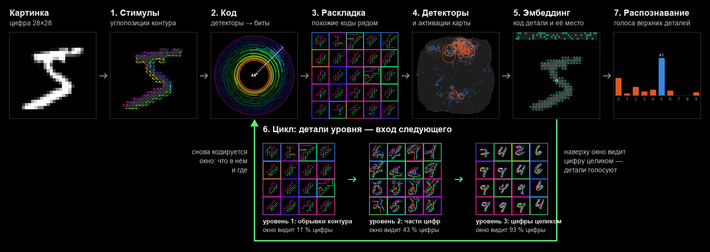

*Путь цифры 5. Этапы 2–5 — один проход: код → раскладка → детекторы и активации → эмбеддинг. Этап 6 замыкает цикл: эмбеддинги окон (детали) снова идут на этап 2. Уровень 0 — штрихи и их место от центра цифры; дальше окно с каждым уровнем видит больше — обрывки контура, части цифр, цифры целиком. Наверху детали голосуют за класс (этап 7).*

| Этап | Вход → выход | Главные классы |
|---|---|---|
| 1. Стимулы | картинка 28×28 → штрихи: точки середины линии, над ними детекторы; у штриха наклон 0…180° и дробное место в клетках сетки 24×24 | `MnistSobelAngleMap`, `StrokeMidline`, `StrokeDetectors` |
| 2. Первичное кодирование ↻ | окно → код «что и где»: биты кругов места и коды элементов под масками мест | `Encoder`, `KeyholeCoder`, `PositionBindingEncoder` |
| 3. Раскладка | коды окон обучающих картинок → карта памяти уровня: похожие рядом | `Layout`, `MemoryMap` |
| 4. Детекторы и активации | карта → иерархия детекторов; код окна → зажжённые точки → сработавшие детекторы | `DetectorHierarchyBuilder`, `HierarchyDetection`, `LevelDetectors` |
| 5. Эмбеддинги первого уровня | сработавшие детекторы → код детали окна | `DetailCoder`, `DetectorEmbeddings` |
| 6. Цикл ↺ | уровень 0 (штрих в окне, место от центра цифры) → уровни 1, 2, 3: детали → окна → снова этапы 2–5, пока окно не увидит цифру целиком | `StrokeLevel`, `MnistLadderRunner`, `CycleStep`, `KeyholeBuilder` |
| 7. Распознавание | детали и отклики уровней → класс цифры | `LinearReader`, `MemoryVotes`, `LevelRecognition` |
| **Итого** | 7 этапов; этапы 2–5 повторяются на каждом уровне (на MNIST — уровни 0…3) | |

В коде проход 2–5 есть в двух видах. Команда `ladder` (и дашборд, и стенд) идёт по циклу: стимул — окно внимания, место записано внутри окна. Команды `layout`, `evaluate` и `predict` делают проход один раз над отдельными штрихами: место штриха на картинке входит в его код, набор для эмбеддинга — вся картинка. Карту команды `layout` цикл не использует.

[↑ к содержанию](#содержание)

## Структура проекта

Код делится на два слоя. **Клиентский** (`client/`) — то, чем клиент, оператор и админ управляют нейросетью: настройки, фреймворк `damp_api` и команды поверх него. **Системный** (`system/damp/`) — то, что под капотом: пакеты по этапам пайплайна.

> **К системе — только через клиентскую часть.** Команды, скрипты и ноутбуки зовут `damp_api`; внутри фреймворка в `system/damp` ходит один мост, `client/damp_api/_system.py`. Правило проверяет тест `tests/test_client_api.py`.


*Зелёная стрелка — единственный вход в системный слой. Рисунок строится по настоящим папкам: `damp.figures.structure()`.*

```text
client/
├── config.toml             # все настройки: самые значимые сверху, техника внизу; у каждой тег [КАНОН] / [РАСШИРЕНИЕ] / [НЕ КАНОН]
├── damp_api/               # фреймворк для программиста: этапы 1–7 как поля Damp()
│   ├── damp.py             #   Damp, Settings (чтение, свои значения — changes)
│   ├── stages.py           #   этапы: stimuli, coding, layout, detectors, embeddings, cycle, recognition, figures
│   ├── parts.py            #   части цикла — результаты кубиков: Digits, Elements, Keyholes, Memory, MapDetectors, …
│   ├── reports.py          #   простые результаты: Code, CycleReport, Prediction, …
│   ├── cache.py            #   кеш шагов: сводка и очистка
│   └── _system.py          #   единственный мост в system/damp
├── run.py                  # команды: ladder, bench, dashboard, layout, evaluate, predict, figures, pinwheel, detectors, sketch, contour, cache, docs
├── dashboard/              # живой дашборд: server.py (только через damp_api) и static/ (страница)
├── apidocs.py              # HTML-справка по damp_api из docstring'ов (pdoc); --links — ссылки README на код
└── examples/digit.png      # картинка для predict
system/damp/
├── stimuli/                # этап 1: штрихи — середина линии (stroke_midline.py), детекторы штрихов (stroke_detectors.py),
│                           #   разбор картинки (MnistSobelAngleMap.py), цифры прогона (digits.py)
├── encoding/               # этап 2: кодер Encoder, элементы уровня (elements.py), код окна — замочной скважины (keyhole_code.py)
├── layout/                 # этап 3: Layout (§5), память уровня (level_memory.py), энергии на видеокарте, тест пинвила
├── activation/             # этапы 4–5: детекторы уровня (level_detectors.py), детали (details.py); проход без цикла (first_level.py)
├── cycle/                  # этап 6: уровень 0 (primary.py), окна внимания (keyholes.py), проход уровня (step.py),
│                           #   лестница (ladder.py), пятна (lateral_inhibition.py), обученный цикл (trained.py — дашборд)
├── decode/                 # этап 7: читатель (linear_reader.py), голоса памяти (memory_votes.py), узнавание по уровню,
│                           #   чистота слияния; честная мерка: эталоны kNN и CNN (baselines.py), стенд bench (bench.py)
├── figures/                # рисунки README; вкладки цикла в Rerun (rerun_cycle.py), запись стенда (rerun_bench.py)
├── settings.py             # читает client/config.toml; правила выводимых значений; свои значения поверх файла
├── cache.py                # кеш шагов: запись на шаг, ключ от содержимого входа
├── environment.py          # видеокарта и журнал прогона
├── logging.py              # единый журнал: консоль, Rerun, файл JSON Lines с ротацией
└── article_refs.py         # номера параграфов статьи и разделов продолжения
docs/                       # статья, продолжение, сверка со статьёй, таблица прогонов (RUNS.md), рисунки README
tests/                      # инварианты статьи, сверки быстрых путей с прямыми
pyproject.toml, CHANGELOG.md  # пакет и версии
data/, logs/                # создают прогоны (в .gitignore)
```

[↑ к содержанию](#содержание)

## Этап 1. Стимулы: штрихи MNIST

Стимул — штрих: кусок линии цифры, его наклон и место. Как получить штрихи, статья не говорит; способ наш, а правила детекторов взяты из §6.4 и перенесены с карты кодов на плоскость картинки. Настройки — `MNIST_*` в `client/config.toml`.

1. **Подготовка.** Картинка 28×28 увеличивается в 8 раз (Lanczos3, рабочая картинка 224×224), контраст повышается. Чернила — пиксели не темнее уровня контура 0.5.
2. **Середина линии** (`MNIST_STROKE_MIDLINE`, `StrokeMidline`). Слова автора (2026-11-17): «ходить не вдоль края штриха, а в точке касания ручки бумаги… мозгу не важна толщина штриха, ему важны его изгибы, перекрестия и прерывы». Точки середины — гребень расстояния до края линии: расстояние растёт от края к середине «шатром» с одним наклоном при любой толщине. Гребень рвётся на стыках и перекрестиях; куски соединяются мостиками по слабым точкам гребня (как линии Стегера и края Кэнни), в общем центре стыка и через разрыв внутри петли. Направление точки — поперёк линии, без стрелки.
3. **Детектор штриха** (`MNIST_STROKE_DETECTORS`, `StrokeDetectors`; §6.4 на картинке — доработка). Для точки-центра — кластер соседних точек с похожим направлением (§6.4.1, модуль косинуса ≥ 0.7), место штриха — взвешенный центр кластера (§6.4.2), поле — круг в шаг штрихов `MNIST_STROKE_STEP` = 4 px рабочей картинки (§6.4.3), центры не попадают в поля друг друга, плотные кандидаты первыми (§6.4.5). Угол — по сумме удвоенных углов точек на куске линии в 3.4 шага: 0…180°. На перекрестии в одном месте стоят два штриха разного направления. Сила штриха — энергия детектора e_d (§6.3).

Штрихи стоят в координатах самой цифры: сдвиг цифры сдвигает их вместе, сетка не режет наклонную линию «лестницей». Место — дробное, в клетках 9 px (24×24 клетки на картинку) — в тех же единицах, что прежде у углопозиций. В среднем **61 штрих на цифру** (100 обучающих цифр — 6 148 штрихов).


*Пятёрка № 35 MNIST train: 300 точек середины линии собраны в 54 штриха. Цвет точки и штриха — направление; штрих середины линии — отрезок без наконечника, круг цветов проходится за 180°.*


*Цифры 0…9 из одних штрихов: форма цифры читается по ним целиком.*

| Шаг штрихов | Сходимость классов верха (100 цифр) |
|---|---|
| 6 px (было у штрихов по краям) | 0.429 |
| **4 px — в конфиге** | **0.469** |
| 3 px | 0.474 |
| **Итого** | 4 px: штрихов по середине вдвое меньше, чем по двум краям, и при 6 px верхняя карта редеет; 3 px — в пределах шума, считается дольше |

Пробовали и отвергли (2026-11-17): гребень яркости — у жирной линии профиль плоский, середина теряется; середины пар встречных точек края — стыки и перекрестия вырезаются, сходимость 0.358 против 0.429. Прежний способ — одна углопозиция на окно сетки 24×24 с дробным местом (`MNIST_SUBCELL_POSITION`) — остался за `MNIST_STROKE_DETECTORS = false`.

**Группы картинок** (вне статьи). Картинки прогона делятся на группы с явными номерами MNIST (`system/damp/stimuli/digits.py`):

| Группа | Откуда | Для чего |
|---|---|---|
| train | MNIST train, пул `BENCH_TRAIN_POOL` = [0, 50 000) | память уровней, детекторы, база деталей |
| validation | MNIST train, пул `BENCH_VALIDATION_POOL` = [50 000, 60 000); не пересекается с train | выбор настроек (select) и итог (report) стенда |
| test | MNIST t10k | проверка цикла (команда `ladder`, таблица прогонов) и финал стенда |
| **Итого** | три группы, номера не пересекаются; у стенда выборка случайная с зерном `BENCH_SEED` | |

**Виды обучающих цифр** (`LADDER_TRAIN_VIEWS`, §7.1.4) — каждая цифра ещё и сдвинутой на ±1 px — **сейчас выключены** (`[]`). Автор (2026-11-17): «убери пока сдвиг» — у штрихов-детекторов сдвиг на 1 px даёт почти те же штрихи, и виды лишь повторяют коды окон. На сетке углопозиций (0.10.0) они давали +3.8 п.п. и устойчивость к сдвигу 78 → 90 %.

**Пример — каждый раз другая пятёрка.** `LADDER_FIGURE_PICTURE = "random"`: в каждом прогоне цикла — другая обучающая пятёрка. Какая выбрана, видно в журнале (`ladder.example`) и в Rerun: `пятёрка № <номер MNIST>`.

[↑ к содержанию](#содержание)

## Этап 2. Первичное кодирование

> ↻ **Начало цикла.** Этапы 2–6 повторяются на каждом уровне. На уровне 0 кодируется штрих и его место от центра цифры, на следующих — детали прошлого уровня и их места в окне ([уровень 0](#уровень-0-первичная-раскладка-штрихов)).

Кодер устроен по схеме [Angle-Encoder](https://github.com/qwertukg/Angle-Encoder): значение координаты ловят широкие перекрывающиеся детекторы, и каждый сработавший детектор ставит в коде свой бит (§4.1, §4.2). Близкие значения делят часть детекторов, поэтому их коды похожи.


*Угол и место кодируются одинаково — видно по двум строкам. Верхняя — угол штриха (105°): замкнутая координата, круг 180°; слева все 10 слоёв кольцами, в середине каждый слой отдельно (сработавшие — цветом бита, остальные серые), справа код 256 бит. Нижняя — место того же штриха: смещение от центра цифры в долях R; слева все 32 сработавших кругов всех слоёв на самой цифре, в середине каждый слой отдельно, справа код 176 бит (длина места уровня 0). В каждом слое горят 2–5 детекторов; у угла 32 единицы из 256 (12.5 %), у места 32 из 176 (18 %). Цвет детектора и бита — слой: широкие красные, узкие фиолетовые. Внизу — код окна уровня 0: место и содержание (код угла под масками сработавших кругов, П.5).*

[↑ к содержанию](#содержание)

### Первичные детекторы угла, X и Y

Детекторы каждой координаты стоят слоями: каждый слой покрывает всю ось, от самого широкого слоя к самому узкому число детекторов растёт геометрически (§4.2, §4.5). Соседние детекторы слоя перекрываются, поэтому одно значение накрывают сразу несколько.

- **Угол** — замкнутая координата (§4.4): 10 слоёв, в них 2, 3, 5, 9, 15, 24, 40, 66, 109 и 180 детекторов (всего 453), перекрытие 0.7. У штриха середины линии круг угла — 180°: 0° и 180° — одна линия. Одно значение включает 31–35 детекторов.
- **X и Y в цикле** — место **внутри окна** в долях его радиуса, а не место на картинке (§7.1.4.1). На уровне 0 — от центра цифры в долях расстояния до самого дальнего штриха, выше — от центра окна; место не дальше радиуса, шаг мест — 0.125 радиуса. Детекторы места — круги на плоскости окна (§4.3), **устроенные как детекторы угла** (автор 2026-11-19: «код позиции должен как код угла получаться, от широких до узких детекторов, слоями»): 10 слоёв, по стороне 2, 3, 4, 5, 6, 7, 8, 10, 13 и 16 кругов (всего 728), перекрытие 0.52, у каждого слоя своя цветовая полоса бит (`LADDER_BINDING_PLACE_*`); длина кода места — своя у уровня (ниже, «Ограниченная длина»). Плоскость — ровно размах мест (`LADDER_PLACE_EXTENT` = 2 шага мест).

  Слои, перекрытие и длина кода подобраны на самом кодере под плотность угла (по 197 местам окна):

  | Код | Детекторов | Слоёв | Единиц на одно значение | Плотность |
  |---|---|---|---|---|
  | угол | 453 | 10 (2…180 на круге 180°) | 31.6 (29–36) | 12.3 % |
  | место — было до 2026-11-19 | 90 | 2 (3 × 3 и 9 × 9, перекрытие 0.4, плоскость −4…4) | 4.3 (2–7) | 1.7 % |
  | **место — сейчас** | 728 | 10 (2 × 2 … 16 × 16, перекрытие 0.52, плоскость −2…2) | **31.7 (16–42)** | **12.4 %** |
  | **Итого** | | | место — как угол | сходство кодов мест убывает с расстоянием на всём размахе (§4.5): 0.72 → 0.39 → 0.22 → … → 0.08 |

  Перекрытие 0.50 даёт 29.2 единицы, 0.55 — 34.1; 8 слоёв с перекрытием 0.6 и 12 слоёв с 0.45 дают ту же плотность. Прежняя плоскость −4…4 была вдвое шире размаха мест: крайние круги не горели ни на одном уровне.
- **X и Y в команде `layout`** — место на картинке: отрезки −1…28, у каждой координаты 10 слоёв, 2…28 детекторов в слое (всего 106), перекрытие 0.7.


*Кодер команды `layout` для стимула (45°, 14, 14): угол — кольца, X и Y — полосы; справа — общий код 512 бит, обведены паразитные биты. Ту же картинку рисует `python client/run.py detectors`.*

Профиль сходства каждой координаты проверяется при сборке кодера (§4.5, §5.13.1): сходство кодов должно убывать с расстоянием на всём диапазоне, иначе кодер пишет `encoder.long_range_order.warning`.

[↑ к содержанию](#содержание)

### Случайный бит, ограниченная длина и плотность кода

- **Случайный бит.** Код делится на цветовые полосы по слоям (§3.2, §4.2.1): самый широкий слой получает младшие («красные») биты, самый узкий — старшие («фиолетовые»). Каждому детектору назначается один случайный бит своей полосы. Совпадения битов у далёких детекторов допускаются.
- **Ограниченная длина.** Длина кода задаётся заранее и не зависит от числа детекторов: у 453 детекторов угла код 256 бит; у 728 кругов места — своя длина на уровне: 176 бит на уровне 0 и 1 792 / 1 536 / 1 088 на уровнях 1–3 (`LADDER_BINDING_PLACE_CODE_LENGTH`). Коды объединяются операцией OR (§2.2.1); бит, который поставили два детектора, — паразитный (§4.2.1).
- **Код окна** (П.4, П.5): биты места (OR кругов, сработавших хотя бы на одном элементе окна) и содержание — коды элементов, переставленные маской своего круга (бит `i` → `i ⊕ m`). Длина содержания — степень двойки под среднюю плотность 0.2 по обучающим окнам, не длиннее 4 096 бит. Длина места подобрана по уровню так, чтобы ни одно обучающее окно не было плотнее 25 % (§2): в окне уровня 0 один штрих (~32 круга), в окнах уровней 1–3 — 12–18 элементов и ~175–200 кругов; при прежних 256 битах место там занимало в среднем 52–58 % (до 81 %). Код окна — 176 + 4 096 = 4 272 бита на уровне 0, 1 792 + 4 096 = 5 888, 1 536 + 4 096 = 5 632 и 1 088 + 4 096 = 5 184 на уровнях 1–3 (подбор 2026-11-20, окна прогона рисунков, 100 цифр). На элемент срабатывает около 32 кругов места, и каждый вносит его код под своей маской, поэтому содержание густое: у штриха уровня 0 — около 950 единиц, у окон уровней 1–3 оно упирается в предел 25 % (1 024 единицы), лишние биты сбрасываются слиянием цветов (§3.3).
- **Плотность.** Доля единиц не выше 25 % (§2). Код угла — 32 единицы из 256 (12.5 %); общий код команды `layout` — в среднем 89.6 единицы из 512 (17.5 %).

[↑ к содержанию](#содержание)

## Этап 3. Раскладка

Коды обучающих стимулов раскладываются на двумерной карте `Layout` (§5): похожие коды встают рядом. В цикле раскладываются коды окон, и карта — память уровня, одна на все окна (П.2). Перед раскладкой почти одинаковые коды сливаются к одному образцу (`LeaderDictionary`): на уровнях 1–3 — при косинусе не ниже 0.8, на уровне 0 — только совпадающие (`LADDER_PRIMARY_MERGE_SIMILARITY` = 1.0: коды соседних штрихов похожи сильнее кодов окон). Предел карты снят (`LADDER_MAP_MAX_POINTS = "none"`); рисунки README сняты при пределе 5 000 точек.

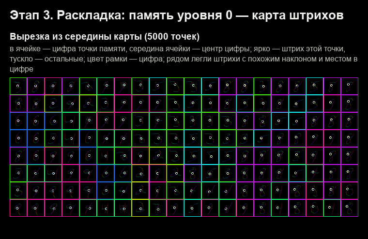

*Карта уровня 0. В ячейке — цифра точки памяти, середина ячейки — центр цифры; в кольце — штрих этой точки. Рядом легли штрихи с похожим наклоном и местом в цифре.*

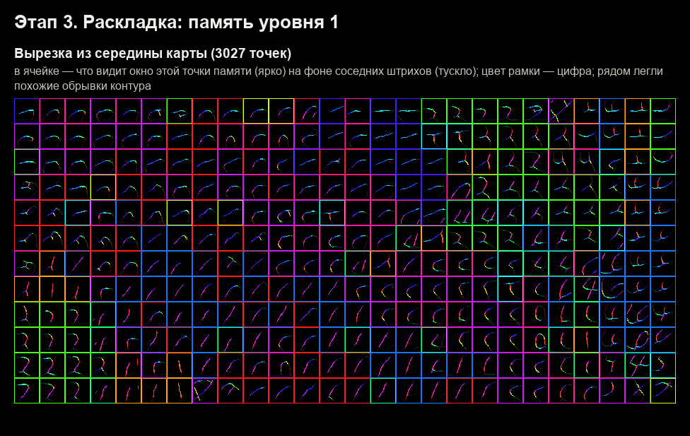

*Карта уровня 1. В ячейке — то, что видит окно этой точки (ярко), на фоне соседних штрихов; цвет рамки — цифра. Рядом лежат похожие обрывки контура: наклонные линии, углы, дуги.*

Как идёт раскладка:

- сходство кодов — косинус; порог `sim_λ = sim · σ(η(sim − λ))`; у карт уровней λ — квантили попарных сходств кодов карты (§5.4, §7.1.7);
- дальняя фаза собирает похожие коды в области, ближняя наводит порядок внутри них (§5.5); точки меняются местами, если обмен снижает энергию пары (§5.6); пары шага выбираются случайно и считаются параллельно (§5.3, §5.10);
- сторона сетки — `⌈√(N·(1 + LAYOUT_EMPTY_RATIO))⌉`, пустых ячеек — 15 % от числа точек, как в статье (§7.1.6);
- остановка фазы — по числу обменов за шаг или по бюджету шагов (§5.6, §7.1.7).

**Режим дальней фазы** — `LAYOUT_SMOOTH_PINWHEELS`:

- `false` — по статье: `φ = Σ s·d` по всему пространству (§5.5.1), жёсткий порог, радиус пар и λ меняются по расписанию §7.1.7;
- `true` — **стоит в конфиге** — сглаживание: гауссово ядро дальней фазы, фиксированный λ, слабый отжиг. Карта выходит из многих пинвилов с плавными переходами. Этого режима нет ни в статье, ни в продолжении; на нём сняты все замеры README.

**Тест пинвила** (`python client/run.py pinwheel`) раскладывает 360 кодов угла на каждую из четырёх позиций — 1 440 кодов «угол + место» кодера команды `layout`. Ожидаемая картина — по пинвилу на позицию с непрерывным углом через границы, как в ориентационных картах V1.


*Одна раскладка в трёх раскрасках: псевдоцвета битов кода (§5.14), угол стимула, яркость по энергии точки (рис. 18 статьи).*

[↑ к содержанию](#содержание)

### Карты всего MNIST в двух режимах

Команда `layout` раскладывает штрихи всего обучающего набора — 60 000 цифр — в обоих режимах. Пиксель — ячейка сетки, цвет — угол штриха; чёрное — пустые ячейки. Угол в раскладке не участвует: это проверочная раскраска, как на рис. 16 статьи.

| Режим статьи | Сглаживание |
|---|---|
|  |  |

| Показатель (0.13.0, штрихи по середине линии) | Режим статьи | Сглаживание |
|---|---|---|
| штрихов | 3 768 355 (≈ 63 на цифру) | 3 768 355 |
| сетка | 2082² | 2082² |
| качество Ē (§5.8) | 0.980 | 0.979 |
| время | 6 мин 34 с (штрихи из кеша) | 20 мин 50 с вместе с первым разбором 60 000 картинок на штрихи |
| **Итого** | | одинаковое качество Ē; в режиме статьи углы собраны в крупные области с резкими границами, при сглаживании — плавные переходы |

> **Цвет угла занимает только половину круга** (красный → зелёный → голубой). Команда `layout` кодирует и раскрашивает угол по кругу 360°, а у штриха середины линии угол 0…180°: половина детекторов угла её кодера не срабатывает никогда. Кодер цикла это учитывает (круг 180°), кодер команды `layout` — нет; это известный долг. Прежние мерки карт (глобальная энергия §5.5.1, доля резких соседей) снимались разовым скриптом на углопозициях 0.11.0 и не пересчитаны.

[↑ к содержанию](#содержание)

### Расчёт энергий

Энергии пар и точек считаются на видеокарте (PyTorch): сходство кодов — матричным произведением на лету, без матрицы N×N (§5.9.5, §5.12); окрестность ближней фазы (§5.5.2) — по окну ячеек вокруг пары; выбор пар — векторно (§5.3, §5.9.1, §5.9.3). Ускоренные пути дают **тот же результат бит в бит**: слагаемые считаются теми же операциями float32 и суммируются той же редукцией, а по ходу раскладки пути сверяются с исходным проходом и при расхождении отключаются. Нужны CUDA и numba; без них работают исходные пути.

| Путь | Настройка | Что делает |
|---|---|---|
| Строки ненулевых `sim_λ` | `LAYOUT_SPARSE_LONG` | при жёстком пороге суммы §5.5.1, §5.5.2 и §5.7 сводятся к точкам, похожим на точки пары |
| Знак вместо суммы | `LAYOUT_PAIR_KERNEL` | правилу обмена §5.6 нужен только знак разности энергий |
| Граница потенциала | `LAYOUT_POTENTIAL_BOUNDS` | по неравенству Йенсена заведомо невыгодные пары отсеиваются без счёта строк |
| Почти-ничьи | `LAYOUT_REDUCTION_REPLICA` | у пар с разностью в пределах ошибки суммирования решение повторяется на хосте в том же порядке сложения |
| Выборка пар | `LAYOUT_COMPILED_SAMPLER` | циклы выборки скомпилированы numba и берут те же случайные числа |
| Слитое ядро | `LAYOUT_FUSED_ENERGY` | при сглаживании всё слагаемое пары считает одно ядро CUDA по таблице сходств (§5.9.5) |
| **Итого** | 6 путей | результат тот же бит в бит; сверка — тесты `tests/test_layout_*.py`, `tests/test_fused_energy.py` |

[↑ к содержанию](#содержание)

### Большие наборы

Наборы больше 100 000 точек (`LAYOUT_LONG_FULL_SPACE_MAX_POINTS`) раскладываются от «затравки»: случайные 30 000 точек раскладываются целиком, остальные встают возле самых похожих точек затравки (§5.9.4). В режиме статьи между затравкой и полным набором идут промежуточные уровни с ближней фазой целиком на видеокарте; при сглаживании после расстановки идут дальняя фаза с малого радиуса и ближняя.

[↑ к содержанию](#содержание)

### Время

Команда `python client/run.py layout --count N --layout-only --rebuild`, RTX 2060 SUPER. Замер 0.11.0 — на углопозициях сетки 24×24 (около 87 на цифру, со штрихами их около 61):

| Цифр | Точек | Сетка | Режим статьи | Сглаживание |
|---|---|---|---|---|
| 100 | 8 693 | 115² | 52 с | 20 с |
| 300 | 26 201 | 199² | 1 мин 49 с | 53 с |
| 1000 | 88 317 | 364² | около трёх часов | 9 мин 22 с |
| 10 000 | 882 607 | 1151² | 2 мин 31 с | 2 мин 41 с |
| 60 000 | 5 302 618 | 2821² | 5 мин 27 с | 13 мин 27 с |
| **Итого** | | | самые медленные — наборы от ~550 цифр до 100 000 точек: строки сходства не помещаются в память, дальняя фаза идёт плотным проходом; большие наборы идут от затравки | |

Замер 0.13.0 на штрихах: 60 000 цифр — 3 768 355 штрихов, сетка 2082², режим статьи 6 мин 34 с, сглаживание 20 мин 50 с вместе с первым разбором картинок на штрихи. Время цикла — в разделе «[Скорость](#скорость)».

[↑ к содержанию](#содержание)

### Файлы результата

Команда `layout` сохраняет раскладку в `data/layout-<count>-<radius>-<LAYOUT_CACHE_TAG>.json` (вместе с детекторами и эмбеддингами, этапы 4–5), карту — в трёх раскрасках: `data/<count>-<radius>.png` — псевдоцвета битов кода (§5.14), `.energy.png` — яркость по энергии точки (рис. 18), `.angle.png` — угол стимула (рис. 16). Файлы цикла — в разделе этапа 6.

[↑ к содержанию](#содержание)

## Этап 4. Детекторы и активации

Раскладка положила похожие коды рядом. Теперь её нужно научиться читать: стимул **зажигает** точки карты, похожие на него, а **детекторы** — круги над кластерами похожих точек — срабатывают по зажжённым точкам своего поля (§6).

- **Детекторы** (§6.4, §7.1.10): пять слоёв, у каждого свой порог сходства λ_d. Детектор строится вокруг случайного центра: кластер похожих точек находит DBSCAN (§6.4.1), радиус выбирается по наибольшему заполнению (§6.4.3), детектор вставляется с заменой менее плотных (§6.4.5). Пороги слоёв идут равными шагами между квантилями попарных сходств кодов карты (§7.1.7): на уровнях 1–3 — 0.46…0.61; в команде `layout` — 0.7…0.9.
- **Энергия точки** `Ê` (§5.7) — насколько точка похожа на соседей; точки с энергией ниже μ_e = 0.12 в срабатывание не входят (§6.5).
- **Активация** (§6.1): стимул зажигает точки, сходство с которыми не ниже λ_a; λ_a равен порогу нижнего слоя детекторов (§7.1.11). Самая похожая точка зажигается всегда (доработка): иначе стимул без единой зажжённой точки не оставил бы следа.
- **Энергия активации** (`ACTIVATION_LOCAL_ENERGY_THRESHOLD` = 0.5; расширение статьи, автор 2026-11-17: «надо учитывать»). Формула энергии точки §5.7, где вместо сходства с соседями — их активация: `Ê_a(j) = Σ a_v / d` по соседям в радиусе 3, делённая на наибольшую по карте для того же стимула. Точка с `Ê_a` ниже порога в детекторы не идёт: одиночные зажжённые точки на отшибе молчат, пятна остаются. Подбор (100 цифр, сходимость классов верха): 0 — 0.493, 0.2 — 0.539, 0.35 — 0.549, **0.5 — 0.555**, 0.7 — 0.546.
- **Срабатывание** (§6.5): уровень активации детектора — энергия зажжённых точек его поля, делённая на его собственную энергию, `E(d) = Σ a·e / e_d`; детектор срабатывает при уровне не ниже μ_d = 0.5.
- **Нормировка уровня** (`LADDER_LEVEL_NORMALISATION = "train_max"`, доработка): уровень детектора делится на его наибольший уровень по окнам обучающих картинок и обрезается в [0, 1]. Статья требует лишь значений в [0, 1] (§7.1.12, §9.3); без нормировки уровни доходили до 8, 12 и 44, и «сильнейшую» деталь выбирали выбросы. Режим `"none"` — ровно формула §6.5.

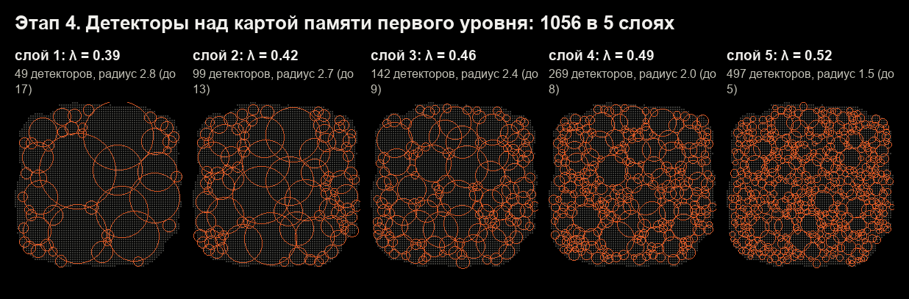

*Пять слоёв детекторов над картой памяти уровня 1: чем выше порог сходства слоя, тем мельче кластеры и тем больше детекторов — от широких областей к узким кластерам.*

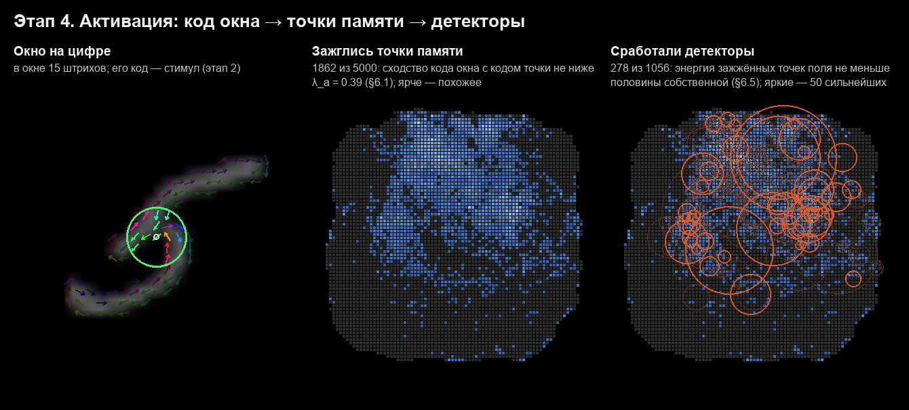

*Окно уровня 1 в середине пятёрки (11 штрихов). Его код зажигает 357 точек памяти из 3 155; в детекторы идут 218 — у которых горят и соседи (синие, ярче — похожее). По ним срабатывает 82 детектора из 936; яркие круги — 50 сильнейших.*

[↑ к содержанию](#содержание)

## Этап 5. Эмбеддинги первого уровня

Эмбеддинг — код того, какие детекторы сработали на набор стимулов, предъявленных вместе (§6.5). Он описывает уже не отдельный стимул, а целое — «какие области памяти отозвались».

- Код — по одному случайному биту от каждого из `σ` сильнейших сработавших детекторов (§6.5, §7.1.12; σ = 10 с подбора 561, 2026-11-20). Длина кода подбирается под плотность `LADDER_TARGET_DENSITY` = 0.1 (§6.6) **только по окнам обучающих картинок**: проверочные окна на неё не влияют. При σ 50 и плотности 0.217 (прогон 266) код детали уровня 0 был 192 бита, уровней 1–3 — 192 / 184 / 144 бита (100 цифр); при σ 10 и 0.1 — около 100 бит.
- **Пустая деталь** — окно, на котором не сработал ни один детектор. Она не голосует и не входит в базу распознавания.
- В цикле набор — содержимое одного окна, а эмбеддинг — **деталь**: место детали — центр её окна, уровень активации — самый сильный из сработавших детекторов (П.1: точка несёт «что» и «насколько»). Деталь уровня 0 — сам штрих с выученным кодом, на своём месте. Детали уровня — элементы следующего.
- В команде `layout` набор — все штрихи картинки сразу, и эмбеддинг описывает картинку целиком; база эмбеддингов обучающих цифр идёт в распознавание (этап 7).

**Мерки статьи по уровням.** Каждый уровень цикла считает мерки из статьи и пишет их в событие `ladder.level`, в отчёт `CycleLevel` (API) и во вкладку этапа 5 в Rerun:

| Мерка | Что это | Параграф |
|---|---|---|
| `energy_mean` | Ē — средняя энергия точек карты уровня, качество раскладки | §5.8 |
| `code_resolution` | сколько окон приходится на один код детали; 1 — все коды разные (у статьи — коды карты, здесь — коды деталей, вне статьи) | §5.13.2.5 |
| `code_largest` | наибольший набор окон с одним и тем же кодом детали | §5.13.2 |
| `detail_bits` | среднее число единиц в коде детали | §6.5 |
| `detail_empty` | доля пустых деталей | §6.5 |
| `detail_full` | доля обучающих окон, у которых сработало не меньше σ = 50 детекторов (код упёрся в предел) | §7.1.8.1 |
| **Итого** | 6 мерок на уровень; замер — в таблице ниже | |

Прогон рисунков README: 100 обучающих цифр, 100 проверочных t10k, карта до 5 000 точек.

| Уровень | `energy_mean` | `code_resolution` | `code_largest` | `detail_bits` | `detail_empty` | `detail_full` |
|---|---|---|---|---|---|---|
| 1 | 0.687 | 1.018 | 7 | 40.5 | 0.3 % | 78 % |
| 2 | 0.641 | 1.017 | 4 | 39.0 | 0.3 % | 65 % |
| 3 | 0.605 | 1.047 | 10 | 30.5 | 1.8 % | 39 % |
| **Итого** | Ē 0.61–0.69 | почти каждый код детали уникален | | ~30–40 единиц | пустых ≤ 1.8 % | у 78 % окон уровня 1 сработало ≥ σ детекторов, у 39 % — уровня 3 |

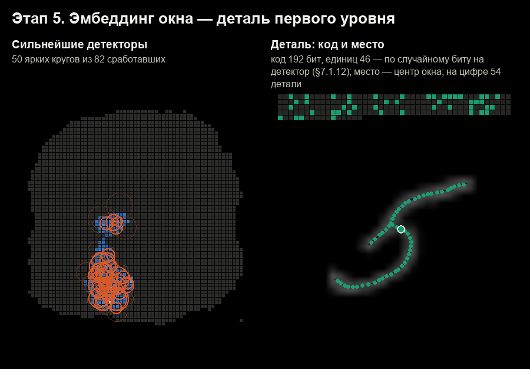

*Слева — сильнейшие детекторы окна, справа — код детали (зелёные клетки) и все детали пятёрки уровня 1: по одной на окно, в центре окна.*

[↑ к содержанию](#содержание)

## Этап 6. Цикл: уровни выше первого

Этапы 2–5 — один проход: код → раскладка → детекторы и активации → эмбеддинг. Статья говорит повторять его: коды детекторов «can be combined, transformed, and laid out at the next level of the hierarchy» (§6.2), «by combining the resulting codes and repeating the process layer by layer, we can obtain complex descriptions» (§6.6). Как собирать коды одного уровня в стимулы следующего, описывает продолжение статьи.

[↑ к содержанию](#содержание)

### Принципы

1. **Один проход на каждом уровне.** Коды раскладываются, над раскладкой строятся детекторы, картинки подаются снова, сработавшие детекторы дают эмбеддинги — и эти эмбеддинги становятся кодами следующего уровня (§6.2, §6.6).
2. **Точка — это «что» и «насколько».** Каждая точка уровня несёт код распознанной детали и уровень активации — насколько увиденное совпало с памятью (П.1).
3. **Окно — миниколонка, память — общая.** Картинку смотрят множеством маленьких окон, «замочных скважин». Каждое окно само сверяет то, что видит, с памятью уровня — одной на все окна — и даёт одну точку следующего уровня. Окна сдвигаются плавно и сильно перекрываются, поэтому соседние точки похожи (П.2, П.3).
4. **Признак привязан к месту.** Детектор места добавляет свои биты места и вносит код признака, изменённый своей маской; перед этим он выбирает, что взять из своей области (пулинг) (П.4, П.5).
5. **Один признак в разных местах — разные вклады.** Одинаковые линии в разных углах окна попадают к разным детекторам и дают разные биты: код зависит и от того, что найдено, и от того, где (П.6).
6. **В деталь входит немного — пять–семь понятий.** Лишние биты и целые коды отбрасываются; код работает как хеш: мелочи начертания теряются, остаётся более ёмкое понятие (П.7).
7. **Окно растёт.** На следующем уровне окно охватывает более крупную область и описывает сочетания деталей прошлого уровня: от штрихов — к частям цифры, от частей — к цифре (П.3).
8. **Место на картинке в код не входит.** Признак записан относительно своего окна, поэтому цифра узнаётся в любом месте кадра (§7.1.4.1, П.9).
9. **Число уровней не задаётся.** Цикл повторяется, пока окно не увидит объект целиком (П.7). Память всех уровней остаётся: поиск идёт по ним снизу вверх (§8.2).

[↑ к содержанию](#содержание)

### Как это сделано

Цикл — команда `ladder`: лестница `MnistLadderRunner` (`system/damp/cycle/ladder.py`) строит уровень 0 (`StrokeLevel`) и повторяет проход уровня `CycleStep` (`system/damp/cycle/step.py`), собранный из частей этапов 2–5. Те же части — кубики фреймворка `damp_api` («[Фреймворк damp_api](#фреймворк-damp_api)»):

```powershell
python client/run.py ladder --count 100 --limit 500
```

**Окно внимания** (П.2) — «замочная скважина», через которую уровень смотрит на картинку (в коде — `keyhole`), — стоит на каждом элементе уровня: на уровне 1 — на каждом штрихе, дальше — на каждой детали. Радиус окна находится по статье (§6.4.1–§6.4.3): у элемента ищется кластер похожих на него соседей, затем круг вокруг элемента, в котором не меньше `LADDER_CLUSTER_MIN_POINTS` точек кластера (10 на уровне 1, 14 выше) и заполнение `n / (π r²)` наибольшее. Взвешенного центра (§6.4.2) и вытеснения (§6.4.5) здесь нет: окно стоит на своём элементе, а поля соседних окон по П.2 обязаны перекрываться.

**Окно на всю картинку** (`LADDER_KEYHOLE_WHOLE_PICTURE`, доработка) **сейчас включено** (подбор 561, 2026-11-20; до того — выключено по прогону 266). Включённое ставит на картинке, где деталей меньше, чем нужно кластеру, окно каждого элемента на всю картинку. Выключенное такие картинки теряет: в прогоне рисунков без окон остаются 7 % картинок на уровне 2 и 28 % на уровне 3, на дашборде обрываются на уровне 1 единицы и прямые черты (23 единицы из 30).

**Код окна** записывает, что в окне и где (П.4, П.5). Объединить коды признаков и коды мест простым OR нельзя: «угол слева, линия справа» и «линия слева, угол справа» дали бы один код. Поэтому у каждого круга места две составляющие:

- **место**: сработавший круг добавляет в код свой случайный бит (OR);
- **содержание**: круг берёт из своей области один элемент — самый сильный (пулинг) — и вносит его код, переставленный своей маской: бит `i` уходит в бит `i ⊕ m`, у каждого круга своё `m`. Число единиц при этом сохраняется, а одинаковые элементы в разных местах окна дают разные биты (П.6).

Если в содержании окна бит больше четверти его длины, лишние отбрасываются слиянием цветов (§3.3), первыми уходят биты узких кругов. Биты места не отбрасываются: их плотность держит длина сегмента места своего уровня (не выше 25 % на обучающих окнах). Масштаб мест окна берётся только по обучающим картинкам.

**Рост окна.** Продолжение требует, чтобы окно следующего уровня «охватывало более крупную область карты» (П.3), но не говорит, во сколько раз. Радиусы окна на уровне меряются в том, что видит одна деталь этого уровня: окно на карте равно полю своей детали. Основание — из физиологии зрения: рецептивное поле растёт в 2–2.5 раза от области к области (V1 → V2 → V4; Freeman & Simoncelli 2011, Rolls 2012). Нижний предел радиуса окна — `LADDER_KEYHOLE_RADIUS_SHARE` = 1.15 меры уровня.

**Пятна** (П.2, П.3). Соседние окна часто видят одно и то же, и их детали складываются в пятно похожих кодов. Перед окнами следующего уровня из соседних деталей (ближе `LADDER_INHIBITION_RADIUS` = 1.0 того, что видит деталь) с кодом, похожим не меньше `LADDER_INHIBITION_SIMILARITY` = 0.8, остаётся сильнейшая; непохожие соседи остаются все (`CycleStep.thin`, `LateralInhibition`). В зрительной коре окружение подавляет ответ сильнее, когда в нём тот же признак (Knierim & van Essen 1992). Так пространство сужается само: в прогоне рисунков окон на цифру 61 → 27 → 11.

**Остановка.** Последний уровень — первый, чьё окно в среднем видит не меньше `LADDER_TOP_COVERAGE` = 0.9 штрихов своей картинки; на MNIST это уровень 3. Слово автора (2026-11-18): «редуцируемся, пока всё не влезет — это и есть последний уровень».


*Пятёрка, её штрихи и окна уровней 1–3 вокруг одного места. Окно уровня 0 — вся цифра вокруг её центра, в нём один штрих.*

[↑ к содержанию](#содержание)

### Уровень 0: первичная раскладка штрихов

Слова автора (2026-11-18): «все же начинается с первичной раскладки», «как можно без неё вообще что-то делать?». Уровень 0 (`StrokeLevel`, `system/damp/cycle/primary.py`; `LADDER_LEVEL0 = true`, `LADDER_LEVEL0_PLACE = "digit"` — вариант 3 автора) — тот же проход, что у уровней:

1. **Окно** — на каждом штрихе, в окне он один. Центр окна — центр цифры (середина её штрихов), радиус — до самого дальнего штриха (доработка: центр цифры не из источников).
2. **Код окна** — место штриха от центра цифры теми же кругами места (П.4) и код наклона штриха под маской каждого сработавшего круга (П.5): 176 + 4 096 = 4 272 бита.
3. **Память** — карта штрихов обучающих цифр; сливаются только совпадающие коды. Рядом ложатся штрихи с похожим наклоном и местом в цифре.
4. **Детекторы** над картой и их срабатывания — как на уровнях (§6.4, §6.5).
5. **Код штриха** — его сильнейшие детекторы (§6.5, §7.1.12). С этим выученным кодом, а не с готовым кодом наклона, штрих идёт в окна уровня 1; место, поле и сила штриха прежние.

Сдвиг цифры коды штрихов не меняет: место считается от её центра.

| Замер (500 обучающих цифр, проверка 1 000 t10k) | Без уровня 0 (прогон 100) | Уровень 0 (прогон 109) |
|---|---|---|
| сходимость классов по уровням 1 / 2 / 3 | 0.28 / 0.49 / 0.66 | 0.45 / 0.56 / 0.67 |
| читатель (§9.3) | 92.1 % | 93.1 % |
| память (голоса кусочков) | 86.9 % | **91.9 %** |
| «все уровни согласны» | 566 из 1 000 | 756 из 1 000 |
| **Итого** | | память +5 п.п. сверх шума; уровень 0 на 500 цифрах: 30 699 штрихов → 19 871 точка карты, 3 717 детекторов, молчащих штрихов 0 %, 863 кода наклона → 18 356 выученных кодов |

Прогоны 100 и 109 сняты при окнах 14 / 1.15, плотности 0.25 и с окном на всю картинку; текущие настройки (прогон 266) на 500 цифрах не мерены.

Общий подход — окно на штрихе держит точки, из которых он собран, место — от центра штриха, «где штрих в цифре» не записано (`LADDER_LEVEL0_PLACE = "stroke"`, замысел автора 2026-11-19) — хуже и варианта 3, и цикла без уровня 0 ([что отвергнуто](#что-проверено-и-отвергнуто)); код остался опцией.

[↑ к содержанию](#содержание)

### Шаг уровня

| № | Что делается | Этап | Кубик `damp_api` | Чем в системе | Основание |
|---|---|---|---|---|---|
| 1 | На каждом элементе уровня ставится окно, радиус — по кластеру похожих соседей (на уровне 0 — окно на штрихе вокруг центра цифры) | 6 | `cycle.keyholes(elements)` (уровень 0 — `cycle.level0`) | `KeyholeBuilder`, `PlaneFieldBuilder`; `StrokeLevel.pieces` | П.2; §6.4.1–§6.4.3 |
| 2 | Содержимое окна записывается одним кодом «что и где» | 2 | `coding.keyholes(keyholes)` | `KeyholeCoder`, `PositionBindingEncoder` | П.4–П.7 |
| 3 | Коды окон обучающих картинок раскладываются — память уровня | 3 | `layout.memory(codes)` | `MemoryMap`: `LeaderDictionary`, `Layout` | §5; П.2 |
| 4 | Над картой строится иерархия детекторов | 4 | `detectors.build(memory)` | `LevelDetectors`: `DetectorHierarchyBuilder` | §6.4, §7.1.10 |
| 5 | Картинки подаются снова: окно зажигает точки памяти, срабатывают детекторы | 4 | `detectors.fire(codes)` | `HierarchyDetection` | §6.1, §6.5 |
| 6 | Сильнейшие детекторы дают код детали; деталь встаёт в центр окна | 5 | `embeddings.details(firing)` | `DetailCoder`: `DetectorEmbeddings` | §6.5, §6.6, §7.1.12; П.1 |
| **Итого** | 6 шагов на уровень; уровень 0 — те же шаги внутри `cycle.level0` | | | | |

Ниже один и тот же шаг на четырёх уровнях — на пятёрке № 35.

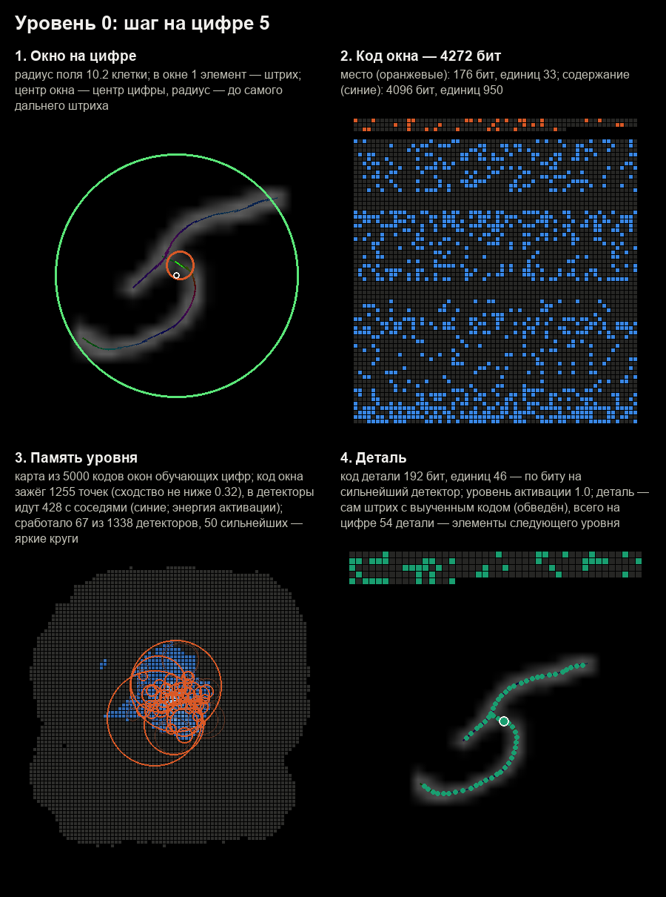

*Уровень 0: окно вокруг центра цифры, радиус 10.2 клетки, в окне один штрих (в кольце). Код 4 272 бита (место — 33 единицы из 176, 19 %) зажигает 1 255 точек карты штрихов, в детекторы идут 428; срабатывает 67 детекторов из 1 338. Деталь — сам штрих с выученным кодом.*


*Уровень 1: в окне 11 штрихов с кодами уровня 0; код окна 5 888 бит, место — 188 единиц из 1 792 (10 %); срабатывает 82 детектора из 936.*


*Уровень 2: в окне 17 деталей уровня 1, на картинке оно видит 46 из 54 штрихов; код окна 5 632 бита, место — 236 единиц из 1 536 (15 %); срабатывает 57 детекторов из 590.*


*Уровень 3: в окне 18 деталей уровня 2, на картинке оно видит 54 из 54 штрихов; код окна 5 184 бита, место — 190 единиц из 1 088 (17 %); срабатывает 48 детекторов из 322.*

[↑ к содержанию](#содержание)

### Что получается на 100 цифрах

Прогон рисунков README: 100 обучающих цифр, 100 проверочных t10k, карта уровня до 5 000 точек, настройки по умолчанию.

| Уровень | Поле окна на картинке, клеток | Окно видит цифры | Окон на картинку | Элементов в окне | Картинок без окон | Точек карты | Детекторов | Соседи одной цифры |
|---|---|---|---|---|---|---|---|---|
| 0 | вся цифра | 1 штрих | 60.8 | 1 | 0 % | 5 000 | 1 338 | — |
| 1 | 3.3 | 22 % | 61.2 | 11.8 | 0 % | 3 155 | 936 | 0.440 |
| 2 | 10.3 | 78 % | 28.3 | 17.3 | 7 % | 1 649 | 590 | 0.546 |
| 3 | 22.7 | 100 % | 14.2 | 19.5 | 28 % | 809 | 322 | 0.559 |
| **Итого** | поле растёт ×3 за уровень | цифра целиком на уровне 3 | пятна сужают пространство 61 → 14 | больше 5–7 понятий П.7 | без окна на всю картинку верх теряет 28 % картинок | | | сходимость верха 0.559 (случайная карта ≈ 0.11–0.14) |

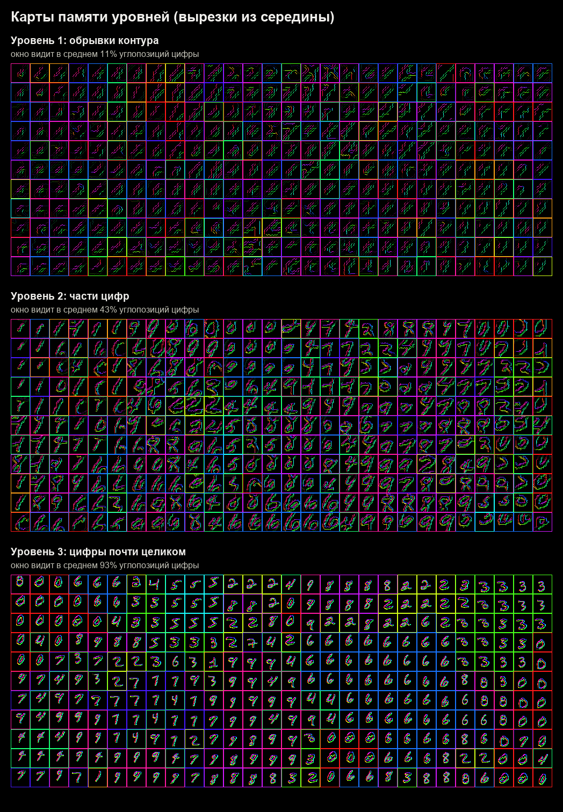

*Вырезки из середины карт памяти. На уровне 0 рядом лежат штрихи с похожим наклоном и местом в цифре, на уровне 1 — похожие обрывки контура, на уровне 2 — крупные части цифр, на уровне 3 — цифры почти целиком, и одинаковые цифры собираются в пятна.*

[↑ к содержанию](#содержание)

### Подбор окон и объём обучения

С уровнем 0 окна подобраны заново (2026-11-18…19). Слова автора: «после новой доработки нужно подбирать параметры по новой», «помни про бисекцию и градиентный спуск». По одной оси — бисекция на всём разумном отрезке, затем спуск по нескольким осям с укорочением шага; каждая точка — парой «окно на всю картинку да / нет». Условия: 200 обучающих цифр, проверка на 1 000 t10k, 296 прогонов — все в [таблице прогонов](docs/RUNS.md).

| Прогон | Цифр | Уровень 0 | Соседей | Окно на всю картинку | Плотность детали | Сходимость верха | Читатель | Память |
|---|---|---|---|---|---|---|---|---|
| база подбора | 200 | центр цифры | 14 | — | 0.25 | 0.609 | 89.9 % | 82.3 % |
| **266 — в конфиге** | 200 | центр цифры | [10, 14] | нет | 0.217 | **0.640** | 89.8 % | 81.9 % |
| 168 — лучший с памятью | 200 | центр цифры | [10, 14] | да | 0.25 | 0.612 | 90.9 % | **85.6 %** |
| 445 | 200 | точки штриха | [10, 14] | нет | 0.217 | 0.535 | 79.1 % | 71.7 % |
| 447 | 200 | нет | [3, 10, 14] | нет | 0.217 | 0.464 | 80.7 % | 66.1 % |
| 100 | 500 | нет | 14 | да | 0.25 | 0.658 | 92.1 % | 86.9 % |
| 109 | 500 | центр цифры | 14 | да | 0.25 | 0.669 | 93.1 % | 91.9 % |
| 446 | 500 | точки штриха | [10, 14] | нет | 0.217 | 0.618 | 90.1 % | 84.8 % |
| **Итого** | | | | | | лучший «по обоим» (сходимость и читатель) — 266, «по трём» (с памятью) — 168 | шум ±0.04 по сходимости | |

- **Соседей на уровне 1 — 10–11**, выше — плато 13…17. Рост окна 1.15–1.25; σ 44–50 (выше 50 всегда хуже); плотность 0.217–0.25.
- **Ландшафт шероховат** (±0.04): длина кода = σ / плотность, и каждая длина — новые случайные коды. Отрыв лидеров 0.02–0.07 — на грани шума. Прогоны детерминированы: одна длина кода — одни цифры до знака.
- **Сходимость** — доля соседних точек верхней карты одной цифры среди пар точек с **разных** обучающих картинок (случайная карта ≈ 0.10). **Читатель** — линейный слой §9.3, **память** — голоса кусочков (§2.2.5, §7.1.13.3).

**Чистота слияния** (мерка, вне статьи; `MergePurity`, событие `ladder.merge`, API `Memory.merge`): одной ли цифры картинки, чьи окна легли в одну точку карты. Идеал автора: на верхнем уровне остаётся 10 классов — по точке на цифру. Замер 0.12.0 (200 цифр): общих точек 18.4 % на уровне 1 и 0.07–0.08 % выше — картинки сливаются почти только на уровне 1, где штрихи общие для всех цифр; до 10 классов далеко.

**Объём обучения.** Время растёт быстрее числа цифр: детекторы — 78 % времени (профиль 1 000 цифр, 2026-11-18). С 0.13.0 построение детекторов идёт без таблицы общих бит «точка × точка»: блоками на видеокарте, память линейна, результат тот же до знака.

| Обучающих цифр | Обучение цикла | Что держит |
|---|---|---|
| 100 | ≈ 2.5 мин (прогон рисунков, 4 уровня, с 500 проверочными) | — |
| 500, уровень 0 | 17.8 мин → **10 мин** с быстрым путём детекторов (прогоны 109 и 110, итог тот же до знака) | детекторы уровня 1: 8.5 → 4.2 мин |
| 1 000 (без уровня 0, до быстрого пути) | 58.6 мин | детекторы 2 735 с из 3 516 |
| 5 000 | не мерено | плотные поля детекторов N × D при срабатывании — оценка ≈ 35 ГБ ОЗУ, не влезут |
| **Итого** | | по умолчанию обучающих: прогона — 2 000 (`DECODER_DEFAULT_COUNT`), дашборда — 500 (`DASHBOARD_TRAIN`); план ускорения на 5 000–60 000 цифр ждёт слова автора |

[↑ к содержанию](#содержание)

### Настройки

Все настройки цикла — `LADDER_*` в `client/config.toml`, разделы «Цикл уровней» и «Код окна»; у каждой тег `[КАНОН]`, `[РАСШИРЕНИЕ]` или `[НЕ КАНОН]`.

| Константа | Значение | Смысл |
|---|---|---|
| `LADDER_LEVEL0` | `true` | уровень 0 — первичная раскладка штрихов; `false` — штрих идёт в окна с готовым кодом наклона |
| `LADDER_LEVEL0_PLACE` | `"digit"` | что в окне уровня 0: `"digit"` — штрих, место от центра цифры (вариант 3); `"stroke"` — точки штриха, место от центра штриха (отвергнуто) |
| `LADDER_PRIMARY_MERGE_SIMILARITY` | 1.0 | слияние кодов карты уровня 0: только совпадающие |
| `LADDER_CLUSTER_MIN_POINTS` | [10, 3, 14] | сколько похожих соседей должно быть в окне (§6.4.3): число на всех уровнях или список по уровням, последнее — на всех выше |
| `LADDER_KEYHOLE_RADIUS_SHARE` | [1.15, 0.5, 2.0] | нижний предел радиуса окна в мерах уровня (что видит одна деталь), по уровням 1, 2, 3 и выше |
| `LADDER_KEYHOLE_WHOLE_PICTURE` | `true` | окно на всю картинку, если кластера на ней нет |
| `LADDER_INHIBITION_RADIUS`, `LADDER_INHIBITION_SIMILARITY` | 1.0, 0.8 | пятна: из соседних деталей с кодом, похожим не меньше 0.8, остаётся сильнейшая (П.2, П.3) |
| `LADDER_CLUSTER_SIMILARITY_QUANTILES` | 0.75, 0.5, 0.25, 0.1, 0 | пороги сходства слоёв при поиске кластера окна |
| `LADDER_TOP_COVERAGE` | 0.9 | доля штрихов картинки в окне, при которой уровень последний |
| `LADDER_TARGET_DENSITY` | 0.1 | плотность кода детали |
| `ACTIVATION_SATURATION_LIMIT` (σ) | 10 | сколько сильнейших детекторов идёт в код детали |
| `ACTIVATION_LOCAL_ENERGY_THRESHOLD` | 0.5 | энергия активации: одиночные зажжённые точки в детекторы не идут |
| `LADDER_LEVEL_NORMALISATION` | `"train_max"` | нормировка уровня активации по обучающим окнам; `"none"` — формула §6.5 |
| `LADDER_STROKE_STRENGTH` | `true` | «сильнейший» элемент круга места на уровне 1 — по силе штриха |
| `LADDER_BINDING_POOLING`, `LADDER_BINDING_MASK` | `"strongest"`, `"address"` | что круг места берёт из своей области; маска переставляет биты: `i` → `i ⊕ m` |
| `LADDER_BINDING_PLACE_LAYERS`, `_WIDEST`, `_NARROWEST`, `_OVERLAP` | 10, 2, 16, 0.52 | круги места как детекторы угла: слоёв, кругов по стороне у самого широкого и самого узкого слоя, перекрытие |
| `LADDER_BINDING_PLACE_CODE_LENGTH` | [176, 1792, 1536, 1088] | бит места по уровням 0, 1, 2, 3 (последнее — выше): ни одно обучающее окно не плотнее 25 % (§2) |
| `LADDER_PLACE_EXTENT` | 2.0 | полуширина плоскости кругов места в шагах мест — ровно размах мест |
| `LADDER_BINDING_TARGET_DENSITY`, `LADDER_BINDING_SATURATION` | 0.2, 0.25 | средняя плотность содержания окна и предел бит содержания одного окна |
| `LADDER_MERGE_SIMILARITY` | 0.8 | порог слияния кодов окон уровней 1–3 к образцу |
| `LADDER_MAP_MAX_POINTS` | `"none"` | предел точек карты; рисунки README — 5 000 (`README_FIGURES_MAP_POINTS`) |
| `LADDER_TRAIN_VIEWS` | `[]` | виды обучающих цифр (§7.1.4) — выключены |
| `LADDER_FIGURE_PICTURE` | `"random"` | пятёрка-пример: каждый раз другая |
| **Итого** | 23 строки | остальные настройки цикла — в `client/config.toml` с комментариями и замерами |

[↑ к содержанию](#содержание)

### Файлы результата

Цикл пишет файлы в `data/ladder-*`: карты уровней (`-level<N>-*.json|png`, N = 0…3), те же карты с рисунками окон в ячейках (`-level<N>-keyholes-<count>.glyphs.png`: ярко — что окно видит, тускло — соседние штрихи, рамка — цифра; у уровня 0 — цифра вокруг центра, штрих точки в кольце), карту верхних деталей (`-classes-*`) и окна уровней на пятёрке-примере (`-fields-<count>.png`).

> ↺ **Конец цикла.** Детали уровня — элементы следующего: цикл возвращается к [этапу 2](#этап-2-первичное-кодирование), пока окно не увидит цифру целиком; потом — [этап 7](#этап-7-распознавание).

[↑ к содержанию](#содержание)

## Этап 7. Распознавание

Как получать класс, статья не описывает; здесь распознавание — мерка того, собрались ли классы. Ответ — по самым похожим обучающим примерам, нечёткий поиск (§2.2.5), либо линейный слой над уровнями активации (§9.3).

[↑ к содержанию](#содержание)

### По эмбеддингам первого уровня

Без цикла: эмбеддинг всей картинки (этап 5, команда `layout`) сравнивается с базой эмбеддингов обучающих цифр (`system/damp/decode/mnist_decoder.py`).

```powershell
python client/run.py layout --count 100 --activation-samples 100
python client/run.py evaluate --count 100 --split test --limit 100
python client/run.py predict --count 100 --image client/examples/digit.png
```

`layout` строит раскладку, детекторы и базу эмбеддингов; `evaluate` считает точность на выборке; `predict` распознаёт одну картинку (`--image`) или `--limit` картинок набора `--dataset`, `--calibrate` подбирает температуру softmax.

[↑ к содержанию](#содержание)

### По уровням цикла

Поиск цифры идёт снизу вверх, тем же путём, что обучение: картинка подаётся на вход, отклик проходит уровень за уровнем.

| Мерка | Как считается |
|---|---|
| **Читатель** (§9.3) | эмбеддинг картинки — самый сильный уровень активации каждого детектора по её окнам на всех уровнях (сегмент уровня единичной длины); класс читает один линейный слой с softmax, обученный на обучающих картинках (`LinearReader`, `system/damp/decode/linear_reader.py`); штраф L2 `λ` из `BENCH_LINEAR_DECAYS` |
| **Память** (§2.2.5, §7.1.13.3) | голоса кусочков: каждый кусочек голосует классами похожих обучающих, ответ — среднее долей голосов по уровням, уверенность — согласие уровней («знаю целиком / по частям / не знаю»; `MemoryVotes`, `system/damp/decode/memory_votes.py`) |
| Отклик уровня | сколько раз каждый детектор памяти уровня сработал на окнах картинки; класс — у самой похожей обучающей картинки (косинус) |
| Отклик по сильнейшему | то же, но берётся самый сильный уровень активации каждого детектора по всем окнам картинки |
| Склейка уровней | отклики уровней 1…k подряд |
| Голосование верхних деталей | каждая деталь верхнего уровня голосует классом самой похожей детали обучающих картинок |
| Соседи одного класса (сходимость) | доля соседних точек карты памяти, пришедших с одной и той же цифры (с разных картинок) |
| **Итого** | 7 мерок: 6 дают ответ, седьмая меряет саму карту; главные в таблице прогонов — сходимость, читатель и память |

**Пустые детали не голосуют.** Деталь, на которой не сработал ни один детектор, не входит в базу и не голосует; картинка без голосов или с нулевым откликом считается неверной, а не угаданной случайно (события `recognition.vote`, `recognition.response`).

[↑ к содержанию](#содержание)

### Честная мерка: DAMP против kNN и CNN

Дальняя цель — догнать и обогнать обычную свёрточную сеть при прочих равных: те же картинки, никаких лишних данных. Эталоны считаются здесь же, а настройки выбираются не по тем картинкам, по которым считается итог. Стенд `bench` (`HonestBench`, `system/damp/decode/bench.py`; вне статьи):

```powershell
python client/run.py bench                                   # 5 наборов по 100 цифр, 100 отложенных
python client/run.py bench --count 100 --sets 5 --validation 100 --test 100    # финал этапа: ещё и test
python client/run.py bench --methods damp pixels --augment none               # только DAMP и kNN
```

Ключи: `--count`, `--sets`, `--validation`, `--test` (0 — не считать), `--map-points`, `--methods` (`damp`, `pixels`, `cnn`), `--augment` (`none`, `shifts`). Результат — `data/bench/bench-<время>.json`: настройки, версия, номера картинок MNIST, все цифры.

| Часть | Что в ней | Что по ней решается |
|---|---|---|
| 5 обучающих наборов | по 100 цифр, случайная выборка из пула [0, 50 000), наборы не пересекаются | чему учатся все методы; итог — среднее по наборам |
| select | половина отложенной выборки (`BENCH_SELECT_SHARE` = 0.5) | выбор k у DAMP и kNN, конфигурации CNN, ранняя остановка |
| report | вторая половина отложенной выборки | **итог**; ни в каком выборе не участвует |
| test | MNIST t10k (`BENCH_TEST`, по умолчанию 0) | один раз в конце этапа, только у выбранных настроек |
| **Итого** | выбор и итог по разным картинкам; test не участвует в выборе | |

- **Случайная выборка.** MNIST train не перемешан по авторам: 1-NN по пикселям на блоках из 250 подряд идущих картинок — от 80.0 до 94.4 %. Сплошной блок как отложенная выборка даёт неверную оценку, поэтому номера — случайная выборка с зерном `BENCH_SEED`.
- **Итог по методу** — среднее, отклонение и 95 % t-интервал по наборам; для разницы DAMP − CNN — парный интервал.
- **Эталоны** (`system/damp/decode/baselines.py`): kNN по пикселям; CNN `"lenet5"` или `"wide"`, Adam, ранняя остановка по select, аугментация `"none"` или `"shifts"` (±2 px). CNN и kNN сняты один раз и не пересчитываются: это ориентир.
- **Вкладка стенда в Rerun** — своя запись «bench»: таблица результатов с «Итого», точность на validation и test, ход обучения CNN по эпохам.

**История** (стенд не гонялся с 0.10.0; тогда — углопозиции сетки, виды обучающих, без уровня 0):

| Метод | 100 обучающих (5 наборов, report) | 1 000 обучающих (2 набора) |
|---|---|---|
| DAMP 0.10.0 — виды + линейный читатель | 81.1 ± 1.7 % | 91.3 % |
| kNN по пикселям | 72.5 ± 1.3 % | 89.5 % |
| CNN со сдвигами ±2 px (ориентир) | ≈ 91 % | ≈ 94–96 % (не мерено) |
| **Итого** | DAMP +8.6 п.п. к kNN, до CNN ≈ −10 п.п. | DAMP +1.8 п.п. к kNN |

Ориентир на 1 000 обучающих (замер 2026-11-16): CNN 97.4 / 98.8 % (без / со сдвигами), kNN 89.8 %, DAMP 0.11.0 — 90.8 %.

[↑ к содержанию](#содержание)

### Результаты

Главные цифры — в [таблице прогонов](docs/RUNS.md) (обучение — первые N цифр MNIST train, проверка — 1 000 картинок t10k; сняты в 0.13.0, при месте окна 256 бит, после 0.13.1 не перемерены): на 200 цифрах с настройками по умолчанию (прогон 266) — сходимость верха 0.640, читатель 89.8 %, память 81.9 %; на 500 цифрах с уровнем 0 (прогон 109, окна 14) — 0.669 / 93.1 / 91.9 %.

Прогон рисунков README (100 обучающих цифр, 100 проверочных t10k, карта до 5 000 точек) мерит грубее — у него нет читателя и памяти:

| Уровень | По отклику уровня | Склейка уровней 1…k | Соседи одной цифры |
|---|---|---|---|
| 1 | 85.0 % | 85.0 % | 0.440 |
| 2 | 76.0 % | 87.0 % | 0.546 |
| 3 | 29.0 % | 69.0 % | 0.559 |
| **Итого** | отклик одного уровня падает к верху | лучшая — склейка уровней 1–2: 87.0 % (100 проверочных: шаг 1 %, разброс ±4–7 п.п.) | голосование верхних деталей — 29.0 %: у 29 % проверочных картинок нет голосов (на верху у них нет окон) |


*Узнавание по уровням цикла: отклик, сильнейший, склейка; пунктир — голосование верхних деталей.*

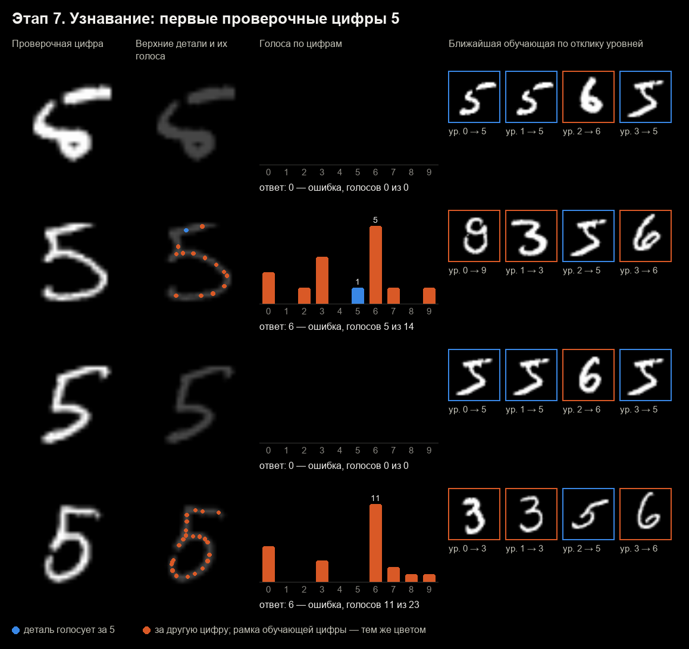

*Как голосуют верхние детали на первых проверочных пятёрках. Синие точки — детали, проголосовавшие за 5, оранжевые — за другую цифру; справа — ближайшая обучающая цифра по отклику каждого уровня (0…3).*

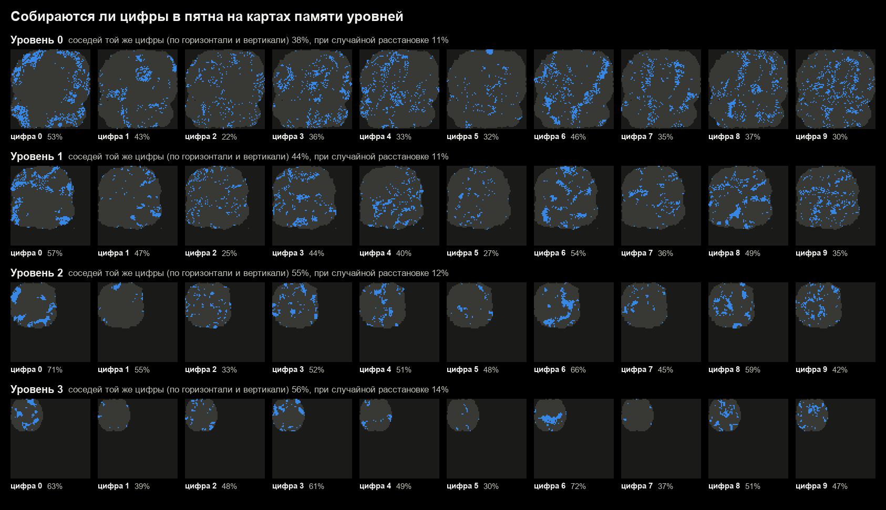

*Строки — уровни 0…3, столбцы — цифры; синим отмечены точки памяти с данной цифры. На уровнях 0–1 точки рассыпаны, выше собраны в пятна.*

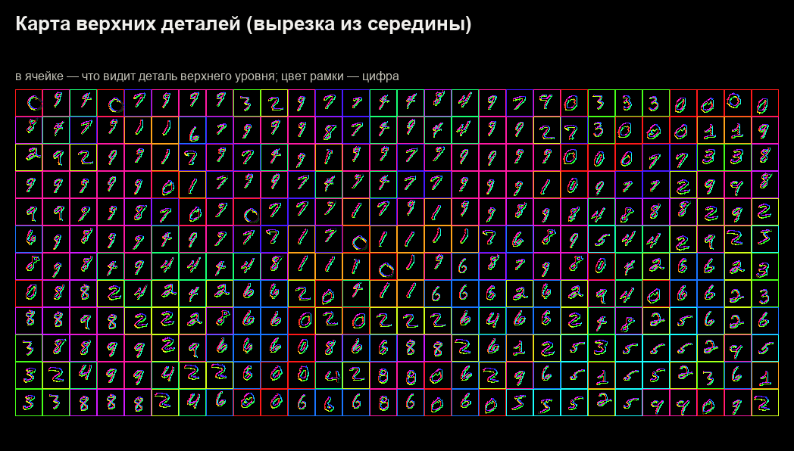

*Вырезка из карты верхних деталей: в ячейке — что видит деталь уровня 3, цвет рамки — цифра.*

[↑ к содержанию](#содержание)

### Что проверено и отвергнуто

Не предлагать снова без нового довода. Числа — как в замере своего времени.

| Вариант | Замер | Что вышло |
|---|---|---|
| Уровень 0 по общему подходу: окно на штрихе держит точки, из которых он собран, место — от центра штриха (`LADDER_LEVEL0_PLACE = "stroke"`; прогоны 445, 446) | 200 цифр: 0.535 / 79.1 / 71.7 % против 0.640 / 89.8 / 81.9 %; 500 цифр: 0.618 / 90.1 / 84.8 % против 0.669 / 93.1 / 91.9 % (сходимость / читатель / память) | хуже варианта 3 и цикла без уровня 0; коды штрихов почти все разные (11 791 из 12 195); автор вернул вариант 3 |
| Цикл без уровня 0 с маленьким окном внизу (соседей [3, 10, 14], прогон 447) | 200 цифр: 0.464 / 80.7 / 66.1 % | хуже всех |
| Середины пар встречных точек края; гребень яркости | 100 цифр, сходимость верха: 0.358 против 0.429 | стыки и перекрестия вырезаются; у жирной линии середина теряется |
| Новые уровни после окна «вся цифра» — правило «пока сужается» (200 цифр) | читатель 73.0 % против 82.5 % | плато нет: пространство схлопывается до 4 точек, сходимость верха 0.547 → 0.259 |
| Память картинок: детали картинки объединяются в одну (§7.1.12; 200 цифр) | читатель / память 78.0 / 75.5 % против 84.0 / 77.0 % | верх сливается по цифрам чисто (0.96), распознавание не лучше; автор: «память картинок не нужна» |
| Расписание размеров окон по доле цифры (200 цифр) | сходимость верха 0.25–0.51 против 0.567 | классы собираются только на уровне, окно которого видит всю цифру |
| Строже срабатывание: λ_a квантилем 0.95 / 0.98, μ_d = 0.8, порог по слоям (100 цифр) | сходимость 0.430 / 0.340 / 0.440 / 0.428 против 0.548 | коды деталей общие, но цифра теряется |
| Код детали от широких слоёв детекторов (§3.3.2) | 0.495 против 0.548; −10 п.п. | коды общие, но не по цифре |
| Окно на 7 понятий; 7 сильнейших понятий; 5–7 крупных областей (П.7 «в лоб») | 33.0 %, 42.6 %, −13 п.п. | пока детали почти все уникальны, урезанное окно теряет цифру |
| Код окна короче простым укорочением (§5.1.2) | −9 п.п. | срезаются биты |
| Круг места объединяет все элементы области (`"max"`); маска как буквальный XOR | 49.8 %, 10.0 % | код окна переполняется; биты признака остаются на местах |
| Торможение любых соседних деталей | 33.8 %, 26.0 % | выбрасывает и разные понятия; принято торможение только похожих — пятна |
| Окно одного размера на всех уровнях; окно уровня 1 из трёх штрихов | 34.4 %, 48.2 % | узнавание падает с уровнем; окно слишком бедное |
| Три масштаба кругов места (§4.5) | −4.3 п.п. | код окна длиннее и дробнее |
| ε-окрестность с постоянным ε вместо 1-NN (§2.2.5); класс по господству классов в детекторах (§8.2) | −9.5 п.п.; 31.7 % | при малом ε голосуют общие штрихи; в поле детектора точки разных цифр |
| **Итого** | 15 вариантов | приняты взамен: вариант 3 уровня 0, гребень расстояния, «последний уровень — первый, где цифра влезает», пятна, линейный читатель |

[↑ к содержанию](#содержание)

### Известные ограничения

- **Без окна на всю картинку верх теряет картинки.** На уровне 3 без окон остаются 28 % картинок (прогон рисунков 0.13.1; при месте окна 256 бит — 35 %, с ещё более ранним кодом места — 24 %), на дашборде обрываются на уровне 1 единицы и прямые черты (23 из 30). Подбор выбрал прогон 266 (без окна) по сходимости и читателю; прогон 168 (с окном) лучше по памяти. Сравнение на 500 цифрах не сделано.
- **Центр окна уровня 0 — центр цифры** — доработка; место штриха в цифре не из источников. Общий подход без него оказался хуже.
- **Кодер команды `layout` не знает штриха без стрелки:** угол у него на круге 360°, а штрихи середины линии лежат в 0…180° — половина детекторов угла (215 из 453) не срабатывает никогда, на картах 60 000 цифр цвет угла занимает полкруга. Кодер цикла это учитывает (круг 180°).
- **П.7 не выполнен:** в окне 12 / 17 / 18 элементов на уровнях 1–3, детали почти все уникальны (`code_resolution` ≈ 1.03–1.06).
- **Содержание окна густое.** С кодом места как у угла на элемент срабатывает около 32 кругов, и каждый вносит его код под своей маской (П.5): у окон уровней 1–3 содержание упирается в предел 25 %, лишнее сбрасывается слиянием цветов. В прогоне рисунков точек на картах меньше, чем с прежним кодом места (3 027 / 1 491 / 620 против 4 551 / 2 443 / 1 136), сходимость верха 0.498 против 0.567, а отклик уровня 1 — 76.6 % против 70.2 %. Прогоны таблицы прогонов (200 и 500 цифр) сняты с прежним кодом места.
- **Объём обучения.** Время детекторов растёт как квадрат точек; на 5 000 цифр плотные поля детекторов при срабатывании не влезут в память. План ускорения ждёт слова автора.
- **Стенд не гонялся с 0.10.0**; главные цифры версии — таблица прогонов на 200 и 500 цифрах, проверка — 1 000 картинок t10k. Шум: сходимость ±0.02 на 500 цифрах (±0.04 на 200), точность ±1.5 п.п.
- **Полный набор тестов в 0.13.0 не прогонялся** (проходили тесты уровня 0, кеша штрихов, обученного цикла и ссылок README).

[↑ к содержанию](#содержание)

## Скорость

Прогон рисунков README — 100 обучающих и 100 проверочных цифр, уровни 0…3 — около 3 мин на RTX 2060 SUPER и Core i5-10400 без кеша шагов кода окна (0.13.1), из кеша — быстрее. Главное время — построение детекторов.

- **Детекторы без таблицы общих бит** (0.13.0). Раньше пакетный счёт кластеров шёл только при таблице N × N (до 20 000 точек), выше — поштучно, в 15–40 раз медленнее. Теперь общие биты считаются блоками на видеокарте, хранятся только кандидаты; порог таблицы — 40 000 точек. 500 цифр с уровнем 0: 17.8 → 10 мин, итог тот же до знака.
- **Уровень детекторов** (`HierarchyDetection._level`) считается во float32, пачка окон дополняется нулями до постоянного числа строк: уровень окна не зависит от того, сколько окон попало в пачку.
- **Быстрые пути** — кластеры всех окон картинки разом, общие биты на видеокарте, DBSCAN по сетке, код окна на видеокарте, отбор сильнейших порогом — дают тот же результат, что прямые; сверка — `MatrixClustersTest`, `SameResultFasterTest`, `tests/test_detail_codes_fast.py`.

Время раскладки команды `layout` — в разделе «[Время](#время)».

[↑ к содержанию](#содержание)

## Запуск

Требования: Python 3.11+ (настройки читает встроенный `tomllib`), NumPy, SciPy, Pillow, PyTorch, Torchvision, Rerun SDK, matplotlib; numba и CUDA — для ускоренных путей раскладки. MNIST при первом запуске скачивается в `data/MNIST`.

| Команда | Что делает | Ключи |
|---|---|---|
| `python client/run.py ladder` | цикл уровней 0…3 и распознавание по нему (этапы 1–7); готовые шаги — из [кеша](#кеш) | `--count` (обучающих), `--limit` (проверочных; 0 — без проверки), `--split`, `--verify-cache` |
| `python client/run.py bench` | честное сравнение DAMP, kNN и CNN («[Честная мерка](#честная-мерка-damp-против-knn-и-cnn)») | `--count`, `--sets`, `--validation`, `--test`, `--map-points`, `--methods`, `--augment` |
| `python client/run.py dashboard` | [живой дашборд](#живой-дашборд), http://127.0.0.1:8765/ | `--count` (обучающих, `DASHBOARD_TRAIN` = 500), `--map-points`, `--port`, `--no-browser`, `--snapshot ФАЙЛ` |
| `python client/run.py figures` | все рисунки README в `docs/` и снимок дашборда (нужен playwright); `--rerun` — скриншоты вкладок Rerun | `--rerun` |
| `python client/run.py layout` | один проход без цикла: раскладка, детекторы, база эмбеддингов | `--count`, `--label`, `--activation-samples`, `--rebuild`, `--layout-only` |
| `python client/run.py evaluate`, `predict` | точность и ответ по эмбеддингам первого уровня | `--count`, `--limit`, `--split`, `--image`, `--dataset`, `--temperature`, `--calibrate`, `--layout-path` |
| `python client/run.py pinwheel` | тест пинвила: картинки и раскладка в `data/pinwheel_test.*` | — |
| `python client/run.py detectors` | картинка детекторов кодера команды `layout` | `--angle`, `--x`, `--y`, `--no-stimulus`, `--output` |
| `python client/run.py sketch 7`, `contour` | цифра из линий её штрихов (Rerun, таблица 0…9) | `--seed`, `--split`, `--upscale` |
| `python client/run.py cache` | кеш шагов: записи и место по шагам | `--clear [ШАГ]` |
| `python client/run.py docs` | HTML-справка по `damp_api` в `docs/api/` (нужен pdoc) | `--open`, `--serve` |
| **Итого** | 13 команд поверх `damp_api` | |

Все настройки — в `client/config.toml`: сверху то, что сильнее всего меняет результат (сколько цифр, правила цикла, код окна), ниже кодер, раскладка, детекторы, рисунки и журнал, в самом конце — техника. Имя ключа то же, что в коде. Другой файл настроек — переменная окружения `DAMP_CONFIG`.

```powershell
$env:RERUN='on'
python client/run.py ladder --count 100 --limit 500
```

[↑ к содержанию](#содержание)

### Фреймворк damp_api

Всё, что делают команды, — из кода, и сверх того: свой цикл из кубиков. У `Damp()` по полю на этап, в порядке и с названиями пайплайна. У каждого этапа есть **кубики** — один шаг этапа, его результат идёт в следующий вызов — и **готовые прогоны**. Все функции — в «[Функции API по этапам](#функции-api-по-этапам)».

Свой цикл из кубиков — тот же, что `cycle.run`, цифра в цифру (тест `CycleBlocksTest`):

```python
import sys; sys.path.insert(0, "client")
from damp_api import Damp

damp = Damp()                                        # настройки — client/config.toml
digits = damp.stimuli.digits(train=100, test=500)    # этап 1: цифры и их штрихи
elements = damp.coding.sticks(digits)                # этап 2: код наклона каждого штриха
if damp.settings["LADDER_LEVEL0"]:
    elements = damp.cycle.level0(elements)           # уровень 0: штрихи с выученными кодами
while True:                                          # этап 6: уровень за уровнем
    keyholes = damp.cycle.keyholes(elements)         #   окна внимания — замочные скважины
    codes = damp.coding.keyholes(keyholes)           #   этап 2: код окна «что и где»
    memory = damp.layout.memory(codes)               #   этап 3: память уровня
    detectors = damp.detectors.build(memory)         #   этап 4: детекторы над картой
    firing = detectors.fire(codes)                   #   этап 4: что сработало на каждом окне
    elements = damp.embeddings.details(firing)       #   этап 5: детали — элементы следующего уровня
    print(keyholes.level, keyholes.radius, memory.points, detectors.count)
    if keyholes.picture_seen >= damp.settings["LADDER_TOP_COVERAGE"]:
        break                                        #   окно видит цифру целиком
damp.recognition.vote(elements)                      # этап 7: голосование верхних деталей
```

**Свои настройки** — поверх `client/config.toml`, без правки файла: `Damp(changes={"LADDER_TOP_COVERAGE": 0.8})` или `damp.with_settings(LADDER_TOP_COVERAGE=0.8)`. Действуют только в вызовах этого `Damp` и его частей; выводимые значения пересчитываются; неизвестное имя — `KeyError`. Другой файл настроек — `Damp("путь/к/config.toml")`.

Части цикла (`damp_api/parts.py`) держат системные объекты внутри и отдают простые значения: `memory.points`, `detectors.layers`, `firing.per_keyhole`, `keyholes.picture_seen`. Уровень не сложился — `LevelFailed`.

[↑ к содержанию](#содержание)

### Функции API по этапам

🧩 — кубик цикла: результат идёт в следующий вызов. ▶️ — готовый прогон или отдельное действие. Имя функции — ссылка на её строку в коде (ставит `python client/apidocs.py --links`, стережёт тест `ReadmeApiLinksTest`). У каждого этапа есть ещё `about` — номер, название, папка в коде и параграфы.

**Этап 1. Стимулы** — `damp.stimuli`

| | Функция | Что делает | Возвращает |
|---|---|---|---|
| 🧩 | [`digits(train, test=0, split="test", shifts=(), train_views=None)`](client/damp_api/stages.py#L97) | цифры MNIST со штрихами: обучающие и их сдвинутые виды (§7.1.4; `None` — `LADDER_TRAIN_VIEWS`), затем проверочные и их сдвиги | `Digits` |
| ▶️ | [`of_image(картинка)`](client/damp_api/stages.py#L124) | штрихи картинки 28×28 | список `Stimulus` |
| ▶️ | [`sketch(цифра)`](client/damp_api/stages.py#L143) | цифра из линий её штрихов в окне Rerun | — |
| ▶️ | [`contour_table()`](client/damp_api/stages.py#L178) | таблица: цифры 0…9 из штрихов | путь к картинке |

**Этап 2. Первичное кодирование ↻** — `damp.coding`

| | Функция | Что делает | Возвращает |
|---|---|---|---|
| 🧩 | [`sticks(digits)`](client/damp_api/stages.py#L240) | код наклона каждого штриха — элементы уровня 0 | `Elements` |
| 🧩 | [`keyholes(keyholes)`](client/damp_api/stages.py#L255) | код каждого окна: что в нём и где (П.4–П.7) | `KeyholeCodes` |
| ▶️ | [`encode(угол, x, y)`](client/damp_api/stages.py#L275) | код стимула первичным кодером команды `layout` | `Code` |
| ▶️ | [`detectors_picture()`](client/damp_api/stages.py#L291) | картинка детекторов кодера: кольца угла, полосы X и Y | путь к картинке |

**Этап 3. Раскладка** — `damp.layout`

| | Функция | Что делает | Возвращает |
|---|---|---|---|
| 🧩 | [`memory(codes, map_points=None)`](client/damp_api/stages.py#L334) | карта памяти уровня из кодов окон обучающих картинок (§5) | `Memory` |
| ▶️ | [`build(count)`](client/damp_api/stages.py#L355) | проход без цикла: раскладка всех штрихов `count` цифр | `LayoutSummary` |
| ▶️ | [`pinwheel()`](client/damp_api/stages.py#L370) | тест пинвила: 360 кодов угла на позицию | `PinwheelReport` |

**Этап 4. Детекторы и активации** — `damp.detectors`

| | Функция | Что делает | Возвращает |
|---|---|---|---|
| 🧩 | [`build(memory)`](client/damp_api/stages.py#L396) | детекторы над картой по слоям порогов (§6.4) | `MapDetectors` |
| 🧩 | [`detectors.fire(codes)`](client/damp_api/parts.py#L388) | какие детекторы сработали на каждом окне (§6.5) | `Firing` |

**Этап 5. Эмбеддинги** — `damp.embeddings`

| | Функция | Что делает | Возвращает |
|---|---|---|---|
| 🧩 | [`details(firing)`](client/damp_api/stages.py#L439) | код детали каждого окна по сработавшим детекторам; детали — элементы следующего уровня | `Elements` |
| ▶️ | [`build(count)`](client/damp_api/stages.py#L458) | проход без цикла: раскладка, детекторы и база эмбеддингов | `LayoutSummary` |

**Этап 6. Цикл ↺** — `damp.cycle`

| | Функция | Что делает | Возвращает |
|---|---|---|---|
| 🧩 | [`level0(elements, map_points=None)`](client/damp_api/stages.py#L501) | уровень 0 — первичная раскладка штрихов: окно на штрихе, память, детекторы; штрихи с выученными кодами (`LADDER_LEVEL0`) | `Elements` |
| 🧩 | [`keyholes(elements)`](client/damp_api/stages.py#L537) | окна внимания следующего уровня: окно на каждом элементе, растёт от уровня к уровню (П.2, П.3) | `Keyholes` |
| 🧩 | [`step(elements)`](client/damp_api/stages.py#L566) | весь проход уровня разом: окна → коды → память → детекторы → срабатывания → детали | `Level` |
| 🧩 | [`covers(level)`](client/damp_api/stages.py#L591) | окно уровня уже видит цифру целиком — цикл окончен | `True` / `False` |
| 🧩 | [`trained(train=None, map_points=None, decay=None)`](client/damp_api/stages.py#L603) | обученный цикл и линейный читатель: по ним идёт любая новая картинка — путь тот же, что у картинки прогона, цифра в цифру ([дашборд](#живой-дашборд)) | `TrainedLadder` |
| ▶️ | [`run(train, test)`](client/damp_api/stages.py#L633) | весь цикл с мерками уровней (команда `ladder`) | `CycleReport` |

**Этап 7. Распознавание** — `damp.recognition`

| | Функция | Что делает | Возвращает |
|---|---|---|---|
| 🧩 | [`by_response(firing)`](client/damp_api/stages.py#L743) | ответ по отклику уровня: какие детекторы сработали на окнах картинки | доля верных `{k: …}` |
| 🧩 | [`vote(details)`](client/damp_api/stages.py#L770) | ответ голосованием деталей: каждая голосует классами похожих обучающих | доля верных `{k: …}` |
| 🧩 | [`linear(firings, decays=None)`](client/damp_api/stages.py#L691) | линейный читатель (§9.3): один слой softmax над самыми сильными уровнями активации детекторов уровней 1…k | доля верных `{λ: …}` |
| ▶️ | [`evaluate(count)`](client/damp_api/stages.py#L888) | проход без цикла: точность на проверочных | `Evaluation` |
| ▶️ | [`predict(файл, count)`](client/damp_api/stages.py#L909) | проход без цикла: цифра на картинке | `Prediction` |
| ▶️ | [`predict_dataset(count)`](client/damp_api/stages.py#L928), [`calibrate(count)`](client/damp_api/stages.py#L949) | точность с журналом ответов; подбор температуры softmax | `Evaluation`; (температура, точность) |
| ▶️ | [`bench(train, sets, validation, test, map_points, methods, augment)`](client/damp_api/stages.py#L792) | честное сравнение DAMP, kNN и CNN: select/report/test, интервалы по наборам (команда `bench`) | `BenchReport` |

**Рисунки** — `damp.figures`: [`readme()`](client/damp_api/stages.py#L977) — все рисунки README, [`structure()`](client/damp_api/stages.py#L987) — только схема устройства проекта.

**Кеш шагов** — `damp.cache`: `summary()` — записи и место по шагам, `clear(шаг)` — очистить шаг или весь кеш, `size()` — байт на диске.

**Сам `Damp`**: [`Damp(config=None, *, changes=None)`](client/damp_api/damp.py#L99) — подключиться; [`with_settings(ИМЯ=значение)`](client/damp_api/damp.py#L117) — тот же `Damp` со своими настройками; [`settings["ИМЯ"]`](client/damp_api/damp.py#L35) — значение настройки; [`stages`](client/damp_api/damp.py#L140) — этапы по порядку; [`version`](client/damp_api/damp.py#L135) — версия.

**Что можно узнать у результатов кубиков**

| Часть | Что это | Главное |
|---|---|---|
| [`Digits`](client/damp_api/parts.py#L75) | цифры прогона | `pictures`, `train`, `test`, `groups`, `labels`, `sticks`; [`picture(i)`](client/damp_api/parts.py#L138) — картинка, цифра и её штрихи |
| [`Elements`](client/damp_api/parts.py#L157) | элементы уровня: штрихи или детали | `level`, `count`, `code_length`, `distinct_codes`, `ones`, `per_picture` |
| [`Keyholes`](client/damp_api/parts.py#L200) | окна внимания уровня | `level`, `count`, `radius`, `keyhole_radius` (средний радиус окна, клеток), `picture_seen`, `per_picture`, `elements_per_keyhole` |
| [`KeyholeCodes`](client/damp_api/parts.py#L253) | коды окон | `count`, `length`, `place_length`, `content_length`, `ones` |
| [`Memory`](client/damp_api/parts.py#L294) | карта памяти уровня | `points`, `width`, `height`, `same_label`, `merge` (чистота слияния); [`release()`](client/damp_api/parts.py#L339) — освободить видеокарту |
| [`MapDetectors`](client/damp_api/parts.py#L357) | детекторы над картой | `count`, `layers`, `activation_threshold`; [`fire(codes)`](client/damp_api/parts.py#L388) |
| [`Firing`](client/damp_api/parts.py#L407) | срабатывания | `keyholes`, `fired`, `per_keyhole`, `silent` |
| [`Level`](client/damp_api/parts.py#L446) | проход уровня целиком | `number`, `keyholes`, `codes`, `memory`, `detectors`, `firing`, `details` |
| [`TrainedLadder`](client/damp_api/parts.py#L473) | обученный цикл и читатель (дашборд) | `levels`, `train_pictures`, `decay`; [`see(картинка)`](client/damp_api/parts.py#L511) → `Sight`; [`maps()`](client/damp_api/parts.py#L575) → `LevelMap` по уровням; [`sticks()`](client/damp_api/parts.py#L646) → `TrainingSticks` |
| **Итого** | 9 частей; все держат системные объекты внутри и отдают простые значения | |

**Что можно узнать у отчёта стенда** (`damp.recognition.bench`, `damp_api/reports.py`): `BenchReport` (весь отчёт: методы, уровни, наборы, путь к JSON, разрыв DAMP − CNN), `BenchMethod` (метод и аугментация), `BenchScore` (точность по наборам и интервал), `BenchRobustness` (устойчивость к сдвигу), `BenchLevel` (мерки уровня DAMP) — все простые значения.

[↑ к содержанию](#содержание)

### Документация API

Каждый класс, метод и свойство `damp_api` описаны в docstring'ах (формат Google: `Args`, `Returns`, `Raises`, `Example`; параграфы — `§6.5`, `П.5`). Из них [pdoc](https://pdoc.dev) собирает HTML со строкой поиска и ссылками на исходники. В справку входят только `damp_api` и его модули; системный слой и мост `_system.py` внутренние.

```powershell
python -m pip install pdoc            # один раз; то же — pip install -e .[docs]
python client/apidocs.py              # собрать HTML в docs/api/ (то же — python client/run.py docs)
python client/apidocs.py --open       # собрать и открыть в браузере
python client/apidocs.py --serve      # живой сервер на http://localhost:8080
python client/apidocs.py --links      # поставить ссылки README «Функции API по этапам» на строки кода
```

Смотреть: `docs/api/index.html`. Папка `docs/api/` создаётся сборкой и в git не хранится.

[↑ к содержанию](#содержание)

## Живой дашборд

Рисуем цифру кистью — и на одном экране видим, что с ней делает каждый уровень цикла: кусочки рисунка (окна внимания, П.2), точки карты, которые они зажигают (§6.1), кластеры — детекторы, в которые кусочки набиваются (§6.5), детали (П.1) и ответ линейного читателя (§9.3).

```powershell
python client/run.py dashboard                 # DASHBOARD_TRAIN = 500 цифр (шаги — из кеша), http://127.0.0.1:8765/
python client/run.py dashboard --count 2000    # больше цифр: с уровнем 0 обучение — часы, не мерено
```

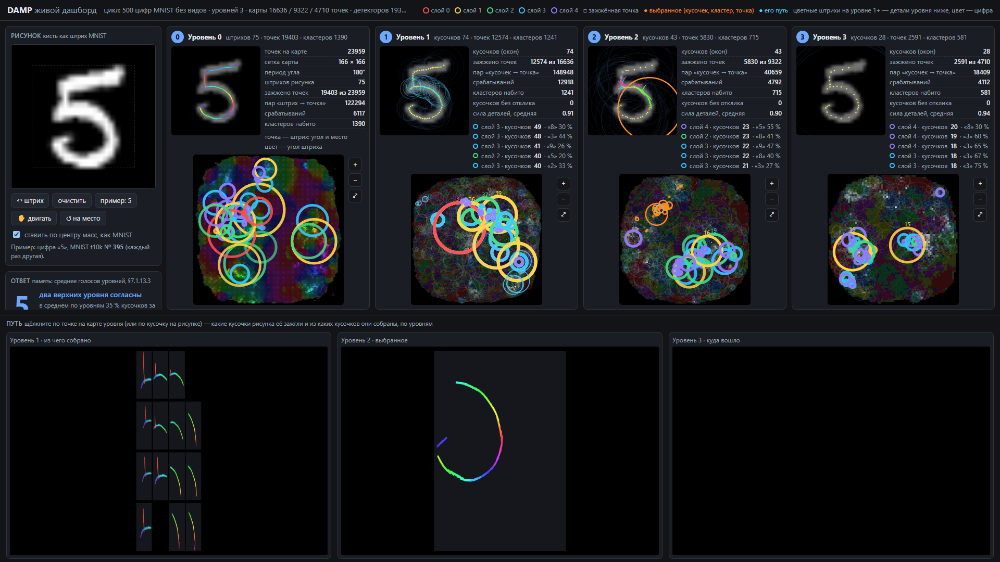

*Снимок на 100 обучающих цифрах (`dashboard --count 100 --snapshot docs/dashboard.png`; по умолчанию дашборд учится на 500). Пример — случайная пятёрка MNIST t10k, здесь № 347 (кнопка «пример: 5», каждый раз другая; номер — под холстом); ответ на ней — 6, уровни расходятся; выбран кусочек уровня 2: ниже подсвечено, из чего он собран, выше — куда вошёл, внизу — его след по уровням.*

| Где | Что видно | Как трогать |
|---|---|---|
| Холст | кисть как штрих MNIST (толщина 2.48 px, размытие σ 0.55), рамка 20×20; рисунок ставится по центру масс, как цифры MNIST | рисовать мышью или пером; «↶ штрих», «очистить», «пример: 5»; двигать рисунок — «✋ двигать», правой кнопкой, Shift + мышь или стрелками (по 1 px), «↺ на место» |
| Ответ | вероятности цифр 0…9 по линейному читателю (§9.3) | — |
| Уровень 0 | карта штрихов: точки, которые зажгли штрихи рисунка, и детекторы над ней | навести, щёлкнуть — как на уровнях |
| Рисунок уровня | кусочки — точки в центрах окон; цвет — сила детали (П.1): синий — слабая, жёлтый — сильная, серый — ни один детектор не сработал. Поверх — детали уровня ниже: на уровне 1 — штрих памяти уровня 0, который штрих рисунка зажёг сильнее всего, его наклон на месте штриха рисунка; выше — штрихи окна памяти, на которое кусочек больше всего похож | навести — круг окна, из чего он собран ниже и куда вошёл выше; щёлкнуть — выбрать |
| Числа уровня | кусочков, зажжено точек, срабатываний, кластеров (и сколько добавил последний штрих), молчащих кусочков, средняя сила деталей; 5 самых набитых кластеров | — |
| Карта уровня | цвет точки — цифра её обучающего окна; белые — сильные совпадения с рисунком; круги — кластеры: цвет — слой детектора, толщина и число — сколько кусочков набилось | колесо — приблизить, потянуть — сдвинуть, ⤢ — вся карта; навести на кластер — его состав; щёлкнуть по точке — путь кусочков, которые её зажгли |
| Путь | пока что-то выбрано, внизу — по полю на уровень: выбранное, из чего оно собрано и куда вошло; яркость — сила кусочка | колесо — приблизить, двойной щелчок — всё |
| **Итого** | один экран: холст, ответ, по три панели на уровень (рисунок, числа, карта), след | |

**Как считается.** Сервер (`client/dashboard/server.py`) обучает цикл кубиком `damp.cycle.trained()` — тот же цикл, что у прогона: `DASHBOARD_TRAIN` цифр MNIST, уровни 0…3, карта без предела (`DASHBOARD_MAP_POINTS`), читатель с λ = 1e-7. Рисунок идёт через обученные уровни теми же классами, что картинка прогона, а всё подобранное по обучающим берётся из обученных уровней. Поэтому у цифры MNIST путь тот же, что в прогоне, цифра в цифру (`tests/test_trained_ladder.py`). Рисунки посреди штриха считают рабочие процессы сервера (`DASHBOARD_WORKERS` = 2, по своему обученному циклу в каждом); последний рисунок штриха считает главный процесс, ответы совпадают байт в байт. Настройки — раздел `[dashboard]` в `client/config.toml`.

| Замер (500 обучающих цифр, уровень 0, окна [10, 14], 2026-11-19) | Значение |
|---|---|
| карты уровней 0 / 1 / 2 / 3 | 23 959 / 16 636 / 9 322 / 4 710 точек; детекторов уровней 1–3 — 1 933 / 1 346 / 1 016 (код места как у угла, 2026-11-20); с прежним кодом места — 19 871 / 25 141 / 16 200 / 8 874 |
| обучение при запуске: заново / из кеша | 8.5 мин + 3 мин до рабочих процессов / 3 мин до рабочих |
| путь одного рисунка; ответ сервера (замер автора, прежний код места) | 160–210 мс; 0.2–0.3 с |
| обновлений рисунка в секунду: 2 рабочих / 1 рабочий (то же) | 13 / 6.7 |
| видеопамять | три копии цикла по 2.0 ГБ — 7.4 из 8 ГБ вместе с Rerun и браузером; с тремя рабочими четыре копии в 8 ГБ не влезают, и рисунок считается минутами |
| **Итого** | рисунок проходит все уровни за доли секунды; ответ дашборда — честный ответ системы |

[↑ к содержанию](#содержание)

## Рисунки README

Все рисунки этапов в `docs/` рисует одна команда:

```powershell
python client/run.py figures          # рисунки этапов, схемы, тест пинвила и снимок дашборда
python client/run.py figures --rerun  # скриншоты вкладок Rerun (окна ненадолго откроются)
```

Она делает прогон цикла на 100 обучающих и 500 проверочных цифрах (`README_FIGURES_*`, карта до 5 000 точек) с наблюдателем (`system/damp/cycle/ladder_trace.py`, `system/damp/figures/`), тест пинвила и картинки детекторов — около 3 минут из кеша. Наблюдатель только запоминает итоги каждого прохода, уровня 0 тоже; то, что рисунок показывает о счёте (зажжённые точки с энергией активации, сработавшие детекторы, голоса), пересчитывается по правилам статьи и сверяется с прогоном (поле `same` события `figures.keyhole`). Стиль — `FIGURE_*` в `client/config.toml`. Снимок дашборда делается на `DASHBOARD_TRAIN` = 500 цифрах (`dashboard --snapshot docs/dashboard.png`). Карты всего MNIST (`docs/layout-60000-*.angle.png`) — командой `python client/run.py layout --count 60000 --layout-only --rebuild` в двух режимах.

| Рисунок | Что на нём | Этап |
|---|---|---|
| `pipeline-overview.png` | пайплайн с петлёй цикла и картами уровней 0…3 | обзор |
| `structure.png` | клиентский и системный слои по настоящим папкам | структура |
| `stage1-sticks.png`, `stage1-digits.png` | картинка, точки середины линии, штрихи; цифры 0…9 из штрихов | 1 |
| `stage2-detectors.png`, `layout-command-detectors.png` | детекторы угла и места, код окна уровня 0; кодер команды `layout` | 2 |
| `stage3-layout-level0.png`, `stage3-layout.png`, `stage3-pinwheel.png`, `layout-60000-*.angle.png` | карта штрихов уровня 0, карта уровня 1, тест пинвила, карты 60 000 цифр | 3 |
| `stage4-detectors.png`, `stage4-activation.png` | слои детекторов, активация окна | 4 |
| `stage5-embedding.png` | деталь окна | 5 |
| `stage6-keyholes.png`, `stage6-step-level0…3.png`, `stage6-level-maps.png` | окна уровней, шаг каждого уровня, карты уровней | 6 |
| `stage7-accuracy.png`, `stage7-fives.png`, `stage7-class-clusters.png`, `stage7-top-map.png` | узнавание по уровням, голоса пятёрок, пятна цифр, карта верхних деталей | 7 |
| `rerun-*.png`, `dashboard.png` | вкладки Rerun, живой дашборд | журнал, дашборд |
| **Итого** | 35 картинок | |

[↑ к содержанию](#содержание)

## Кеш

Картинки всегда одни и те же, поэтому готовый шаг считается один раз. **Каждый шаг — запись сама по себе**, независимо от других (`system/damp/cache.py`, настройки `[cache]`):

- **ключ записи** — хеш содержимого входа шага, значений настроек, которые читает его код, текста этого кода и окружения (версии numpy, torch, numba, видеокарта);
- **шаг пересчитался, а результат тот же** — следующие шаги всё равно берутся из кеша: у них тот же вход («ранний обрыв» систем сборки Bazel, Shake);
- **из кеша — то же, что заново, бит в бит**: тесты `tests/test_cache.py`, сверка `python client/run.py ladder --verify-cache`.

| Шаг кеша | Что хранится | Запись |
|---|---|---|
| `stimuli.sticks` | штрихи каждой картинки MNIST (виды обучающих цифр не хранятся: их штрихи считаются заново) | файл на набор, картинки дописываются |
| `stimuli.stroke_points` | точки, из которых собраны штрихи (только `LADDER_LEVEL0_PLACE = "stroke"`) | на набор картинок |
| `coding.sticks` | коды наклона штрихов | на набор картинок |
| `cycle.keyholes` | окна внимания уровня | на уровень |
| `coding.keyholes` | коды окон «что и где» | на уровень, уровень 0 тоже |
| `layout.memory` | карта памяти: ячейки точек, порог λ, энергии точек | на уровень и карту классов |
| `activation.detectors` | иерархия детекторов над картой | на уровень |
| `embeddings.details` | коды деталей | на уровень |
| `recognition.responses` | отклики картинок на уровне | на уровень |
| `figures.map_glyphs` | рисунки карт окон и деталей | на рисунок |
| **Итого** | 10 шагов; срабатывания детекторов не хранятся — считаются за секунды | место — до `CACHE_MAX_BYTES` = 20 ГБ |

```powershell
python client/run.py cache                       # записи и место по шагам
python client/run.py cache --clear layout.memory  # пересчитать карты при следующем прогоне
python client/run.py cache --clear               # весь кеш
python client/run.py ladder --verify-cache        # пересчитать шаги из кеша и сверить бит в бит
```

Из кода — `Damp().cache` (`summary()`, `clear()`, `size()`). Выключить — `CACHE_ENABLED = false` или `DAMP_CACHE=off` (так в тестах). Проход без цикла (команды `layout`, `evaluate`) кешируется по-старому: раскладка — `data/layout-*.json` (`--rebuild` — заново).

[↑ к содержанию](#содержание)

## Логирование

Все события пишутся внутри реализаций через `LOGGER.event` — одной записью сразу в три места:

| Куда | Что там | Зачем |
|---|---|---|
| консоль | короткая строка `событие ключ=значение … [параграф]` | следить за прогоном |
| `logs/damp.jsonl` | одна запись JSON на строку: `ts`, `run`, `level`, `event`, `section`, `data` (полностью), `msg`; в цикле — ещё `cycle` (номер уровня) | искать человеку и нейросети |
| Rerun | вкладки этапов 1–7 цикла, картинки и графики (`RERUN=on`); запись прогона — `logs/rerun/*.rrd` | смотреть, что делает каждый этап |
| **Итого** | одна точка записи, три приёмника; главный — файл журнала, Rerun — для глаз | |

У каждого понятия статьи в конце записи стоит номер параграфа (`[6.5]`), у понятий продолжения — номер раздела (`[П.5]`), у остального — `[вне статьи]`. Файл журнала ротируется по размеру: 20 МБ × 10 файлов (`LOG_FILE_*`); `DAMP_LOG_FILE=off` выключает файл. Отметки цикла: `ladder.cycle.begin` (начало прохода уровня, этап 2) и `ladder.cycle.end` (конец, этап 6) — у уровня 0 тоже.

| Событие | Что пишет | Параграф |
|---|---|---|
| `ladder.example` | какая пятёрка выбрана примером: номер MNIST и номер по счёту | вне статьи |
| `level0.strokes` | уровень 0: штрихов, точек карты, детекторов, длины кодов, доля молчащих штрихов, кодов наклона → выученных кодов | §7.1.12 |
| `ladder.level` | мерки уровня: окна, карта, детекторы, `energy_mean`, `code_resolution`, `code_largest`, `detail_bits`, `detail_empty`, `detail_full`, точность | §6.6 |
| `ladder.merge` | чистота слияния уровня | вне статьи |
| `activation.lateral_inhibition` | пятна: деталей до и после, порог сходства | §6.4.5 |
| `recognition.vote`, `recognition.response` | голосование деталей и картинки без отклика | §2.2.5 |
| `recognition.levels`, `recognition.linear` | голосование окон по уровням активности; линейный читатель: λ, признаки, потеря | §7.1.12, §9.3 |
| `stimuli.views` | виды обучающих цифр | §7.1.4 |
| `bench.start`, `bench.set`, `bench.cnn.trained`, `bench.table`, `bench.result` | стенд: протокол, наборы, CNN, таблица, итог | вне статьи |
| `dashboard.ladder`, `dashboard.see` | дашборд: обученный цикл готов; итог рисунка по окончании штриха | §6.6, §6.5 |
| `figures.keyhole` | рисунок окна-примера уровня и сверка пересчёта с прогоном (`same`) | §6.5 |
| **Итого** | 18 событий в таблице: у одиннадцати — параграфы статьи, семь вне статьи | |

```powershell
rg '"event": "ladder.level"' logs/damp.jsonl                 # все уровни цикла
jq 'select(.level == "warning")' logs/damp.jsonl             # все предупреждения
jq 'select(.section == "6.5") | .event' logs/damp.jsonl      # всё, что связано с §6.5
jq 'select(.cycle == 0)' logs/damp.jsonl                     # стимулы и уровень 0
```

[↑ к содержанию](#содержание)

### Rerun: цикл по этапам

`$env:RERUN='on'` — прогон цикла открывает окно Rerun с вкладками **Обзор** и по вкладке на этап 1–7, как разделы README. Шкала **cycle** внизу — уровень: `#0` — стимулы и уровень 0, `#1…#3` — уровни цикла. Передвиньте её, и все вкладки покажут выбранный уровень. **Весь путь показан на одной пятёрке** — той же, что на рисунках README этого прогона (`system/damp/figures/rerun_cycle.py`).

| Вкладка | Что видно | Числа по уровням |
|---|---|---|
| Обзор | пока идёт прогон — какой этап идёт (▶) и что готово (✓), уровень 0 тоже; в конце — сводка уровней 0…3 с итогом; журнал со столбцом `cycle` | точность, секунды шагов |
| 1. Стимулы | пятёрка и её штрихи (отрезки без наконечника, цвет — направление 0…180°), цифры 0–9; как получаются штрихи | штрихов на картинку |
| 2. Кодирование ↻ | окна пятёрки и окно-пример (на `#0` — один круг вокруг центра цифры, в окне один штрих), его код «место \| содержание», детекторы угла и места | единиц и плотность кода окна |
| 3. Раскладка | карта памяти (на `#0` — карта штрихов): точки разъезжаются по ходу раскладки, цвет — цифра, белое кольцо — окно пятёрки; качество Ē по шагам; карта окон | точек, соседи одной цифры |
| 4. Детекторы | слои детекторов заполняются один за другим; окно пятёрки зажигает точки (светло-серые — погасли по энергии активации), срабатывают детекторы, сильнейшие — оранжевым | детекторов, сработало на окно |
| 5. Эмбеддинги | код детали, детали пятёрки (на `#0` — штрихи с выученными кодами), уровни сработавших детекторов, мерки статьи | единиц в коде детали, сила |
| 6. Цикл ↺ | окна уровней вокруг одного места пятёрки (уровень 0 — серый круг вокруг центра цифры), отметки начала и конца цикла | радиус окна, доля цифры, элементов, окон |
| 7. Распознавание | точность — сразу после уровня; карта верхних деталей, ошибки 10×10, голоса у каждой цифры | точность по отклику, склейке, голосованию |
| **Итого** | 8 вкладок: все рисунки цикла из README и все числа `ladder.level`, путь одной пятёрки | |

**По ходу счёта.** Часть прохода уровня рисуется, как только готова: окна (этап 6) → коды (2) → карта (3) → детекторы и срабатывания (4) → детали (5) → точность (7). Карта складывается кадрами раз в `RERUN_LIVE_INTERVAL` = 0.5 с, слои детекторов заполняются один за другим; вкладка идущего этапа открывается сама (`RERUN_FOLLOW_STAGE`). При повторе из кеша части приходят те же, только быстрее, без хода раскладки и слоёв.


*Обзор: сводка уровней 0…3 с итогом, точность и время шагов по уровням, журнал со столбцом `cycle`.*


*Этап 4: детекторы по слоям; код окна-примера зажигает точки, срабатывают детекторы, оранжевые — сильнейшие.*


*Этап 6: окна уровней вокруг одного места пятёрки, отметки начала и конца цикла, рост окна по уровням.*

Остальные вкладки: [1. Стимулы](docs/rerun-1-stimuli.png) · [2. Кодирование](docs/rerun-2-coding.png) · [3. Раскладка](docs/rerun-3-layout.png) · [5. Эмбеддинги](docs/rerun-5-embeddings.png) · [7. Распознавание](docs/rerun-7-recognition.png).

**Запись прогона** — `logs/rerun/<время>-<pid>-cycle.rrd` (последние `RERUN_RECORD_KEEP` = 10); открыть позже: `rerun logs/rerun/<файл>.rrd`. Без окна, только в файл: `DAMP_RERUN_VIEWER=off`.

**Схема данных** — устойчивая, на неё можно опираться (`rerun.dataframe`, свой разбор `.rrd`):

| Путь | Что | Шкала |
|---|---|---|
| `/pipeline` | цвета и подписи цифр 0–9 (AnnotationContext) | статично |
| `/pipeline/overview/summary`, `/seconds/<шаг>` | сводка прогона, секунды шагов | статично, cycle |
| `/pipeline/s1_stimuli/main/…`, `/digits/d<k>/…` | пятёрка и цифры 0–9: картинка и штрихи | статично |
| `/pipeline/s2_coding/keyhole/{image,elements,all,circle}`, `/code/place`, `/code/content` | окна пятёрки, окно-пример и его код | cycle |
| `/pipeline/s3_layout/map`, `/map/five`, `/energy`, `/glyphs`, `/live/quality` | карта памяти уровня, окно пятёрки на карте, качество Ē | cycle |
| `/pipeline/s4_detectors/layers/l<k>`, `/activation/{map,lit,fired,strongest}` | детекторы по слоям и срабатывание окна-примера | cycle |
| `/pipeline/s5_embeddings/code`, `/details/…`, `/fired_levels` | деталь окна-примера | cycle |
| `/pipeline/s6_cycle/keyholes/…`, `/marks` | окна уровней на цифре, отметки цикла | cycle |
| `/pipeline/s7_recognition/accuracy/…`, `/confusion`, `/votes/d<k>`, `/top_map` | распознавание | cycle |
| `/pipeline/<этап>/stats/<мерка>`, `/pipeline/<этап>/about` | числа уровня и описание вкладки | cycle |
| `/damp/log`, `/damp/log/<событие>` | журнал | cycle, log_tick, log_time |
| `/bench/…` (запись «bench») | таблица стенда, точность, ход обучения CNN | epoch |
| **Итого** | 7 этапов и обзор; шкала cycle — уровень, 0 — стимулы и уровень 0 | |

[↑ к содержанию](#содержание)

## Тесты

```powershell
$env:RERUN='on'    # прогоны тестов видны в окне Rerun; 'off' — без окна
python -m unittest discover -s tests -t .
```

**Полный набор в 0.13.0 не прогонялся**; проходили `tests/test_level0.py`, `StrokePointsCacheTest`, `tests/test_trained_ladder.py` и `ReadmeApiLinksTest`. Тесты работают без кеша (`DAMP_CACHE=off` ставит `tests/__init__.py`); тесты кеша включают его сами во временной папке.

| Файл | Что проверяет |
|---|---|
| `tests/test_stroke_midline.py` | штрихи по середине линии: середина вместо двух краёв, толщина не важна, угол без стрелки, на перекрестии — два штриха |
| `tests/test_level0.py` | уровень 0: окно на каждом штрихе, место от центра цифры (`"digit"`) или от центра штриха (`"stroke"`), выученные коды — вход уровня 1 |
| `tests/test_primary_level.py` | первичная карта штрихов «угол + место» и её отклик на штрихи картинки |
| `tests/test_ladder.py` | цикл: окна и их радиусы, код окна, детали, торможение; быстрые пути против прямых (`MatrixClustersTest`, `SameResultFasterTest`: таблица, блоки и поштучный счёт кластеров дают те же детекторы) |
| `tests/test_detail_codes_fast.py` | быстрые пути сборки деталей против прямых |
| `tests/test_detail_spots.py`, `tests/test_keyhole_whole_picture.py` | пятна; окно на всю картинку |
| `tests/test_hierarchy_detection.py` | срабатывание детекторов пакетами против прямого счёта |
| `tests/test_merge_purity.py`, `tests/test_memory_votes.py`, `tests/test_fuzzy_search.py` | чистота слияния; класс из памяти; нечёткий поиск (§2.2.5) |
| `tests/test_article_invariants.py` | кодер, раскладка, детекторы и активация по статье, тест пинвила |
| `tests/test_layout_*.py`, `tests/test_fused_energy.py` | раскладка: ускоренные пути, большие наборы, кеш |
| `tests/test_figures.py`, `tests/test_rerun_cycle.py` | рисунки и наблюдатель; вкладки Rerun заполнены, из кеша — теми же записями |
| `tests/test_trained_ladder.py` | обученный цикл: цифра MNIST, поданная как рисунок, проходит уровни цифра в цифру как в прогоне |
| `tests/test_cache.py` | кеш шагов: из кеша — то же, что заново, бит в бит; цикл с кешем = цикл без кеша |
| `tests/test_client_api.py` | фреймворк: этапы по пайплайну, свои настройки, цикл из кубиков = готовый прогон, в систему ходит только `_system.py`, ссылки README на код |
| `tests/test_protocol.py`, `tests/test_honest_measures.py`, `tests/test_bench.py`, `tests/test_baselines.py` | протокол: группы картинок, пример-пятёрка, длина кода только по обучающим, стенд, эталоны |
| `tests/test_logging.py`, `tests/test_imports.py` | журнал JSON Lines; модули импортируются, команды собираются |
| **Итого** | 31 файл | |

[↑ к содержанию](#содержание)

## Что дальше

Ждёт слова автора:

| Что | Зачем |
|---|---|
| Полный набор тестов | 0.13.0 проверена выборочно; показ уровня 0 в Rerun и на рисунках меняет `rerun_cycle.py` и `figures/` |
| Прогон 266 против 168 на 500 цифрах | окно на всю картинку: сходимость и читатель против памяти и обрыва единиц на уровне 1 |
| Судьба кода `LADDER_LEVEL0_PLACE = "stroke"` | по правилу «только текущий подход» отвергнутое удаляется; решает автор |
| Название уровня 0 и тег `LADDER_LEVEL0` (`[КАНОН]` под вопросом: центр цифры — доработка) | сверка со статьёй |
| Ускорение на 5 000–60 000 цифр | детекторы — 78 % времени; поля детекторов при срабатывании не влезут в память |
| «Место от соседей» на уровне 0 | замысел автора: место штриха в цифре — из соседних штрихов, а не от центра цифры |
| Угол кодера команды `layout` — на круг 180°, как у цикла | у штриха середины линии нет стрелки; половина детекторов угла `layout` молчит |
| **Итого** | 7 пунктов | |

Научный план v2 (этапы 0–7, 2026-11-15) пройден в 0.10.0: стенд и эталоны, код детали уровнями активности (§7.1.12), виды обучающих (§7.1.4), линейный читатель (§9.3), замер на 1 000 цифр. С 2026-11-17 цель — первичное кодирование и детектирование: пятна, нормировка `train_max`, окна по похожим соседям (0.12.0), энергия активации, штрихи по середине линии и уровень 0 (0.13.0). Отложено автором: декодирование «сверху вниз».

[↑ к содержанию](#содержание)
