# DAMP: разреженные коды, раскладка и цикл уровней на MNIST

**Версия 0.13.8** · [журнал версий](CHANGELOG.md) · [сверка со статьёй](docs/ARTICLE_COMPLIANCE.md) · [ход подбора](docs/TUNING.md) · [сходимость верха](docs/CONVERGENCE.md) · [скорость](docs/SPEEDUP.md) · [таблица прогонов](docs/RUNS.md)

Реализация DAMP по статье [DAMP](docs/DAMP.pdf) и её [продолжению](docs/DAMP_continuation.md). Проверка — на MNIST: весь обучающий набор, 60 000 картинок, проходит все уровни.

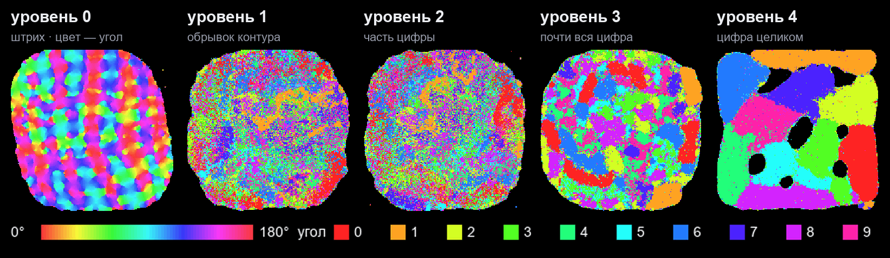

*Карты памяти уровней 0–4, прогон стенда 1569: 60 000 картинок MNIST train на всех уровнях, в каждой карте 41 000 точек. На уровне 0 цвет — наклон штриха: карта собрана из пинвилов. Выше цвет — цифра окна: на уровнях 1–2 цифры перемешаны (обрывки контура общие для всех цифр), на уровне 3 — пятна, на уровне 4 — по пятну на цифру.*

| Весь MNIST train, два зерна (прогоны 1568 / 1569) | Зерно 3 | Зерно 10 |
|---|---|---|
| сходимость верха **М1u** — доля точек цифры в её главном пятне | 0.903 | **0.930** |
| честная сходимость верха — соседи одной цифры с разных картинок | 0.908 | 0.906 |
| **читатель** на всём MNIST t10k (10 000 картинок) | 97.9 % | **98.0 %** |
| **память** на всём t10k | 96.2 % | 95.7 % |
| обучение / весь прогон, RTX 2060 SUPER | 122 / 138 мин | 119 / 136 мин |
| **Итого** | двойка — двумя пятнами | 10 цифр — 10 пятен |

1. **Стимулы.** Картинка распадается на штрихи: детекторы над точками середины линии. У штриха — место и наклон 0…180°.
2. **Код.** Окно смотрит на элементы и пишет код «что и где». Сработал широкий детектор места или наклона — горит его бит.
3. **Раскладка.** Коды окон всех обучающих картинок ложатся на карту: похожие рядом. Карта — память уровня.
4. **Детекторы.** Над пятнами похожего встают детекторы. Окно зажигает точки памяти — детекторы срабатывают.
5. **Эмбеддинг.** Сильнейшие сработавшие детекторы дают код детали окна.
6. **Цикл.** Детали — элементы следующего уровня, снова этап 2. Уровень 0 — штрих и его место в цифре; дальше окно шире: обрывок контура → часть цифры → почти вся цифра → вся цифра одним окном (уровень 4).
7. **Распознавание.** Новая картинка проходит все уровни; класс читают линейный слой и голоса памяти.

В скобках по тексту — источник: §6.5 — параграф статьи, П.5 — раздел продолжения.

> **Цель сейчас** (автор): каждый класс — **один целый кластер** на верхней карте (2026-11-21); при той же сходимости лучше та карта, где точек больше (2026-11-24); картинок на верхних уровнях не больше, чем на нижних, а растить число картинок — плавно, проверяя каждую ступень (2026-11-24…25). Мерка — М1u. Точность распознавания — страж, не цель.

## Содержание

- [Пайплайн одним взглядом](#пайплайн-одним-взглядом)
- [Структура проекта](#структура-проекта)
- [Этап 1. Стимулы: штрихи MNIST](#этап-1-стимулы-штрихи-mnist)
- [Этап 2. Первичное кодирование](#этап-2-первичное-кодирование) — ↻ **начало цикла**
  - [Первичные детекторы угла, X и Y](#первичные-детекторы-угла-x-и-y)
  - [Случайный бит, ограниченная длина и плотность кода](#случайный-бит-ограниченная-длина-и-плотность-кода)
- [Этап 3. Раскладка](#этап-3-раскладка)
  - [Карты всего MNIST в двух режимах](#карты-всего-mnist-в-двух-режимах)
  - [Расчёт энергий](#расчёт-энергий)
  - [Большие наборы](#большие-наборы)
  - [Время](#время)
  - [Файлы результата](#файлы-результата)
- [Этап 4. Детекторы и активации](#этап-4-детекторы-и-активации)
- [Этап 5. Эмбеддинги первого уровня](#этап-5-эмбеддинги-первого-уровня)
- [Этап 6. Цикл: уровни выше первого](#этап-6-цикл-уровни-выше-первого) — ↺ **конец цикла: детали уровня снова идут на этап 2**
  - [Принципы](#принципы)
  - [Как это сделано](#как-это-сделано)
  - [Уровень 0: первичная раскладка штрихов](#уровень-0-первичная-раскладка-штрихов)
  - [Шаг уровня](#шаг-уровня)
  - [Что получается на 60 000 картинках](#что-получается-на-60-000-картинках)
  - [Подбор: стенд, опора, ступени картинок](#подбор-стенд-опора-ступени-картинок)
  - [Настройки](#настройки)
  - [Файлы результата](#файлы-результата-1)
- [Этап 7. Распознавание](#этап-7-распознавание)
  - [По эмбеддингам первого уровня](#по-эмбеддингам-первого-уровня)
  - [По уровням цикла](#по-уровням-цикла)
  - [Честная мерка: DAMP против kNN и CNN](#честная-мерка-damp-против-knn-и-cnn)
  - [Результаты](#результаты)
  - [Что проверено и отвергнуто](#что-проверено-и-отвергнуто)
  - [Известные ограничения](#известные-ограничения)
- [Скорость и память](#скорость-и-память)
- [Запуск](#запуск)
  - [Стенд подбора](#стенд-подбора)
  - [Фреймворк damp_api](#фреймворк-damp_api)
  - [Функции API по этапам](#функции-api-по-этапам)
  - [Документация API](#документация-api)
- [Живой дашборд](#живой-дашборд)
  - [Снимок: дашборд без обучения](#снимок-дашборд-без-обучения)
- [Рисунки README](#рисунки-readme)
- [Кеш](#кеш)
- [Логирование](#логирование)
  - [Rerun: цикл по этапам](#rerun-цикл-по-этапам)
- [Тесты](#тесты)
- [Что дальше](#что-дальше)

## Пайплайн одним взглядом

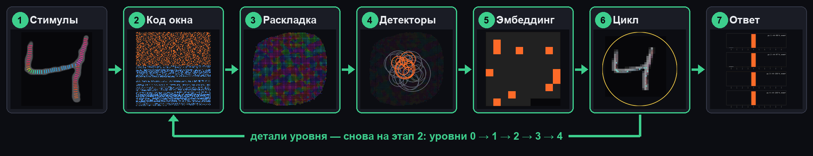

*Путь одной цифры. Этапы 2–6 (зелёная рамка) — проход уровня: код окна → раскладка → детекторы → эмбеддинг → окна следующего уровня. Петля возвращает детали на этап 2, пока не пройдены уровни 0–4. Наверху уровни голосуют за класс.*

| Этап | Вход → выход | Главные классы | Код (`system/damp/`) |
|---|---|---|---|
| 1. Стимулы | картинка 28×28 → штрихи: место (дробное, клетки 24×24) и наклон 0…180° | `StrokeMidline`, `StrokeDetectors`, `MnistSobelAngleMap` | `stimuli/` |
| 2. Первичное кодирование ↻ | окно → код «что и где»: биты кругов места (OR) + коды элементов под масками мест | `Encoder`, `KeyholeCoder`, `PositionBindingEncoder` | `encoding/` |
| 3. Раскладка | коды окон обучающих картинок → карта памяти уровня: похожие рядом | `Layout`, `MemoryMap`, `LeaderDictionary` | `layout/` |
| 4. Детекторы и активации | карта → 5 слоёв детекторов; код окна → зажжённые точки → сработавшие детекторы | `DetectorHierarchyBuilder`, `HierarchyDetection`, `LevelDetectors` | `activation/` |
| 5. Эмбеддинги | σ сильнейших детекторов → код детали окна | `DetailCoder`, `DetectorEmbeddings` | `activation/` |
| 6. Цикл ↺ | уровень 0 (штрих, место от центра цифры) → уровни 1–4: детали → окна → снова этапы 2–5 | `StrokeLevel`, `MnistLadderRunner`, `CycleStep`, `KeyholeBuilder` | `cycle/` |
| 7. Распознавание | отклики всех уровней → класс цифры | `LinearReader`, `MemoryVotes`, `LevelRecognition` | `decode/` |
| **Итого** | 7 этапов; этапы 2–5 повторяются на каждом уровне — на MNIST это уровни 0…4 | | |

> **Кадры полос** в разделах этапов — нарезки пошаговых схем, которые автор просил на цифре 4: четвёрка № 2 MNIST train, разбор 2026-11-21 на стенде 250 картинок (`tools/tuning/atomic_diagram.py`, `tools/tuning/level_diagram.py`; полосы собирает `tools/readme_strips.py`). Числа на кадрах — того разбора; нынешние числа — в таблицах. Механизм с тех пор тот же, кроме верха: σ 10 → 13, на уровне 4 одно окно на картинку и место в масштабе цифры, гладкий старт карты уровня 4.

В коде проход 2–5 есть в двух видах. Команда `ladder`, дашборд и стенд идут **по циклу**: стимул — окно внимания, место записано внутри окна. Команды `layout`, `evaluate` и `predict` делают **один проход** над отдельными штрихами: место штриха на картинке входит в его код, набор для эмбеддинга — вся картинка. Карту команды `layout` цикл не использует.

[↑ к содержанию](#содержание)

## Структура проекта

Код делится на два слоя. **Клиентский** (`client/`) — то, чем клиент, оператор и админ управляют нейросетью: настройки, фреймворк `damp_api` и команды поверх него. **Системный** (`system/damp/`) — то, что под капотом: пакеты по этапам пайплайна.

> **К системе — только через клиентскую часть.** Команды, скрипты и ноутбуки зовут `damp_api`; в `system/damp` из клиентской части ходит один мост — `client/damp_api/_system.py`. Правило стережёт `tests/test_client_api.py`.


```text
client/
├── config.toml             # все настройки: самые значимые сверху, техника внизу; у каждой тег [КАНОН] / [РАСШИРЕНИЕ] / [НЕ КАНОН]
├── damp_api/               # фреймворк: этапы 1–7 как поля Damp(); части цикла, отчёты, кеш; мост _system.py
├── run.py                  # команды: ladder, bench, dashboard, layout, evaluate, predict, figures, pinwheel, detectors, sketch, contour, cache, docs
├── dashboard/              # живой дашборд: server.py (только через damp_api) и static/
├── apidocs.py              # HTML-справка по damp_api (pdoc); --links — ссылки README на код
└── examples/digit.png      # картинка для predict
system/damp/
├── stimuli/                # этап 1: середина линии, детекторы штрихов, цифры прогона
├── encoding/               # этап 2: кодер Encoder, элементы уровня, код окна — замочной скважины
├── layout/                 # этап 3: Layout (§5), память уровня, отбор образцов, гладкий старт, энергии на видеокарте
├── activation/             # этапы 4–5: детекторы уровня, срабатывания, детали
├── cycle/                  # этап 6: уровень 0 (primary.py), окна, проход уровня (step.py), лестница (ladder.py), обученный цикл
├── decode/                 # этап 7: читатель, голоса памяти, отклики уровней, чистота слияния; эталоны и стенд bench
├── figures/                # рисунки команды figures, вкладки Rerun
├── rows_on_disk.py         # коды окон уровня во временном файле (большие наборы)
├── snapshot.py             # граф объектов на диске без pickle: снимок обученного цикла
├── settings.py, cache.py, environment.py, logging.py, article_refs.py
tools/
├── tuning/                 # стенд подбора: прогонщик доски, опора (base.json), журнал прогонов, разборы верха (top/)
├── glm/                    # агент GLM и роутер задач автора
└── readme_strips.py        # полосы-нарезки README из кадров схем
docs/                       # статья, продолжение, сверка со статьёй, ход подбора, рисунки README (readme/ — полосы)
tests/                      # инварианты статьи, сверки быстрых путей с прямыми «до бита»
data/, logs/                # создают прогоны (в .gitignore)
```

[↑ к содержанию](#содержание)

## Этап 1. Стимулы: штрихи MNIST

Стимул — **штрих**: кусок линии цифры, его наклон и место. Как получить штрихи, статья не говорит; способ наш, правила детекторов взяты из §6.4 и перенесены с карты кодов на плоскость картинки. Настройки — `MNIST_*` в `client/config.toml`.

**Середина линии** (`MNIST_STROKE_MIDLINE`, `StrokeMidline`). Слова автора (2026-11-17): «мозгу не важна толщина штриха, ему важны его изгибы, перекрестия и прерывы».

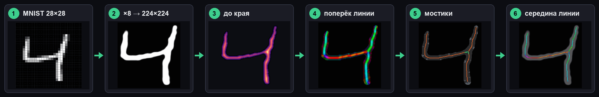

**①** пиксели MNIST 28×28 · **②** ×8 → рабочая картинка 224×224 (Lanczos3), чернила — не темнее 0.5 · **③** расстояние до края у каждого пикселя чернил: «шатёр» с одним наклоном при любой толщине · **④** изгиб и направление поперёк линии (гессиан; цвет — угол 0…180°) · **⑤** вершины гребня; разрывы на стыках и в петлях закрывают мостики по слабым точкам (зелёные) · **⑥** точки середины линии, у каждой — направление без стрелки.

**Штрих — детектор над точками** (`MNIST_STROKE_DETECTORS`, `StrokeDetectors`; §6.4 на картинке — доработка).

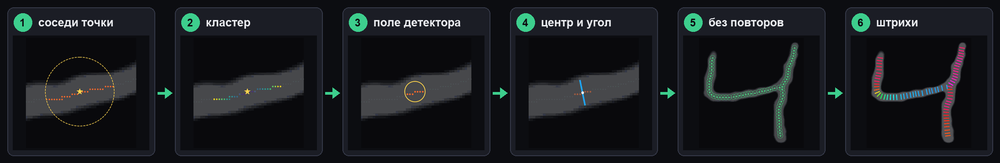

**①** точка-центр и соседи с похожим направлением (|cos| ≥ 0.7, §6.4.1) · **②** кластер растёт по соседям · **③** поле — круг в шаг штрихов `MNIST_STROKE_STEP` = 4 px (§6.4.3) · **④** место — центр с весом «сходство × сила» (§6.4.2), угол — по удвоенным углам · **⑤** плотные кандидаты первыми; рядом со взятым штрихом похожий не берётся (§6.4.5) · **⑥** штрихи цифры.

- Штрихи стоят в координатах самой цифры: сдвиг цифры сдвигает их вместе, сетка не режет наклонную линию «лестницей».
- Место — дробное, в клетках 9 px (24×24 клетки на картинку). На перекрестии в одном месте два штриха разного направления. Сила штриха — энергия его детектора (§6.3).
- **≈ 63 штриха на цифру**: весь MNIST train — 3 768 355 штрихов.

**Группы картинок** (вне статьи; `system/damp/stimuli/digits.py`) — номера MNIST явные и не пересекаются:

| Группа | Откуда | Для чего |
|---|---|---|
| train | MNIST train: стенд — первые N картинок; стенд `bench` — пул [0, 50 000) | память уровней, детекторы, база деталей |
| validation | MNIST train, пул [50 000, 60 000) | выбор настроек стенда `bench` |
| test | MNIST t10k | читатель и память: стенд — первые 100, итог ступени — весь t10k |
| **Итого** | три группы, номера не пересекаются | на ступени 60 000 train целиком — validation не остаётся |

Виды обучающих цифр со сдвигом (`LADDER_TRAIN_VIEWS`, §7.1.4) выключены: у штрихов-детекторов сдвиг на 1 px даёт почти те же штрихи.

[↑ к содержанию](#содержание)

## Этап 2. Первичное кодирование

> ↻ **Начало цикла.** Этапы 2–6 повторяются на каждом уровне. На уровне 0 кодируется штрих и его место от центра цифры, выше — детали прошлого уровня и их места в окне.

Кодер устроен по схеме [Angle-Encoder](https://github.com/qwertukg/Angle-Encoder): значение ловят широкие перекрывающиеся детекторы, каждый сработавший ставит в коде свой бит (§4.1, §4.2). Близкие значения делят часть детекторов — их коды похожи.

[↑ к содержанию](#содержание)

### Первичные детекторы угла, X и Y

**Угол** — замкнутая координата (§4.4), круг 180°: у штриха середины линии нет стрелки.

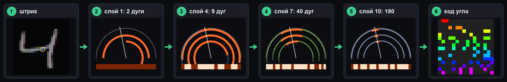

**①** штрих — окно уровня 0 · **②–⑤** слои детекторов угла от 2 широких дуг до 180 узких: сработавшие дуги ставят по случайному биту своей цветовой полосы (на кадрах — слои 1, 4, 7, 10) · **⑥** код угла — OR битов, 256 бит.

- 10 слоёв: 2, 3, 5, 9, 15, 24, 40, 66, 109 и 180 детекторов (453), перекрытие 0.85 (`MNIST_ANGLE_OVERLAP`); код 256 бит, около 57 единиц (22 %).

**X и Y в цикле** — место **внутри окна** в долях его радиуса, а не на картинке (§7.1.4.1). Детекторы места — круги на плоскости окна (§4.3), **устроенные как детекторы угла** (автор 2026-11-19: «код позиции должен как код угла получаться, от широких до узких детекторов, слоями»).

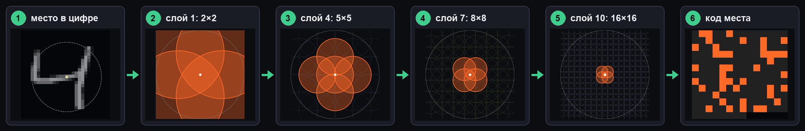

**①** место штриха — смещение от центра цифры в долях R (R — до самого дальнего штриха), шаг 0.125 R · **②–⑤** слои кругов места от 2×2 до 16×16: в каждом слое горят 4–5 кругов (на кадрах — слои 1, 4, 7, 10) · **⑥** код места уровня 0 — 176 бит.

- 10 слоёв, по стороне 2, 3, 4, 5, 6, 7, 8, 10, 13 и 16 кругов (728), перекрытие 0.52 (`LADDER_BINDING_PLACE_*`); на значение — около 32 единиц (12 %). Плоскость — ровно размах мест (`LADDER_PLACE_EXTENT` = 2 шага).
- **На уровне 4** самый узкий слой — 8 × 8 (`LADDER_BINDING_PLACE_NARROWEST` = [16, 16, 16, 16, 8] в опоре) и место — в масштабе самой цифры ([этап 6](#как-это-сделано)).
- **X и Y в команде `layout`** — место на картинке: отрезки −1…28, 10 слоёв по 2…28 детекторов, перекрытие 0.7.

Профиль сходства каждой координаты проверяется при сборке кодера (§4.5, §5.13.1): сходство кодов убывает с расстоянием на всём диапазоне, иначе — `encoder.long_range_order.warning`.

<details>
<summary>Детекторы угла и места одним рисунком (команда <code>figures</code>, пятёрка № 35)</summary>


*Верхняя строка — угол штриха, нижняя — его место от центра цифры: все слои вместе, каждый слой отдельно, код. Рисунок 0.13.1: перекрытие угла тогда было 0.7 (32 единицы из 256).*

</details>

[↑ к содержанию](#содержание)

### Случайный бит, ограниченная длина и плотность кода

Окно складывает коды всех своих элементов в один **код окна** «что и где» (П.4, П.5). Простое OR не годится: «угол слева, линия справа» и «линия слева, угол справа» дали бы один код. Поэтому у каждого круга места две составляющие:

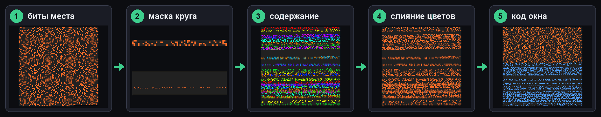

**①** **биты места** — OR кругов, сработавших хотя бы на одном элементе; на уровне 0 каждый круг ставит 39 бит (`LADDER_BINDING_PLACE_BITS` = [39, 1]) — 6 864 бит · **②** **маска круга**: круг берёт из своей области один элемент (сильнейший, пулинг П.5) и вносит его код переставленным: бит `i` → бит `i ⊕ m` · **③** **содержание** — OR по кругам, до 8 192 бит; цвет — слой круга · **④** единиц больше 25 % — **слияние цветов** (§3.3), первыми уходят биты узких кругов · **⑤** код окна уровня 0: место (оранжевое) + содержание (синее), 15 056 бит.

- **Случайный бит.** Код делится на цветовые полосы по слоям (§3.2, §4.2.1): широкий слой — младшие «красные» биты, узкий — старшие «фиолетовые». Каждый детектор получает один случайный бит своей полосы. Бит, который поставили два детектора, — паразитный (§4.2.1).
- **Ограниченная длина.** Длина кода задана заранее и не зависит от числа детекторов. Место — своё у уровня: 176 × 39 = 6 864 бит на уровне 0, 1 792 / 1 536 / 1 088 на уровнях 1 / 2 / 3 и выше (`LADDER_BINDING_PLACE_CODE_LENGTH`) — самая короткая длина, при которой ни одно обучающее окно не плотнее 25 %. Содержание — степень двойки под среднюю плотность 0.2, не длиннее 8 192 бит (`LADDER_BINDING_LENGTH_MAX`).
- **Плотность.** Доля единиц не выше 25 % (§2): у содержания её держит слияние цветов, у места — длина. На 60 000 картинках у кода окна уровня 0 в среднем 1 270 единиц места и 1 670 содержания.
- **Перечисление** (`LADDER_BINDING_ENUMERATE_FROM` = 4; П.5 «перечисление выбранных»): на уровне 4 круги одного слоя разбирают элементы окна по очереди — каждому кругу сильнейший ещё не взятый. Иначе в окне на всю цифру ~56 % проходов содержания доставалось одной сильнейшей детали.

[↑ к содержанию](#содержание)

## Этап 3. Раскладка

Коды раскладываются на двумерной карте `Layout` (§5): похожие встают рядом. В цикле раскладываются коды окон, и карта — **память уровня**, одна на все окна (П.2).

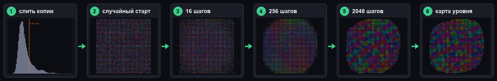

**①** почти одинаковые коды сливаются к одному образцу (`LeaderDictionary`): на уровне 0 — только совпадающие, выше — при косинусе ≥ 0.9; гистограмма сходств и порог λ · **②** случайная расстановка: квадратная сетка, 15 % клеток пустые (§7.1.6) · **③–⑤** дальняя фаза: пара точек меняется местами, если энергия пары растёт (§5.6); радиус пар сужается, λ растёт · **⑥** после ближней фазы — карта уровня 0: пинвилы угла.

- Сходство — косинус; порог `sim_λ = sim · σ(η(sim − λ))`; λ карт уровней — квантили попарных сходств кодов карты, 0.82…0.982 (§5.4, §7.1.7).
- Дальняя фаза собирает похожее в области, ближняя наводит порядок внутри них (§5.5). Пары шага выбираются случайно и считаются параллельно (§5.3, §5.10).
- **Режим `LAYOUT_SMOOTH_PINWHEELS = true`** — сглаживание: гауссово ядро дальней фазы, фиксированный λ, слабый отжиг. Карта из многих пинвилов с плавными переходами. Этого режима нет ни в статье, ни в продолжении; на нём сняты все замеры. `false` — по статье: `φ = Σ s·d` по всему пространству (§5.5.1), λ по расписанию §7.1.7.
- **Гладкий старт верхней карты** (`LADDER_LAYOUT_SMOOTH_START_FROM` = 4 в опоре; вне статьи — там старт случайный): точки уровня 4 сначала расставляются по сходству кодов без меток (перплексия 10), потом доводятся раскладкой с радиуса 0.1 ширины карты. Подбор v19: М1u 0.790 → 0.844. До 8 000 точек — плотный счёт, от 8 001 до 70 000 — без матриц N × N (`smooth_start.embed_blocked`: сродства рёбрами, отталкивание блоками строк, сумма в постоянном порядке — повтор до бита).
- **Предел точек карты** — 41 000 на ступенях за 1 000 картинок (`DASHBOARD_MAP_POINTS` в стенде, `LADDER_MAP_MAX_POINTS` у команды `ladder`). Окна обходятся вразброс; в карту идёт выборка окон, но **все картинки проходят все уровни**. На 1 000 картинках предел стоит −0.003 ± 0.007 М1u и ускоряет прогон с 24.5 до 15.8 мин.

**Тест пинвила** (`python client/run.py pinwheel`) раскладывает 360 кодов угла на каждую из четырёх позиций; ожидаемая картина — по пинвилу на позицию, как в ориентационных картах V1.


*Одна раскладка в трёх раскрасках: псевдоцвета битов кода (§5.14), угол стимула, яркость по энергии точки (рис. 18 статьи).*

[↑ к содержанию](#содержание)

### Карты всего MNIST в двух режимах

Команда `layout` раскладывает штрихи всего обучающего набора (без цикла, место — на картинке). Пиксель — клетка, цвет — угол штриха; угол в раскладке не участвует — это проверочная раскраска, как на рис. 16 статьи.

| Режим статьи | Сглаживание |
|---|---|
| 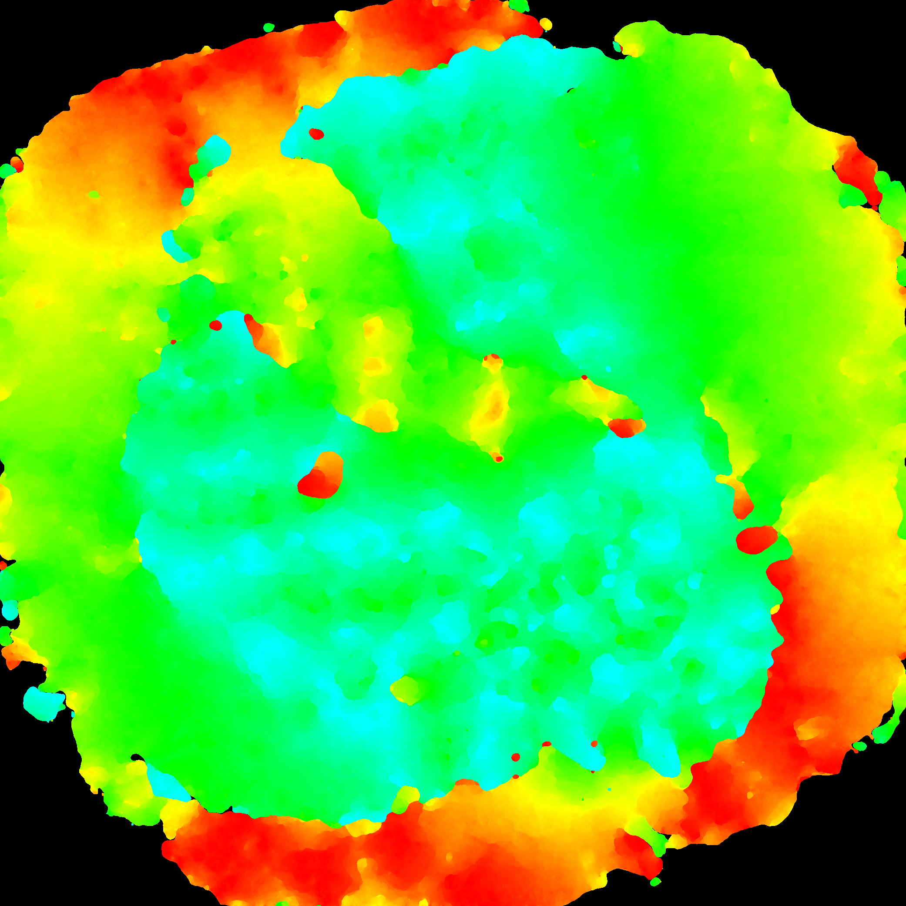 |  |

| Показатель (0.13.0) | Режим статьи | Сглаживание |
|---|---|---|
| штрихов / сетка | 3 768 355 / 2082² | 3 768 355 / 2082² |
| качество Ē (§5.8) | 0.980 | 0.979 |
| время | 6 мин 34 с (штрихи из кеша) | 20 мин 50 с с разбором картинок на штрихи |
| **Итого** | | Ē одинаково; в режиме статьи — крупные области с резкими границами, при сглаживании — плавные переходы |

> Цвет угла занимает полкруга: кодер команды `layout` кодирует угол на 360°, а у штриха середины линии он 0…180° — половина детекторов угла этого кодера молчит. Кодер цикла это учитывает; это известный долг.

[↑ к содержанию](#содержание)

### Расчёт энергий

Энергии пар и точек считаются на видеокарте (PyTorch), выбор пар — векторно (§5.3, §5.9). Ускоренные пути дают **тот же результат бит в бит**: те же операции float32 и та же редукция; по ходу раскладки пути сверяются с исходным и при расхождении отключаются. Нужны CUDA и numba.

| Путь | Настройка | Что делает |
|---|---|---|
| Строки ненулевых `sim_λ` | `LAYOUT_SPARSE_LONG` | при жёстком пороге суммы §5.5.1, §5.5.2, §5.7 сводятся к похожим точкам |
| Знак вместо суммы | `LAYOUT_PAIR_KERNEL` | правилу обмена §5.6 нужен только знак разности энергий |
| Граница потенциала | `LAYOUT_POTENTIAL_BOUNDS` | заведомо невыгодные пары отсеиваются без счёта строк (неравенство Йенсена) |
| Почти-ничьи | `LAYOUT_REDUCTION_REPLICA` | пары на грани ошибки суммирования решаются на хосте в том же порядке сложения |
| Выборка пар | `LAYOUT_COMPILED_SAMPLER` | циклы выборки на numba, те же случайные числа |
| Слитое ядро | `LAYOUT_FUSED_ENERGY` | всё слагаемое пары — одно ядро CUDA по таблице сходств; большим картам — таблица общих бит int16 (целиком до ~46 тыс. точек, половиной — до ~65 тыс.) |
| Коды int8 | `LAYOUT_INT8_CODES`, `ACTIVATION_INT8_CODES` | число общих бит — `torch._int_mm`: то же целое, памяти вчетверо меньше |
| **Итого** | 7 путей | сверка — `tests/test_layout_*.py`, `tests/test_fused_energy.py`, `tests/test_hierarchy_detection.py` |

[↑ к содержанию](#содержание)

### Большие наборы

- **Команда `layout`.** Больше 100 000 точек (`LAYOUT_LONG_FULL_SPACE_MAX_POINTS`) — от «затравки»: 30 000 случайных точек раскладываются целиком, остальные встают возле самых похожих точек затравки (§5.9.4), затем дальняя фаза с малого радиуса и ближняя.
- **Цикл.** Карта уровня — не больше 41 000 точек (выше — выборка окон). Отбор образцов идёт по номерам, без копии всех кодов; одинаковые коды — группы по 128-битному хешу (перемешивание splitmix64), каждая группа сверяется побайтно. После отбора коды окон уровня уходят во временный файл (`rows_on_disk.py`, от 1 ГиБ) и читаются кусками.

[↑ к содержанию](#содержание)

### Время

| Что | Время, RTX 2060 SUPER |
|---|---|
| карта уровня 0–3 в цикле, 41 000 точек | ~2 мин раскладка + ~1.5 мин детекторы, на любой ступени картинок |
| верхняя карта: 1 000 / 5 000 / 8 000 / 40 000 точек | 3 с / 48 с / 2 мин / ~7.5 мин |
| команда `layout`, 60 000 цифр (3.8 млн штрихов) | 6.5 мин (статья, штрихи из кеша) / 21 мин (сглаживание, с разбором на штрихи) |
| **Итого** | с пределом карты раскладка нижних уровней не растёт с числом картинок; растёт верх и коды окон |

<details>
<summary>Замер 0.11.0 команды <code>layout</code> по числу цифр (углопозиции сетки 24×24)</summary>

| Цифр | Точек | Сетка | Режим статьи | Сглаживание |
|---|---|---|---|---|
| 100 | 8 693 | 115² | 52 с | 20 с |
| 1 000 | 88 317 | 364² | около трёх часов | 9 мин 22 с |
| 10 000 | 882 607 | 1151² | 2 мин 31 с | 2 мин 41 с |
| 60 000 | 5 302 618 | 2821² | 5 мин 27 с | 13 мин 27 с |
| **Итого** | | | медленнее всего — от ~550 цифр до 100 000 точек: строки сходства не помещаются в память | |

</details>

[↑ к содержанию](#содержание)

### Файлы результата

Команда `layout` пишет раскладку в `data/layout-<count>-<radius>-<LAYOUT_CACHE_TAG>.json` (с детекторами и эмбеддингами, этапы 4–5) и карту в трёх раскрасках: `data/<count>-<radius>.png` — псевдоцвета битов (§5.14), `.energy.png` — энергия точки (рис. 18), `.angle.png` — угол (рис. 16). Файлы цикла — в [этапе 6](#файлы-результата-1).

[↑ к содержанию](#содержание)

## Этап 4. Детекторы и активации

Раскладка положила похожие коды рядом. Теперь её нужно научиться читать: стимул **зажигает** точки карты, похожие на него, а **детекторы** — круги над кластерами похожих точек — срабатывают по зажжённым точкам своего поля (§6).

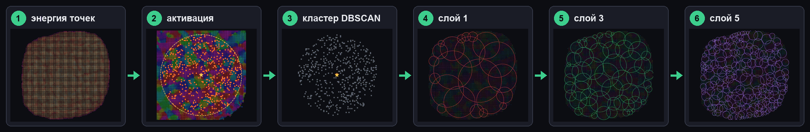

**①** энергия точек Ê — насколько точка похожа на соседей (§5.7) · **②** активация вокруг случайного центра: похожие точки в радиусе r_a · **③** кластер DBSCAN, связный с центром (§6.4.1); радиус — по наибольшему заполнению (§6.4.3) · **④–⑥** слои 1, 3, 5: порог сходства растёт — круги мельчают.

- **Детекторы** (§6.4, §7.1.10): 5 слоёв, у каждого свой порог λ_d — равные шаги между квантилями попарных сходств карты (§7.1.7). Центр детектора с энергией не ниже μ_e = 0.12, центры не попадают в поля друг друга (§6.4.5).
- На 60 000 картинках (прогон 1569) детекторов на уровнях 0–4: **415 / 1 080 / 1 217 / 1 316 / 2 015**; на уровне 4 по слоям 69 → 985, радиус 3.8 → 1.7 клетки.
- Общие биты кодов — строками по запросу с видеокарты (int8 × int8 → int32), без таблицы N × N в ОЗУ; блок счёта — не больше `WINDOW_CELLS` = 8 млн пар.

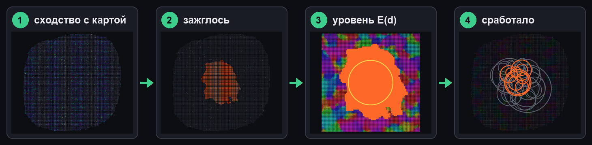

**①** сходство кода окна со всеми точками карты · **②** зажглись точки со сходством ≥ λ_a и энергией активации ≥ 0.5 · **③** уровень детектора E(d) — энергия зажжённых точек его круга, делённая на его собственную · **④** сработали детекторы с E(d) ≥ 0.5; оранжевые — σ сильнейших.

- **Активация** (§6.1): λ_a равен порогу нижнего слоя детекторов (§7.1.11). Самая похожая точка зажигается всегда (доработка): иначе стимул без единой зажжённой точки не оставил бы следа.
- **Энергия активации** (`ACTIVATION_LOCAL_ENERGY_THRESHOLD` = 0.5; расширение, автор 2026-11-17): формула §5.7, где вместо сходства с соседями — их активация. Одиночные зажжённые точки на отшибе молчат, пятна остаются.
- **Срабатывание** (§6.5): `E(d) = Σ a·e / e_d`, порог μ_d = 0.5.
- **Нормировка** (`LADDER_LEVEL_NORMALISATION = "train_max"`, доработка): E(d) делится на наибольший уровень детектора по обучающим окнам и обрезается в [0, 1] (§7.1.12, §9.3 требуют лишь значений в [0, 1]).
- Срабатывания не кешируются (выход огромный): на 60 000 картинках уровень 3 — 165 млн троек «окно — детектор — уровень»; они считаются кусками int32 и сразу склеиваются.

[↑ к содержанию](#содержание)

## Этап 5. Эмбеддинги первого уровня

Эмбеддинг — код того, какие детекторы сработали на набор стимулов, предъявленных вместе (§6.5). В цикле набор — содержимое одного окна, а эмбеддинг — **деталь**.

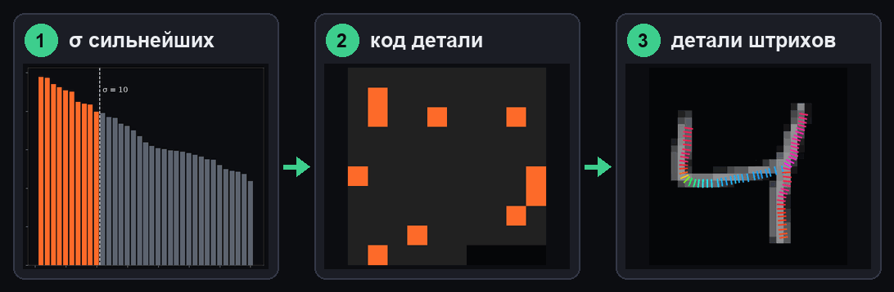

**①** σ сильнейших сработавших детекторов (на кадре σ = 10; в опоре 13) · **②** код детали — по случайному биту от каждого, плотность 0.1 · **③** у каждого окна своя деталь на своём месте.

- **Код** — по одному случайному биту от σ сильнейших (§6.5, §7.1.12; `ACTIVATION_SATURATION_LIMIT` — 13 в опоре, 10 в `config.toml`). Длина — под плотность `LADDER_TARGET_DENSITY` = 0.1 (§6.6), **только по окнам обучающих картинок**.
- **Деталь** несёт «что» и «насколько» (П.1): код, место — центр окна, сила — уровень сильнейшего сработавшего детектора. Деталь уровня 0 — сам штрих с выученным кодом.
- **Пустая деталь** — окно, на котором не сработал ни один детектор. Она не голосует и не входит в базу распознавания.
- В команде `layout` набор — все штрихи картинки, эмбеддинг описывает картинку целиком.
- Мерки статьи по уровням (`energy_mean` §5.8, `code_resolution` §5.13.2.5, `detail_bits`, `detail_empty` §6.5, `detail_full` §7.1.8.1) пишет событие `ladder.level` и отчёт `CycleLevel`.

[↑ к содержанию](#содержание)

## Этап 6. Цикл: уровни выше первого

Этапы 2–5 — один проход: код → раскладка → детекторы → эмбеддинг. Статья говорит его повторять: коды детекторов «can be combined, transformed, and laid out at the next level of the hierarchy» (§6.2); «by combining the resulting codes and repeating the process layer by layer, we can obtain complex descriptions» (§6.6). Как собирать коды одного уровня в стимулы следующего, описывает продолжение.

[↑ к содержанию](#содержание)

### Принципы

1. **Один проход на каждом уровне.** Коды раскладываются, над раскладкой строятся детекторы, картинки подаются снова, сработавшие детекторы дают эмбеддинги — коды следующего уровня (§6.2, §6.6).
2. **Точка — «что» и «насколько».** Каждая точка уровня несёт код детали и уровень активации (П.1).
3. **Окно — миниколонка, память — общая.** Картинку смотрят множеством окон — «замочных скважин»; каждое сверяет увиденное с памятью уровня, одной на все окна (П.2, П.3).
4. **Признак привязан к месту.** Круг места добавляет свои биты места и вносит код признака под своей маской (П.4, П.5).
5. **Один признак в разных местах — разные вклады** (П.6).
6. **В деталь входит немного — пять–семь понятий**; код работает как хеш: мелочи начертания теряются (П.7).
7. **Окно растёт:** от штрихов — к частям цифры, от частей — к цифре (П.3).
8. **Место на картинке в код не входит:** признак записан относительно своего окна (§7.1.4.1, П.9).
9. **Число уровней — пока окно не увидит объект целиком;** память всех уровней остаётся, поиск идёт снизу вверх (П.7, §8.2).

[↑ к содержанию](#содержание)

### Как это сделано

Цикл — лестница `MnistLadderRunner` (`system/damp/cycle/ladder.py`): уровень 0 (`StrokeLevel`), затем проход `CycleStep` (`system/damp/cycle/step.py`) на уровнях 1–4. Те же части — кубики `damp_api` ([фреймворк](#фреймворк-damp_api)).

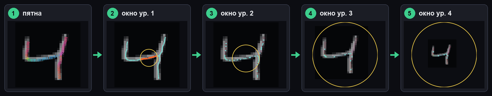

**①** пятна: из похожих соседних деталей остаётся сильнейшая · **②** окно уровня 1 — кластер похожих соседей вокруг штриха · **③** уровень 2 · **④** уровень 3 — почти вся цифра · **⑤** уровень 4 — вся цифра (в опоре — одно окно на картинку).

| Уровень | Окно (`keyhole`, П.2) | Место в коде | Настройки |
|---|---|---|---|
| 0 | на каждом штрихе, в окне он один; центр — центр цифры, радиус — до самого дальнего штриха | от центра цифры | `LADDER_LEVEL0`, `LADDER_LEVEL0_PLACE = "digit"` |
| 1 | на каждом штрихе: круг, где ≥ 10 похожих соседей и заполнение наибольшее (§6.4.1–§6.4.3) | в долях радиуса окна | `LADDER_CLUSTER_MIN_POINTS` = [10, 3, 14], `LADDER_KEYHOLE_RADIUS_SHARE` = [1.15, 0.5, 2.0] |
| 2 | на каждой детали: ≥ 3 соседей, радиус ≥ 0.5 меры уровня | в долях радиуса окна | те же списки |
| 3 | на каждой детали: ≥ 14 соседей, радиус ≥ 2.0 меры уровня | с поправкой на наклон почерка | `LADDER_PLACE_SHEAR_FROM` = 3 |
| 4 | **одно окно на картинку**: центр — середина её деталей, радиус — до самой дальней | **в масштабе цифры**: смещение в долях 2 · √(var x + var y) деталей картинки | `LADDER_KEYHOLE_ONE_FROM` = 4, `LADDER_PLACE_SCALE_FROM` = 4 |
| **Итого** | окно растёт от штриха до всей цифры | место частей записано одинаково у разных почерков | значения — опоры стенда |

- **Мера уровня** — что видит одна деталь уровня; окно на карте равно полю своей детали. Рост поля за уровень — как от V1 к V2 и V4 (×2–2.5; Freeman & Simoncelli 2011).
- **Окно на всю картинку** (`LADDER_KEYHOLE_WHOLE_PICTURE = true`, доработка): если на картинке деталей меньше, чем нужно кластеру, окно каждой детали — на всю картинку; иначе картинка теряла бы верх.
- **Пятна** (П.2, П.3; `LADDER_INHIBITION_RADIUS` = 1.0, `LADDER_INHIBITION_SIMILARITY` = 0.8): из соседних деталей с похожим кодом остаётся сильнейшая, непохожие остаются все. В коре окружение подавляет ответ сильнее, когда в нём тот же признак (Knierim & van Essen 1992).
- **Наклон почерка** (с уровня 3): смещение элемента сдвигается на наклон картинки, `dx′ = dx − s·dy`, |s| ≤ 0.5.
- **Остановка.** Уровней над уровнем 0 — `LADDER_CLUSTER_LEVELS` (4 в опоре); правило «последний — первый, чьё окно видит цифру целиком» (`LADDER_TOP_COVERAGE`) выключено значением 1.01. Окно уровня 3 видит 97 % цифры, уровня 4 — всю.

[↑ к содержанию](#содержание)

### Уровень 0: первичная раскладка штрихов

Слова автора (2026-11-18): «все же начинается с первичной раскладки». Уровень 0 (`StrokeLevel`, `system/damp/cycle/primary.py`) — тот же проход, что у уровней:

1. **Окно** — на каждом штрихе, в окне он один; центр — центр цифры (доработка: центра цифры нет в источниках).
2. **Код окна** — место штриха от центра цифры (39 бит на круг) и код наклона под маской каждого сработавшего круга: 15 056 бит.
3. **Память** — карта штрихов всех обучающих картинок; сливаются только совпадающие коды (`LADDER_PRIMARY_MERGE_SIMILARITY` = 1.0).
4. **Детекторы** и срабатывания — как на уровнях.
5. **Код штриха** — его σ сильнейших детекторов: с выученным кодом, а не с готовым кодом наклона, штрих идёт в окна уровня 1.

Сдвиг цифры коды штрихов не меняет. Замер 0.13.0 (500 цифр, 1 000 t10k): с уровнем 0 память 86.9 → 91.9 %, читатель 92.1 → 93.1 %.

[↑ к содержанию](#содержание)

### Шаг уровня

| № | Что делается | Этап | Кубик `damp_api` | Чем в системе | Основание |
|---|---|---|---|---|---|
| 1 | на элементах ставятся окна (на уровне 0 — окно на штрихе вокруг центра цифры) | 6 | `cycle.keyholes(elements)` (уровень 0 — `cycle.level0`) | `KeyholeBuilder`, `PlaneFieldBuilder`; `StrokeLevel` | П.2; §6.4.1–§6.4.3 |
| 2 | содержимое окна — один код «что и где» | 2 | `coding.keyholes(keyholes)` | `KeyholeCoder`, `PositionBindingEncoder` | П.4–П.7 |
| 3 | коды окон обучающих картинок раскладываются — память уровня | 3 | `layout.memory(codes)` | `MemoryMap`: `LeaderDictionary`, `Layout` | §5; П.2 |
| 4 | над картой строится иерархия детекторов | 4 | `detectors.build(memory)` | `DetectorHierarchyBuilder` | §6.4, §7.1.10 |
| 5 | картинки подаются снова: окно зажигает точки, срабатывают детекторы | 4 | `detectors.fire(codes)` | `HierarchyDetection` | §6.1, §6.5 |
| 6 | сильнейшие детекторы дают код детали; деталь встаёт в центр окна | 5 | `embeddings.details(firing)` | `DetailCoder` | §6.5, §6.6, §7.1.12; П.1 |
| **Итого** | 6 шагов на уровень | | | | |

Один и тот же шаг на всех пяти уровнях:

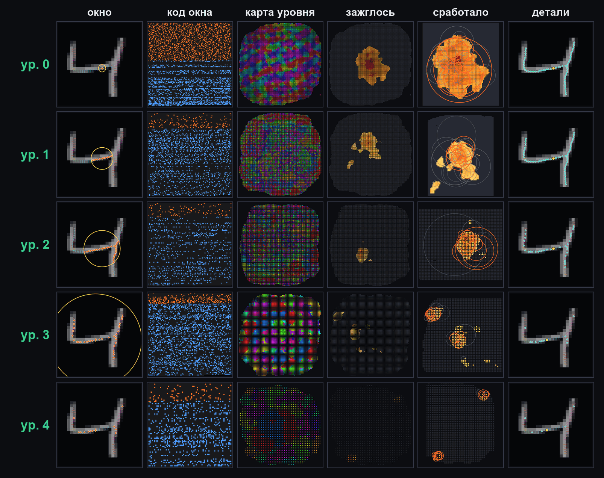

*Строки — уровни 0–4, столбцы — части шага на одной картинке: окно (жёлтый круг; оранжевые — элементы в окне), код окна (оранжевое — место, синее — содержание), карта уровня, зажжённые точки, сработавшие детекторы (оранжевые — σ сильнейших), детали картинки (жёлтая — деталь этого окна). Чем выше уровень, тем шире окно и тем меньше пятно, которое оно зажигает.*

[↑ к содержанию](#содержание)

### Что получается на 60 000 картинках

Прогон стенда 1569: весь MNIST train на всех уровнях, предел карты 41 000 точек, зерно 10.

| Уровень | Что в окне | Окон на картинку | Элементов в окне | Окно видит цифры | Поле окна, клеток | Точек карты | Детекторов | Картинок на точку карты | Честная сходимость |
|---|---|---|---|---|---|---|---|---|---|
| 0 | штрих | 62.8 | 1 | 1.6 % | 9.3 (вся цифра) | 41 000 | 415 | — | 0.29 |
| 1 | штрихи | 58.8 | 11.2 | 20 % | 3.2 | 41 000 | 1 080 | 77 | 0.38 |
| 2 | детали ур. 1 | 39.3 | 5.0 | 34 % | 4.8 | 41 000 | 1 217 | 57 | 0.35 |
| 3 | детали ур. 2 | 30.7 | 29.8 | 97 % | 15.0 | 41 000 | 1 316 | 32 | 0.71 |
| 4 | детали ур. 3 | **1.0** | 23.2 | **100 %** | 26.4 | 41 000 | 2 015 | 1.5 | **0.91** |
| **Итого** | от штриха к цифре | пятна сужают 63 → 31 окна | | цифра целиком — на уровне 4 | | все карты у предела | | наверху окна разных картинок почти не сливаются | классы собираются на уровнях 3–4 |

*Честная сходимость — доля соседних точек карты одной цифры среди пар с разных картинок (случайная карта ≈ 0.10). «Картинок на точку» — со скольких картинок окна слились в одну точку (`MergePurity`).*

[↑ к содержанию](#содержание)

### Подбор: стенд, опора, ступени картинок

Подбор идёт на **стенде** (`tools/tuning/`, [docs/HARNESS.md](docs/HARNESS.md)): карточка на доске — правка настроек, прогонщик гоняет её парами зёрен и решает по М1u к **опоре** — среднему 12 зёрен с принятыми правками (`tools/tuning/stand/base.json`). Направление подбора — [docs/DIRECTION.md](docs/DIRECTION.md), [docs/CLUSTERS.md](docs/CLUSTERS.md); ход — [docs/TUNING.md](docs/TUNING.md), [docs/CONVERGENCE.md](docs/CONVERGENCE.md).

**Что подняло сходимость верха** (М1u, 12 зёрен):

| Шаг | Картинок | М1u | Что принято |
|---|---|---|---|
| опора v19 | 250 | 0.790 | — |
| v19.15 | 250 | 0.844 | гладкий старт верхней карты |
| v20.6 | 250 | 0.860 | одно окно на картинку и место в масштабе цифры наверху |
| v20.7 | 250 | 0.873 | перплексия гладкого старта 30 → 10 |
| v21.8 | 250 | 0.912 | 4 уровня над уровнем 0 (верх — уровень 4) |
| опора на 500 / 750 / 1 000 | 500 / 750 / 1 000 | 0.916 / 0.889 / **0.906** | те же настройки, больше картинок на всех уровнях |
| **Итого** | | 0.790 → 0.906 | перенос на другие картинки проверен: на наборах 1–3 правки ночи v19–v21 дали +0.058 ± 0.011 (~79 % роста стенда) |

**Ступени за 1 000** (слово автора: «иди за 1000 но плавно, попутно все проверяя»): опора на 1 000 + предел карты 41 000, зёрна 3 / 10, читатель и память — на первых 100 картинках t10k.

| Картинок | М1u, зерно 3 / 10 | Честная | Читатель | Память | Прогон, мин |
|---|---|---|---|---|---|
| 1 000 (опора, 12 зёрен) | 0.891 / 0.921 | 0.827 | 0.957 | 0.939 | 24.5 (без предела) |
| 2 000 | 0.928 / 0.882 | 0.840 | 0.995 | 0.970 | 20.8 |
| 5 000 | 0.921 / 0.908 | 0.874 | 0.975 | 0.965 | 28.1 |
| 12 000 | 0.934 / 0.923 | 0.891 | 0.980 | 0.965 | 46.3 |
| 20 000 | 0.896 / 0.939 | 0.900 | 0.990 | 0.960 | 63.7 |
| 30 000 | 0.934 / 0.910 | 0.906 | 0.985 | 0.980 | 67 |
| 40 000 | 0.933 / 0.922 | 0.910 | 0.992 | 0.962 | 71 |
| 50 000 | 0.930 / 0.906 | 0.904 | 0.995 | 0.955 | ≈ 110 |
| **60 000 — весь train** | **0.903 / 0.930** | **0.907** | 0.985 | 0.950 | 137 |
| **Итого** | к опоре на тех же зёрнах +0.011 ± 0.002 | растёт с картинками | | | +2.5 мин на 1 000 картинок до 8 000, дальше — коды окон и срабатывания |

Скачки М1u одного зерна (0.88 ↔ 0.93) — от двойки: раскладка верха то собирает её в одно пятно, то делит на два.

[↑ к содержанию](#содержание)

### Настройки

Все настройки — в `client/config.toml` (разделы «Цикл уровней», «Код окна»); у каждой тег `[КАНОН]`, `[РАСШИРЕНИЕ]` или `[НЕ КАНОН]`. **Опора стенда** — правки поверх файла (`tools/tuning/stand/base.json`); все числа этого README сняты с опорой.

| Настройка | `config.toml` | Опора | Смысл |
|---|---|---|---|
| `ACTIVATION_SATURATION_LIMIT` (σ) | 10 | **13** | сколько сильнейших детекторов идёт в код детали |
| `LADDER_CLUSTER_LEVELS` | 5 | **4** | уровней над уровнем 0 |
| `LADDER_KEYHOLE_ONE_FROM` | 0 | **4** | с этого уровня одно окно на картинку |
| `LADDER_PLACE_SCALE_FROM`, `_K` | 0, 2.0 | **4**, 2.0 | место в масштабе цифры |
| `LADDER_PLACE_SHEAR_FROM`, `_LIMIT` | 0, 0.5 | **3**, 0.5 | поправка места на наклон почерка |
| `LADDER_BINDING_PLACE_NARROWEST` | 16 | **[16, 16, 16, 16, 8]** | кругов по стороне в самом узком слое места, по уровням |
| `LADDER_LAYOUT_SMOOTH_START_FROM`, `_PERPLEXITY`, `_RADIUS` | 0, 30, 0.1 | **4**, **10**, 0.1 | гладкий старт верхней карты |
| `DASHBOARD_MAP_POINTS` | `"none"` | **41 000** на ступенях за 1 000 | предел точек карты в стенде |
| `MNIST_ANGLE_OVERLAP` | 0.85 | 0.85 | перекрытие детекторов угла |
| `LADDER_BINDING_ENUMERATE_FROM` | 4 | 4 | перечисляющий пулинг на верху |
| `LADDER_MERGE_SIMILARITY`, `LADDER_PRIMARY_MERGE_SIMILARITY` | 0.9, 1.0 | 0.9, 1.0 | слияние кодов окон к образцу |
| `LADDER_CLUSTER_MIN_POINTS` | [10, 3, 14] | то же | соседей в окне по уровням 1, 2, 3+ |
| `LADDER_KEYHOLE_RADIUS_SHARE` | [1.15, 0.5, 2.0] | то же | нижний предел радиуса окна в мерах уровня |
| `LADDER_BINDING_PLACE_CODE_LENGTH`, `_BITS` | [176, 1792, 1536, 1088], [39, 1] | то же | бит места по уровням; копий на круг |
| `LADDER_BINDING_LENGTH_MAX`, `_TARGET_DENSITY`, `_SATURATION` | 8192, 0.2, 0.25 | то же | содержание окна: предел длины, плотность, насыщение |
| `LADDER_TARGET_DENSITY` | 0.1 | то же | плотность кода детали |
| `ACTIVATION_LOCAL_ENERGY_THRESHOLD` | 0.5 | то же | энергия активации |
| `LADDER_INHIBITION_RADIUS`, `_SIMILARITY` | 1.0, 0.8 | то же | пятна |
| `LADDER_TOP_COVERAGE` | 1.01 | то же | остановка по охвату цифры выключена |
| **Итого** | | 8 правок опоры | дашборд и команда `ladder` читают `config.toml` — опору им дают `Damp(changes=…)` или копия конфига в `DAMP_CONFIG` |

[↑ к содержанию](#содержание)

### Файлы результата

Цикл пишет в `data/ladder-*` (стенд — в `data/tune/ladder-*`): карты уровней (`-level<N>-*.json|png`), карты с рисунками окон в ячейках (`-level<N>-keyholes-<count>.glyphs.png`), карту верхних деталей (`-classes-*`) и окна уровней на пятёрке-примере (`-fields-<count>.png`). Стенд добавляет строку прогона в `tools/tuning/stand/tune2_log.jsonl` и карты уровней одной картинкой — `data/maps/tune2-<номер>.png` (из таких сделана карта в начале README).

> ↺ **Конец цикла.** Детали уровня — элементы следующего: цикл возвращается к [этапу 2](#этап-2-первичное-кодирование), пока не пройден последний уровень; потом — [этап 7](#этап-7-распознавание).

[↑ к содержанию](#содержание)

## Этап 7. Распознавание

Как получать класс, статья не описывает: распознавание — мерка того, собрались ли классы. Новая картинка проходит тем же путём, что обучение, — уровень за уровнем.

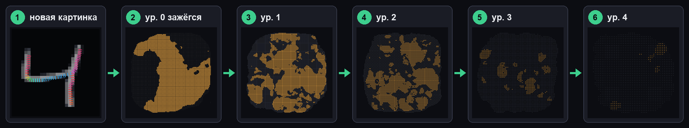

**①** новая картинка и её штрихи · **②–⑥** сколько каждой карты она зажигает на уровнях 0–4: внизу — широкие области (штрихи общие у всех цифр), наверху — несколько маленьких пятен своей цифры.

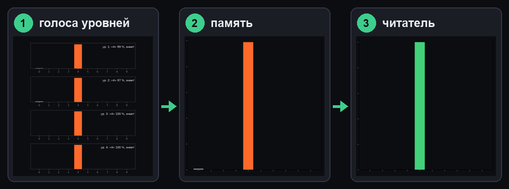

**①** голоса уровней 1–4: доля голосов за каждую цифру · **②** память: уровни согласны — «знаю целиком» · **③** читатель: линейный слой над уровнями активации.

[↑ к содержанию](#содержание)

### По эмбеддингам первого уровня

Без цикла: эмбеддинг всей картинки (команда `layout`) сравнивается с базой эмбеддингов обучающих цифр (`system/damp/decode/mnist_decoder.py`).

```powershell
python client/run.py layout --count 100 --activation-samples 100   # раскладка, детекторы, база эмбеддингов
python client/run.py evaluate --count 100 --split test --limit 100 # точность на выборке
python client/run.py predict --count 100 --image client/examples/digit.png
```

[↑ к содержанию](#содержание)

### По уровням цикла

| Мерка | Как считается |
|---|---|
| **Читатель** (§9.3) | эмбеддинг картинки — сильнейший уровень активации каждого детектора по её окнам на всех уровнях; класс читает один линейный слой с softmax (`LinearReader`); штраф L2 из `BENCH_LINEAR_DECAYS` |
| **Память** (§2.2.5, §7.1.13.3) | голоса кусочков: каждый голосует классами похожих обучающих; ответ — среднее долей голосов по уровням; уверенность — согласие уровней: «знаю целиком / по частям / не знаю» (`MemoryVotes`) |
| **М1, М1u** (вне статьи) | М1 цифры — доля её точек верхней карты в самом большом связном пятне этой цифры; М1u — среднее по 10 цифрам и по 3 раскладкам верха. Идеал — 1.0: каждый класс — одно целое пятно |
| Честная сходимость (вне статьи) | доля соседних точек карты одной цифры среди пар с **разных** картинок |
| Чистота слияния (вне статьи) | одной ли цифры картинки, чьи окна легли в одну точку карты (`MergePurity`, событие `ladder.merge`) |
| Отклик уровня, склейка, голосование деталей | класс самой похожей обучающей картинки по откликам одного уровня, уровней 1…k подряд, или голосами верхних деталей |
| **Итого** | главные — М1u (цель подбора), читатель и память (стражи) | |

Пустые детали не голосуют; картинка без голосов считается неверной, а не угаданной.

[↑ к содержанию](#содержание)

### Честная мерка: DAMP против kNN и CNN

Стенд `bench` (`HonestBench`, `system/damp/decode/bench.py`; вне статьи): те же картинки, эталоны kNN по пикселям и CNN считаются здесь же, настройки выбираются (`select`) не по тем картинкам, по которым считается итог (`report`); `test` — один раз в конце этапа. Номера — случайная выборка с зерном: MNIST train не перемешан по авторам (1-NN на блоках по 250 картинок — от 80.0 до 94.4 %).

```powershell
python client/run.py bench --count 100 --sets 5 --validation 100 --test 100
```

| Метод (стенд не гонялся с 0.10.0) | 100 обучающих (5 наборов) | 1 000 обучающих |
|---|---|---|
| DAMP 0.10.0 | 81.1 ± 1.7 % | 91.3 % |
| kNN по пикселям | 72.5 ± 1.3 % | 89.5 % |
| CNN со сдвигами ±2 px (ориентир) | ≈ 91 % | 97.4 / 98.8 % (без / со сдвигами) |
| **Итого** | DAMP +8.6 п.п. к kNN, до CNN ≈ −10 п.п. | сегодня на 60 000 — читатель 98.0 % на всём t10k |

[↑ к содержанию](#содержание)

### Результаты

**Весь MNIST train на всех уровнях** (прогоны 1568 / 1569; читатель и память — на всех 10 000 картинках t10k):

| Мерка | Зерно 3 | Зерно 10 | Среднее |
|---|---|---|---|
| М1u | 0.903 | 0.930 | 0.917 |
| честная сходимость верха | 0.908 | 0.906 | 0.907 |
| читатель (ДИ 95 %) | 0.979 (0.976–0.982) | 0.980 (0.977–0.983) | **0.980** |
| память | 0.962 | 0.957 | 0.959 |
| **Итого** | | | М1u к опоре на 1 000 картинках на тех же зёрнах: +0.011 ± 0.002 |

**М1 по цифрам** (среднее 3 раскладок верха):

| Прогон | 0 | 1 | 2 | 3 | 4 | 5 | 6 | 7 | 8 | 9 |
|---|---|---|---|---|---|---|---|---|---|---|
| 1569, зерно 10 | 0.98 | 0.95 | 0.92 | 0.91 | 0.93 | 0.88 | 0.98 | 0.94 | 0.91 | 0.92 |
| 1568, зерно 3 | 0.98 | 0.93 | **0.63** | 0.91 | 0.94 | 0.89 | 0.98 | 0.95 | 0.92 | 0.90 |
| **Итого** | лучше всех 0 и 6 | | двойка — от зерна | | | слабее всех 5 | | | | |

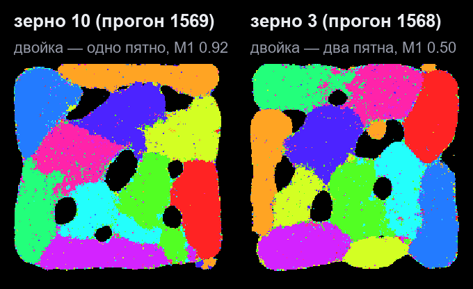

*Уровень 4 двух зёрен на тех же 60 000 картинках: двойка (жёлто-зелёная) одним пятном у зерна 10 и двумя у зерна 3. На 50 000 картинках было наоборот: распад двойки — свойство раскладки, не кода.*

**Память по согласию уровней** (1568, весь t10k): все уровни согласны — у 82.6 % картинок (верно 99.2 %), согласны верхние — 12.8 % (память 92.5 %), уровни расходятся — 4.6 % (память 53.2 %, читатель 81.0 %).

[↑ к содержанию](#содержание)

### Что проверено и отвергнуто

Не предлагать снова без нового довода. Числа — как в замере своего времени.

<details>
<summary>Механизм (0.10–0.13, 100–500 цифр): 15 вариантов</summary>

| Вариант | Замер | Что вышло |
|---|---|---|
| Уровень 0 по общему подходу: точки штриха, место от центра штриха (`LADDER_LEVEL0_PLACE = "stroke"`; прогоны 445, 446) | 200 цифр: 0.535 / 79.1 / 71.7 % против 0.640 / 89.8 / 81.9 % (сходимость / читатель / память) | коды штрихов почти все разные; автор вернул место от центра цифры |
| Цикл без уровня 0 с маленьким окном внизу (прогон 447) | 0.464 / 80.7 / 66.1 % | хуже всех |
| Середины пар встречных точек края; гребень яркости | сходимость верха 0.358 против 0.429 | стыки и перекрестия вырезаются; у жирной линии середина теряется |
| Новые уровни после окна «вся цифра» — «пока сужается» | читатель 73.0 % против 82.5 % | пространство схлопывается до 4 точек |
| Память картинок: детали картинки — одна | 78.0 / 75.5 % против 84.0 / 77.0 % | автор: «память картинок не нужна» |
| Расписание размеров окон по доле цифры | сходимость 0.25–0.51 против 0.567 | классы собираются только там, где окно видит всю цифру |
| Строже срабатывание: λ_a квантилем 0.95 / 0.98, μ_d = 0.8, порог по слоям | 0.430 / 0.340 / 0.440 / 0.428 против 0.548 | коды общие, но цифра теряется |
| Код детали от широких слоёв детекторов (§3.3.2) | 0.495 против 0.548 | коды общие, но не по цифре |
| П.7 «в лоб»: окно на 7 понятий, 7 сильнейших, 5–7 областей | 33.0 %, 42.6 %, −13 п.п. | урезанное окно теряет цифру |
| Код окна короче простым укорочением (§5.1.2) | −9 п.п. | срезаются биты |
| Круг места объединяет всё (`"max"`); маска как буквальный XOR | 49.8 %, 10.0 % | код переполняется; биты признака на местах |
| Торможение любых соседних деталей | 33.8 %, 26.0 % | выбрасывает и разные понятия; приняты пятна похожих |
| Окно одного размера на всех уровнях; окно уровня 1 из трёх штрихов | 34.4 %, 48.2 % | узнавание падает с уровнем |
| Три масштаба кругов места (§4.5) | −4.3 п.п. | код длиннее и дробнее |
| ε-окрестность вместо 1-NN (§2.2.5); класс по господству в детекторах (§8.2) | −9.5 п.п.; 31.7 % | голосуют общие штрихи |
| **Итого** | 15 вариантов | приняты: место от центра цифры, гребень расстояния, пятна, линейный читатель |

</details>

<details open>
<summary>Подбор верха (планы v20–v29, стенд 250–1 000 картинок, ΔМ1u к опоре)</summary>

| Вариант | ΔМ1u | Что вышло |
|---|---|---|
| σ 13 → 10; σ 16 | −0.057; +0.006 (t 1.4) | σ 13 — у оптимума с обеих сторон |
| плотность кода детали 0.07 | −0.026 | «обострять» код детали вредно |
| шкала места K 1.5 / K 3; аффинная нормировка места | −0.011 / +0.004; минус | K 2 у оптимума; растяжение места вредит |
| 16 кругов места на верху; место верха 2 176 бит; длина содержания 16 384 | −0.003…−0.016 | огрубление кода верха — нужный допуск |
| 3 уровня над уровнем 0 вместо 4 | −0.013 | 4 уровня приняты (v21.8) |
| допуск круга места, торможение на входе верха, перечисление с уровня 5, 2 бита места, слияние 0.875 / 0.925, наклон 0.75 | ≈ 0 или минус | дешёвые оси исчерпаны: v22–v26 — 0 из 22 |
| лучшая из 3 раскладок верха по соседству; доводка с радиуса 0.05 | +0.004; +0.004 | на стенде верха +0.017 / +0.007, на полном — в пределах шума; не взяты |
| добавочные картинки только верху (верх 1 000–4 000 точек при нижних на 500) | М1u до 0.936 | против принципа автора «верх не больше низа»; взят путь «больше картинок всем уровням» |
| больше картинок одному промежуточному уровню; нижние уровни на 250 при верхе 4 000 | −0.020; −0.025 | картинок нужно всем уровням сразу |
| **Итого** | | к сходимости вели механизм верха (одно окно, масштаб цифры, гладкий старт) и число картинок, а не тонкая настройка |

</details>

[↑ к содержанию](#содержание)

### Известные ограничения

- **Двойка рвётся на два пятна** у части раскладок (на 1 000 картинках — у 6 зёрен из 12, на 60 000 — у зерна 3). В пространстве кодов верха классы связны: это раскладка, не код.
- **Предел карты 41 000 точек.** На ступенях за 1 000 в карту идёт выборка окон. Выше упирается память видеокарты: таблица общих бит int16 целиком — до ~46 тыс. точек, половиной — до ~65 тыс.; гладкий старт без N × N — до 70 000.
- **ОЗУ на 60 000 — у края запаса:** пик процесса 11.0 ГиБ на 24 ГБ машины (подбор длины кода деталей уровня 3); свободной меньше 6 ГБ около 40 с.
- **Опора стенда — 1 000 картинок, 12 зёрен.** Ступени за 1 000 сняты на 2–4 зёрнах; опора на большой ступени — решение автора. Читатель стенда — первые 100 картинок t10k (лёгкие); на всём t10k замерены только ступени 40 000 (одно зерно, первые 1 000) и 60 000.
- **П.7 не выполнен:** в окне 11 / 5 / 30 / 23 элемента на уровнях 1–4 вместо 5–7 понятий.
- **Центр окна уровня 0 — центр цифры** — доработка; в источниках его нет.
- **Кодер команды `layout`** кодирует угол на 360°, а штрихи лежат в 0…180°: половина его детекторов угла молчит.
- **Рисунки команды `figures`** (`docs/stage*.png`, `docs/rerun-*.png`, `docs/dashboard.png`) — версии 0.13.1: 100 цифр, уровни 0–3, без опоры. Кадры полос README — на четвёрке, а не на пятёрке-примере.
- **Тесты:** полный набор не прогонялся; `tests/test_protocol.py` устарел (14 проверок ждут штрихов из 4 полей, их 5).
- **Стенд `bench` не гонялся с 0.10.0.**

[↑ к содержанию](#содержание)

## Скорость и память

Всё ускорение — **без изменения результата**: каждая правка сверена «до бита» прогоном стенда на 2 000 картинках (54 мерки и таблица по уровням) и тестом «быстрый путь = прямой». Подробно — [docs/SPEEDUP.md](docs/SPEEDUP.md).

| Картинок | Прогон стенда | Пик ОЗУ процесса | Что держит время |
|---|---|---|---|
| 1 000 (предел карты) | 15.8 мин | — | раскладка и детекторы |
| 5 000 | 28.1 мин | 6.7 ГБ | + коды окон |
| 20 000 | 63.7 мин | 9.1 ГБ | + срабатывания, верх |
| 40 000 | 71 мин | 10.2 ГиБ | срабатывания — треть обучения |
| **60 000** | **137 мин** | **11.0 ГиБ** | обучение ~2 ч, мерки ~15 мин |
| **Итого** | | на 60 000 видеопамять — до 6 ГиБ из 8, видеокарта до 87 °C | раскладка и детекторы уровней 0–3 с пределом карты не растут |

Что сделало 60 000 возможным (0.13.4–0.13.7):

- **Видеокарта вместо процессора:** раскраска кодов окон (×2.2), мерка слияния на int8 (×3), отбор образцов на int8, срабатывания на int8.
- **Память без копий:** детекторы без таблицы N × N в ОЗУ; отбор образцов по номерам и хешу; срабатывания и отклики кусками; коды окон уровня — во временном файле (`DAMP_SPILL_BYTES`, `DAMP_SPILL_DIR`); читатель — одна копия float64.
- **Видеопамять между шагами** возвращается после отбора образцов и детекторов (`CycleStep._clear_device_cache`): пик 7.9 → 5.4 ГБ.
- **Гладкий старт больших карт** без матриц N × N (до 70 000 точек), повтор до бита.

[↑ к содержанию](#содержание)

## Запуск

Требования: Python 3.11+ (у автора 3.13), NumPy, SciPy, Pillow, PyTorch с CUDA, Torchvision, numba, Rerun SDK, matplotlib. MNIST при первом запуске скачивается в `data/MNIST`. Машина замеров — RTX 2060 SUPER 8 ГБ, Core i5-10400, 24 ГБ ОЗУ.

| Команда | Что делает | Ключи |
|---|---|---|
| `python client/run.py ladder` | цикл уровней и распознавание (этапы 1–7); готовые шаги — из [кеша](#кеш) | `--count`, `--limit`, `--split`, `--verify-cache` |
| `python client/run.py dashboard` | [живой дашборд](#живой-дашборд), http://127.0.0.1:8765/; `--save` / `--load` — [снимок без обучения](#снимок-дашборд-без-обучения) | `--count`, `--map-points`, `--port`, `--no-browser`, `--snapshot ФАЙЛ`, `--save ПАПКА`, `--load ПАПКА`, `--workers` |
| `python client/run.py bench` | честное сравнение DAMP, kNN и CNN | `--count`, `--sets`, `--validation`, `--test`, `--map-points`, `--methods`, `--augment` |
| `python client/run.py figures` | рисунки команды в `docs/`, снимок дашборда; `--rerun` — вкладки Rerun | `--rerun` |
| `python client/run.py layout` | один проход без цикла: раскладка, детекторы, база эмбеддингов | `--count`, `--label`, `--activation-samples`, `--rebuild`, `--layout-only` |
| `python client/run.py evaluate`, `predict` | точность и ответ по эмбеддингам без цикла | `--count`, `--limit`, `--split`, `--image`, `--dataset`, `--temperature`, `--calibrate` |
| `python client/run.py pinwheel`, `detectors` | тест пинвила; картинка детекторов кодера `layout` | `--angle`, `--x`, `--y`, `--output` |
| `python client/run.py sketch 7`, `contour` | цифра из линий её штрихов | `--seed`, `--split`, `--upscale` |
| `python client/run.py cache` | кеш шагов: записи и место | `--clear [ШАГ]` |
| `python client/run.py docs` | HTML-справка по `damp_api` в `docs/api/` | `--open`, `--serve` |
| **Итого** | 13 команд поверх `damp_api` | |

Все настройки — в `client/config.toml`; другой файл — переменная `DAMP_CONFIG`.

[↑ к содержанию](#содержание)

### Стенд подбора

Прогон стенда — обученный цикл с правками поверх `config.toml` и мерки всех уровней (`tools/tuning/stand/tune_cycle.py`). Обычно его запускает прогонщик доски (`pwsh tools/start.ps1`, [docs/HARNESS.md](docs/HARNESS.md)); из кода — так же, как стенд:

```python
import json, sys; sys.path.insert(0, "client")
from damp_api import Damp

base = json.load(open("tools/tuning/stand/base.json", encoding="utf-8-sig"))   # опора
damp = Damp(changes={**base, "DASHBOARD_MAP_POINTS": 41000, "ENCODER_RANDOM_SEED": 10})
ladder = damp.cycle.trained(60000)        # весь MNIST train на всех уровнях, ~2 ч
maps = ladder.maps()                      # карты уровней 0–4: клетки, цифры, картинки точек
```

| Файл | Что в нём |
|---|---|
| `tools/tuning/stand/base.json` | опора: принятые правки |
| `tools/tuning/base_runs.json` | номера опорных прогонов по 12 зёрнам (сейчас — опора на 1 000: 1502–1513) |
| `tools/tuning/stand/tune2_log.jsonl` | строка на прогон: правки, мерки всех уровней, время |
| `tools/tuning/plan.md` | план подбора: строки — карточки доски |
| `tools/tuning/top/` | стенд верха: раскладка верхней карты на кодах из кеша за секунды |
| **Итого** | опора, её прогоны, журнал, план, стенд верха |

[↑ к содержанию](#содержание)

### Фреймворк damp_api

Всё, что делают команды, — из кода, и сверх того: свой цикл из кубиков. У `Damp()` по полю на этап, в порядке и с названиями пайплайна. У каждого этапа есть **кубики** — один шаг этапа, его результат идёт в следующий вызов — и **готовые прогоны**.

Свой цикл из кубиков — тот же, что `cycle.run`, цифра в цифру (тест `CycleBlocksTest`):

```python
import sys; sys.path.insert(0, "client")
from damp_api import Damp

damp = Damp()                                        # настройки — client/config.toml
digits = damp.stimuli.digits(train=100, test=500)    # этап 1: цифры и их штрихи
elements = damp.coding.sticks(digits)                # этап 2: код наклона каждого штриха
if damp.settings["LADDER_LEVEL0"]:
    elements = damp.cycle.level0(elements)           # уровень 0: штрихи с выученными кодами
for _ in range(damp.settings["LADDER_CLUSTER_LEVELS"]):  # этап 6: уровень за уровнем
    keyholes = damp.cycle.keyholes(elements)         #   окна внимания — замочные скважины
    codes = damp.coding.keyholes(keyholes)           #   этап 2: код окна «что и где»
    memory = damp.layout.memory(codes)               #   этап 3: память уровня
    detectors = damp.detectors.build(memory)         #   этап 4: детекторы над картой
    firing = detectors.fire(codes)                   #   этап 4: что сработало на каждом окне
    elements = damp.embeddings.details(firing)       #   этап 5: детали — элементы следующего уровня
    print(keyholes.level, keyholes.radius, memory.points, detectors.count)
    if keyholes.picture_seen >= damp.settings["LADDER_TOP_COVERAGE"]:
        break                                        #   окно видит цифру целиком
damp.recognition.vote(elements)                      # этап 7: голосование верхних деталей
```

**Свои настройки** — поверх `client/config.toml`, без правки файла: `Damp(changes={"LADDER_CLUSTER_LEVELS": 4})` или `damp.with_settings(LADDER_CLUSTER_LEVELS=4)`. Действуют только в вызовах этого `Damp` и его частей; выводимые значения пересчитываются; неизвестное имя — `KeyError`.

Части цикла (`damp_api/parts.py`) держат системные объекты внутри и отдают простые значения: `memory.points`, `detectors.layers`, `firing.per_keyhole`, `keyholes.picture_seen`. Уровень не сложился — `LevelFailed`.

[↑ к содержанию](#содержание)

### Функции API по этапам

🧩 — кубик цикла: результат идёт в следующий вызов. ▶️ — готовый прогон или отдельное действие. Имя функции — ссылка на её строку в коде (ставит `python client/apidocs.py --links`, стережёт тест `ReadmeApiLinksTest`). У каждого этапа есть ещё `about` — номер, название, папка в коде и параграфы.

**Этап 1. Стимулы** — `damp.stimuli`

| | Функция | Что делает | Возвращает |
|---|---|---|---|
| 🧩 | [`digits(train, test=0, split="test", shifts=(), train_views=None)`](client/damp_api/stages.py#L99) | цифры MNIST со штрихами: обучающие и их сдвинутые виды (§7.1.4; `None` — `LADDER_TRAIN_VIEWS`), затем проверочные и их сдвиги | `Digits` |
| ▶️ | [`of_image(картинка)`](client/damp_api/stages.py#L126) | штрихи картинки 28×28 | список `Stimulus` |
| ▶️ | [`sketch(цифра)`](client/damp_api/stages.py#L145) | цифра из линий её штрихов в окне Rerun | — |
| ▶️ | [`contour_table()`](client/damp_api/stages.py#L180) | таблица: цифры 0…9 из штрихов | путь к картинке |

**Этап 2. Первичное кодирование ↻** — `damp.coding`

| | Функция | Что делает | Возвращает |
|---|---|---|---|
| 🧩 | [`sticks(digits)`](client/damp_api/stages.py#L242) | код наклона каждого штриха — элементы уровня 0 | `Elements` |
| 🧩 | [`keyholes(keyholes)`](client/damp_api/stages.py#L257) | код каждого окна: что в нём и где (П.4–П.7) | `KeyholeCodes` |
| ▶️ | [`encode(угол, x, y)`](client/damp_api/stages.py#L277) | код стимула первичным кодером команды `layout` | `Code` |
| ▶️ | [`detectors_picture()`](client/damp_api/stages.py#L293) | картинка детекторов кодера: кольца угла, полосы X и Y | путь к картинке |

**Этап 3. Раскладка** — `damp.layout`

| | Функция | Что делает | Возвращает |
|---|---|---|---|
| 🧩 | [`memory(codes, map_points=None)`](client/damp_api/stages.py#L336) | карта памяти уровня из кодов окон обучающих картинок (§5) | `Memory` |
| ▶️ | [`build(count)`](client/damp_api/stages.py#L357) | проход без цикла: раскладка всех штрихов `count` цифр | `LayoutSummary` |
| ▶️ | [`pinwheel()`](client/damp_api/stages.py#L372) | тест пинвила: 360 кодов угла на позицию | `PinwheelReport` |

**Этап 4. Детекторы и активации** — `damp.detectors`

| | Функция | Что делает | Возвращает |
|---|---|---|---|
| 🧩 | [`build(memory)`](client/damp_api/stages.py#L398) | детекторы над картой по слоям порогов (§6.4) | `MapDetectors` |
| 🧩 | [`detectors.fire(codes)`](client/damp_api/parts.py#L400) | какие детекторы сработали на каждом окне (§6.5) | `Firing` |

**Этап 5. Эмбеддинги** — `damp.embeddings`

| | Функция | Что делает | Возвращает |
|---|---|---|---|
| 🧩 | [`details(firing)`](client/damp_api/stages.py#L441) | код детали каждого окна по сработавшим детекторам; детали — элементы следующего уровня | `Elements` |
| ▶️ | [`build(count)`](client/damp_api/stages.py#L460) | проход без цикла: раскладка, детекторы и база эмбеддингов | `LayoutSummary` |

**Этап 6. Цикл ↺** — `damp.cycle`

| | Функция | Что делает | Возвращает |
|---|---|---|---|
| 🧩 | [`level0(elements, map_points=None)`](client/damp_api/stages.py#L503) | уровень 0 — первичная раскладка штрихов: окно на штрихе, память, детекторы; штрихи с выученными кодами (`LADDER_LEVEL0`) | `Elements` |
| 🧩 | [`keyholes(elements)`](client/damp_api/stages.py#L539) | окна внимания следующего уровня: окно на каждом элементе, растёт от уровня к уровню (П.2, П.3) | `Keyholes` |
| 🧩 | [`step(elements)`](client/damp_api/stages.py#L568) | весь проход уровня разом: окна → коды → память → детекторы → срабатывания → детали | `Level` |
| 🧩 | [`covers(level)`](client/damp_api/stages.py#L593) | окно уровня уже видит цифру целиком — цикл окончен | `True` / `False` |
| 🧩 | [`trained(train=None, map_points=None, decay=None)`](client/damp_api/stages.py#L605) | обученный цикл и линейный читатель: по ним идёт любая новая картинка — путь тот же, что у картинки прогона, цифра в цифру ([дашборд](#живой-дашборд)) | `TrainedLadder` |
| 🧩 | [`load(path, check=None)`](client/damp_api/stages.py#L635) | обученный цикл из снимка (`TrainedLadder.save`) без обучения, с настройками снимка и сверкой ответов на картинках t10k | `TrainedLadder` |
| ▶️ | [`run(train, test)`](client/damp_api/stages.py#L669) | весь цикл с мерками уровней (команда `ladder`) | `CycleReport` |

**Этап 7. Распознавание** — `damp.recognition`

| | Функция | Что делает | Возвращает |
|---|---|---|---|
| 🧩 | [`by_response(firing)`](client/damp_api/stages.py#L779) | ответ по отклику уровня: какие детекторы сработали на окнах картинки | доля верных `{k: …}` |
| 🧩 | [`vote(details)`](client/damp_api/stages.py#L806) | ответ голосованием деталей: каждая голосует классами похожих обучающих | доля верных `{k: …}` |
| 🧩 | [`linear(firings, decays=None)`](client/damp_api/stages.py#L727) | линейный читатель (§9.3): один слой softmax над самыми сильными уровнями активации детекторов уровней 1…k | доля верных `{λ: …}` |
| ▶️ | [`evaluate(count)`](client/damp_api/stages.py#L924) | проход без цикла: точность на проверочных | `Evaluation` |
| ▶️ | [`predict(файл, count)`](client/damp_api/stages.py#L945) | проход без цикла: цифра на картинке | `Prediction` |
| ▶️ | [`predict_dataset(count)`](client/damp_api/stages.py#L964), [`calibrate(count)`](client/damp_api/stages.py#L985) | точность с журналом ответов; подбор температуры softmax | `Evaluation`; (температура, точность) |
| ▶️ | [`bench(train, sets, validation, test, map_points, methods, augment)`](client/damp_api/stages.py#L828) | честное сравнение DAMP, kNN и CNN: select/report/test, интервалы по наборам (команда `bench`) | `BenchReport` |

**Рисунки** — `damp.figures`: [`readme()`](client/damp_api/stages.py#L1013) — все рисунки README, [`structure()`](client/damp_api/stages.py#L1023) — только схема устройства проекта.

**Кеш шагов** — `damp.cache`: `summary()` — записи и место по шагам, `clear(шаг)` — очистить шаг или весь кеш, `size()` — байт на диске.

**Сам `Damp`**: [`Damp(config=None, *, changes=None)`](client/damp_api/damp.py#L99) — подключиться; [`with_settings(ИМЯ=значение)`](client/damp_api/damp.py#L138) — тот же `Damp` со своими настройками; [`settings["ИМЯ"]`](client/damp_api/damp.py#L35) — значение настройки; [`stages`](client/damp_api/damp.py#L161) — этапы по порядку; [`version`](client/damp_api/damp.py#L156) — версия; [`from_snapshot(папка)`](client/damp_api/damp.py#L118) — `Damp` с настройками счёта снимка.

**Что можно узнать у результатов кубиков**

| Часть | Что это | Главное |
|---|---|---|
| [`Digits`](client/damp_api/parts.py#L87) | цифры прогона | `pictures`, `train`, `test`, `groups`, `labels`, `sticks`; [`picture(i)`](client/damp_api/parts.py#L150) — картинка, цифра и её штрихи |
| [`Elements`](client/damp_api/parts.py#L169) | элементы уровня: штрихи или детали | `level`, `count`, `code_length`, `distinct_codes`, `ones`, `per_picture` |
| [`Keyholes`](client/damp_api/parts.py#L212) | окна внимания уровня | `level`, `count`, `radius`, `keyhole_radius` (средний радиус окна, клеток), `picture_seen`, `per_picture`, `elements_per_keyhole` |
| [`KeyholeCodes`](client/damp_api/parts.py#L265) | коды окон | `count`, `length`, `place_length`, `content_length`, `ones` |
| [`Memory`](client/damp_api/parts.py#L306) | карта памяти уровня | `points`, `width`, `height`, `same_label`, `merge` (чистота слияния); [`release()`](client/damp_api/parts.py#L351) — освободить видеокарту |
| [`MapDetectors`](client/damp_api/parts.py#L369) | детекторы над картой | `count`, `layers`, `activation_threshold`; [`fire(codes)`](client/damp_api/parts.py#L400) |
| [`Firing`](client/damp_api/parts.py#L419) | срабатывания | `keyholes`, `fired`, `per_keyhole`, `silent` |
| [`Level`](client/damp_api/parts.py#L458) | проход уровня целиком | `number`, `keyholes`, `codes`, `memory`, `detectors`, `firing`, `details` |
| [`TrainedLadder`](client/damp_api/parts.py#L485) | обученный цикл и читатель (дашборд) | `levels`, `train_pictures`, `decay`; [`see(картинка)`](client/damp_api/parts.py#L556) → `Sight`; [`maps()`](client/damp_api/parts.py#L620) → `LevelMap` по уровням; [`sticks()`](client/damp_api/parts.py#L691) → `TrainingSticks`; [`save(папка)`](client/damp_api/parts.py#L514) → `SnapshotReport`; `snapshot` — снимок, из которого загружен |
| **Итого** | 9 частей; все держат системные объекты внутри и отдают простые значения | |

**Что можно узнать у отчёта стенда** (`damp.recognition.bench`, `damp_api/reports.py`): `BenchReport` (весь отчёт: методы, уровни, наборы, путь к JSON, разрыв DAMP − CNN), `BenchMethod` (метод и аугментация), `BenchScore` (точность по наборам и интервал), `BenchRobustness` (устойчивость к сдвигу), `BenchLevel` (мерки уровня DAMP) — все простые значения.

[↑ к содержанию](#содержание)

### Документация API

Каждый класс, метод и свойство `damp_api` описаны в docstring'ах (формат Google: `Args`, `Returns`, `Raises`, `Example`; параграфы — `§6.5`, `П.5`). Из них [pdoc](https://pdoc.dev) собирает HTML со строкой поиска и ссылками на исходники. В справку входят только `damp_api` и его модули; системный слой и мост `_system.py` внутренние.

```powershell
python -m pip install pdoc            # один раз; то же — pip install -e .[docs]
python client/apidocs.py              # собрать HTML в docs/api/ (то же — python client/run.py docs)
python client/apidocs.py --open       # собрать и открыть в браузере
python client/apidocs.py --serve      # живой сервер на http://localhost:8080
python client/apidocs.py --links      # поставить ссылки README «Функции API по этапам» на строки кода
```

Смотреть: `docs/api/index.html`. Папка `docs/api/` создаётся сборкой и в git не хранится.

[↑ к содержанию](#содержание)

## Живой дашборд

Рисуем цифру кистью — и на одном экране видим, что с ней делает каждый уровень цикла: кусочки рисунка (окна, П.2), точки карты, которые они зажигают (§6.1), детекторы, в которые кусочки набиваются (§6.5), детали (П.1) и ответ читателя (§9.3).

```powershell
python client/run.py dashboard                 # DASHBOARD_TRAIN = 500 цифр, настройки config.toml
python client/run.py dashboard --count 2000    # больше цифр
```


*Снимок 0.13.1 (100 обучающих цифр, уровни 0…3). Пример — случайная пятёрка MNIST t10k; выбран кусочек уровня 2: ниже подсвечено, из чего он собран, выше — куда вошёл, внизу — его след по уровням.*

| Где | Что видно | Как трогать |
|---|---|---|
| Холст | кисть как штрих MNIST (2.48 px, размытие σ 0.55), рамка 20×20; рисунок ставится по центру масс | рисовать; «↶ штрих», «очистить», «пример: 5»; двигать — «✋», правой кнопкой, стрелками |
| Ответ | вероятности цифр 0…9 по читателю | — |
| Уровень | рисунок с кусочками (цвет — сила детали), числа уровня, карта: цвет точки — цифра, белые — совпадения с рисунком, круги — детекторы | навести — окно кусочка, щёлкнуть — выбрать; колесо — приблизить |
| След | по полю на уровень: выбранное, из чего собрано и куда вошло | колесо, двойной щелчок |
| **Итого** | холст, ответ, по три панели на уровень, след | |

Сервер (`client/dashboard/server.py`) обучает цикл кубиком `damp.cycle.trained()` — тот же цикл, что у прогона, поэтому у цифры MNIST путь тот же, цифра в цифру (`tests/test_trained_ladder.py`). Дашборд читает `config.toml`, а не опору стенда (опора — `python tools/tuning/dashboard_base.py [зерно] [картинок]` или `run <номер прогона>`); рисунки посреди штриха считают `DASHBOARD_WORKERS` = 2 рабочих процесса.

### Снимок: дашборд без обучения

Обученный цикл сохраняется в папку и запускается из неё без обучения — на своей машине или у коллеги.

```powershell
# у себя: обучить (готовые шаги — из кеша) и записать снимок
python client/run.py dashboard --count 500 --save data/dashboard/trained-500
python tools/tuning/dashboard_base.py run 1553 --save data/dashboard/trained-1553   # на настройках прогона стенда

# у себя или у коллеги: запуск из снимка, без обучения
python client/run.py dashboard --load data/dashboard/trained-1553
```

```text
trained-1553/
├── snapshot.json   # подпись, версия DAMP, коммит, все настройки счёта, ответы сверки (первые 100 картинок MNIST t10k)
├── graph.json      # граф объектов обученного цикла: уровни 0–4, карты, детекторы, читатель, голоса памяти
└── arrays.npz      # все массивы графа (без pickle)
```

- **Что нужно коллеге:** репозиторий на том же коммите, окружение проекта (PyTorch с CUDA, numpy, scipy, numba), папка снимка. MNIST скачается сам. Кеш и стенд не нужны.
- **Настройки** счёта берутся из снимка, из своего `config.toml` — только машина и страница (`DASHBOARD_*`, `LOG_*`, `CACHE_*`, `RERUN_*`, `FIGURE_*`, `README_FIGURES_*`, `BENCH_*`).
- **Сверка.** При записи цикл отвечает на первые 100 картинок t10k; при загрузке — ещё раз, ответы сравниваются до бита: класс, вероятности читателя, вердикт памяти. Разошлись — в выводе «ВНИМАНИЕ» и предупреждение `cycle.snapshot.check.warning` в журнале: другой коммит или версии библиотек.
- **Рабочие процессы** со снимком по умолчанию не поднимаются (`--workers 0`): каждая копия цикла держит свою видеопамять.
- **Запись** не меняет цикл: перед ней освобождается видеокарта, кеши строятся заново при следующем рисунке (тест `tests/test_snapshot.py`: исходный, записанный и загруженный цикл ведут картинки цифра в цифру).

| Снимок | Картинок | Размер | Запись | Загрузка со сверкой |
|---|---|---|---|---|
| проверочный, опора стенда | 100 | 53 МБ | 13 с | 15 с |
| `trained-1553` — прогон стенда 1553, самые чёткие кластеры верха | 20 000 | 584 МБ | 29 с | 45 с до готовой страницы, сверка 100 из 100 |
| **Итого** | | | | вместо часа обучения — меньше минуты; граф — JSON, массивы — npz, читаются только классы `damp` |

Из кода — `ladder.save(папка)` и `damp.cycle.load(папка)` ([функции API](#функции-api-по-этапам)); настройки снимка без загрузки цикла — `Damp.from_snapshot(папка)`.

[↑ к содержанию](#содержание)

## Рисунки README

| Рисунки | Откуда | Чем пересобрать |
|---|---|---|
| `docs/readme/*.png` — полосы этапов, сетка уровней, карты 60 000 | кадры схем `data/maps/atomic/panels/`, `data/maps/level-diagrams/panels/` (разбор 2026-11-21) и карты прогонов `data/maps/tune2-1568.png`, `tune2-1569.png` | `python tools/readme_strips.py` (только чтение картинок, без счёта) |
| кадры схем | `tools/tuning/atomic_diagram.py` (атомарная схема на четвёрке), `tools/tuning/level_diagram.py` (схема на каждый уровень) | обучение — из кеша стенда |
| `docs/stage*.png`, `docs/structure.png`, `docs/pipeline-overview.png`, `docs/rerun-*.png`, `docs/dashboard.png` | команда `figures` (0.13.1: 100 цифр, уровни 0–3) | `python client/run.py figures` (`--rerun` — вкладки Rerun) |
| `docs/layout-60000-*.angle.png` | команда `layout` на 60 000 цифр в двух режимах | `python client/run.py layout --count 60000 --layout-only --rebuild` |
| **Итого** | 16 полос + рисунки команды | папка `data/` в git не входит: полосы пересобираются там, где есть кадры |

[↑ к содержанию](#содержание)

## Кеш

Картинки всегда одни и те же, поэтому готовый шаг считается один раз. **Каждый шаг — запись сама по себе** (`system/damp/cache.py`):

- **ключ** — хеш содержимого входа шага, настроек, которые читает его код, текста этого кода (по AST, без комментариев) и окружения;
- шаг пересчитался, а результат тот же — следующие шаги всё равно из кеша («ранний обрыв»);
- **из кеша — то же, что заново, бит в бит**: `tests/test_cache.py`, `python client/run.py ladder --verify-cache`.

| Шаг кеша | Что хранится | Запись |
|---|---|---|
| `stimuli.sticks` | штрихи каждой картинки MNIST | файл на набор, картинки дописываются |
| `coding.sticks` | коды наклона штрихов | на набор картинок |
| `cycle.keyholes`, `coding.keyholes` | окна уровня и их коды | на уровень, уровень 0 тоже |
| `layout.memory` | карта памяти: клетки точек, порог λ, энергии | на уровень |
| `activation.detectors` | иерархия детекторов | на уровень |
| `embeddings.details` | коды деталей | на уровень |
| `recognition.responses` | отклики картинок | на уровень |
| **Итого** | срабатывания не хранятся — их выход огромный | предел `CACHE_MAX_BYTES` = 60 ГиБ, вытеснение до 75 % |

```powershell
python client/run.py cache                        # записи и место по шагам
python client/run.py cache --clear layout.memory  # пересчитать карты
python client/run.py ladder --verify-cache        # пересчитать шаги из кеша и сверить бит в бит
```

Выключить — `CACHE_ENABLED = false` или `DAMP_CACHE=off` (так в тестах).

[↑ к содержанию](#содержание)

## Логирование

Все события пишутся внутри реализаций через `LOGGER.event` — одной записью в три места:

| Куда | Что там |
|---|---|
| консоль | строка `событие ключ=значение … [параграф]`; на стенде — только предупреждения и «жив» раз в 30 с |
| `logs/damp.jsonl` | запись JSON на строку: `ts`, `run`, `level`, `event`, `section`, `data`, `msg`, в цикле — `cycle`; ротация 20 МБ × 10 |
| Rerun | вкладки этапов 1–7 (`RERUN=on`); запись — `logs/rerun/*.rrd` |
| **Итого** | одна точка записи, три приёмника | |

У понятий статьи в конце записи — номер параграфа (`[6.5]`), продолжения — раздела (`[П.5]`), остального — `[вне статьи]`. Отметки цикла: `ladder.cycle.begin` (этап 2) и `ladder.cycle.end` (этап 6).

| Событие | Что пишет | Параграф |
|---|---|---|
| `level0.strokes` | уровень 0: штрихов, точек карты, детекторов, длины кодов | §7.1.12 |
| `ladder.level` | мерки уровня: окна, карта, детекторы, `energy_mean`, `code_resolution`, `detail_*`, точность | §6.6 |
| `ladder.merge` | чистота слияния уровня | вне статьи |
| `layout.smooth_start`, `layout.best_of` | гладкий старт (поле `path`: плотный / блочный), выбор лучшей раскладки | вне статьи |
| `dictionary.hash_collision` | хеш групп кодов не сошёлся — повтор с другим зерном | вне статьи |
| `cycle.snapshot.save`, `cycle.snapshot.load`, `cycle.snapshot.check` | снимок обученного цикла: записан, загружен, сверка ответов (`.warning` — не совпали) | вне статьи |
| `activation.lateral_inhibition` | пятна: деталей до и после | §6.4.5 |
| `recognition.vote`, `recognition.linear` | голосование деталей; читатель | §2.2.5, §9.3 |
| **Итого** | | полный список — по `rg '"event"' logs/damp.jsonl` |

```powershell
rg '"event": "ladder.level"' logs/damp.jsonl          # все уровни цикла
jq 'select(.level == "warning")' logs/damp.jsonl      # предупреждения
jq 'select(.cycle == 0)' logs/damp.jsonl              # стимулы и уровень 0
```

[↑ к содержанию](#содержание)

### Rerun: цикл по этапам

`$env:RERUN='on'` — прогон цикла открывает окно Rerun с вкладкой **Обзор** и по вкладке на этап 1–7. Шкала **cycle** — уровень: `#0` — стимулы и уровень 0. Весь путь — на одной пятёрке, каждый раз другой (`system/damp/figures/rerun_cycle.py`). Части уровня рисуются по ходу счёта: окна → коды → карта → детекторы → детали → точность. На стенде Rerun выключен (держал 1.5 ГБ).


*Этап 4 (снимок 0.13.1): детекторы по слоям; код окна-примера зажигает точки, срабатывают детекторы, оранжевые — сильнейшие.*

Остальные вкладки: [Обзор](docs/rerun-0-overview.png) · [1. Стимулы](docs/rerun-1-stimuli.png) · [2. Кодирование](docs/rerun-2-coding.png) · [3. Раскладка](docs/rerun-3-layout.png) · [5. Эмбеддинги](docs/rerun-5-embeddings.png) · [6. Цикл](docs/rerun-6-cycle.png) · [7. Распознавание](docs/rerun-7-recognition.png).

Схема путей записи — `/pipeline/s<N>_<этап>/…` на шкале `cycle`, журнал — `/damp/log`, стенд `bench` — `/bench/…`.

[↑ к содержанию](#содержание)

## Тесты

```powershell
$env:RERUN='on'
python -m unittest discover -s tests -t .
```

Тесты работают без кеша (`DAMP_CACHE=off` ставит `tests/__init__.py`). **Полный набор не прогонялся**; правки 0.13.4–0.13.7 проверены своими тестами и сверками «до бита» прогоном стенда.

| Файл | Что проверяет |
|---|---|
| `test_stroke_midline.py`, `test_level0.py`, `test_primary_level.py` | этап 1 и уровень 0: середина линии, штрихи, окно на штрихе, место от центра цифры |
| `test_ladder.py`, `test_detail_codes_fast.py`, `test_detail_spots.py`, `test_keyhole_whole_picture.py` | цикл: окна, код окна (на видеокарте = на процессоре), детали, пятна |
| `test_hierarchy_detection.py`, `test_firing_chunks.py`, `test_rows_on_disk.py` | срабатывания: пакеты, int8 = float32, куски = целиком, коды на диске |
| `test_code_dictionary.py`, `test_merge_purity.py` | отбор образцов (хеш, int8), чистота слияния |
| `test_layout_*.py`, `test_fused_energy.py`, `test_smooth_start_large.py` | раскладка: быстрые пути, int8, лучшая из K, гладкий старт больших карт (повтор до бита) |
| `test_cache.py`, `test_trained_ladder.py`, `test_client_api.py` | кеш бит в бит; обученный цикл = прогон; фреймворк и ссылки README на код |
| `test_snapshot.py` | снимок: граф объектов без pickle (общие ссылки, циклы, генераторы, отказ чужим объектам); загруженный цикл = исходный до бита |
| `test_extra_pictures.py`, `test_memory_votes.py`, `test_fuzzy_search.py` | добавочные картинки; голоса памяти; нечёткий поиск |
| `test_article_invariants.py` | кодер, раскладка, детекторы и активация по статье, тест пинвила |
| `test_figures.py`, `test_rerun_cycle.py`, `test_logging.py`, `test_imports.py` | рисунки, Rerun, журнал, импорты |
| `test_protocol.py`, `test_honest_measures.py`, `test_bench.py`, `test_baselines.py` | протокол и стенд `bench`; `test_protocol.py` устарел |
| **Итого** | 37 файлов | |

[↑ к содержанию](#содержание)

## Что дальше

Ждёт слова автора:

| Что | Зачем |
|---|---|
| Опора стенда на большой ступени (12 зёрен) | ступени за 1 000 сняты на 2–4 зёрнах; опора на 60 000 — ~28 ч стенда |
| Двойка одним пятном у всех зёрен | главный остаток М1u; распад — в раскладке верха |
| Гладкий старт блочным счётом и до 8 000 точек | на кодах верха 5 000 точек: 0.916 против 0.896 и 11 с против 51 с |
| Запас ОЗУ на 60 000 | пик 11 ГиБ; не копировать пары при маске «все наборы», тройки срабатываний освобождать раньше |
| Рисунки `figures` на опоре, уровни 0–4, пятёрка | `docs/stage*.png` и вкладки Rerun — версии 0.13.1 |
| Полный набор тестов; `test_protocol.py` | проверено выборочно |
| Угол кодера команды `layout` — на круг 180° | половина его детекторов угла молчит |
| **Итого** | 7 пунктов | |

[↑ к содержанию](#содержание)
