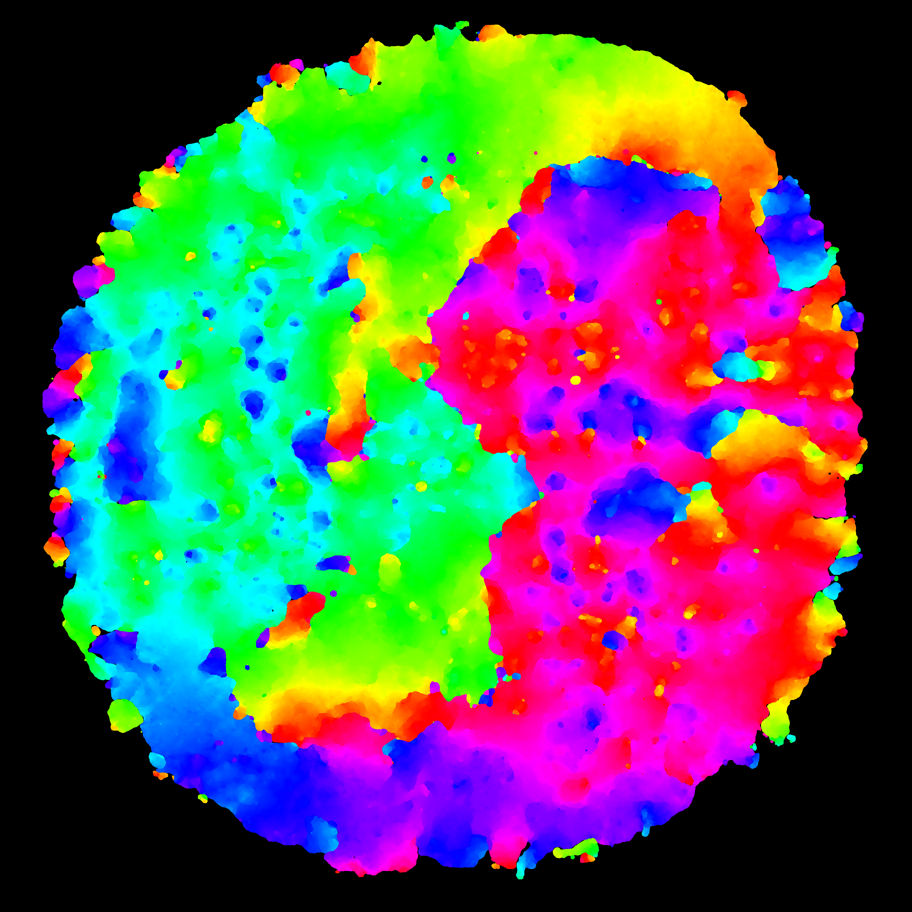
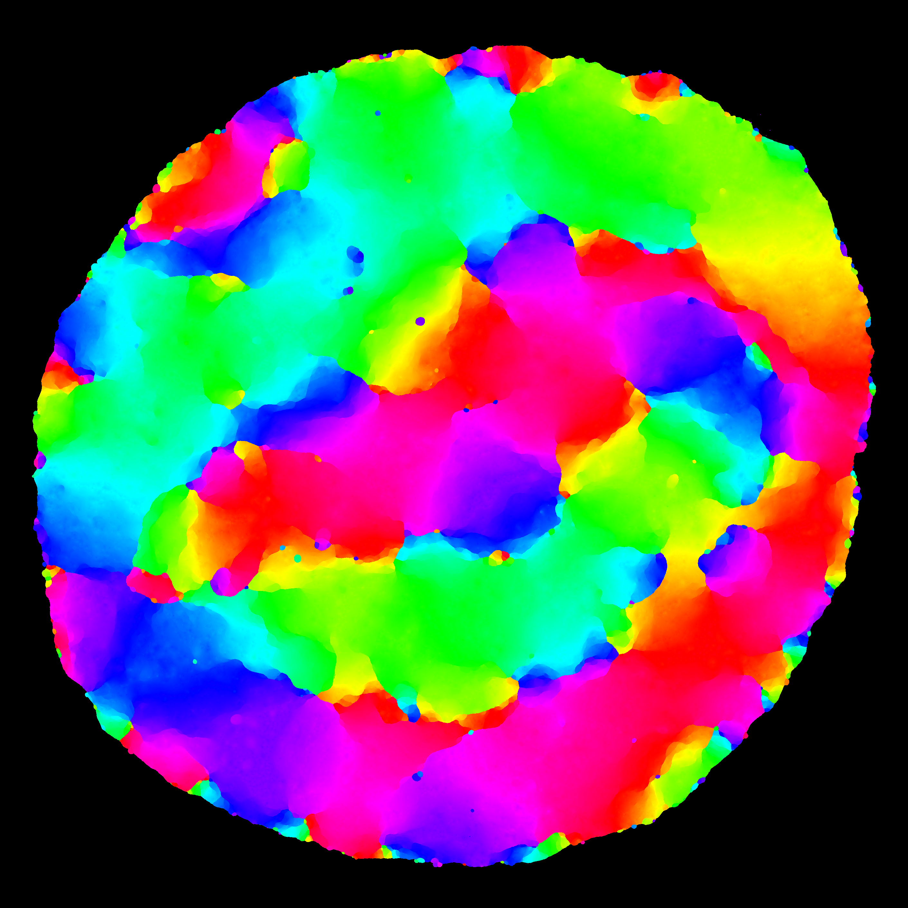
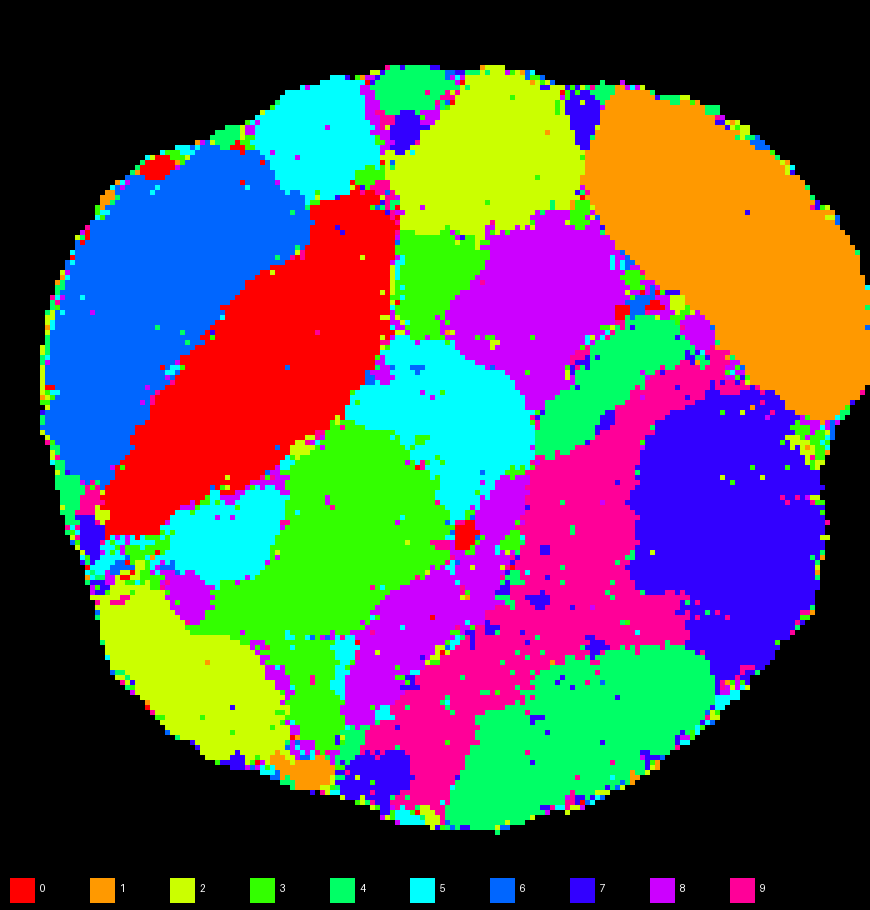

# DAMP: разреженное кодирование и двумерная раскладка MNIST

Реализация алгоритма DAMP из статьи [DAMP.pdf](docs/DAMP.pdf)
([текст](docs/DAMP_extracted.txt)): стимулы кодируются широкими детекторами в
разреженные битовые векторы, коды раскладываются на двумерной решётке дальней и
ближней энергетическими фазами, над раскладкой строится иерархия детекторов,
а активность детекторов даёт структурные эмбеддинги.

Соответствие разделам статьи по компонентам описано в
[docs/ARTICLE_COMPLIANCE.md](docs/ARTICLE_COMPLIANCE.md).

## Структура

```text
damp/
├── encoding/
│   ├── bitarray.py       # разреженный битовый вектор (§2)
│   ├── damp_encoder.py   # широкие детекторы со случайными битами, двумерная позиция кругами (§4, §4.3),
│   │                     # псевдоцвета (§5.14)
│   └── detector_view.py  # картинка первичных детекторов по слоям (§3.2, §4.1, §4.2.1)
├── layout/
│   ├── damp_layout.py        # DAMP Layout: дальняя и ближняя фазы, энергии (§5)
│   ├── code_table.py         # коды точек массивами: упакованные биты, hue, подписи
│   ├── pair_energy_gpu.py    # энергии пар и точек на torch: проходы по всему V и по окну ячеек (§5.12)
│   ├── fused_pair_energy.py  # слитое ядро энергий: слагаемое одним ядром, та же редукция (§5.9.5, §5.12)
│   ├── sparse_long_energy.py # строки ненулевых sim_λ и суммы по ним той же редукцией float32 (§5.9.5)
│   ├── pair_sign_kernel.py   # знак φ_c − φ_s пар шага одним проходом ядра устройства (§5.6, §5.12)
│   ├── potential_bounds.py   # нижняя граница потенциала точки: отсев заведомо невыгодных пар (§5.5.1)
│   ├── reduction_replica.py  # суммы пар «у нуля разности» на хосте в порядке сложения редукции
│   ├── pair_sampler.py       # выборка пар шага скомпилированными циклами (§5.3, §5.9.1, §5.9.3)
│   ├── device_kernel.py      # ядра устройства jiterator, кеш ядер, загрузка таблиц шага
│   ├── seeded.py             # большие раскладки: затравка, родители, расстановка по блокам (§5.9.4)
│   ├── device_step.py        # шаг большой раскладки целиком на устройстве (§5.3, §5.5, §5.6, §5.10)
│   ├── window_energy_kernel.py # энергии окрестности пар и точек по ячейкам окна без хранения слагаемых
│   ├── map_comparison.py     # сравнение двух карт одних стимулов: стенки, сингулярности, Ē (§5.13.2)
│   └── payload.py            # сохранение кодов раскладки, потоковая запись файла раскладки
├── activation/
│   ├── activation.py     # активация, иерархия детекторов, эмбеддинги (§6)
│   ├── plane_detection.py # детекторы-круги над раскладкой, код набора стимулов для следующего уровня
│   │                     # (§4.3, §6.2, §6.5), подбор длины кода по плотности (§6.6)
│   └── point_codes.py    # код второго уровня на каждую точку раскладки, зажигание по порогу λ_a
├── decode/
│   └── mnist_decoder.py  # нечёткий поиск по базе эмбеддингов (§2.2.5)
├── MnistSobelAngleMap.py # извлечение стимулов (угол, X, Y) из MNIST: увеличение, контур, окна Собеля
├── angle_position_sketch.py # диагностика: цифра, собранная из линий углопозиций
├── article_refs.py       # номера параграфов статьи для логов
└── logging.py            # единый лог в консоль и Rerun, раскладки панелей Rerun

main.py                   # все константы и MNIST-конвейер (layout, predict, evaluate, second, second-points)
pinwheel_test.py          # тест: по 360 кодов угла на позицию раскладываются в пинвилы
detectors_visual.py       # картинка первичных детекторов кодера
digit_sketch.py           # цифра MNIST из линий её углопозиций (Rerun)
digits_contour_test.py    # таблица «оригинал | цифра из линий углопозиций» для цифр 0…9
sticks_layout.py          # раскладка стимулов из архива sticks_28x28_360.zip
white_circle_layout.py    # раскладка стимулов одной картинки (white_circle_28x28_grayscale.png)
tests/                    # инварианты статьи и сверки ускоренных путей с исходными
docs/                     # статья, её текст, соответствие реализации статье, карты раскладки для README
```

## Стимулы MNIST

Стимул раскладки — углопозиция `(угол, X, Y)`: направление градиента Собеля в окне
и индексы этого окна. Извлечение (`damp/MnistSobelAngleMap.py`) в статье не описано,
его параметры — константы `MNIST_*` в `main.py`:

- картинка 28×28 увеличивается в 8 раз фильтром Lanczos3 (224×224), контраст
  повышается, Собель считается на увеличенной картинке (`MNIST_SOBEL_UPSCALE_ENABLED`,
  `MNIST_SOBEL_UPSCALE = 8`, `MNIST_SOBEL_CONTRAST = 100`);
- окно — 9×9 увеличенных пикселей (`MNIST_PATCH_SIZE = 9`), сетка 224 // 9 = 24×24 окна;
  X и Y — индексы окна 0…23, остаток у правого и нижнего края в окна не попадает;
- углопозиции берутся только по контуру цифры (`MNIST_CONTOUR_ONLY = True`): окно даёт
  стимул, если через него проходит контур (пиксель штриха не темнее
  `MNIST_CONTOUR_LEVEL = 0.5` рядом с фоном); угол — направление градиента в пикселях
  контура, период 360°; залитая середина штриха и фон пропускаются;
- окно даёт ровно одну углопозицию; если края в окне смотрят в противоположные стороны
  (тонкий штрих целиком в окне, когерентность ниже
  `MNIST_CONTOUR_TWO_EDGE_COHERENCE = 0.5`), берётся сильнейший край.

100 цифр дают 8 693 стимула, 1000 — 88 317, 10 000 — 882 607, весь обучающий набор
(60 000) — 5 302 618.

Какую часть формы цифры несут углопозиции, показывают два скрипта: по каждой
углопозиции рисуется отрезок длиной в окно вдоль края штриха.

```powershell
python digit_sketch.py 7            # одна цифра в Rerun: оригинал и цифра из линий
python digits_contour_test.py       # таблица для цифр 0…9, digits_contour_test.png
```

Ключи `digit_sketch.py`: `--seed`, `--split`, `--patch-size`, `--upscale` / `--no-upscale`
(меняют окно и предобработку только в скрипте); константы — `DIGIT_SKETCH_*`
и `DIGITS_CONTOUR_*`.

## Кодер

Кодер устроен по схеме [Angle-Encoder](https://github.com/qwertukg/Angle-Encoder):

- коды координат либо сливаются в общий код той же длины (OR, §2.2.1), либо
  склеиваются в сегменты (конкатенация); выбор по §2.2.3 задаёт `ENCODER_SHARED_CODE`;
- слои детекторов идут от самого широкого к самому узкому, число детекторов
  растёт геометрически (§4.2, §4.5);
- код координаты делится на равные цветовые полосы по слоям (§3.2, §4.4.2, §5.14):
  самый широкий слой получает младшие («красные») биты, самый узкий — старшие
  («фиолетовые»); каждому детектору назначается один случайный бит своей полосы
  (случайная перестановка бит полосы), коллизии далёких детекторов допускаются
  и логируются (§4.2.1);
- слои циклической координаты сдвинуты друг относительно друга на долю шага
  (`ENCODER_LAYER_PHASE`), чтобы плотность кода не зависела от значения; у отрезка
  без детекторов за краями детекторы стоят по центрам своих шагов;
- ожидаемая плотность кода оценивается по полосам и логируется; выше 25 % (§2)
  кодер пишет `encoder.density.warning`.

Для MNIST стимул `(угол, X, Y)` кодируется общим кодом из 512 бит
(`ENCODER_SHARED_CODE = True`, `ENCODER_SHARED_CODE_LENGTH = 512`): биты угловых и
позиционных детекторов объединяются OR, у каждой координаты свои цветовые полосы по
всей длине кода (10 полос по 51–52 бита), совпадения бит разных координат допускаются
(§2.2.3, §4.2.1). При `ENCODER_SHARED_CODE = False` — сегменты 256 + 128 + 128 бит
(`MNIST_ANGLE_CODE_LENGTH`, `MNIST_POSITION_CODE_LENGTH`).

| Координата | Диапазон | Слоёв | Детекторов в слоях | Перекрытие |
|---|---|---|---|---|
| угол (циклическая) | 0…360° | 10 | 2, 3, 5, 9, 15, 24, 40, 66, 109, 180 | 0.7 |
| X, Y (отрезок) | −1…28 | 10 | 2, 3, 4, 5, 6, 9, 12, 16, 21, 28 | 0.7 |

Всего 665 детекторов (453 угловых и по 106 на X и Y). У позиции детекторов за краями
отрезка нет (`MNIST_POSITION_EDGE_DETECTORS = False`), а нижняя граница вынесена на шаг
за край данных (`MNIST_POSITION_MIN = -1`), чтобы окно 0 не лежало на краю отрезка.
Ожидаемая плотность общего кода 17.9 %, на стимулах MNIST в среднем 89.6 единичных бит
из 512 (17.5 %) — ниже 25 % из §2.

Слоёв и перекрытия у угла и позиции поровну: перекрытие убирает «стенки» между
областями карты, а отношение числа слоёв решает, какая координата выходит непрерывной
(§4.2.1, §4.5, §5.13.2.2). С прежними значениями (22 слоя, перекрытие 0.4 — оставлены
в `main.py` закомментированными строками) в режиме статьи соседних ячеек, разнящихся
по углу больше чем на 30° или по позиции больше чем на 3 окна, было втрое больше
(60 000 цифр: 1.21 % → 0.37 %); цена — различных кодов на 60 000 цифр 256 тыс. вместо
456 тыс.

Профиль сходства каждой координаты проверяется при сборке кодера
(`Encoder.long_range_order`, §4.5, §5.13.1): сходство по собственным битам координаты
должно убывать с расстоянием на всём диапазоне. С текущими детекторами проверка
проходит для угла, X и Y (позиция: 0.90 / 0.79 / 0.68 на расстоянии 1 / 2 / 3 окна
и 0.33 на 10 окнах; угол: 0.59 на 14° и 0.28 на 86°); при нарушении кодер пишет
`encoder.long_range_order.warning`.

Первичные детекторы можно посмотреть картинкой: `python detectors_visual.py`
(или `--angle 120 --x 5 --y 20`, `--no-stimulus`, `--output файл.png`). Для угла, X и Y
по слоям рисуются рецептивные поля; перекрывающиеся соседние детекторы разнесены по
дорожкам, цвет — цвет бита (§3.2, §5.14), активные для стимула детекторы выделены;
внизу — биты общего кода по координатам и код стимула с паразитными битами.
Константы — `DETECTORS_VIEW_*` в `main.py`, картинка — `detectors_view.png` и Rerun.

## Раскладка

Режим задаёт флаг `LAYOUT_SMOOTH_PINWHEELS` в `main.py`:

- `False` (значение по умолчанию) — **режим статьи**: дальняя фаза `φ = Σ s·d`
  по всему пространству (§5.5.1), жёсткий порог η = ∞, радиус пар от d/2 к 1 и λ от 0.65
  к 0.8 шагом 0.05 меняются, когда обмены падают до 1 % от начального значения этапа
  (§7.1.7), без отжига (§5.6);
- `True` — **сглаживание** пространства между пинвилами (расширение статьи): гауссово
  ядро дальней фазы, старт радиуса со всей карты, геометрическое расписание,
  фиксированный λ = 0.65 с сигмоидой η = 10 и слабый отжиг разворачивают соседние
  пинвилы друг к другу.

Флаг задаёт константы `LAYOUT_LONG_KERNEL`, `LAYOUT_ETA`,
`LAYOUT_ADAPTIVE_RADIUS_START_FACTOR`, `LAYOUT_ADAPTIVE_RADIUS_SCHEDULE`,
`LAYOUT_SHORT_ADAPTIVE_RADIUS_SCHEDULE`, `LAYOUT_ANNEAL_TEMPERATURE`,
`LAYOUT_ADAPTIVE_SWAP_TRIGGER`, `LAYOUT_ADAPTIVE_LAMBDA_STEP`,
`LAYOUT_PAIRS_POINT_FRACTION`, бюджеты шагов `LAYOUT_TUNE_LONG_STEPS_*`
и `LAYOUT_TUNE_SHORT_STEPS_*` и метку кеша `LAYOUT_CACHE_TAG`
(`article-kernel-v1` или `gauss-kernel-v1`).

Параметры:

- cosine, порог `sim_λ = sim · σ(η(sim − λ))` с λ = 0.65; η = ∞ (`LAYOUT_ETA = None`)
  по статье и η = 10 при сглаживании; рост λ ступенями до 0.8 (§7.1.7) задаётся
  `LAYOUT_ADAPTIVE_LAMBDA_STEP`, при сглаживании выключен (с гауссовым ядром рост λ
  оставляет складки);
- сторона сетки — `⌈√(N·(1 + LAYOUT_EMPTY_RATIO))⌉`; `LAYOUT_EMPTY_RATIO = 0.50`:
  пустых ячеек половина от числа точек, то есть треть сетки (в статье, §7.1.6, запас
  около 15 %);
- дальняя энергия считается по всему пространству; подмножество §5.9.4
  используется только для пространств крупнее
  `LAYOUT_LONG_FULL_SPACE_MAX_POINTS` = 100 000 точек, а в гауссовой дальней фазе —
  только пока в окрестность радиуса r(t) ожидаемо попадает не меньше
  `LAYOUT_LONG_SUBSET_MIN_NEIGHBOURS` точек подмножества (иначе локальная энергия
  оценивается шумно и обмены становятся случайными). В режиме статьи на подмножестве
  из 745 точек шум оценки Δ держал ~1 % случайных пар «выгодными», триггер 1 % (§7.1.7)
  не срабатывал и расписание λ/r дальней фазы не доходило до конца;
- ядро дальней энергии задаётся `LAYOUT_LONG_KERNEL`: `"distance"` — формула
  статьи `φ = Σ s·d` (§5.5.1); `"gauss"` (при `LAYOUT_SMOOTH_PINWHEELS`) — расширение статьи:
  `φ = Σ s·exp(−d²/2σ²)`, σ = `LAYOUT_LONG_KERNEL_WIDTH`·r(t), радиус r(t)
  стартует со стороны карты и убывает геометрически (`LAYOUT_ADAPTIVE_RADIUS_*`),
  λ в дальней фазе фиксирован, в окне радиусов `LAYOUT_ANNEAL_*` действует слабый
  отжиг (невыгодные обмены принимаются с вероятностью `exp(Δ/(T·rms|Δ|))`);
  вместе это даёт карту из нескольких пинвилов с чередованием закрутки и без
  складок между позициями (см. `docs/ARTICLE_COMPLIANCE.md`, раздел
  «Расширение статьи»);
- расстояние в парных энергиях: `LAYOUT_LONG_DISTANCE = "euclidean"` (d из §5.5),
  `LAYOUT_SHORT_DISTANCE = "squared"` (d² без корня, §5.9.2);
- пары шага считаются спекулятивно (§5.10); в режиме статьи пар за шаг не больше
  `LAYOUT_PAIRS_POINT_FRACTION` = 0.1 от числа точек, поэтому обменов за шаг
  много меньше числа точек;
- остановка фазы по числу обменов за шаг (`LAYOUT_MIN_SWAP_RATIO`, у ближней фазы —
  `LAYOUT_SHORT_MIN_SWAP_RATIO`) или по достижении качества Ē `LAYOUT_ENERGY_TARGET`
  (§5.6, §5.8; сейчас `None` — только по обменам), либо по бюджету шагов: в режиме
  статьи у дальней фазы 50 000 шагов (`LAYOUT_TUNE_LONG_STEPS_*`), у ближней — от 2 500
  (`LAYOUT_TUNE_SHORT_STEPS_*`). С текущими детекторами дальняя фаза на 100 цифрах
  заканчивается по обменам (24.5 тыс. шагов), а начиная с 300 цифр упирается в бюджет
  раньше, чем расписание §7.1.7 доходит до конца: 300 цифр — λ = 0.8 и r = 12, затравка
  из 30 тыс. точек — λ = 0.75 и r = 26; расписание продолжает ближняя фаза в пределах
  своего бюджета.

### Карты всего MNIST в двух режимах

Весь обучающий набор — 60 000 цифр, 5 302 618 точек на сетке 2821×2821 — разложен
в обоих режимах с текущими детекторами. Пиксель картинки — ячейка сетки, цвет — угол
стимула (оттенок по кругу 360°: 0° — красный, 120° — зелёный, 240° — синий), чёрное —
пустые ячейки. Угол в раскладке не участвует: это диагностическая раскраска, как на
рис. 16 статьи.

| Режим статьи | Сглаживание |
|---|---|
|  |  |
| `data/60000-15.angle.png` | `data/60000-31.angle.png` |

- **Режим статьи** (`LAYOUT_SMOOTH_PINWHEELS = False`). Дальний порядок один на всю
  карту: каждый угол занимает одну большую область — зелёно-голубая половина слева,
  красно-пурпурная справа, синяя полоса внизу. Области разделены резкими границами,
  внутри них остаются мелкие островки других углов.
- **Сглаживание** (`LAYOUT_SMOOTH_PINWHEELS = True`). Карта из многих пинвилов: один
  и тот же угол повторяется в нескольких местах карты, переходы между областями
  плавные, островков почти нет.

| Показатель | Режим статьи | Сглаживание |
|---|---|---|
| Глобальная энергия §5.5.1 `Φ = Σ sim_λ·d` при λ = 0.8, доля от случайной расстановки | 0.220 | 0.273 |
| Среднее расстояние между точками с сходством не ниже 0.8, ячеек (у случайной пары — 1178) | 260 | 322 |
| Соседние ячейки с сходством ниже 0.65 | 0.13 % | 0.004 % |
| Соседние ячейки с разностью угла больше 30° | 0.34 % | 0.27 % |
| Качество Ē (§5.8, r_e = 3; у каждого режима со своим `sim_λ`) | 0.980 | 0.981 |
| Время команды | 5 мин 27 с | 13 мин 27 с |

Какая раскладка лучше, зависит от мерила: глобальная энергия статьи ниже в режиме
статьи (похожие коды собраны в одном месте карты), локально глаже сглаживание.
Картинки в `docs/` — копии файлов из `data/`, которые команда перезаписывает при
каждом запуске.

### Расчёт энергий

Энергии пар и точек считаются на PyTorch (CUDA/MPS): сходство кодов — одним
матричным произведением на лету, без матрицы N×N (§5.9.5, §5.12), окрестность
§5.5.2 — по окну ячеек сетки вокруг центра пары, подмножество B — для дальней
фазы (§5.9.4); выбор пар шага векторный (§5.3, §5.9.1, §5.9.3). Без torch —
прежний OpenGL-движок (moderngl, матрица N×N) или NumPy.

Поверх этого работают ускоренные пути, которые дают **тот же результат бит-в-бит**:
слагаемые считаются теми же операциями float32 и суммируются той же редукцией той же
формы, поэтому раскладка совпадает шаг в шаг, а файлы результата — побайтно. По ходу
раскладки пути сверяются с исходным проходом (`LAYOUT_*_VERIFY_EVERY`) и при
расхождении отключаются. Нужны CUDA и `numba`; без них работают исходные пути с тем
же результатом.

- **Строки ненулевых `sim_λ`** (режим статьи; `LAYOUT_SPARSE_LONG`,
  `sparse_long_energy.py`): при жёстком пороге `sim_λ(a, v) = 0` для всех точек с
  `sim < λ`, поэтому суммы §5.5.1 по всему V, §5.5.2 по окрестности и §5.7 сводятся
  к точкам, похожим на точки пары. Строки сходства строятся один раз (§5.9.5) и
  прореживаются при росте λ (§7.1.7); шаг стоит `O(p·k)` вместо `O(p·N)`, k — число
  похожих точек: с текущими детекторами 17.9 % от N при λ = 0.65 и 1.8 % при λ = 0.8
  (100 цифр). Строки строятся, пока в них не больше `LAYOUT_SPARSE_MAX_EDGES` =
  400 млн элементов и они занимают не больше половины свободной памяти устройства:
  при λ = 0.65 это наборы примерно до 48 тыс. точек (около 550 цифр). На больших
  наборах этапы с малым λ идут плотным проходом, а строки строятся, когда λ
  вырастет настолько, что они поместятся.
- **Знак вместо суммы** (`LAYOUT_PAIR_KERNEL`, `pair_sign_kernel.py`): правилу
  обмена §5.6 нужен только знак `φ_c − φ_s`. Ядро устройства считает слагаемые
  строк сходства потоками по отрезкам строк (§5.12) и выносит решение по оценке
  ошибки суммирования float32; шаг — несколько запусков ядер вместо сотни
  операций torch.
- **Граница потенциала** (`LAYOUT_POTENTIAL_BOUNDS`, `potential_bounds.py`):
  `U_a(p) = Σ_v sim_λ(a, v)·‖p − p_v‖` — выпуклая функция ячейки, поэтому
  `U_a(p) ≥ Σ_групп ‖M·p − P‖` по группам похожих точек на грубой сетке
  (неравенство Йенсена). Если из границы следует `φ_c < φ_s`, обмена нет и строки
  пары не считаются: на затравке из 30 тыс. точек так снимается 87–96 % пар шага.
- **Почти-ничьи** (`LAYOUT_REDUCTION_REPLICA`, `reduction_replica.py`): у пар,
  разность сумм которых лежит в пределах ошибки суммирования (единицы на шаг),
  решает само число редукции float32 — оно считается на хосте в том же порядке
  сложения, что у редукции устройства (порядок сверяется с устройством).
- **Выборка пар** (`LAYOUT_COMPILED_SAMPLER`, `pair_sampler.py`): циклы выборки
  скомпилированы numba и берут числа у того же генератора numpy теми же
  запросами — пары и состояние генератора те же.
- **Слитое ядро** (`LAYOUT_FUSED_ENERGY`, `fused_pair_energy.py`): при сигмоиде
  (сглаживание) `sim_λ` нигде не ноль, суммы §5.5 берутся по всем точкам V или
  ячейкам окна. Сходство кодов предвычислено таблицей (§5.9.5) — значения `sim_λ`
  всех пар точек, а если она не помещается в память — число общих бит по
  парам точек или различных кодов; всё слагаемое считает одно ядро CUDA на
  элемент (пара, точка) вместо полусотни операций torch (§5.12). В режиме статьи
  это же ядро считает плотные проходы, когда строки сходства не помещаются.

Разделы «Ускорение без изменения результата», «Шаг раскладки одним проходом ядра» и
«Слитое ядро энергий» в `docs/ARTICLE_COMPLIANCE.md` описывают устройство и замеры
этих путей. Замеры там сделаны с прежними детекторами (22 слоя, перекрытие 0.4), у
которых похожих точек было в 6–7 раз меньше (2.7 % от N при λ = 0.65, 0.25 % при
λ = 0.8): слитое ядро ускоряло раскладку 300 цифр в режиме сглаживания с 483 до 52 с,
а строки сходства с ядром знака и границей потенциала — раскладку 680 цифр
(59 462 точки) в режиме статьи с 15 до 2 минут. С текущими детекторами строки такого
набора при λ = 0.65 в память не помещаются (см. «Время»).

### Большие наборы

Наборы больше `LAYOUT_LONG_FULL_SPACE_MAX_POINTS` = 100 000 точек раскладываются от
«затравки»: случайное подмножество из `LAYOUT_SEED_POINTS` = 30 000 точек
раскладывается целиком обычным алгоритмом, остальные точки ставятся возле самых
похожих точек затравки. Коды хранятся массивами, без объекта на точку. До границы
раскладка обычная (раздел «Большие раскладки» в `docs/ARTICLE_COMPLIANCE.md`):

- режим статьи: затравка раскладывается точным алгоритмом статьи (дальняя фаза по
  всему V и ближняя), между ней и полным набором — промежуточные уровни (не больше
  `LAYOUT_SEED_LEVEL_RATIO_MAX` = 16 точек на родителя: 60 000 цифр — 30 тыс. →
  399 тыс. → 5.3 млн, 10 000 цифр — 30 тыс. → 163 тыс. → 883 тыс.); место точки
  в блоке родителя — по самым похожим на неё точкам предыдущего уровня,
  с изотропной добавкой шире блока; на каждом уровне идёт
  ближняя фаза статьи (§5.5.2) целиком на устройстве (`device_step.py`,
  `window_energy_kernel.py`) с радиуса в `LAYOUT_SEED_SHORT_RADIUS_FACTOR` =
  4 блока родителя, без ранней отсечки пар (§5.9.1) — она и проводит границы
  областей (иначе карта повторяла бы сетку блоков прямыми отрезками границ);
- режим сглаживания: после расстановки от затравки — дальняя фаза с малого радиуса
  (шаг целиком на устройстве, `LAYOUT_DEVICE_STEP`) и ближняя фаза.

### Время

Команда `python main.py layout --count N --layout-only --rebuild` целиком, RTX 2060
SUPER 8 ГБ, `RERUN=off`, текущие детекторы; у наборов от 2000 цифр коды взяты из
файла (первый запуск дольше на кодирование набора: 60 000 цифр — около 2 минут):

| Цифр | Точек | Сетка | Режим статьи | Сглаживание |
|---|---|---|---|---|
| 100 | 8 693 | 115² | 52 с | 20 с |
| 300 | 26 201 | 199² | 1 мин 49 с | 53 с |
| 1000 | 88 317 | 364² | часы (см. ниже) | 9 мин 22 с |
| 10 000 | 882 607 | 1151² | 2 мин 31 с | 2 мин 41 с |
| 60 000 | 5 302 618 | 2821² | 5 мин 27 с | 13 мин 27 с |

В режиме статьи самые медленные — наборы примерно от 550 цифр до границы большого
режима (100 000 точек, около 1130 цифр): строки сходства не помещаются в память, и
дальняя фаза идёт плотным проходом. На 1000 цифр строки не поместились при λ = 0.65
и 0.7, шаг дальней фазы стоил 0.2 с; прогон остановлен на 16-й минуте после 4 700
шагов, а при бюджете дальней фазы в 50 000 шагов это около трёх часов (оценка по темпу
шагов). Наборы больше 100 000 точек раскладываются от затравки, поэтому 10 000 и
60 000 цифр считаются за минуты.

### Файлы результата

Раскладка сохраняется в `data/layout-<count>-<radius>-<LAYOUT_CACHE_TAG>.json`, карта —
в трёх раскрасках: `data/<count>-<radius>.png` — сумма псевдоцветов битов кода (§5.14),
`data/<count>-<radius>.energy.png` — та же раскраска с яркостью по нормированной
энергии Ê (рис. 18), и `data/<count>-<radius>.angle.png` — диагностическая раскраска
по углу стимула, как на рис. 16 статьи. Угол не участвует в раскладке. `<radius>` —
радиус выбора пар ближней фазы: в имени JSON — ожидаемый по настройке, в именах
картинок — итоговый; у больших наборов режима статьи они различаются (60 000 цифр:
`layout-60000-31-article-kernel-v1.json` и `60000-15.png`).

## Детекторы и эмбеддинги

- энергия точки `Ê` с радиусом r_e = 3 (`LAYOUT_ENERGY_RADIUS`, §5.7), та же матрица Ê,
  что и для качества раскладки Ē (§5.8); E_max берётся по всему пространству;
- пять слоёв детекторов с порогами λ_d = 0.7…0.9 (§7.1.10); радиус активации
  r_a каждого слоя задан долей стороны карты (`ACTIVATION_DETECTOR_LAYER_SPECS`):
  нижние слои ищут области и гиперкластеры, верхние — кластеры и секторы;
  центры выбираются случайно, кластер находится DBSCAN, радиус — по максимуму
  заполнения, вставка с заменой менее плотных детекторов (§6.4–§6.4.5);
- порог активации λ_a равен порогу нижнего слоя (§7.1.11);
- уровень активации детектора — отношение энергий без ограничения сверху,
  порог μ_d = 0.5 (§6.5);
- размер и насыщенность выходного кода вычисляются по среднему числу
  активных детекторов на обучающих стимулах (§6.6); результат и сами детекторы
  сохраняются в JSON раскладки вместе с эмбеддингами и переиспользуются при оценке;
- эмбеддинг — colour merge кодов `σ` сильнейших детекторов (§6.5, §7.1.12).

## Второй уровень: коды картинок и карта цифр

Расширение статьи: способ получить код набора стимулов (картинки) и разложить такие коды на
следующем уровне (§6.2, §6.6), не строя иерархию детекторов §6.4. Отличия от статьи — в разделе
«Расширение статьи: детекторы-круги над раскладкой» файла `docs/ARTICLE_COMPLIANCE.md`.

1. Первая раскладка углопозиций считается как обычно (в любом из двух режимов).
2. Карта раскладки заполняется детекторами-кругами всех слоёв равномерно — это детекторы
   двумерной позиции §4.3. Их задаёт тот же `Encoder` с координатой `PlaneDimension`: слои
   от самого широкого к самому узкому с перекрытием соседей, как у координат стимула.
   Радиус круга — доля стороны карты (`SECOND_LEVEL_RADIUS_MAX` = 0.33 … `SECOND_LEVEL_RADIUS_MIN`
   = 0.025), слоёв `SECOND_LEVEL_LAYERS` = 5, перекрытие `SECOND_LEVEL_OVERLAP` = 0.6; число
   кругов по стороне растёт геометрически: 4, 8, 14, 27, 50 — всего 3 505 кругов.
3. Все углопозиции картинки подаются заново. Каждая зажигает точки раскладки с самым
   похожим кодом (сходство не ниже λ_a = 0.7): для обучающей картинки это точки с тем же
   кодом. Зажжённая точка активирует круги, в поле которых лежит, — правило кодера позиции.
4. Код картинки — вектор фиксированной длины: каждому кругу назначен один случайный бит,
   активный круг зажигает свой бит. Длина кода не задаётся, а подбирается (`PlaneCodeSizer`,
   §6.6): наименьшая, при которой средняя плотность кодов первых 100 картинок не выше 25 %
   (`SECOND_LEVEL_TARGET_DENSITY`, §2). С выбранными кругами это около 3 тысяч бит: картинка
   активирует примерно 800 кругов.
5. Коды картинок раскладываются тем же `Layout` с той же настройкой. Отличается только порог
   сходства λ: сходства кодов картинок лежат в другом диапазоне, чем у первичных кодов,
   поэтому λ берётся квантилем их попарных сходств — той же долей похожих пар, что дают
   первичным кодам λ = 0.65 и λ = 0.8 (`SECOND_LEVEL_LAYOUT_LAMBDA_QUANTILE` = 0.82,
   `SECOND_LEVEL_LAYOUT_LAMBDA_MAX_QUANTILE` = 0.982).
6. Проверка — нечёткий поиск (§2.2.5): класс тестовой картинки определяется по самым похожим
   кодам обучающих картинок тем же декодером, с температурой голосования
   `SECOND_LEVEL_DECODER_TEMPERATURE` = 0.02.

```powershell
python main.py second --count 2000 --limit 1000
```

Ключи: `--count` — число обучающих цифр, `--limit` — число картинок проверки (0 — без неё),
`--split` — набор проверки, `--rebuild` — пересчитать первую раскладку. Результат:
`data/second-<count>-<radius>-<LAYOUT_CACHE_TAG>.json` и три карты второй раскладки —
`data/second-<count>-<radius>.png` (псевдоцвета кода), `.angle.png` (цвет — класс цифры:
оттенок = класс · 36°) и `.energy.png`. Карта в псевдоцветах кода (§5.14) у второго уровня
одноцветна: в каждом коде горит четверть случайных битов, и их цвета усредняются в один оттенок;
структуру карты показывает раскраска по классу.

### Измерения с выбранными параметрами

RTX 2060 SUPER, `RERUN=off`, 2000 тестовых картинок. «По пикселям» и «ближайший сосед» — один
ближайший сосед по косинусу (сырых пикселей и кодов второго уровня) на одних и тех же обучающих
и тестовых картинках; «соседи одного класса» — доля пар соседних занятых ячеек второй карты с
одним классом (событие `plane_detection.map`; при случайной расстановке — 10 %):

| Первая раскладка | Обучающих цифр | По пикселям | Ближайший сосед | Длина кода | Соседи одного класса |
|---|---|---|---|---|---|
| сглаживание | 100 | 65.2 % | 75.7 % | 2 712 | 46 % |
| сглаживание | 1 000 | 84.8 % | 90.7 % | 2 960 | 74 % |
| сглаживание | 5 000 | 91.9 % | 93.7 % | 2 968 | 84 % |
| режим статьи | 100 | 65.2 % | 74.4 % | 2 744 | 54 % |
| режим статьи | 2 000 | 88.9 % | 92.9 % | 2 976 | 81 % |
| режим статьи | 5 000 | 91.9 % | 93.9 % | 3 128 | 86 % |

На 5000 цифрах при сглаживании по пяти соседям — 94.6 %, декодер самой команды — 94.6 %; команда
целиком — 3 мин 41 с вместе с первой раскладкой. Режим первой раскладки на результат не влияет.
В режиме статьи 1000 цифр попадают в зону, где первая раскладка считается часами (см. «Время»),
поэтому средняя проверка там сделана на 2000 цифрах.

### Как подобраны параметры

Перебор по одному параметру, оценка — ближайший сосед на 2000 тестовых картинок (разброс
±0.6 %). Чувствителен только самый узкий радиус; остальные параметры лежат на плато и выбраны
по длине кода.

- **Самый узкий радиус**, доля стороны карты (5 слоёв, перекрытие 0.7):

  | Набор, карта | 0.01 | 0.015 | 0.02 | 0.03 | 0.045 | 0.07 |
  |---|---|---|---|---|---|---|
  | 100 цифр, 115 ячеек, сглаживание | 72.8 % | 73.7 % | 74.2 % | 75.0 % | 73.2 % | 66.4 % |
  | 100 цифр, 115 ячеек, режим статьи | 73.1 % | 74.3 % | 74.0 % | 75.3 % | 72.4 % | 65.0 % |
  | 1000 цифр, 364 ячейки, сглаживание | 88.8 % | 89.9 % | 89.5 % | 90.1 % | 87.1 % | 77.3 % |
  | 2000 цифр, 514 ячеек, режим статьи | 90.9 % | 92.1 % | 92.1 % | 92.4 % | 90.9 % | 81.1 % |

  Лучший радиус в долях стороны один и тот же (0.02–0.03) при любом размере карты, то есть в
  ячейках он растёт вместе с картой: 3 ячейки на карте 115, 11 на карте 364, 15 на карте 514.
  Поэтому радиус задан долей стороны, а не числом ячеек.
- **Самый широкий радиус** (1000 цифр): 0.15 — 90.4 %, 0.33 — 90.1 %, 0.6 — 90.6 %. Не влияет:
  широкие круги зажигает любая картинка.
- **Слои и перекрытие** (1000 цифр): 3, 5, 7, 10 слоёв × перекрытие 0.5, 0.6, 0.7, 0.8 — все
  16 вариантов дают 88.4–90.7 %, а длина кода меняется от 1 208 до 22 280 бит. Выбраны 5 слоёв
  и перекрытие 0.6 (90.7 %, 2 960 бит); 10 слоёв и 0.7, как у X и Y стимула, — 90.1 % при
  9 672 битах.
- **Длина и плотность кода** (1000 цифр, выбранные круги): плотность 50 % (1 256 бит) — 87.5 %,
  40 % — 89.1 %, 30 % — 89.7 %, 25 % (2 960 бит) — 90.7 %, 10 % (7 848 бит) — 90.3 %, 2 %
  (40 464 бита) — 90.1 %, 0.5 % (162 720 бит) — 90.4 %. Длиннее 3 тысяч бит точность не растёт,
  даже если взять в 26 раз больше кругов (10 слоёв, перекрытие 0.9, 524 288 бит — 90.2 %);
  плотнее 25 % — падает. В режиме статьи на 2000 цифрах: 50 % — 91.6 %, 25 % — 92.9 %,
  2 % — 93.0 %.
- **Бит круга берётся из всего кода** (`SECOND_LEVEL_LAYER_BANDS = False`). С цветовыми полосами
  слоёв, как у одномерных координат, при плотности 25 % полосы широких слоёв почти пусты, а
  полосы узких переполнены: 89.6 % против 93.7 % без полос (2000 цифр, 10 слоёв).

### Большие наборы

Замеры до подбора параметров (круги 0.85 … 0.02, 10 слоёв, перекрытие 0.7, код 8–9 тысяч бит;
сглаживание; «декодер» — проверка самой команды):

| Обучающих цифр | Тестовых | По пикселям | Ближайший сосед | Декодер | Длина кода | Соседи одного класса |
|---|---|---|---|---|---|---|
| 2 000 | 1 000 | 89.7 % | 93.7 % | 94.6 % | 8 392 | 80 % |
| 10 000 | 2 000 | 94.0 % | 95.3 % | 96.4 % | 8 944 | 86 % |
| 20 000 | 2 000 | 95.2 % | 95.9 % | 95.8 % | 9 240 | 87 % |

Выигрыш перед пикселями убывает с числом обучающих цифр: 10 пунктов на 100 цифрах, 4 — на
2000, 0.7 — на 20 000. 20 000 цифр (1.76 млн точек первой раскладки, вторая — сетка 174²) —
17 минут вместе с первой раскладкой.

Карта второго уровня на 20 000 цифр, цвет — класс цифры:



### Код на углопозицию

Второй вариант того же приёма: набор — один стимул, то есть каждая точка первой раскладки
получает код своего места на карте, и эти коды раскладываются заново.

```powershell
python main.py second-points --count 100
python main.py second-points --count 100 --activation threshold
```

Проверялось, сглаживает ли вторая раскладка карту (100 цифр, 8 693 точки). «Стенки» — доля
пар соседних ячеек, различающихся по углу больше чем на 30° или по окну больше чем на 3;
Ē считается по исходным кодам точек на их новых местах:

| Режим, правило зажигания | Стенки: первая → вторая | Ē: первая → вторая |
|---|---|---|
| сглаживание, самые похожие точки (`best`) | 9.4 % → 12.5 % | 0.814 → 0.797 |
| статья, `best` | 9.2 % → 36.9 % | 0.827 → 0.565 |
| сглаживание, все точки со сходством ≥ 0.7 (`threshold`) | 9.4 % → 6.4–6.8 % | 0.814 → 0.804–0.811 |
| статья, `threshold` | 9.2 % → 14.2 % | 0.827 → 0.820 |

При правиле `best` карта не сглаживается: код несёт только место точки, соседи первой карты
остаются соседями, и вторая карта в лучшем случае повторяет первую с поворотом и отражением.
Сглаживание даёт правило `threshold` и только в режиме сглаживания: стенок на треть меньше,
сингулярностей вдвое меньше, ценой 0.4–1.3 % качества Ē. Измеритель карт —
`damp/layout/map_comparison.py`.

## Уровень «окно внимания»: «что» отдельно от «где»

Расширение статьи (ветка `window-level`). Второй уровень выше читает первую раскладку целиком и для
узнавания цифр в ней не нуждается: место углопозиции на картинке известно и так, раскладывать нужно только
то, чего мы не знаем заранее, — формы кусков. Уровень строится по указанию автора статьи про окно внимания
(«то, что внутри окна, будет точкой кодового пространства») и без первой раскладки.

```
python main.py window --count 1000 --limit 2000
```

1. **Углопозиции** цифр — тем же выделением, что у первой раскладки: угол и узел сетки окон 24×24.
2. **Окно** (`AttentionWindows`): круг радиуса 2.5 клетки (первый из `WINDOW_LEVEL_RADII`) с центром в каждой клетке.
   Кусок — углопозиции в окне, записанные от центра окна. Один и тот же рисунок даёт один и тот же кусок
   в любом месте картинки.
3. **Код куска** (`ConjunctionEncoder`): детектор-произведение = детектор направления × круг места в окне,
   оба — обычные детекторы `Encoder` (§4.1–§4.3) с теми же слоями и перекрытием. Срабатывают все пары
   активных детекторов; каждому — один случайный бит; код куска — OR по его углопозициям (§2.2.1).
   Длина кода подбирается под плотность 25 % (§6.6).
4. **Словарь образцов** (`LeaderDictionary`): коды кусков обучающих картинок сливаются к образцу при
   сходстве не ниже `WINDOW_LEVEL_MERGE_SIMILARITY = 0.7`. Образцы раскладываются тем же `Layout` —
   получается **карта форм**. Каждый кусок получает место на ней: точку с самым похожим кодом
   (`NearestPointActivation`, §6.1).
5. **Код картинки**: детектор-произведение = круг на карте форм × круг на картинке (место окна), OR по всем
   кускам картинки, длина под плотность 25 %.
6. **Карта цифр** — раскладка кодов обучающих картинок; **проверка** — нечёткий поиск (§2.2.5): класс по
   самым похожим кодам обучающих картинок (`NearestCodeClassifier`).

### Измерения

Режим сглаживания, 2000 проверочных цифр, один ближайший сосед, RTX 2060 SUPER. В этой таблице — один
уровень кусков (`WINDOW_LEVEL_RADII = (2.5,)`, код картинки от него); несколько уровней — в следующем разделе.

| Способ | 1000 цифр | 5000 цифр | Что раскладывается |
|---|---|---|---|
| Второй уровень над первой раскладкой (`second`) | 90.6 % | 93.7 % | первая раскладка: 88 тыс. и 440 тыс. точек |
| Уровень «окно внимания» (`window`) | **92.8 %** | **95.9 %** | карта форм: 2068 и 3576 точек |

Вся команда `window` вместе с выделением углопозиций, картой цифр и проверкой: 64 с на 1000 цифр и 135 с на
5000 (в обоих случаях ещё 2000 проверочных). На 5000 цифрах на карте цифр 86.0 % пар соседних ячеек — одного
класса.

На 1000 цифрах: 273 куска на картинку, 6.7 углопозиции в куске, код куска 752 бита; из 276 600 кусков
обучающих картинок 229 414 различных кодов и 2068 образцов (сжатие в 134 раза); у 99.8 % всех кусков, включая
куски проверочных картинок, есть образец со сходством не ниже 0.7. Код картинки 36 672 бита. На карте цифр
76.5 % пар соседних ячеек — одного класса (при случайной расстановке 10 %).

Словарь образцов растёт медленно: 2068 → 3576 образцов при 1000 → 5000 картинок (кусков впятеро больше).
Опытный образец до реализации (3 слоя детекторов) на 100 цифрах давал 76.6 % против 75.7 % у второго уровня.

### Качество против длины кода: что стоит по умолчанию

Код картинки должен быть коротким, иначе раскладка большого числа картинок не помещается в память. Перебор
на 2000 и 5000 цифрах (2000 проверочных, один ближайший сосед) дал вариант по умолчанию: углопозиции и один
уровень кусков (окно 2.5), 5 слоёв детекторов, перекрытие 0.3, срабатывают все круги, в которые попала
точка, плотность кода картинки 40 %, код картинки склеен из кодов обоих уровней.

| Вариант (5000 цифр) | Код картинки | Зажжено бит | Узнавание |
|---|---|---|---|
| **По умолчанию: перекрытие 0.3, плотность 40 %** | **2 880 бит** | 1 180 | **95.45 %** |
| Перекрытие 0.3, плотность 25 % | 5 088 бит | 1 310 | 95.65 % |
| Перекрытие 0.4, плотность 25 % | 9 432 бита | 2 410 | 95.6 % |
| Перекрытие 0.6, плотность 40 % (максимум качества) | 23 872 бита | 9 750 | 96.4 % |
| Только углопозиции, перекрытие 0.4, плотность 25 % | 1 560 бит | 400 | 95.3 % |
| Два уровня кусков, перекрытие 0.6, плотность 25 % | 94 624 бита | 24 200 | 95.4 % |
| Второй уровень над первой раскладкой (`second`) | около 3 тыс. бит | — | 93.7 % |

Вся команда по умолчанию на 5000 цифрах — 117 с; словарь форм 9596 образцов (предел 20 000 не достигнут);
на карте цифр 85.6 % пар соседних ячеек одного класса. При коде в 2880 бит карта цифр раскладывается по
полным кодам: запас `WINDOW_LEVEL_PICTURE_MAP_CELLS` — около 62 тысяч картинок.

Что показал перебор:

- **Второй уровень кусков в коде картинки вредит** при любом перекрытии: 94.9 % против 95.65 % (0.3),
  95.4 % против 95.95 % (0.6) на 5000 цифрах.
- **Перекрытие** задаёт число сработавших кругов (4.9 на слой при 0.6, 1.6 при 0.3) и почти не меняет
  качество: от 0.6 к 0.3 код короче в 8 раз, узнавание ниже на 0.3–0.8 пункта.
- **Плотность 40 %** вместо 25 % укорачивает код в 1.8 раза в пределах погрешности; 50 % уже теряет.
- **Слои** (2000 цифр, перекрытие 0.3): 3 — 93.0 %, 5 — 95.0 %, 7 — 93.95 %, 10 — 93.75 %.
- **Только вложенные круги** — 88–92 % во всех вариантах.

Погрешность замера на 2000 проверочных цифрах — около 0.5 пункта.

### Несколько уровней кусков

Шаг «окно → кусок → словарь → карта форм» повторяется по одному разу на каждый радиус из
`WINDOW_LEVEL_RADII`: следующий уровень смотрит окном уже на куски предыдущего (элемент — место куска на
карте форм и центр его окна). По умолчанию уровень кусков один (окно 2.5 клетки); таблица ниже снята при
перекрытии 0.6 и плотности 25 %. Код картинки склеивается из кодов всех уровней, начиная с углопозиций
(§2.2.3, `WINDOW_LEVEL_PICTURE_LEVELS = "all"`).

| Уровни кусков | Код картинки | 1000 цифр | 5000 цифр | Длина кода | Время |
|---|---|---|---|---|---|
| один, окно 2.5 | от этого уровня | 92.8 % | **95.9 %** | 37 тыс. бит | 64 с и 135 с |
| два, окна 2.5 и 1.5 | от всех уровней | — | 95.4 % | 95 тыс. бит | 281 с на 5000 |
| три, окна 1.5, 1.5, 1.5 | от верхнего | 87.7 % | — | 58 тыс. бит | 196 с на 1000 |
| три, окна 1.5, 1.5, 1.5 | от всех уровней | 90.2 % | — | 143 тыс. бит | 219 с на 1000 |

Каждый следующий уровень кусков пока стоит точности, а не добавляет её: его словарь не схлопывается. На
5000 цифрах у первого уровня кусков 3576 образцов, у второго — 20 000 (упёрся в `WINDOW_LEVEL_DICTIONARY_MAX`).
Крупные куски повторяются редко, и слияние к образцу с порогом 0.7 их почти не объединяет. Склейка кода
картинки со всех уровней возвращает часть потерянного (90.2 % против 87.7 % на 1000 цифрах).

Словари без упора в предел (замер 2026-11-13: 1000 цифр, настройки по умолчанию — перекрытие 0.3, 5 слоёв,
плотность кода картинки 40 %, окна 2.5, 1.5, 1.5; 2000 проверочных цифр). Предел
`WINDOW_LEVEL_DICTIONARY_MAX` поднят с 50 000 до 1 000 000: уровню 2 нужно 45 429 образцов на 1000 цифр и
84 170 на 2000, прежний предел срезал словарь.

| Промежуточных уровней | Узнавание, 1 сосед | 5 соседей | Код картинки | Образцов верхнего уровня кусков | Одноклассные соседи на карте цифр |
|---|---|---|---|---|---|
| 0 (только углопозиции) | 88.05 % | 88.15 % | 616 бит | — | — |
| 1 | 91.10 % | **91.65 %** | 2896 бит | 5141 (карта 88×88) | 75.9 % |
| 2 | **91.25 %** | 90.90 % | 6024 бит | 45 429 (карта 262×262) | 74.1 % |
| 3 | 89.40 % | 90.20 % | 9944 бит | 65 116 (карта 313×313) | 73.4 % |

Без упора в предел второй промежуточный уровень перестаёт вредить, но и не помогает: +0.15 пункта по одному
соседу, −0.75 по пяти, код вдвое длиннее. Третий отнимает 1.7 пункта. Причина та же — куски верхних уровней
почти не повторяются: образцом становится 1.9 % кусков уровня 1, 12.4 % уровня 2 и 14.1 % уровня 3, а доля
кусков, чей код в точности совпал с кодом образца, растёт 3.4 % → 13.9 % → 20.9 %. Карта форм верхних уровней
хранит почти отдельные куски, а не обобщения. Время: уровень 1 — 16 с, уровень 2 — 154 с, уровень 3 — 379 с.

Словарь больше 100 000 образцов раскладывается от затравки (`LAYOUT_SEED_POINTS`) со своими порогами сходства —
только в режиме сглаживания. На данных этот путь ещё не запускался: на 1000 цифрах все словари меньше 100 000,
прогон на 2000 был отменён. Банк образцов `LeaderDictionary` растёт частями, память не зависит от предела.

### Лестница уровней: окна-блоки и шаг окон

Замысел: с уровнем в ячейке становится больше углопозиций, а ячеек на цифру — меньше (углопозиция → окончания
и углы → простые завитки → сложные завитки → цифра). При круглых окнах в каждой клетке выходит наоборот: кусков
на цифру 277, 367, 463. Окна-блоки (`WINDOW_LEVEL_WINDOWS = "blocks"`, `BlockWindows`) уложены без перекрытия,
углопозиция входит ровно в один кусок уровня, и кусков × углопозиций в куске = углопозиций картинки на любом
уровне. Стороны `WINDOW_LEVEL_BLOCK_SIDES = (3, 6, 12)` на сетке 24×24 — почти равные отношения между уровнями.

Замер 2026-11-13: 1000 цифр, 2000 проверочных, остальные настройки по умолчанию.

| Уровень | Кусков на цифру | Углопозиций в куске | Образцов | Карта |
|---|---|---|---|---|
| 0, углопозиции | 88.3 | 1 | — | — |
| 1, блок 3×3 | 23.3 | 3.8 | 992 | 39×39 |
| 2, блок 6×6 | 9.4 | 9.4 | 3023 | 68×68 |
| 3, блок 12×12 | 4.0 | 22.3 | 1812 | 53×53 |
| картинка | 1 | 88.3 | — | — |

Узнавание по одному соседу, код картинки склеен из уровней 0…k:

| Окна | Уровень 0 | 0…1 | 0…2 | 0…3 |
|---|---|---|---|---|
| Круглые 2.5, 1.5, 1.5, шаг 1 (по умолчанию) | 88.05 % | **91.10 %** | **91.25 %** | 89.40 % |
| Круглые 2.5, 3, 6, шаги 1, 2, 4 (`WINDOW_LEVEL_STRIDES`) | 89.05 % | 91.25 % | 89.90 % | 88.70 % |
| Круглые 2, 4, 8, шаги 2, 4, 8 | 88.50 % | 87.50 % | 84.10 % | 82.00 % |
| Круглые 1.5, 3, 6, шаги 2, 4, 8 | 88.10 % | 83.85 % | 81.30 % | 79.60 % |
| Блоки 3, 6, 12 без перекрытия | 88.60 % | 85.40 % | 84.50 % | 83.10 % |

Лестница блоков точная и строится за полминуты, но узнавание с ней ниже, чем по одним углопозициям: уровни
блоков по отдельности дают 49.5 %, 34.7 % и 24.5 %. Главная потеря — шаг окон первого уровня кусков больше
одной клетки (−4…−7 пунктов): сдвиг цифры на клетку заново режет все куски (§4.4.1: соседние окна должны
давать общие биты; §4.2.1: детекторы должны перекрываться). Перекрытие окон при том же шаге возвращает часть
(87.5 % против 83.85 %). Число уровней во всех вариантах качество не поднимает. Уровень 0 в строках немного
разный: у вариантов разное поле вокруг сетки для кодера места.

#### Окна из наброшенных кругов

`WINDOW_LEVEL_WINDOWS = "detectors"` (`DetectorWindows`): картинка заранее не режется. На её плоскость
набрасывается слой перекрывающихся кругов-детекторов (§4.3), кусок — элементы картинки внутри одного
сработавшего круга, элемент входит во все круги, в которые попал. Место элемента внутри широкого круга кодируют
слои кругов вдвое и вчетверо меньше. Диаметры широких кругов `WINDOW_LEVEL_DETECTOR_DIAMETERS = (2, 4, 8, 16)`:
первый — с толщину линии цифры (2 клетки: медиана расстояния между противоположными краями линии по
углопозициям), каждый следующий вдвое шире; перекрытие 0.3.

Замер 2026-11-13, 1000 цифр, 2000 проверочных. Углопозиций под кругом — точный счёт по цепочке уровней.

| Уровень | Диаметр круга | Кругов на цифру | Углопозиций под кругом | Образцов | Узнавание, уровни 0…k |
|---|---|---|---|---|---|
| 0 | — | 88.3 | 1 | — | 88.30 % |
| 1 | 2 | 76.8 | 1.9 | 3002 | 83.35 % |
| 2 | 4 | 27.7 | 4.2 | 5453 | 80.90 % |
| 3 | 8 | 11.0 | 9.3 | 3464 | 80.20 % |
| 4 | 16 | 5.4 | 16.3 | 1438 | 78.35 % |

С перекрытием 0.6 кругов на цифру втрое больше (231, 104, 53, 28), узнавание 85.6 / 84.25 / 83.55 / 83.55 %.

Много плавных уровней при том же способе перехода между уровнями качество не возвращают. Восемь уровней,
диаметры от 2 до 6.15 с ростом в 1.17 раза: 88.3 → 83.35 → 80.3 → 79.45 → 77.55 → 77.5 → 76.1 → 74.85 → 73.75 %.
Шестнадцать уровней с постоянным диаметром 2: 87.65 → 81.9 → … → 72.8 %, а карты уровней с седьмого
вырождаются до 88 образцов и перестают меняться. Каждый уровень сам по себе узнаёт хуже предыдущего (67.5 %
у первого при 88.3 % у углопозиций, хотя под его кругом в среднем 1.9 углопозиции): информация теряется на
самом переходе — кусок заменяется одной ячейкой двумерной карты.

#### Размер пространства уровня по расписанию

Замысел: размер всего пространства должен плавно убывать с каждым уровнем — от числа углопозиций до числа
картинок, после чего идут классы. `WINDOW_LEVEL_DICTIONARY = "all"`: точкой карты уровня становится каждый
кусок обучающих картинок (без слияния к образцам), как на уровне 0 точкой служит каждая углопозиция; тогда
размер пространства равен числу кусков и задаётся только размером наброшенных кругов. Число кругов по стороне
подобрано под убывание на треть за уровень; поле плоскости кругов постоянное
(`WINDOW_LEVEL_DETECTOR_MARGIN = 4`).

Замер 2026-11-13, 1000 цифр, 2000 проверочных, перекрытие кругов 0.3.

| Уровень | Диаметр круга | Точек в пространстве | Карта | Узнавание, уровни 0…k | Уровень отдельно |
|---|---|---|---|---|---|
| 0 | — | 88 317 | — | 87.80 % | 87.80 % |
| 1 | 2.54 | 56 863 | 293×293 | 84.45 % | 64.70 % |
| 2 | 3.52 | 39 647 | 244×244 | 82.30 % | 59.10 % |
| 3 | 5.08 | 26 319 | 199×199 | 79.30 % | 47.25 % |
| 4 | 7.62 | 17 191 | 161×161 | 77.15 % | 39.05 % |
| 5 | 9.14 | 12 735 | 139×139 | 76.25 % | 31.75 % |
| 6 | 15.24 | 8 802 | 115×115 | 74.80 % | 29.40 % |
| 7 | 22.86 | 4 000 | 78×78 | 74.05 % | 25.55 % |
| 8 | вся картинка | 1 000 | 39×39 | 74.45 % | 29.45 % |

Шесть уровней убывают ровно, последние два шага крупнее: решётка из двух и одного круга по стороне не даёт
значений между четырьмя кругами на цифру и одним. Построение всех уровней — 9 минут, из них 4 минуты первая
карта. Узнавание падает с каждым уровнем так же, как в остальных лестницах.

### Какие круги срабатывают и как идут слои

Два уровня кусков (окна 2.5 и 1.5), код картинки от всех уровней, 2000 проверочных цифр.

| Правило срабатывания кругов | 5000 цифр | Код картинки | Зажжено бит | Образцов 1-го уровня кусков |
|---|---|---|---|---|
| Все круги, в которые попала точка (§4.1) | **95.4 %** | 94.6 тыс. бит | около 24 тыс. | 3576 |
| Только вложенные (`WINDOW_LEVEL_NESTED_CIRCLES = True`) | 91.0 % | 13.4 тыс. бит | около 3.4 тыс. | 730 |

«Только вложенные»: круг слоя срабатывает, если целиком лежит внутри сработавшего круга ближайшего более
широкого слоя. Один элемент зажигает в 2.5–3 раза меньше детекторов (углопозиция на картинке — 24 вместо 61,
кусок на картинке — 37 вместо 116), код картинки короче в 7 раз, но узнавание ниже на 4.4 пункта.

| Слои двумерных детекторов (все круги) | 1000 цифр | 2000 цифр |
|---|---|---|
| 5 слоёв, радиусы от широкого к узкому геометрическим рядом | **91.8 %** | **93.6 %** |
| 5 слоёв, каждый вдвое мельче: 2×2 … 32×32 (`WINDOW_LEVEL_HALVING_LAYERS`) | 88.4 % | 90.9 % |
| 7 слоёв, каждый вдвое мельче: 2×2 … 128×128 | 81.2 % | 85.9 % |

При делении пополам от 2×2 круги места в окне куска (окно — 5 клеток) уже с четвёртого слоя мельче одной
клетки: они не объединяют соседние места, и словарь образцов разбухает.

Нумерация уровней: уровень 0 — углопозиции (первичный, в этой схеме не раскладывается), уровни 1… — куски
(у каждого своя карта форм), последний уровень — картинки (карта цифр).

Раскладки каждого уровня сохраняются картинками с содержимым точек (`LayoutGlyphMap`):
`data/window-level<N>-shapes-<count>.glyphs.png` — карта форм уровня N, в ячейке образца нарисованы
углопозиции картинки в его поле зрения (отрезок, цвет — направление);
`data/window-level<N>-pictures-<count>.glyphs.png` — карта цифр, в ячейке сама цифра, цвет — класс. Если
код картинки слишком длинный для раскладки на видеокарте (`WINDOW_LEVEL_PICTURE_MAP_CELLS`), карта цифр
строится по случайной выборке его бит; узнавание считается по полным кодам.

### Что проверено и отвергнуто

Замеры опытного образца на 1000 цифрах (3 слоя детекторов, базовый результат 92.2 %).

- **Шаг окна 2** вместо 1 — 86.1 % вместо 92.2 %: карта форм складывается только при плотной выборке.
- **Ещё один такой же уровень** (окно над кусками) теряет 1.5–4 пункта при любом шаге уровней: его словарь
  не схлопывается (на 1000 цифрах 12–20 тыс. образцов против 0.5–2 тыс. на первом).
- **Грубые круги на карте форм** (0.33…0.1 стороны вместо 0.33…0.03) — 90.0 %.
- **Несколько зажжённых образцов на кусок** вместо одного — без выигрыша.
- **Код картинки короче 16 тыс. бит** при тех же детекторах теряет: 8192 бита — 90.2 %.
- **Куски в абсолютных координатах первой карты** — 70–82 % против 90.6 %.

### Параметры

Константы `WINDOW_LEVEL_*` в `main.py`: радиус и шаг окна, число слоёв и перекрытие детекторов, диапазоны
детекторов направления и кругов, порог слияния, предел словаря, плотность кодов.
`WINDOW_LEVEL_CROSS_LAYERS = True` перемножает детекторы любых двух слоёв: +1 пункт на 1000 цифрах, но код
картинки вчетверо длиннее. Файлы результата: `data/window-shapes-<N>-*.json|png` (карта форм) и
`data/window-pictures-<N>-*.json|png` (карта цифр).

## Запуск

Требования: Python 3.10+, NumPy, Pillow, PyTorch, Torchvision, Rerun SDK; SciPy — для
наборов больше 100 000 точек; numba и CUDA — для ускоренных путей раскладки (без них
работают исходные); moderngl — запасной движок без torch; matplotlib — для
`detectors_visual.py`.

Раскладка и база эмбеддингов по 100 обучающим изображениям с Rerun:

```powershell
$env:RERUN='on'
python main.py layout --count 100
```

Ключи `layout`: `--count` — число обучающих цифр, `--label` оставляет цифры одного
класса, `--activation-samples` задаёт число эмбеддингов (по умолчанию равно
`--count`). MNIST при первом запуске скачивается в `data/MNIST`. Значение `--count`
по умолчанию — 1000 цифр; в режиме статьи с текущими детекторами такая раскладка
занимает часы (см. «Время»), поэтому в примерах число цифр задано явно.

Готовая раскладка и эмбеддинги берутся из кеша в `data/` (имя файла содержит
`LAYOUT_CACHE_TAG`, внутри — подпись кодера). Флаг `--rebuild` игнорирует
текущий кеш, считает раскладку и эмбеддинги заново и записывает новый кеш
поверх старого — так виден ход раскладки в Rerun:

```powershell
python main.py layout --count 100 --activation-samples 100 --rebuild
```

Флаг `--layout-only` заканчивает конвейер на раскладке: сохраняются JSON и
картинки раскладки в `data/`, активация и эмбеддинги не считаются. Обычный
запуск без флага потом возьмёт эту раскладку из кеша и продолжит с активации:

```powershell
python main.py layout --count 100 --layout-only --rebuild
```

Так же раскладывается весь обучающий набор MNIST (5.3 млн точек; файл раскладки —
3.6 ГБ, этапы после раскладки на таком размере не рассчитаны):

```powershell
python main.py layout --count 60000 --layout-only --rebuild
```

Оценка на тестовой выборке и распознавание одной картинки:

```powershell
python main.py evaluate --count 100 --split test --limit 100
python main.py predict --count 100 --image test/digit.png
```

`predict` без `--image` декодирует `--limit` картинок набора `--dataset`; `--calibrate`
подбирает температуру softmax, `--layout-path` задаёт файл раскладки явно.

Тест пинвила: по 360 углов от 0° до 359° для каждой позиции из
`PINWHEEL_POSITIONS` (по умолчанию четыре позиции `(10,10)`, `(20,10)`, `(10,20)`,
`(20,20)`, всего 1440 стимулов) в одной общей раскладке.
Используются общий кодер MNIST (общий код угла и позиции 512 бит или сегменты
256 + 128 + 128), параметры `LAYOUT_*` и тот же `LayoutParameterTuner`; отдельных
настроек кодера пинвила нет. Ожидаемая картина: по пинвилу на позицию; в режиме
сглаживания соседние пинвилы закручены в противоположные стороны, оттенок
непрерывен через границы позиций, как в ориентационных картах V1.

```powershell
python pinwheel_test.py
```

Результаты: `pinwheel_test.png` (псевдоцвета кодов, §5.14),
`pinwheel_test.energy.png` (яркость по энергии, рис. 18),
`pinwheel_test.angle.png` (раскраска по углу), `pinwheel_test.json`. В лог
попадают метрики `pinwheel.quality`: средняя разница углов соседей, доля резких
переходов и число сингулярностей.

Тесты инвариантов:

```powershell
$env:RERUN='off'
python -m unittest discover -s tests -p "test*.py"
```

## Кеш

Имя файла раскладки содержит `LAYOUT_CACHE_TAG`, а внутри хранятся отпечаток
кодера и параметры получения стимулов (окно и режим углопозиций). Раскладка,
сделанная другим кодером или на других стимулах, не переиспользуется. После
изменения констант кодера старые файлы в `data/` можно удалить. Файл раскладки
больше `LAYOUT_CACHE_MAX_FILE_BYTES` = 512 МБ (около 750 тыс. точек) как кеш не
читается — такая раскладка каждый раз считается заново.

Коды цифр большого набора (от `ENCODING_CODES_CACHE_MIN_DIGITS` = 2000 цифр)
сохраняются в `data/codes-<набор>-<отпечаток>.npz` (`ENCODING_CODES_CACHE`): повторный
запуск с тем же кодером не кодирует набор заново (60 000 цифр — 2 минуты, файл
0.4 ГБ). Отпечаток в имени файла — подпись кодера, значения констант `MNIST_*`
и `ENCODER_*` и тексты модулей кодирования и извлечения стимулов: после любого
их изменения набор кодируется заново, а прежний файл можно удалить. Ключ
`--rebuild` относится к раскладке и эмбеддингам, коды он не пересчитывает.

## Логирование

Все события пишутся внутри реализаций через `LOGGER.event` с номером параграфа
статьи в квадратных скобках — одной записью в консоль и в Rerun.
События, которых в статье нет (файлы, кеш, чекпоинты, бэкенды, извлечение
стимулов MNIST, точность классификации), помечаются `[вне статьи]`.
`RERUN=on` включает Rerun, `RERUN=off` отключает. При открытии окна Rerun логгер
делает активной свою раскладку панелей (`RerunViewerBlueprint`): главная панель —
ход раскладки с раскраской по углу стимула, как в pinwheel-тесте (`layout/angle`,
рис. 16; кадр раз в `LAYOUT_LOG_EVERY_LONG` / `LAYOUT_LOG_EVERY_SHORT` шагов), рядом
графики доли обменов и Ē и лог, на вкладках — ход раскладки в псевдоцветах кода
(`layout/image`, §5.14), итоговые карты, активация, детекторы кодера и детекторы-круги
второго уровня (`plane_detection`: зажжённые точки карты и активные круги) — независимо
от панелей, сохранённых Rerun с прошлых сессий. Период угла для раскраски —
`LAYOUT_COMPONENT_PERIOD`; в самой раскладке угол не участвует. Карта раскладки
больше 200 000 точек выводится картинкой «ячейка сетки — пиксель» (без кружков
поверх неё). Большой набор раскладывается по уровням, и карта хода показывает
текущий уровень: при 60 000 цифр в режиме статьи сначала затравку из 30 тыс. точек
(сетка 213²), затем уровень 399 тыс. точек (774²) и полный набор 5.3 млн точек (2821²).
