# DAMP: разреженные коды, раскладка и цикл уровней на MNIST

**Версия 0.11.0** · [журнал версий](CHANGELOG.md)

Реализация DAMP по статье [DAMP](docs/DAMP.pdf) и её [продолжению](docs/DAMP_continuation.md). Проверка — на MNIST.

1. **Стимулы.** Картинка распадается на штрихи контура: где край и куда он смотрит.
2. **Код.** Широкие детекторы ловят угол штриха и его место. Сработал детектор — загорелся его бит. Похожие штрихи — похожие коды.
3. **Раскладка.** Коды ложатся на карту: похожие — рядом. Карта — это память.
4. **Детекторы.** Над пятнами похожего встают детекторы. Новая картинка зажигает точки памяти — детекторы срабатывают.
5. **Эмбеддинг.** Какие детекторы сработали — это новый код, крупнее: уже не штрих, а деталь.
6. **Цикл.** Детали идут на второй круг — снова на этап 2. С каждым кругом окно шире: штрих → часть цифры → цифра целиком.
7. **Распознавание.** Наверху детали голосуют: какая это цифра.

В скобках по тексту — источник: §6.5 — параграф статьи, П.5 — раздел продолжения.

## Содержание

- [Пайплайн одним взглядом](#пайплайн-одним-взглядом)
- [Структура проекта](#структура-проекта)
- [Этап 1. Стимулы: углопозиции MNIST](#этап-1-стимулы-углопозиции-mnist)
- [Этап 2. Первичное кодирование](#этап-2-первичное-кодирование) — ↻ **начало цикла**
  - [Первичные детекторы угла, X и Y](#первичные-детекторы-угла-x-и-y)
  - [Случайный бит, ограниченная длина и плотность кода](#случайный-бит-ограниченная-длина-и-плотность-кода)
- [Этап 3. Раскладка](#этап-3-раскладка)
  - [Карты всего MNIST в двух режимах](#карты-всего-mnist-в-двух-режимах)
  - [Расчёт энергий](#расчёт-энергий)
  - [Большие наборы](#большие-наборы)
  - [Время](#время)
  - [Файлы результата](#файлы-результата)
- [Этап 4. Детекторы и активации](#этап-4-детекторы-и-активации)
- [Этап 5. Эмбеддинги первого уровня](#этап-5-эмбеддинги-первого-уровня)
- [Этап 6. Цикл: уровни выше первого](#этап-6-цикл-уровни-выше-первого) — ↺ **конец цикла: детали уровня снова идут на этап 2**
  - [Принципы](#принципы)
  - [Как это сделано](#как-это-сделано)
  - [Шаг уровня](#шаг-уровня)
  - [Что получается на 100 цифрах](#что-получается-на-100-цифрах)
  - [Настройки](#настройки)
  - [Файлы результата](#файлы-результата-1)
- [Этап 7. Распознавание](#этап-7-распознавание)
  - [По эмбеддингам первого уровня](#по-эмбеддингам-первого-уровня)
  - [По уровням цикла](#по-уровням-цикла)
  - [Честная мерка: DAMP против kNN и CNN](#честная-мерка-damp-против-knn-и-cnn)
  - [Результаты](#результаты)
  - [Что проверено и отвергнуто](#что-проверено-и-отвергнуто)
  - [Известные ограничения](#известные-ограничения)
- [Скорость](#скорость)
- [Запуск](#запуск)
  - [Фреймворк damp_api](#фреймворк-damp_api)
  - [Функции API по этапам](#функции-api-по-этапам)
  - [Документация API](#документация-api)
- [Живой дашборд](#живой-дашборд) — рисуем цифру кистью, видим кусочки и кластеры всех уровней
- [Рисунки README](#рисунки-readme)
- [Кеш](#кеш)
- [Логирование](#логирование)
  - [Rerun: цикл по этапам](#rerun-цикл-по-этапам)
- [Тесты](#тесты)
- [Что дальше](#что-дальше)

## Пайплайн одним взглядом


*Путь цифры 5. Этапы 2–5 — один проход: код → раскладка → детекторы и активации → эмбеддинг. Этап 6 замыкает цикл: эмбеддинги окон (детали) снова идут на этап 2, и окно с каждым уровнем видит больше — обрывки контура, части цифр, цифры целиком. Наверху детали голосуют за класс (этап 7).*

| Этап | Вход → выход | Главные классы |
|---|---|---|
| 1. Стимулы | картинка 28×28 → углопозиции: направление края и место на сетке 24×24 (дробное — внутри клетки) | `MnistSobelAngleMap` |
| 2. Первичное кодирование ↻ | значение угла и места → разреженный код | `Encoder` |
| 3. Раскладка | коды обучающих стимулов → карта: похожие рядом | `Layout` |
| 4. Детекторы и активации | карта → иерархия детекторов; стимул → зажжённые точки → сработавшие детекторы | `DetectorHierarchyBuilder`, `HierarchyDetection`, `ActivationEngine` |
| 5. Эмбеддинги первого уровня | сработавшие детекторы → код набора стимулов | `DetectorEmbeddings`, `ActivationEngine` |
| 6. Цикл ↺ | детали уровня → окна → снова этапы 2–5, пока окно не увидит цифру целиком; на MNIST три уровня | `MnistLadderRunner`, `CycleStep`, `KeyholeBuilder` |
| 7. Распознавание | эмбеддинги и детали верхнего уровня → класс цифры | `MnistDecoder`, `NearestCodeClassifier`, `NearestVectorClassifier` |

В коде проход 2–5 есть в двух видах. Команды `layout`, `evaluate` и `predict` делают его один раз над отдельными углопозициями: место углопозиции на картинке входит в её код, набор для эмбеддинга — вся картинка. Команда `ladder` идёт по циклу: стимул — окно внимания, место записано внутри окна, и карту команды `layout` цикл не использует — свой первый уровень он строит из окон. На каждом этапе ниже сказано, как он выглядит в обоих видах.

[↑ к содержанию](#содержание)

## Структура проекта

Код делится на два слоя. **Клиентский** (`client/`) — то, чем клиент, оператор и админ управляют нейросетью: настройки, фреймворк `damp_api` и команды поверх него. **Системный** (`system/damp/`) — то, что под капотом: пакеты по этапам пайплайна.

> **К системе — только через клиентскую часть.** Команды, скрипты и ноутбуки зовут `damp_api`; внутри фреймворка в `system/damp` ходит один мост, `client/damp_api/_system.py`. Правило проверяет тест `tests/test_client_api.py`.

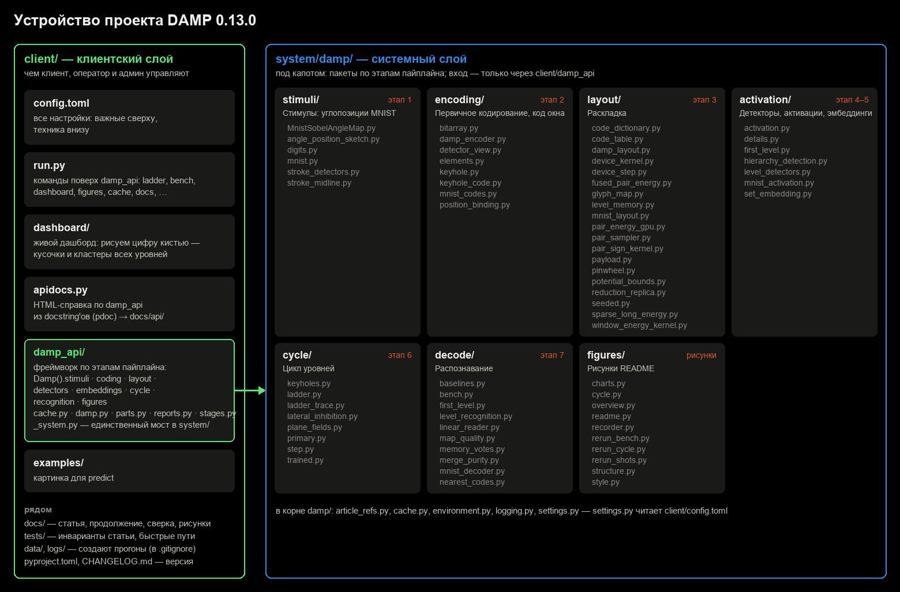

*Зелёная стрелка — единственный вход в системный слой. Рисунок строится по настоящим папкам: `damp.figures.structure()`.*

```text
client/
├── config.toml             # все настройки: самые значимые сверху, техника внизу
├── damp_api/               # фреймворк для программиста: этапы 1–7 как поля Damp()
│   ├── damp.py             #   Damp, Settings (чтение, свои значения — changes)
│   ├── stages.py           #   этапы: stimuli, coding, layout, detectors, embeddings, cycle, recognition, figures
│   ├── parts.py            #   части цикла — результаты кубиков: Digits, Elements, Keyholes, Memory, MapDetectors, …
│   ├── reports.py          #   простые результаты: Code, CycleReport, Prediction, …
│   ├── cache.py            #   кеш шагов: сводка и очистка
│   └── _system.py          #   единственный мост в system/damp
├── run.py                  # команды поверх damp_api: ladder, bench, dashboard, layout, evaluate, predict, figures, pinwheel, detectors, sketch, contour, cache, docs
├── dashboard/              # живой дашборд: server.py (только через damp_api) и static/ (страница: холст, уровни, кластеры, след)
├── apidocs.py              # HTML-справка по damp_api из docstring'ов (pdoc)
└── examples/digit.png      # картинка для predict
system/damp/
├── stimuli/                # этап 1: углопозиции MNIST, цифры прогона (digits.py)
├── encoding/               # этап 2: кодер Encoder, элементы уровня (elements.py), код окна — замочной скважины (keyhole_code.py), картинка детекторов
├── layout/                 # этап 3: Layout (§5), память уровня (level_memory.py), энергии на видеокарте, тест пинвила
├── activation/             # этапы 4–5: детекторы уровня (level_detectors.py), детали (details.py); проход без цикла (first_level.py)
├── cycle/                  # этап 6: окна внимания — замочные скважины (keyholes.py), проход уровня (step.py), лестница (ladder.py), наблюдатель,
│                           #   обученный цикл и путь новой картинки (trained.py — дашборд)
├── decode/                 # этап 7: узнавание по уровню (level_recognition.py), нечёткий поиск, мера «соседи одного класса»;
│                           #   честная мерка: эталоны kNN и CNN (baselines.py), стенд bench (bench.py)
├── figures/                # рисунки README; вкладки цикла в Rerun (rerun_cycle.py), запись стенда (rerun_bench.py)
├── settings.py             # читает client/config.toml; правила выводимых значений; свои значения поверх файла
├── cache.py                # кеш шагов: запись на шаг, ключ от содержимого входа
├── environment.py          # видеокарта и журнал прогона
├── logging.py              # единый журнал: консоль, Rerun, файл JSON Lines с ротацией
└── article_refs.py         # номера параграфов статьи и разделов продолжения
docs/                       # статья, продолжение, сверка со статьёй, рисунки README
tests/                      # инварианты статьи, сверки быстрых путей с прямыми
pyproject.toml, CHANGELOG.md  # пакет и версии
data/, logs/                # создают прогоны (в .gitignore)
```

[↑ к содержанию](#содержание)

## Этап 1. Стимулы: углопозиции MNIST

Стимул — углопозиция: направление края цифры и клетка, где он найден. Извлечение (`system/damp/stimuli/MnistSobelAngleMap.py`) статья не описывает; его параметры — настройки `MNIST_*` в `client/config.toml`:

- картинка 28×28 увеличивается в 8 раз (Lanczos3, 224×224), контраст повышается, на увеличенной картинке считается Собель;
- сетка окон 9×9 увеличенных пикселей — 24×24 клетки на картинку;
- углопозицию даёт только окно, через которое проходит контур цифры; угол — направление перепада яркости (0…360°); одно окно — одна углопозиция, при двух противоположных краях берётся сильнейший;
- место углопозиции — дробное (`MNIST_SUBCELL_POSITION`, вне статьи): целая часть — клетка сетки, дробная — где край проходит внутри неё (центр масс пикселей контура выбранного края, вес — сила градиента).

**Дробное место** снимает «лестницу» у наклонных краёв. При целом месте штрих стоит в середине клетки, и косая линия идёт ступеньками в клетку (1.125 px). Замер — 72 синтетические полосы толщиной 2.2 px, углы через 7.5°:

| | целое место (было) | дробное место (стало) |
|---|---|---|
| разброс места поперёк края, СКО | 0.39 px | 0.04 px |
| худшая полоса | 0.46 px | 0.06 px |
| штрихов | 3 633 | 3 633 |
| **Итого** | ступеньки в клетку | край ровный, в 10 раз точнее; штрихов столько же |

Место входит в код окна через круги места (П.4–П.5), поэтому меняется счёт всех уровней цикла. Шаг между соседями, в котором заданы радиусы построения окон (§6.4), меряется по сетке окон: углопозиции стоят по одной на окно, и дробное место шаг выборки не меняет. Путь дашборда — 100 обучающих цифр с видами, первые 1 000 цифр t10k (стенд не гонялся):

| Место штриха | Уровней | Точность | Пятёрки |
|---|---|---|---|
| целое | 3 | 78.6 % | 46 % |
| дробное (сейчас в конфиге) | 4 | 75.3 % | 38 % |
| **Итого** | | −3.3 п.п. | на дробных местах окна на ~5 % меньше: радиус по максимуму заполнения (§6.4.3) на непрерывных расстояниях выходит чуть меньше, и цикл строит 4-й уровень |

Выключить — `MNIST_SUBCELL_POSITION = false`.

100 цифр дают 8 693 углопозиции, в среднем 87 на цифру; весь обучающий набор (60 000 цифр) — 5 302 618.

**Сила штриха** (`LADDER_STROKE_STRENGTH`, вне статьи). У штриха есть сила края: модуль среднего градиента его участка, нормированный внутри картинки. При `true` (в конфиге сейчас так) «сильнейший» элемент круга места на первом уровне выбирается по этой силе (пулинг `"strongest"`, этап 6). При `false` — как раньше: сила у всех штрихов 1, и выбор идёт по порядку обхода. Углопозиции с силой хранятся в кеше шага `stimuli.sticks`; старые файлы без силы не читаются.

**Группы картинок** (вне статьи). Картинки прогона делятся на группы с явными номерами MNIST, а не на «первые N» (`system/damp/stimuli/digits.py`; у каждой картинки есть свой номер):

| Группа | Откуда | Для чего |
|---|---|---|
| train | MNIST train, пул `BENCH_TRAIN_POOL` = [0, 50 000) | память уровней, детекторы, база деталей |
| validation | MNIST train, пул `BENCH_VALIDATION_POOL` = [50 000, 60 000); не пересекается с train | выбор настроек (select) и итог (report); см. «[Честная мерка](#честная-мерка-damp-против-knn-и-cnn)» |
| test | MNIST t10k | смотрится один раз, в конце этапа, только у выбранных настроек |
| **Итого** | три группы, номера не пересекаются; выборка случайная с зерном `BENCH_SEED` | |

**Виды обучающих цифр** (`LADDER_TRAIN_VIEWS`, §7.1.4). В статье слово берётся сразу в нескольких разбиениях на токены, чтобы сходство не зависело от разбиения. У картинки «разбиение» — то, в какие клетки сетки 24×24 попали штрихи: сдвиг цифры на 1 пиксель (≈ 0.9 клетки) даёт другие углопозиции той же цифры. Поэтому каждая обучающая цифра идёт ещё и в 4 видах, сдвинутых на ±1 пиксель по вертикали и горизонтали (как микросаккады глаза). Виды — тоже обучающие: по ним строятся память уровней и база распознавания (группа `views` внутри `train`; событие `stimuli.views`). Это аугментация сдвигами, поэтому честная пара для DAMP — CNN со сдвигами. Пример-пятёрка берётся только среди исходных цифр.

| | 100 цифр без видов | 100 цифр и 4 вида |
|---|---|---|
| обучающих картинок | 100 | 500 |
| «уровни k=1», report (2 набора, 1 000 отложенных) | 70.2 % | 74.0 % |
| ответов, совпавших при сдвиге проверочной цифры на 1 px | 78 % | 90 % |
| **Итого** | | **+3.8 п.п.** и заметно устойчивее к сдвигу; разбор сдвинутой картинки — ~10 мс |

**Пример — каждый раз другая пятёрка.** `LADDER_FIGURE_PICTURE = "random"` (в конфиге сейчас так): в каждом прогоне цикла берётся другая обучающая пятёрка (выбор один раз за прогон, без зерна); число вместо слова — номер пятёрки по счёту. Какая выбрана, видно в журнале (событие `ladder.example`, поле с номером MNIST) и в Rerun: `пятёрка № <номер MNIST>`. Рисунки README сняты на одной из пятёрок; новый запуск `figures` покажет другую.

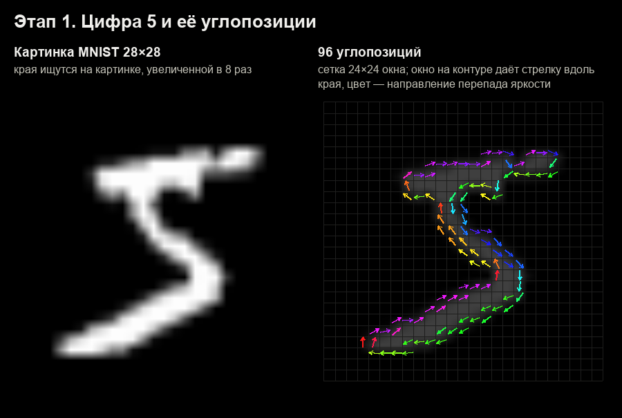

*Цифра 5 и её 85 углопозиций. Стрелка идёт вдоль края, цвет — направление перепада яркости.*

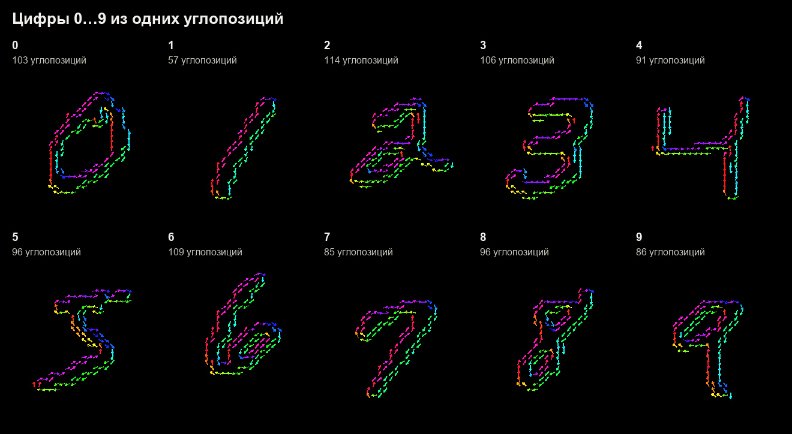

*Цифры 0…9 из одних углопозиций: форма цифры читается по ним целиком.*

[↑ к содержанию](#содержание)

## Этап 2. Первичное кодирование

> ↻ **Начало цикла.** Этапы 2–6 повторяются на каждом уровне. На первом уровне кодируются углопозиции, на следующих — детали прошлого уровня (этап 6).

Кодер устроен по схеме [Angle-Encoder](https://github.com/qwertukg/Angle-Encoder): значение координаты ловят широкие перекрывающиеся детекторы, и каждый сработавший детектор ставит в коде свой бит (§4.1, §4.2). Близкие значения делят часть детекторов, поэтому их коды похожи.

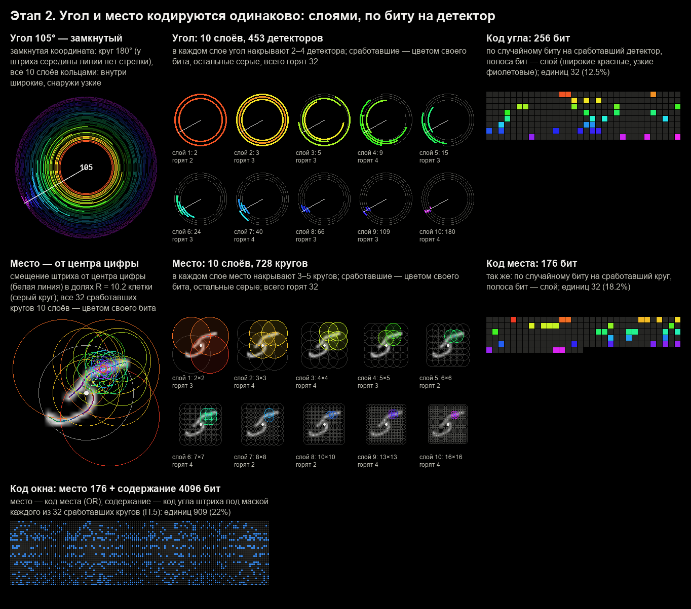

*Цикл, окно в середине цифры 5. Верхний ряд — детекторы угла штриха в центре окна (кольца) и детекторы места в окне (круги двух слоёв); сработавшие яркие, круги залиты. Нижний ряд — код угла штриха, биты места окна и биты содержания окна. Цвет детектора и бита — номер бита: широкие слои красные, узкие фиолетовые.*

[↑ к содержанию](#содержание)

### Первичные детекторы угла, X и Y

Детекторы каждой координаты стоят слоями: каждый слой покрывает всю ось, от самого широкого слоя к самому узкому число детекторов растёт геометрически (§4.2, §4.5). Соседние детекторы слоя перекрываются, поэтому одно значение накрывают сразу несколько.

- **Угол** — замкнутая координата (§4.4): 10 слоёв, в них 2, 3, 5, 9, 15, 24, 40, 66, 109 и 180 детекторов (всего 453), перекрытие 0.7. Одно значение включает 31–32 детектора.
- **X и Y в цикле** — место штриха **внутри окна**, отсчитанное от центра окна, а не место на картинке. Поэтому одна и та же форма даёт один и тот же код в любом месте кадра (§7.1.4.1). Место — двумерная позиция, и её детекторы — круги на плоскости окна (§4.3): два слоя, 9 широких и 81 узкий круг, перекрытие 0.4 (`LADDER_BINDING_PLACE_*`).
- **X и Y в команде `layout`** — место на картинке: отрезки −1…28, у каждой координаты 10 слоёв, 2…28 детекторов в слое (всего 106), перекрытие 0.7.

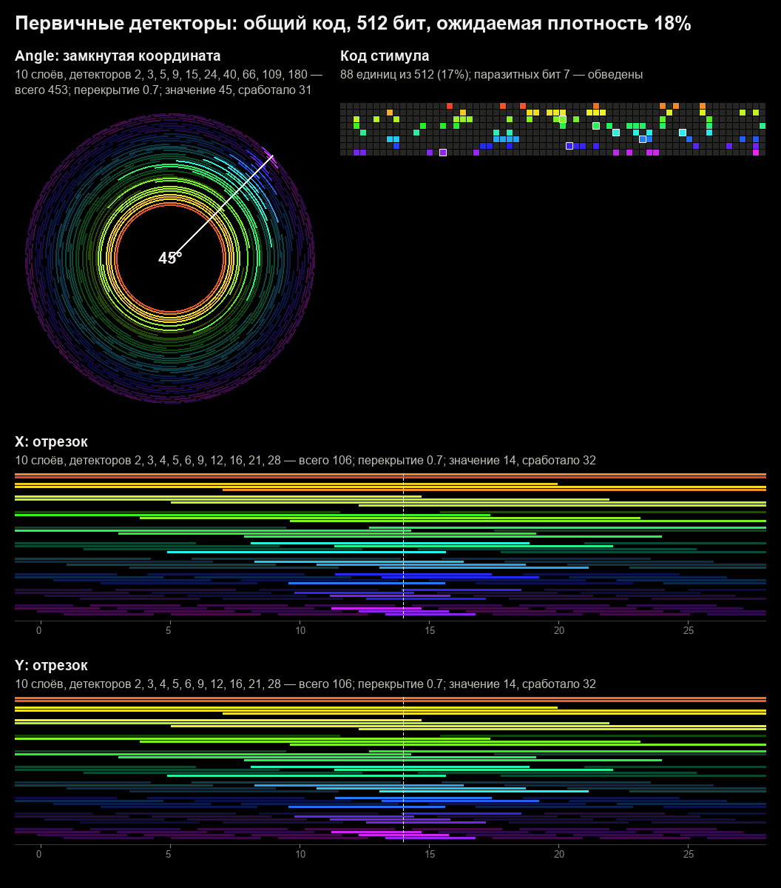

*Кодер команды `layout` для стимула (45°, 14, 14): угол — кольца, X и Y — полосы; справа — общий код 512 бит, обведены паразитные биты. Ту же картинку рисует `python client/run.py detectors`.*

Профиль сходства каждой координаты проверяется при сборке кодера (§4.5, §5.13.1): сходство кодов должно убывать с расстоянием на всём диапазоне, иначе кодер пишет `encoder.long_range_order.warning`.

[↑ к содержанию](#содержание)

### Случайный бит, ограниченная длина и плотность кода

- **Случайный бит.** Код делится на цветовые полосы по слоям (§3.2, §4.2.1): самый широкий слой получает младшие («красные») биты, самый узкий — старшие («фиолетовые»). Каждому детектору назначается один случайный бит своей полосы. Совпадения битов у далёких детекторов допускаются.
- **Ограниченная длина.** Длина кода задаётся заранее и не зависит от числа детекторов: у 453 детекторов угла код 256 бит, у 90 кругов места — тоже 256. Коды координат объединяются операцией OR (§2.2.1); бит, который поставили детекторы двух координат, — паразитный (§4.2.1). В команде `layout` угол, X и Y сливаются в общий код 512 бит (`ENCODER_SHARED_CODE`).
- **Плотность.** Доля единиц не должна превышать 25 % (§2). Код угла — 32 единицы из 256 (12.5 %); общий код команды `layout` — в среднем 89.6 единицы из 512 (17.5 %).

[↑ к содержанию](#содержание)

## Этап 3. Раскладка

Коды обучающих стимулов раскладываются на двумерной карте `Layout` (§5): похожие коды встают рядом. В цикле раскладываются коды окон (этап 6), и карта — память уровня, одна на все окна (П.2); перед раскладкой почти одинаковые коды (косинус не ниже 0.8) сливаются к одному образцу (`LeaderDictionary`), в замерах карта ограничена 5 000 точками. В команде `layout` раскладываются все углопозиции обучающих цифр.


*Вырезка из карты памяти первого уровня цикла. В ячейке — то, что видит окно этой точки, на фоне соседних углопозиций; цвет рамки — цифра, откуда окно. Рядом лежат похожие обрывки контура: наклонные линии, углы, дуги.*

Как идёт раскладка:

- сходство кодов — косинус; порог `sim_λ = sim · σ(η(sim − λ))` с λ = 0.65 (§5.4);
- дальняя фаза собирает похожие коды в области, ближняя наводит порядок внутри них (§5.5); точки меняются местами, если обмен снижает энергию пары (§5.6); пары шага выбираются случайно и считаются параллельно (§5.3, §5.10);
- сторона сетки — `⌈√(N·(1 + LAYOUT_EMPTY_RATIO))⌉`, пустых ячеек — 15 % от числа точек, как в статье (§7.1.6); замер при 50 % не лучше, см. [сверку со статьёй](docs/ARTICLE_COMPLIANCE.md);
- остановка фазы — по числу обменов за шаг или по бюджету шагов (§5.6, §7.1.7).

**Режим дальней фазы** задаёт `LAYOUT_SMOOTH_PINWHEELS` в `client/config.toml`:

- `False` — по статье: `φ = Σ s·d` по всему пространству (§5.5.1), жёсткий порог, радиус пар и λ меняются по расписанию §7.1.7;
- `True` — **сейчас стоит в конфиге** — сглаживание: гауссово ядро дальней фазы, фиксированный λ, слабый отжиг; карта выходит из многих пинвилов с плавными переходами между ними. Этого режима нет ни в статье, ни в продолжении — это наша доработка; на неё настроены все замеры этого README.

**Тест пинвила** (`python client/run.py pinwheel`) раскладывает 360 кодов угла на каждую из четырёх позиций — 1 440 кодов «угол + место» общего кодера команды `layout`. Ожидаемая картина — по пинвилу на позицию с непрерывным углом через границы, как в ориентационных картах V1. Образец — [docs/pinwheel.png](docs/pinwheel.png).

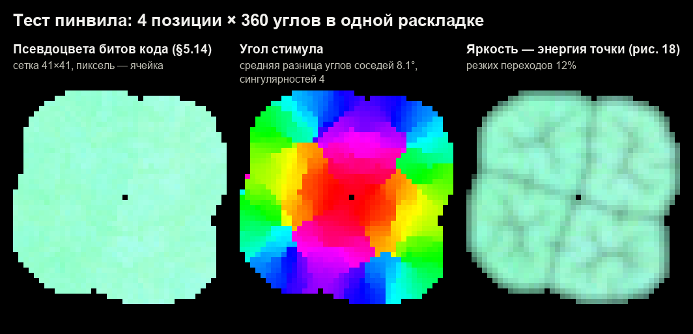

*Одна раскладка в трёх раскрасках: псевдоцвета битов кода (§5.14), угол стимула, яркость по энергии точки (рис. 18 статьи).*

[↑ к содержанию](#содержание)

### Карты всего MNIST в двух режимах

Команда `layout` разложила весь обучающий набор — 60 000 цифр, 5 302 618 углопозиций на сетке 2821×2821 — в обоих режимах. Пиксель — ячейка сетки, цвет — угол стимула (0° — красный, 120° — зелёный, 240° — синий), чёрное — пустые ячейки. Угол в раскладке не участвует: это проверочная раскраска, как на рис. 16 статьи.

| Режим статьи | Сглаживание |
|---|---|
|  | 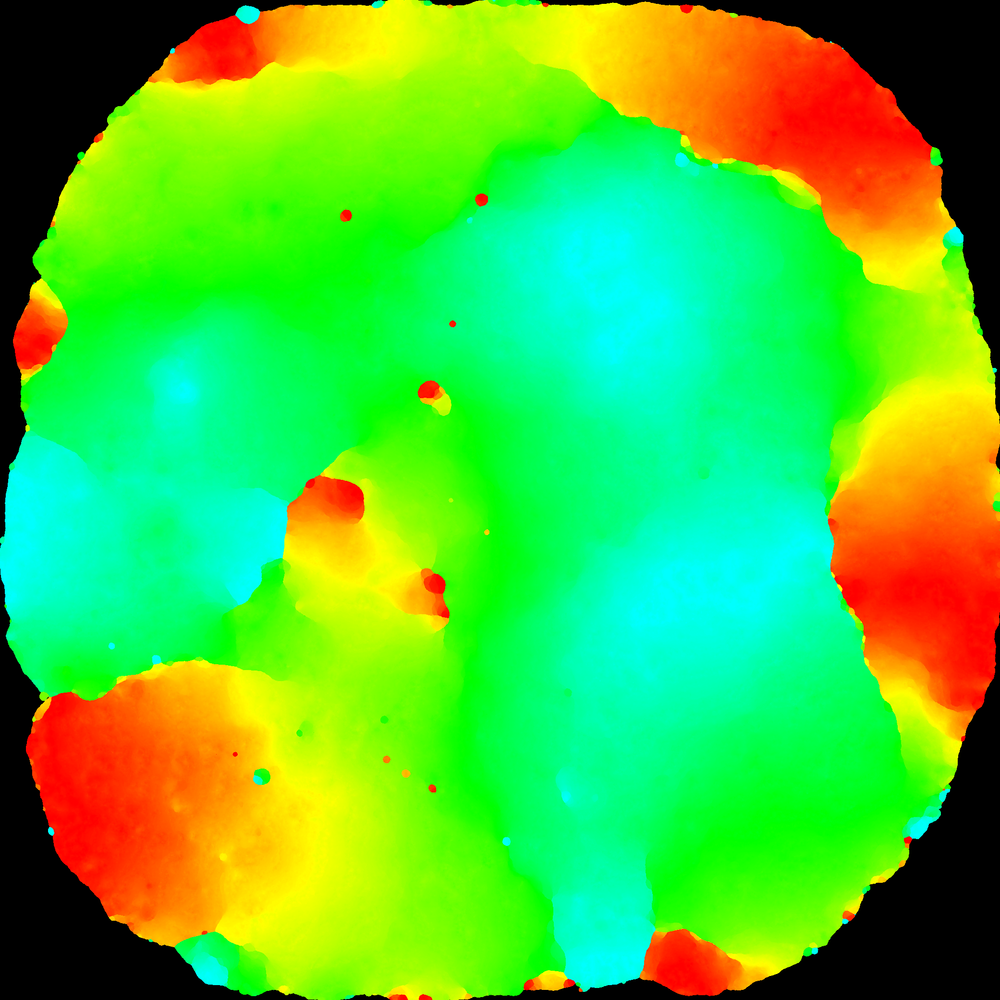 |

| Показатель | Режим статьи | Сглаживание |
|---|---|---|
| Глобальная энергия §5.5.1 при λ = 0.8, доля от случайной расстановки | 0.220 | 0.273 |
| Соседние ячейки со сходством ниже 0.65 | 0.13 % | 0.004 % |
| Соседние ячейки с разностью угла больше 30° | 0.34 % | 0.27 % |
| Качество Ē (§5.8, r_e = 3) | 0.980 | 0.981 |

В режиме статьи каждый угол занимает одну большую область с резкими границами, глобальная энергия статьи ниже. При сглаживании карта состоит из многих пинвилов, локально она глаже.

[↑ к содержанию](#содержание)

### Расчёт энергий

Энергии пар и точек считаются на видеокарте (PyTorch): сходство кодов — матричным произведением на лету, без матрицы N×N (§5.9.5, §5.12); окрестность ближней фазы (§5.5.2) — по окну ячеек вокруг пары; выбор пар — векторно (§5.3, §5.9.1, §5.9.3). Ускоренные пути дают **тот же результат бит в бит**: слагаемые считаются теми же операциями float32 и суммируются той же редукцией, а по ходу раскладки пути сверяются с исходным проходом и при расхождении отключаются. Нужны CUDA и numba; без них работают исходные пути.

- **Строки ненулевых `sim_λ`** (`LAYOUT_SPARSE_LONG`): при жёстком пороге суммы §5.5.1, §5.5.2 и §5.7 сводятся к точкам, похожим на точки пары.
- **Знак вместо суммы** (`LAYOUT_PAIR_KERNEL`): правилу обмена §5.6 нужен только знак разности энергий; его выносит ядро устройства.
- **Граница потенциала** (`LAYOUT_POTENTIAL_BOUNDS`): по неравенству Йенсена заведомо невыгодные пары отсеиваются без счёта строк.
- **Почти-ничьи** (`LAYOUT_REDUCTION_REPLICA`): у пар с разностью в пределах ошибки суммирования решение повторяется на хосте в том же порядке сложения.
- **Выборка пар** (`LAYOUT_COMPILED_SAMPLER`): циклы выборки скомпилированы numba и берут те же случайные числа.
- **Слитое ядро** (`LAYOUT_FUSED_ENERGY`): при сглаживании всё слагаемое пары считает одно ядро CUDA по таблице сходств (§5.9.5).

[↑ к содержанию](#содержание)

### Большие наборы

Наборы больше 100 000 точек (`LAYOUT_LONG_FULL_SPACE_MAX_POINTS`) раскладываются от «затравки»: случайные 30 000 точек раскладываются целиком, остальные встают возле самых похожих точек затравки (§5.9.4). В режиме статьи между затравкой и полным набором идут промежуточные уровни (60 000 цифр: 30 тыс. → 399 тыс. → 5.3 млн точек) с ближней фазой целиком на видеокарте; при сглаживании после расстановки идут дальняя фаза с малого радиуса и ближняя.

[↑ к содержанию](#содержание)

### Время

Команда `python client/run.py layout --count N --layout-only --rebuild`, RTX 2060 SUPER:

| Цифр | Точек | Сетка | Режим статьи | Сглаживание |
|---|---|---|---|---|
| 100 | 8 693 | 115² | 52 с | 20 с |
| 300 | 26 201 | 199² | 1 мин 49 с | 53 с |
| 1000 | 88 317 | 364² | около трёх часов | 9 мин 22 с |
| 10 000 | 882 607 | 1151² | 2 мин 31 с | 2 мин 41 с |
| 60 000 | 5 302 618 | 2821² | 5 мин 27 с | 13 мин 27 с |

В режиме статьи самые медленные — наборы примерно от 550 цифр до 100 000 точек: строки сходства не помещаются в память, и дальняя фаза идёт плотным проходом. Наборы больше идут от затравки и считаются за минуты. Время цикла — в разделе «[Скорость](#скорость)».

[↑ к содержанию](#содержание)

### Файлы результата

Команда `layout` сохраняет раскладку в `data/layout-<count>-<radius>-<LAYOUT_CACHE_TAG>.json` (вместе с детекторами и эмбеддингами, этапы 4–5), карту — в трёх раскрасках: `data/<count>-<radius>.png` — псевдоцвета битов кода (§5.14), `.energy.png` — яркость по энергии точки (рис. 18), `.angle.png` — угол стимула (рис. 16). Файлы цикла — в разделе этапа 6.

[↑ к содержанию](#содержание)

## Этап 4. Детекторы и активации

Раскладка положила похожие коды рядом. Теперь её нужно научиться читать: стимул **зажигает** точки карты, похожие на него, а **детекторы** — круги над кластерами похожих точек — срабатывают по зажжённым точкам своего поля (§6).

- **Детекторы** (§6.4, §7.1.10): пять слоёв, у каждого свой порог сходства λ_d. Детектор строится вокруг случайного центра: кластер похожих точек находит DBSCAN (§6.4.1), радиус выбирается по наибольшему заполнению (§6.4.3), детектор вставляется с заменой менее плотных (§6.4.5). В цикле пороги слоёв идут равными шагами между квантилями попарных сходств кодов карты, которыми задан порог её раскладки (§7.1.7), — на первом уровне 0.39…0.53; в команде `layout` — 0.7…0.9.
- **Энергия точки** `Ê` (§5.7) — насколько точка похожа на соседей; точки с малой энергией в срабатывание не входят (§6.5).
- **Активация** (§6.1): стимул зажигает точки, сходство с которыми не ниже λ_a; λ_a равен порогу нижнего слоя детекторов (§7.1.11). В цикле самая похожая точка зажигается всегда — это наша добавка: иначе стимул без единой зажжённой точки не оставил бы следа.
- **Срабатывание** (§6.5): уровень активации детектора — энергия зажжённых точек его поля, делённая на его собственную энергию, `E(d) = Σ a·e / e_d`; детектор срабатывает при уровне не ниже μ_d = 0.5.
- **Нормировка уровня** (`LADDER_LEVEL_NORMALISATION`). Статья требует лишь значений уровня в [0, 1] (§7.1.12, §9.3), способа не задаёт. Два значения:
  - `"none"` — ровно формула §6.5, уровень сверху не ограничен: обычно около 0.75, но у отдельных детекторов доходит до 8, 12 и 44, и «сильнейшую» деталь области выбирают эти выбросы;
  - `"train_max"` — **доработка вне статьи**: уровень детектора делится на его наибольший уровень по окнам обучающих картинок и обрезается в [0, 1] (детектор, ни разу не сработавший на обучающих: `min(E, 1)`). По нормированным уровням выбираются σ сильнейших детекторов детали, считаются сила детали (П.1) и пик отклика картинки. Проверочные окна нормировку не меняют.
  - **По умолчанию — `"none"`, формула статьи.** Замер этапа 0 (стенд, 5 наборов): `train_max` 65.1 %, `none` 64.5 % на report — разность в пределах шума, поэтому оставлена формула §6.5 (таблица вариантов — в «[Честной мерке](#честная-мерка-damp-против-knn-и-cnn)»).


*Пять слоёв детекторов над картой памяти первого уровня цикла: чем выше порог сходства слоя, тем мельче кластеры и тем больше детекторов — от широких областей к узким кластерам.*


*Окно в середине цифры 5. Его код зажигает 1 862 точки памяти из 5 000 (синие, ярче — похожее), по ним срабатывает 278 детекторов из 1 056; яркие круги — 50 сильнейших.*

[↑ к содержанию](#содержание)

## Этап 5. Эмбеддинги первого уровня

Эмбеддинг — код того, какие детекторы сработали на набор стимулов, предъявленных вместе (§6.5). Он описывает уже не отдельный стимул, а целое — «какие области памяти отозвались».

- Код — по одному случайному биту от каждого из `σ` = 50 сильнейших сработавших детекторов, colour merge (§6.5, §7.1.12). Длина кода подбирается под плотность 0.25 (§6.6) **только по окнам обучающих картинок уровня** (по маске, а не по первым наборам): проверочные окна на неё не влияют.
- **Пустая деталь** — окно, на котором не сработал ни один детектор. Она не голосует и не входит в базу распознавания (этап 7), а в расчёт `code_resolution` и `code_largest` не берётся; число пустых деталей — `detail_empty`.
- В цикле набор — содержимое одного окна, а эмбеддинг — **деталь**: 152–176 бит, единиц около 40; место детали — центр её окна, уровень активации — самый сильный из сработавших детекторов (П.1: точка несёт «что» и «насколько»). Детали первого уровня — элементы второго (этап 6).
- В команде `layout` набор — все углопозиции картинки сразу, и эмбеддинг описывает картинку целиком; база эмбеддингов обучающих цифр сохраняется вместе с раскладкой и идёт в распознавание (этап 7).

**Мерки статьи по уровням.** Каждый уровень цикла считает мерки из статьи и пишет их в событие `ladder.level`, в отчёт `CycleLevel` (API) и во вкладку этапа 5 в Rerun:

| Мерка | Что это | Параграф |
|---|---|---|
| `energy_mean` | Ē — средняя энергия точек карты уровня, качество раскладки | §5.8 |
| `code_resolution` | сколько окон приходится на один код детали; 1 — все коды разные. Статья меряет коды карты, здесь — коды деталей (вне статьи) | §5.13.2.5 |
| `code_largest` | наибольший набор окон с одним и тем же кодом детали | §5.13.2 |
| `detail_bits` | среднее число единиц в коде детали | §6.5 |
| `detail_empty` | доля пустых деталей | §6.5 |
| `detail_full` | доля обучающих окон, у которых сработало не меньше σ = 50 детекторов (код упёрся в предел) | §7.1.8.1 |
| **Итого** | 6 мерок на уровень; замер этапа 0 (настройки по умолчанию, среднее по 5 наборам) — в таблице ниже | |

| Уровень | `energy_mean` | `code_resolution` | `code_largest` | `detail_bits` | `detail_empty` | `detail_full` |
|---|---|---|---|---|---|---|
| 1 | 0.648 | 1.002 | 6.2 | 43.5 | 0.0 % | 92 % |
| 2 | 0.601 | 1.007 | 5.8 | 40.2 | 0.9 % | 82 % |
| 3 | 0.661 | 1.007 | 10.0 | 41.5 | 1.3 % | 86 % |
| **Итого** | Ē 0.60–0.66 | почти каждый код детали уникален | | ~40 единиц | пустых ≤ 1.3 % | у 82–92 % окон сработало ≥ σ детекторов — код упирается в σ | |


*Слева — сильнейшие детекторы окна, справа — код детали (зелёные клетки) и все детали цифры 5 первого уровня: по одной на окно, в центре окна.*

[↑ к содержанию](#содержание)

## Этап 6. Цикл: уровни выше первого

Этапы 2–5 — один проход: код → раскладка → детекторы и активации → эмбеддинг. Статья говорит повторять его: коды детекторов «can be combined, transformed, and laid out at the next level of the hierarchy» (§6.2), «by combining the resulting codes and repeating the process layer by layer, we can obtain complex descriptions» (§6.6). Как собирать коды одного уровня в стимулы следующего, описывает продолжение статьи.

[↑ к содержанию](#содержание)

### Принципы

1. **Один проход на каждом уровне.** Коды раскладываются, над раскладкой строятся детекторы, картинки подаются снова, сработавшие детекторы дают эмбеддинги — и эти эмбеддинги становятся кодами следующего уровня (§6.2, §6.6).
2. **Точка — это «что» и «насколько».** Каждая точка уровня несёт код распознанной детали и уровень активации — насколько увиденное совпало с памятью (П.1).
3. **Окно — миниколонка, память — общая.** Картинку смотрят множеством маленьких окон, «замочных скважин». Каждое окно само сверяет то, что видит, с памятью уровня — одной на все окна — и даёт одну точку следующего уровня. Окна сдвигаются плавно и сильно перекрываются, поэтому соседние точки похожи (П.2, П.3).
4. **Признак привязан к месту.** Детектор места добавляет свои биты места и вносит код признака, изменённый своей маской; перед этим он выбирает, что взять из своей области (пулинг) (П.4, П.5).
5. **Один признак в разных местах — разные вклады.** Одинаковые линии в разных углах окна попадают к разным детекторам и дают разные биты: код зависит и от того, что найдено, и от того, где (П.6).
6. **В деталь входит немного — пять–семь понятий.** Лишние биты и целые коды отбрасываются; код работает как хеш: мелочи начертания теряются, остаётся более ёмкое понятие (П.7).
7. **Окно растёт.** На следующем уровне окно охватывает более крупную область и описывает сочетания деталей прошлого уровня: от штрихов — к частям цифры, от частей — к цифре (П.3).
8. **Место на картинке в код не входит.** Признак записан относительно своего окна, поэтому цифра узнаётся в любом месте кадра, а память, выученная на малом поле, годится для большего (§7.1.4.1, П.9).
9. **Число уровней не задаётся.** Цикл повторяется, пока сочетания деталей не сложатся в коды целых понятий — пока окно не увидит объект целиком (П.7). Память всех уровней остаётся: поиск идёт по ним снизу вверх (§8.2).

[↑ к содержанию](#содержание)

### Как это сделано

В коде цикл — команда `ladder`: лестница `MnistLadderRunner` (`system/damp/cycle/ladder.py`) повторяет проход уровня `CycleStep` (`system/damp/cycle/step.py`), собранный из частей этапов 2–5. Те же части — кубики фреймворка `damp_api` (см. «[Фреймворк damp_api](#фреймворк-damp_api)»):

```powershell
python client/run.py ladder --count 100 --limit 500
```

**Окно внимания** (П.2) — «замочная скважина», через которую уровень смотрит на картинку (в коде — `keyhole`), — стоит на каждом элементе уровня: на первом уровне — на каждом штрихе, дальше — на каждой детали. Радиус окна находится по статье (§6.4.1–§6.4.3): у элемента ищется кластер похожих на него соседей, затем круг вокруг элемента, в котором не меньше 5 точек кластера и заполнение `n / (π r²)` наибольшее. Взвешенного центра (§6.4.2) и вытеснения перекрывающихся полей (§6.4.5) здесь нет: окно стоит на своём элементе, а поля соседних окон по П.2 обязаны перекрываться.

**Код окна** записывает, что в окне и где (П.4, П.5). Объединить коды признаков и коды мест простым OR нельзя: «угол слева, линия справа» и «линия слева, угол справа» дали бы один код. Поэтому у каждого круга места (этап 2) две составляющие:

- **место**: сработавший круг добавляет в код свой случайный бит (OR);
- **содержание**: круг берёт из своей области один элемент — самый сильный (пулинг) — и вносит его код, переставленный своей маской: бит `i` уходит в бит `i ⊕ m`, у каждого круга своё `m`. Число единиц при этом сохраняется, а одинаковые элементы в разных местах окна дают разные биты (П.6).

Код окна — 256 бит места и 4 096 бит содержания, всего 4 352 бита, единиц в нём 560–870. Длина содержания подбирается по обучающим окнам под среднюю плотность 0.2; если в окне бит больше четверти длины, лишние отбрасываются слиянием цветов (§3.3), первыми уходят биты узких кругов. Масштаб мест окна (внешний и внутренний радиус кругов места) тоже берётся только по обучающим картинкам: проверочные картинки код обучающих окон не меняют (тест `TaughtOnlyFieldTest`).

**Рост окна.** Продолжение требует, чтобы окно следующего уровня «охватывало более крупную область карты» (П.3), но не говорит, во сколько раз. Правило §6.4.3 само роста не даёт: детали стоят так же густо, как штрихи, и круг выходит того же размера. Поэтому радиусы окна на уровне меряются в том, что видит одна деталь этого уровня: окно на карте равно полю своей детали. Основание взято из физиологии зрения: рецептивное поле растёт в 2–2.5 раза от области к области (V1 → V2 → V4; Freeman & Simoncelli 2011, Rolls 2012). Замер: радиус поля на картинке 2.6 → 6.6 → 15.5 клетки.

**Остановка.** Последний уровень — первый, чьё окно в среднем видит не меньше `LADDER_TOP_COVERAGE` = 0.9 углопозиций своей картинки; на MNIST это третий.

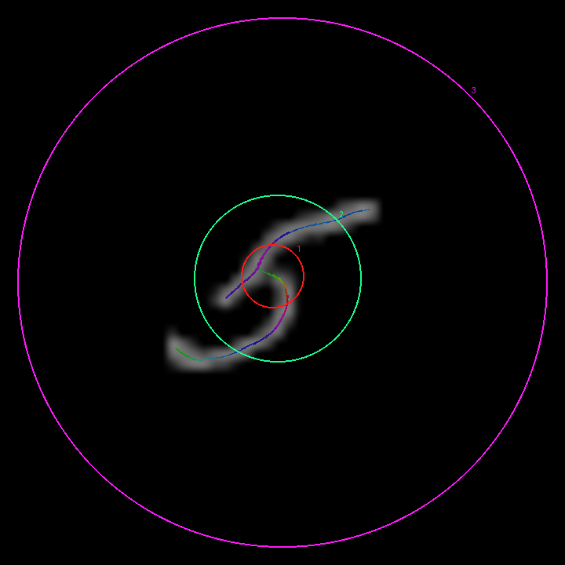

*Цифра 5, её углопозиции и окна уровней 1–3 вокруг одного места.*

[↑ к содержанию](#содержание)

### Шаг уровня

| № | Что делается | Этап | Кубик `damp_api` | Чем в системе | Основание |
|---|---|---|---|---|---|
| 1 | На каждом элементе уровня ставится окно, радиус — по кластеру похожих соседей | 6 | `cycle.keyholes(elements)` | `KeyholeBuilder`, `PlaneFieldBuilder` | П.2; §6.4.1–§6.4.3 |
| 2 | Содержимое окна записывается одним кодом «что и где» | 2 | `coding.keyholes(keyholes)` | `KeyholeCoder`, `PositionBindingEncoder` | П.4–П.7 |
| 3 | Коды окон обучающих картинок раскладываются — память уровня | 3 | `layout.memory(codes)` | `MemoryMap`: `LeaderDictionary`, `Layout` | §5; П.2 |
| 4 | Над картой строится иерархия детекторов | 4 | `detectors.build(memory)` | `LevelDetectors`: `DetectorHierarchyBuilder` | §6.4, §7.1.10 |
| 5 | Картинки подаются снова: окно зажигает точки памяти, срабатывают детекторы | 4 | `detectors.fire(codes)` | `HierarchyDetection` | §6.1, §6.5 |
| 6 | Сильнейшие детекторы дают код детали; деталь встаёт в центр окна | 5 | `embeddings.details(firing)` | `DetailCoder`: `DetectorEmbeddings` | §6.5, §6.6, §7.1.12; П.1 |

Ниже один и тот же шаг на трёх уровнях: окно в середине цифры 5.

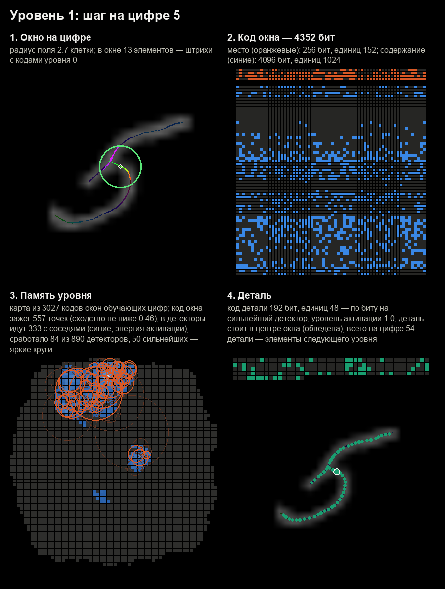

*Уровень 1: в окне 15 штрихов, его код зажигает 1 862 точки памяти, срабатывает 278 детекторов.*

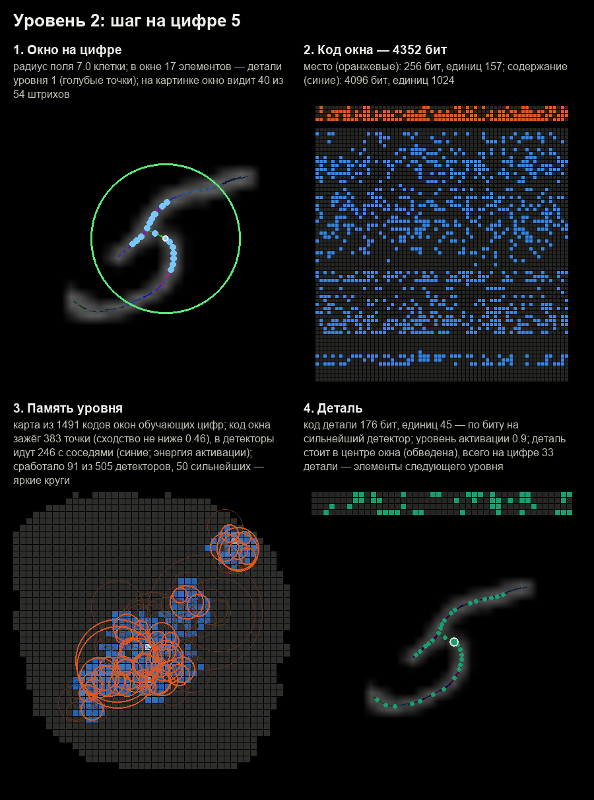

*Уровень 2: в окне 25 деталей первого уровня, на картинке оно видит 50 штрихов из 85.*

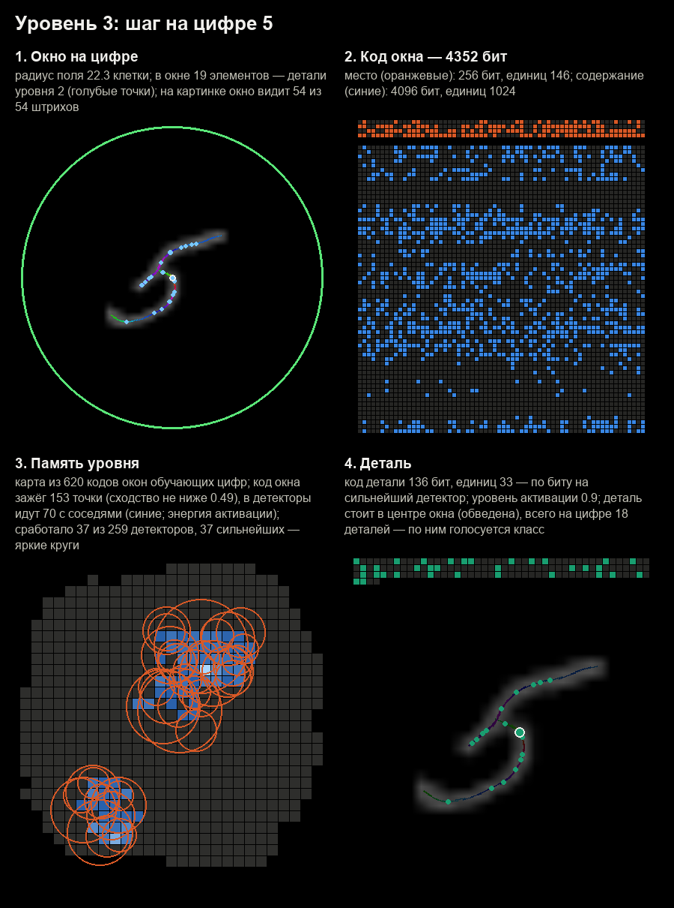

*Уровень 3: в окне 56 деталей второго уровня, оно видит всю цифру (85 штрихов из 85).*

[↑ к содержанию](#содержание)

### Что получается на 100 цифрах

100 обучающих цифр и их 4 сдвинутых вида (500 обучающих картинок, §7.1.4), 500 проверочных, карта уровня до 5 000 точек.

| Уровень | Радиус поля на картинке | Окно видит цифры | Окон на картинку | Элементов в окне | Точек карты | Детекторов |
|---|---|---|---|---|---|---|
| 1 | 2.6 | 11 % | 87 | 9.4 | 5 000 | 1 056 |
| 2 | 6.6 | 43 % | 87 | 16.5 | 5 000 | 1 029 |
| 3 | 15.5 | 93 % | 85 | 42.8 | 5 000 | 1 030 |

> Таблица снята прогоном рисунков при целом месте и до исправления окна (граничный сосед, 0.11.0); с дробным местом уровней 4. Пересчитает `python client/run.py figures`.

Из элементов окна в его код проходит около двадцати — по одному на сработавший круг места.


*Вырезки из середины карт памяти. На первом уровне рядом лежат похожие обрывки контура, на втором — крупные части цифр, на третьем — цифры почти целиком, и одинаковые цифры собираются в пятна.*

[↑ к содержанию](#содержание)

### Настройки

Все настройки — `LADDER_*` в `client/config.toml`, разделы «Цикл уровней» и «Код окна». Настройки стенда сравнения — `BENCH_*` (раздел «Протокол данных и стенд»; см. «[Честная мерка](#честная-мерка-damp-против-knn-и-cnn)»).

| Константа | Значение | Смысл |
|---|---|---|
| `LADDER_CLUSTER_MIN_POINTS` | 5 | сколько похожих соседей должно быть в окне (§6.4.3; П.7: «пять–семь понятий») |
| `LADDER_CLUSTER_SIMILARITY_QUANTILES` | 0.75, 0.5, 0.25, 0.1, 0 | пороги сходства слоёв при поиске кластера окна |
| `LADDER_TOP_COVERAGE` | 0.9 | доля углопозиций картинки в окне, при которой уровень последний |
| `LADDER_STROKE_STRENGTH` | `true` | сила штриха первого уровня по силе края; `false` — у всех 1 (вне статьи; [этап 1](#этап-1-стимулы-углопозиции-mnist)) |
| `LADDER_LEVEL_NORMALISATION` | `"none"` (по умолчанию) или `"train_max"` | нормировка уровня активации детектора: `"none"` — формула §6.5, `"train_max"` — деление на максимум по обучающим окнам, доработка вне статьи ([этап 4](#этап-4-детекторы-и-активации)) |
| `LADDER_FIGURE_PICTURE` | `"random"` | пятёрка-пример: `"random"` — каждый раз другая, число — её номер по счёту |
| `LADDER_BINDING_POOLING` | `"strongest"` | что круг места берёт из своей области: сильнейший элемент |
| `LADDER_BINDING_MASK` | `"address"` | маска переставляет биты кода признака: бит `i` → `i ⊕ m` |
| `LADDER_BINDING_PLACE_RADIUS_MAX` / `_MIN` | 2.0 / 0.75 | радиусы двух слоёв кругов места, в шагах мест |
| `LADDER_BINDING_TARGET_DENSITY`, `LADDER_BINDING_SATURATION` | 0.2, 0.25 | средняя плотность кода окна и предел бит одного окна |
| `LADDER_MERGE_SIMILARITY` | 0.8 | порог слияния кодов окон к образцу |
| `LADDER_MAP_MAX_POINTS` | `None` | предел точек карты; в замерах README — 5 000 |
| `LADDER_SATURATION` | 50 | `σ`: сколько сильнейших детекторов идёт в код детали |
| `LADDER_TARGET_DENSITY` | 0.25 | плотность кода детали |

[↑ к содержанию](#содержание)

### Файлы результата

Цикл пишет файлы в `data/ladder-*`: карты уровней (`-level<N>-*.json|png`), те же карты с рисунками окон в ячейках (`-level<N>-keyholes-<count>.glyphs.png`: ярко — что окно видит, тускло — соседние углопозиции, рамка — цифра), карту верхних деталей (`-classes-*`) и окна уровней на цифре-примере (`-fields-<count>.png`; цифра — `LADDER_FIGURE_DIGIT` = 5).

> ↺ **Конец цикла.** Детали уровня — элементы следующего: цикл возвращается к [этапу 2](#этап-2-первичное-кодирование), пока окно не увидит цифру целиком; потом — [этап 7](#этап-7-распознавание).

[↑ к содержанию](#содержание)

## Этап 7. Распознавание

Как получать класс, статья не описывает; здесь распознавание — мерка того, собрались ли классы. Ответ — по самым похожим обучающим примерам, нечёткий поиск (§2.2.5).

[↑ к содержанию](#содержание)

### По эмбеддингам первого уровня

Без цикла: эмбеддинг всей картинки (этап 5, команда `layout`) сравнивается с базой эмбеддингов обучающих цифр (`system/damp/decode/mnist_decoder.py`).

```powershell
python client/run.py layout --count 100 --activation-samples 100
python client/run.py evaluate --count 100 --split test --limit 100
python client/run.py predict --count 100 --image client/examples/digit.png
```

`layout` строит раскладку, детекторы и базу эмбеддингов; `evaluate` считает точность на выборке; `predict` распознаёт одну картинку (`--image`) или `--limit` картинок набора `--dataset`, `--calibrate` подбирает температуру softmax.

[↑ к содержанию](#содержание)

### По уровням цикла

Поиск цифры идёт снизу вверх, тем же путём, что обучение: картинка подаётся на вход, отклик проходит уровень за уровнем.

| Мерка | Как считается |
|---|---|
| Отклик уровня | сколько раз каждый детектор памяти уровня сработал на окнах картинки; класс — у самой похожей обучающей картинки (косинус) |
| Отклик по сильнейшему | то же, но берётся самый сильный уровень активации каждого детектора по всем окнам картинки |
| Склейка уровней | отклики уровней 1…k подряд |
| Голосование верхних деталей | каждая деталь верхнего уровня голосует классом самой похожей детали обучающих картинок |
| Уровни активности окна (§7.1.12) | окно верхнего уровня — вектор уровней активности детекторов в [0, 1]; голосуют k самых похожих окон обучающих (косинус); считает стенд `bench` |
| Линейный читатель (§9.3) | эмбеддинг картинки — самый сильный уровень активации каждого детектора по её окнам на всех уровнях (сегмент уровня единичной длины); класс читает один линейный слой с softmax, обученный на обучающих картинках (`LinearReader`, `system/damp/decode/linear_reader.py`); считают стенд `bench` и кубик `damp.recognition.linear` |
| Соседи одного класса | доля соседних точек карты памяти, пришедших с одной и той же цифры |
| **Итого** | 7 мерок: 6 дают ответ, седьмая меряет саму карту; стенд выбирает читателя по select | |

**Линейный читатель** (§9.3: «нормированные уровни активации иерархии детекторов — эмбеддинг в ℝⁿ … выход дискретной модели — вход нейросети»). Память DAMP строится без учителя; читатель — с учителем, учится только на обучающих картинках (вместе с видами), штраф L2 `λ` из `BENCH_LINEAR_DECAYS` = [1e-8, 1e-7, 1e-6] выбирается по select. Событие `recognition.linear` пишет λ, число признаков, потерю и итерации L-BFGS. На 2 наборах с видами: λ = 1e-7 — **79.8 %** против 74.2 % у «уровни k=3».

**Пустые детали не голосуют.** Деталь, на которой не сработал ни один детектор, не входит в базу обучающих деталей и не голосует; картинка, у которой не осталось ни одного голоса, или картинка с нулевым откликом, считается неверной, а не угаданной случайно. Событие `recognition.vote` пишет число голосов и пустых деталей, `recognition.response` — картинки без отклика.

[↑ к содержанию](#содержание)

### Честная мерка: DAMP против kNN и CNN

Цель проекта — догнать и обогнать обычную свёрточную сеть при прочих равных: те же картинки, никаких лишних данных. Поэтому эталоны считаются здесь же, а настройки выбираются не по тем картинкам, по которым считается итог. Стенд `bench` (`HonestBench`, `system/damp/decode/bench.py`; вне статьи):

```powershell
python client/run.py bench                                   # 5 наборов по 100 цифр, 1 000 отложенных
python client/run.py bench --count 100 --sets 5 --validation 1000 --test 500   # финал этапа: ещё и test
python client/run.py bench --methods damp pixels --augment none               # только DAMP и kNN
```

Ключи: `--count`, `--sets`, `--validation`, `--test` (0 — не считать), `--map-points`, `--methods` (`damp`, `pixels`, `cnn`), `--augment` (`none`, `shifts`). Результат — `data/bench/bench-<время>.json`: настройки, версия, номера картинок MNIST, все цифры.

**Протокол.**

| Часть | Что в ней | Что по ней решается |
|---|---|---|
| 5 обучающих наборов | по 100 цифр, случайная выборка из пула [0, 50 000), наборы не пересекаются | чему учатся все методы; итог — среднее по наборам |
| select | половина отложенной выборки (`BENCH_SELECT_SHARE` = 0.5) | выбор k у DAMP и kNN, конфигурации CNN, ранняя остановка и выбор лучшей CNN |
| report | вторая половина отложенной выборки (`BENCH_VALIDATION` = 1 000 картинок всего: select 500 / report 500) | **итог**; ни в каком выборе не участвует |
| test | MNIST t10k (`BENCH_TEST`, по умолчанию 0) | один раз в конце этапа, только у выбранных настроек |
| **Итого** | выбор и итог по разным картинкам; test не участвует в выборе | |

- **Случайная выборка.** Номера картинок — случайная выборка с зерном `BENCH_SEED` из своего пула, «префиксом»: набор `s` один и тот же при любом числе наборов. Сплошные блоки не годятся, см. находку ниже.
- **Итог по методу** — среднее, отклонение и 95 % t-интервал по наборам; для разницы DAMP − CNN — парный интервал по наборам; у report — ещё биномиальная ошибка.
- **Эталоны** (`system/damp/decode/baselines.py`): `PixelNearest` — kNN по пикселям (k из `BENCH_NEIGHBOURS`); `ConvNetBaseline` — свёрточная сеть `"lenet5"` или `"wide"`, Adam, ранняя остановка по select, перебор архитектуры × lr × weight decay × dropout (`BENCH_CNN_*`). Аугментация `"none"` или `"shifts"` — случайный сдвиг до ±`BENCH_SHIFT_PIXELS` = 2 пикселей. У DAMP сдвиги задаёт не режим стенда, а настройка `LADDER_TRAIN_VIEWS` (виды обучающих цифр, [этап 1](#этап-1-стимулы-углопозиции-mnist)): строка DAMP одна, в протоколе JSON — `damp_train_views` и `damp_train_pictures`; с видами честная пара для DAMP — CNN со сдвигами. У kNN режим `shifts` не поддержан: в таблице прочерк.
- **Устойчивость к сдвигу.** 100 отложенных картинок, сдвинутых на (1, 1) пиксель (`BENCH_PIXEL_PICTURES`, `BENCH_PIXEL_SHIFT`): доля ответов, не изменившихся от сдвига.
- **Мерки статьи** по уровням DAMP (`energy_mean`, `code_resolution` и др., см. [этап 5](#этап-5-эмбеддинги-первого-уровня)) стенд пишет в отчёт.

**Вкладка стенда в Rerun.** Стенд ведёт свою запись «bench» с раскладкой `BenchBlueprint` (`system/damp/figures/rerun_bench.py`): таблица результатов с «Итого», столбцы точности на validation и на test, ход обучения CNN по эпохам (потеря и точность на select, шкала `epoch`) и журнал. Результат — события `bench.*` (раздел «[Логирование](#логирование)»).

**Находка: MNIST train не перемешан по авторам.** 1-NN по пикселям на 500 обучающих картинках стенда, по блокам из 250 подряд идущих картинок отложенной области:

| Блок MNIST train | 1-NN по пикселям |
|---|---|
| 57000–57249 | 84.4 % |
| 57250–57499 | 83.6 % |
| 57500–57749 | 80.0 % |
| 57750–57999 | 82.8 % |
| 58000–58249 | 91.2 % |
| 58250–58499 | 90.8 % |
| 58500–58749 | 86.0 % |
| 58750–58999 | 92.0 % |
| 59000–59249 | 94.4 % |
| 59250–59499 | 85.6 % |
| 59500–59749 | 89.2 % |
| 59750–59999 | 92.8 % |
| **Итого** | среднее 87.7 %, размах 80.0–94.4 % (14.4 пункта между блоками по 250 картинок): соседние блоки — разные авторы, сплошной блок как отложенная выборка даёт неверную оценку | |

Первый замер стенда шёл ещё со сплошной отложенной выборкой 59000–59499, разделённой на две половины. Select вышел намного легче report у всех методов — у report штрихи толще (медиана суммы яркостей 130 против 101), это другие авторы:

| Метод | select | report | разрыв | ответы при сдвиге на 1 px |
|---|---|---|---|---|
| DAMP | 87.0 % | 59.8 ± 4.9 % | 27.2 п.п. | 87.8 % |
| kNN по пикселям | 85.0 % | 73.8 ± 4.3 % | 11.2 п.п. | 60.6 % |
| CNN без аугментации | — | 77.8 ± 5.7 % | — | 84.8 % |
| CNN со сдвигами | 99.0 % | 82.6 ± 2.8 % | 16.4 п.п. | 97.2 % |
| **Итого** | сплошной блок: select на 11–27 пунктов легче report у всех; DAMP теряет на «толстых» авторах больше всех (27 против 11 у kNN и 16 у CNN) | | | |

Эти цифры — **история, не итог** (сплошной блок, один замер). Вывод: DAMP чувствителен к толщине штриха и почерку (вопрос этапа 2 плана), а выбирать настройки и мерить итог надо на случайной выборке — так устроен стенд теперь.

**Итог этапа 0** (случайная выборка, 5 наборов по 100 цифр, 500 отложенных: select 250 / report 250; `data/bench/bench-20261115-083037.json`). CNN и kNN — **примерный ориентир**, куда стремиться: сняты один раз и не пересчитываются; test не мерялся.

| Метод | Настройка | report | 95 % интервал | Ответы при сдвиге на 1 px |
|---|---|---|---|---|
| DAMP | k = 1 | 65.1 ± 2.5 % | [62.0; 68.2] | 81.0 % |
| kNN по пикселям | k = 1 | 70.3 ± 2.2 % | [67.6; 73.1] | 58.0 % |
| CNN без аугментации | wide, dropout 0.5 | 86.4 ± 2.2 % | [83.6; 89.2] | 84.6 % |
| CNN со сдвигами ±2 px | wide, dropout 0.5 | 90.6 ± 1.4 % | [88.9; 92.4] | 93.8 % |
| **Итого** | | DAMP − CNN без аугментации = −21.3 п.п. [−25.1; −17.5]; до лучшей CNN — −25.5 п.п. [−28.4; −22.6] | | |

Варианты правок модели этапа 0 (только DAMP, те же наборы и картинки, report):

| Сила штриха | Нормировка уровня | report |
|---|---|---|
| да | `train_max` | 65.1 % |
| да | `none` (§6.5) — **по умолчанию** | 64.5 % |
| нет | `train_max` | 65.7 % |
| нет | `none` | 67.0 % |
| **Итого** | | все различия в пределах шума (парные интервалы ±4–6 п.п.); оставлены формула статьи и сила штриха |

**Итог версии 0.10.0** (этапы 2–5 плана; 5 наборов по 100 цифр, **1 000** отложенных: select 500 / report 500; `data/bench/bench-20261115-155249.json`). DAMP учится на 100 цифрах и их 4 сдвинутых видах (§7.1.4), класс читает линейный слой над уровнями активации (§9.3); стенд выбрал λ = 1e-7 по select. CNN — ориентир этапа 0 (500 отложенных), не пересчитывался.

| Метод | Настройка | report | 95 % интервал | Ответы при сдвиге на 1 px |
|---|---|---|---|---|
| **DAMP 0.10.0** | виды + линейный, λ = 1e-7 | **81.1 ± 1.7 %** | [78.9; 83.2] | 86 % |
| DAMP 0.10.0, голосование окон | виды + «уровни k=1» | 74.0 % | | |
| DAMP 0.9.0 | «уровни k=1» | 70.0 ± 2.5 % | [66.9; 73.1] | 78 % |
| kNN по пикселям | k = 1 | 72.5 ± 1.3 % | [70.9; 74.1] | 58 % |
| CNN без аугментации (ориентир) | wide, dropout 0.5 | ≈ 86 % | | 85 % |
| CNN со сдвигами ±2 px (ориентир) — честная пара для DAMP с видами | wide, dropout 0.5 | ≈ 91 % | | 94 % |
| **Итого** | | DAMP: +11.1 п.п. к 0.9.0 и +8.6 п.п. к kNN; до CNN со сдвигами ≈ −10 п.п. (было −25) | | |

**Кривая 100 → 1 000 обучающих** (этап 7 плана; `python client/run.py bench --count 1000 --sets 2 --methods damp pixels`, те же 1 000 отложенных; `data/bench/bench-20261115-161841.json`). Наборы вложены: 100-цифровые наборы 1–5 — первые 500 цифр 1000-цифрового набора 1. CNN на 1 000 не мерялась: ориентир ≈ 94–96 % — по общему опыту, не замер.

| Метод | 100 обучающих (5 наборов) | 1 000 обучающих (2 набора) | Ответы при сдвиге на 1 px (1 000) |
|---|---|---|---|
| **DAMP 0.10.0** (виды + линейный читатель) | 81.1 % | **91.3 %** (89.4 и 93.2; λ = 1e-8) | 94.5 % |
| DAMP 0.10.0, голосование окон «уровни k=1» | 74.0 % | 89.5 % | |
| kNN по пикселям | 72.5 % (k = 1) | 89.5 % (k = 3) | 74.5 % |
| CNN со сдвигами (ориентир) | ≈ 91 % | ≈ 94–96 % | |
| **Итого** | DAMP +8.6 п.п. к kNN | DAMP +1.8 п.п. к kNN; до CNN ≈ −3…−5 п.п. | цикл на 1 000 — 12.5 мин на набор |

Карта уровня осталась в 5 000 точек: на 1 000 цифрах она видит ~1 % окон (на 100 — ~11 %), а соседей одного класса на верхней карте меньше (32 % против 43 %). Это следующий рычаг — карта или её выборка под число обучающих.

[↑ к содержанию](#содержание)

### Результаты

> **Замер старого протокола.** Проверочные — первые 500 картинок t10k, и настройки подбирались по ним же, поэтому цифры завышены. Они оставлены для истории и для рисунков; честные цифры — в «[Честной мерке](#честная-мерка-damp-против-knn-и-cnn)».

Цикл: 100 обучающих цифр и их 4 сдвинутых вида (500 обучающих картинок), 500 проверочных, карта уровня до 5 000 точек.

| Уровень | Отклик | По сильнейшему | Склейка 1…k | Соседи одного класса |
|---|---|---|---|---|
| 1 | 49.0 % | 46.6 % | 49.0 % | 18 % |
| 2 | 57.4 % | 57.2 % | 55.4 % | 27 % |
| 3 | 59.0 % | 60.4 % | 66.8 % | 49 % |

Голосование верхних деталей — **67.2 %** (с видами обучающих цифр; рисунки ниже сняты на этом прогоне).

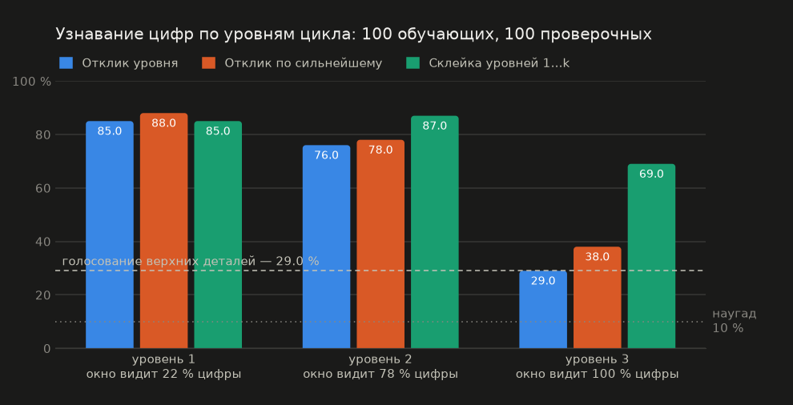

*Узнавание растёт с уровнем по всем трём меркам; пунктир — голосование верхних деталей.*


*Как голосуют верхние детали на первых четырёх проверочных пятёрках: две узнаны, одна принята за тройку, одна — за ноль. Синие точки — детали, проголосовавшие за 5, оранжевые — за другую цифру; справа — ближайшая обучающая цифра по отклику каждого уровня.*


*Строки — уровни, столбцы — цифры; синим отмечены точки памяти, пришедшие с данной цифры. На первом уровне точки рассыпаны, на третьем собраны в пятна. У каждой цифры пятен несколько: окно третьего уровня видит цифру почти целиком, но со своего места.*


*Вырезка из карты верхних деталей: в ячейке — что видит деталь третьего уровня, цвет рамки — цифра.*

**Независимость от места.** Проверочные картинки, сдвинутые на (3, 5) клеток, дают тот же отклик на каждом уровне (косинус 1.0): окна стоят на элементах, а не на сетке кадра.

[↑ к содержанию](#содержание)

### Что проверено и отвергнуто

Цикл, те же 100 и 500 цифр, голосование верхних деталей; в остальном — настройки из таблицы «Настройки». Варианты ниже, кроме первой строки, сняты при 50 % пустых ячеек, до перехода на 15 %.

| Вариант | Голосование | Что вышло |
|---|---|---|
| Текущие настройки | **64.0 %** | — |
| Пустых ячеек раскладки 50 % вместо 15 % (две пары прогонов, зёрна 0 и 1) | 65.2 %, 60.4 % против 64.0 %, 65.2 % | в пределах шума зерна (±2.5 пункта и более); 15 % по статье не хуже, оставлено |
| Круги места мельче (радиус широкого слоя 1.5) | 62.0 % | в окно проходит больше элементов, код плотнее |
| Круг места объединяет все элементы своей области (`"max"`) | 49.8 % | код окна переполняется, карта третьего уровня слипается |
| Маска как буквальный XOR с вектором | 10.0 % | биты признака остаются на своих местах, код насыщается — поэтому маска переставляет биты |
| Окну первого уровня достаточно трёх похожих штрихов | 48.2 % | окно около 3×3 клеток слишком бедное |
| Окно одного размера на всех уровнях (§6.4.3 без правила роста) | 34.4 % | шесть уровней, узнавание падает с уровнем |
| Торможение соседних деталей (`LADDER_INHIBITION_RADIUS`) | 33.8 %, 26.0 % | выбрасывает слишком много |
| Карта без предела и до 10 000 точек | 64.8 %, 67.0 % | в пределах шума (±2 пункта), уровень считается вдвое дольше |
| Нечёткий поиск §2.2.5 с постоянным ε вместо k ближайших (стенд, 1 000 отложенных, `BENCH_EPSILONS`) | ε = 0.8: 58.6 %, ε = 0.85: 60.1 % против 68.1 % у 1-NN | −9.5 п.п. [−12.8; −6.3]: при малом ε голосуют общие штрихи, при большом у деталей нет соседей; 1-NN — та же окрестность с ε по ближайшему, оставлен |
| Код окна короче (§5.1.2: 128–256 бит) простым укорочением содержания до 2 048 (`LADDER_BINDING_LENGTH_MAX`) | 59.6 %, 57.2 % против 68.4 %, 66.6 % (2 набора) | −9 п.п.: срезаются биты; короче — только через другое содержание окна |
| Окно объединяет 7 сильнейших понятий (П.7, `LADDER_BINDING_CONCEPTS = 7`) | 42.6 % против 68.4 % (набор 1) | окно уровня 3 держит ~43 элемента, 7 сильнейших цифру не описывают; П.7 предполагает окно, которое само охватывает 5–7 понятий |
| **Уровни активности детекторов как эмбеддинг окна** (§7.1.12, `BENCH_LEVEL_EMBEDDING`) | **70.0 %** против 68.1 % у битового кода (k = 1) | **+1.9 п.п. [−0.1; +4.0] на report, +1.6 [+0.8; +2.4] на всей 1 000 — принято**: стенд выбирает его по select |
| Уровни, делённые на максимум детектора по обучающим (§9.3, `BENCH_LEVEL_SCALES`) | 69.4 % против 70.0 % у обрезки до 1 | разницы нет (−0.1 п.п. [−1.0; +0.9] на всей 1 000); оставлена обрезка |
| Класс по господству классов в детекторах верхней карты (§8.2, `BENCH_DOMINANCE`) | 31.7 % против 70.0 % | в поле детектора точки разных цифр; сумма профилей окна сглаживается к доле классов |
| Содержание окна из 5–7 крупных областей: один широкий слой кругов места (П.7, `LADDER_BINDING_PLACE_LAYERS = 1`) | 59.6 %, 54.2 % против 72.8 %, 67.6 % (2 набора) | −13 п.п.: код окна короче (1 280–2 304 бит), но теряются мелкие места понятий |
| Окно на 7 понятий (П.7, `LADDER_KEYHOLE_CONCEPTS = 7`): радиус до 7-го ближайшего элемента | 33.0 % против 72.8 % (набор 1) | семь уровней по 7–8 понятий, но детали почти все уникальны, соседи одного класса на картах ~17 % на всех уровнях — классы не собираются |
| Код детали из двух широких слоёв детекторов (§3.3.2, `LADDER_EMBEDDING_LAYERS = 2`) | 63.0 %, 56.4 % против 72.8 %, 67.6 % (2 набора) | −10 п.п.: коды чаще общие (сливается ~30 % окон уровня 3), но не по цифре — соседей одного класса 35 % против 54 % |
| Три масштаба кругов места (§4.5, `LADDER_BINDING_PLACE_LAYERS = 3`: 3 × 3, 5 × 5, 9 × 9) | 65.0 %, 66.8 % против 72.8 %, 67.6 % (2 набора) | −4.3 п.п.; ответов, совпавших при сдвиге на 1 px, 74 % против 78 %: код окна длиннее и дробнее |
| **Виды обучающих цифр** (§7.1.4, `LADDER_TRAIN_VIEWS`: 4 сдвига на ±1 px) | **75.6 %, 72.4 %** против 72.8 %, 67.6 % («уровни k=1», 2 набора) | **+3.8 п.п.**, ответов, совпавших при сдвиге на 1 px, 90 % против 78 % — **принято**; честная пара — CNN со сдвигами |
| **Линейный читатель** (§9.3, `BENCH_LINEAR_DECAYS`) поверх видов | **81.2 %, 78.4 %** (λ = 1e-7) против 76.0 %, 72.4 % у «уровни k=3» (2 набора) | **+5.6 п.п. — принято**; λ = 1e-8 — 79.3 %, 1e-6 — 78.5 %, 1e-5 — 77.2 %, 1e-4 — 72.4 %, 1e-3 и больше — хуже 56 % |
| Окно верхнего уровня видит всю цифру (этап 4, `LADDER_TOP_COVERAGE = 0.99`: ещё уровень 4) | линейный 82.4 %, 79.2 % против 81.2 %, 78.4 % (2 набора) | +1.0 п.п. — в пределах шума; голоса деталей −8 п.п., прогон дольше на 15 %; оставлено 0.9 |

[↑ к содержанию](#содержание)

### Известные ограничения

Исправлено на этапе 0 (версия 0.9.0): настройки выбираются по отложенной выборке, а не по итоговой; длина кода детали и масштаб мест окна — только по обучающим окнам; сила штриха считается по силе края; пустые детали не голосуют. Нормировка `"train_max"` проверена и выигрыша не дала — по умолчанию формула статьи.

- **DAMP чувствителен к толщине штриха и почерку.** На «толстых» авторах он теряет больше kNN и CNN (находка выше). Виды обучающих цифр (0.10.0) подняли устойчивость к сдвигу на 1 px с 78 до 90 %; к толщине штриха отдельно не проверялось.
- **Отставание от CNN.** DAMP 0.10.0 — 81.1 % против ≈ 91 % у CNN со сдвигами (его честная пара: DAMP учится на сдвинутых видах) — ≈ −10 пунктов; kNN по пикселям — 72.5 %. Голосование окон без обученного читателя — 74 %: почти каждый код детали уникален, и код упирается в σ.
- По умолчанию (`"none"`, §6.5) уровень активации сверху не ограничен (до 8, 12 и 44 на уровнях 1, 2, 3), и сильнейшую деталь области могут выбирать выбросы; нормировка `"train_max"` этого не исправила в точности (в пределах шума).
- Стенд различает только эффекты больше ~4–6 пунктов (5 наборов × 250 картинок report): мелкие правки так не проверить.
- «Что видит окно» — оценка сверху, поэтому остановка может сработать раньше, чем нужно.
- Основные замеры — на 100 обучающих цифрах (стенд — 5 наборов по 100); кривая на 1 000 обучающих снята на 2 наборах, CNN на 1 000 не мерилась, карта в 5 000 точек видит там ~1 % окон.
- Сдвиги у DAMP — виды обучающих цифр (`LADDER_TRAIN_VIEWS`), а не режим `shifts` стенда; у kNN режим `shifts` не поддержан.
- Весь набор тестов с видами шёл 33 мин вместо прежних 10.5. Тяжёлые тесты, где виды не предмет проверки (стенд, кеш, честность мерок, протокол бегуна), теперь идут без них (`LADDER_TRAIN_VIEWS = ()`), и набор идёт 24 мин; виды проверяют тесты протокола, `CycleBlocksTest` и тест вкладок Rerun.

[↑ к содержанию](#содержание)

## Скорость

Цикл на 100 обучающих цифрах с 4 видами (500 обучающих картинок) и 500 проверочных (три уровня) считается около двух с половиной минут на RTX 2060 SUPER и Core i5-10400 (без видов — около двух). Уровень — около 40 с (прогон рисунков README, шаги без кеша):

| Часть уровня | Время |
|---|---|
| Раскладка карты памяти | 7–8 с |
| Иерархия детекторов | 8–9 с |
| Окна внимания | 8–10 с |
| Код окна | 7–13 с |
| Эмбеддинги деталей | 3–4 с |
| Срабатывание детекторов | 1–2 с |
| **Итого** | ≈ 40 с на уровень; карта не растёт с числом обучающих (до 5 000 точек), остальное растёт с числом окон. На 1 000 обучающих с видами — 12.5 мин на набор стенда |

Уровень детекторов (`HierarchyDetection._level`) считается во float32, но пачка окон дополняется нулями до постоянного числа строк: уровень окна не зависит от того, сколько проверочных окон попало в пачку, цифра в цифру. Вариант во float64 стоил +2 с на уровень и отвергнут.

Быстрые пути — кластеры всех окон картинки разом умножением матриц, таблица общих бит пар кодов карты на видеокарте, DBSCAN по сетке, код окна на видеокарте, отбор сильнейших детекторов порогом — дают тот же результат, что прямые; сверка — в тестах `MatrixClustersTest` и `SameResultFasterTest`. Время раскладки команды `layout` — в разделе «[Время](#время)».

[↑ к содержанию](#содержание)

## Запуск

Требования: Python 3.11+ (настройки читает встроенный `tomllib`), NumPy, SciPy, Pillow, PyTorch, Torchvision, Rerun SDK, matplotlib; numba и CUDA — для ускоренных путей раскладки (без них работают исходные). MNIST при первом запуске скачивается в `data/MNIST`.

| Команда | Что делает | Ключи |
|---|---|---|
| `python client/run.py ladder` | цикл уровней и распознавание по нему (этапы 1–7); готовые шаги — из [кеша](#кеш) | `--count` (обучающих, по умолчанию 1000), `--limit` (проверочных, по умолчанию 2000; 0 — без проверки), `--split`, `--verify-cache` (пересчитать шаги из кеша и сверить) |
| `python client/run.py bench` | честное сравнение DAMP, kNN по пикселям и CNN: наборы, select/report/test, интервалы, устойчивость к сдвигу; см. «[Честная мерка](#честная-мерка-damp-против-knn-и-cnn)» | `--count` (обучающих в наборе, 100), `--sets` (наборов, 5), `--validation` (отложенных, 500), `--test` (из t10k, 0 — не считать), `--map-points`, `--methods`, `--augment` |
| `python client/run.py layout` | один проход без цикла: раскладка, детекторы, база эмбеддингов (этапы 2–5) | `--count`, `--label`, `--activation-samples`, `--rebuild`, `--layout-only` |
| `python client/run.py evaluate` | точность по эмбеддингам первого уровня | `--count`, `--limit`, `--split`, `--temperature`, `--layout-path` |
| `python client/run.py predict` | распознавание одной картинки или батча по эмбеддингам первого уровня | `--count`, `--image`, `--dataset`, `--limit`, `--temperature`, `--calibrate`, `--layout-path` |
| `python client/run.py dashboard` | [живой дашборд](#живой-дашборд): рисуем цифру кистью — кусочки и кластеры всех уровней на одном экране, http://127.0.0.1:8765/ | `--count` (обучающих, 100), `--map-points` (5000), `--port`, `--no-browser`, `--snapshot ФАЙЛ` (только снимок страницы) |
| `python client/run.py figures` | все рисунки README в `docs/`, в том числе снимок дашборда (нужен playwright) | — |
| `python client/run.py pinwheel` | тест пинвила: картинки и раскладка в `data/pinwheel_test.*` | — |
| `python client/run.py detectors` | картинка детекторов кодера команды `layout` | `--angle`, `--x`, `--y`, `--no-stimulus`, `--output` |
| `python client/run.py sketch 7`, `python client/run.py contour` | цифра из линий её углопозиций (Rerun, таблица 0…9) | `--seed`, `--split`, `--upscale` |
| `python client/run.py cache` | кеш шагов: записи и место по шагам | `--clear [ШАГ]` — очистить шаг или весь кеш |
| `python client/run.py docs` | HTML-справка по `damp_api` в `docs/api/` (нужен pdoc) | `--open`, `--serve` |

Все настройки — в `client/config.toml`: сверху то, что сильнее всего меняет результат (сколько цифр, правила цикла, код окна), ниже кодер, раскладка, детекторы, рисунки и журнал, в самом конце — техника, которая меняет только скорость и память. Имя ключа то же, что в коде, поэтому поиск по имени находит и настройку, и место, где она работает. Другой файл настроек — переменная окружения `DAMP_CONFIG`.

Замер этого README с Rerun:

```powershell
$env:RERUN='on'
python client/run.py ladder --count 100 --limit 500
```

### Фреймворк damp_api

Всё, что делают команды, — из кода, и сверх того: свой цикл из кубиков. У `Damp()` по полю на этап, в порядке и с названиями пайплайна. У каждого этапа есть **кубики** — один шаг этапа, его результат идёт в следующий вызов — и **готовые прогоны**, собранные системой целиком. Все функции с описанием — в «[Функции API по этапам](#функции-api-по-этапам)».

Свой цикл из кубиков — тот же, что `cycle.run`, цифра в цифру (тест `CycleBlocksTest`):

```python
import sys; sys.path.insert(0, "client")
from damp_api import Damp

damp = Damp()                                        # настройки — client/config.toml
digits = damp.stimuli.digits(train=100, test=500)    # этап 1: цифры и их углопозиции
elements = damp.coding.sticks(digits)                # этап 2: углопозиции — элементы уровня 0
while True:                                          # этап 6: уровень за уровнем
    keyholes = damp.cycle.keyholes(elements)         #   окна внимания — замочные скважины
    codes = damp.coding.keyholes(keyholes)           #   этап 2: код окна «что и где»
    memory = damp.layout.memory(codes, map_points=5000)  # этап 3: память уровня
    detectors = damp.detectors.build(memory)         #   этап 4: детекторы над картой
    firing = detectors.fire(codes)                   #   этап 4: что сработало на каждом окне
    elements = damp.embeddings.details(firing)       #   этап 5: детали — элементы следующего уровня
    print(keyholes.level, keyholes.radius, memory.points, detectors.count, damp.recognition.by_response(firing))
    if keyholes.picture_seen >= damp.settings["LADDER_TOP_COVERAGE"]:
        break                                        #   окно видит цифру целиком
damp.recognition.vote(elements)                      # этап 7: {1: 0.64, 5: 0.656}
```

**Свои настройки** — поверх `client/config.toml`, без правки файла: `Damp(changes={"LADDER_TOP_COVERAGE": 0.8})` или `damp.with_settings(LADDER_TOP_COVERAGE=0.8)`. Действуют только в вызовах этого `Damp` и его частей; выводимые значения пересчитываются (`ENCODER_RANDOM_SEED` → `LADDER_RANDOM_SEED`); неизвестное имя — `KeyError`. Другой файл настроек — `Damp("путь/к/config.toml")`.

Части цикла (`damp_api/parts.py`) держат системные объекты внутри и отдают простые значения: `memory.points`, `detectors.layers`, `firing.per_keyhole`, `keyholes.picture_seen`. Уровень не сложился — `LevelFailed`.

[↑ к содержанию](#содержание)

### Функции API по этапам

🧩 — кубик цикла: результат идёт в следующий вызов. ▶️ — готовый прогон или отдельное действие. Имя функции — ссылка на её строку в коде (тест `ReadmeApiLinksTest` следит, чтобы ссылки не съехали). У каждого этапа есть ещё `about` — номер, название, папка в коде и параграфы.

**Этап 1. Стимулы** — `damp.stimuli`

| | Функция | Что делает | Возвращает |
|---|---|---|---|
| 🧩 | [`digits(train, test=0, split="test", shifts=(), train_views=None)`](client/damp_api/stages.py#L97) | цифры MNIST с углопозициями: сначала обучающие и их сдвинутые виды (§7.1.4; `None` — `LADDER_TRAIN_VIEWS`), затем проверочные и их сдвиги | `Digits` |
| ▶️ | [`of_image(картинка)`](client/damp_api/stages.py#L124) | углопозиции картинки 28×28 | список `Stimulus` |
| ▶️ | [`sketch(цифра)`](client/damp_api/stages.py#L143) | цифра из линий её углопозиций в окне Rerun | — |
| ▶️ | [`contour_table()`](client/damp_api/stages.py#L178) | таблица: цифры 0…9 из углопозиций контура | путь к картинке |

**Этап 2. Первичное кодирование ↻** — `damp.coding`

| | Функция | Что делает | Возвращает |
|---|---|---|---|
| 🧩 | [`sticks(digits)`](client/damp_api/stages.py#L240) | код направления каждой углопозиции — элементы уровня 0 | `Elements` |
| 🧩 | [`keyholes(keyholes)`](client/damp_api/stages.py#L255) | код каждого окна: что в нём и где (П.4–П.7) | `KeyholeCodes` |
| ▶️ | [`encode(угол, x, y)`](client/damp_api/stages.py#L275) | код стимула первичным кодером команды `layout` | `Code` |
| ▶️ | [`detectors_picture()`](client/damp_api/stages.py#L291) | картинка детекторов кодера: кольца угла, полосы X и Y | путь к картинке |

**Этап 3. Раскладка** — `damp.layout`

| | Функция | Что делает | Возвращает |
|---|---|---|---|
| 🧩 | [`memory(codes, map_points=None)`](client/damp_api/stages.py#L334) | карта памяти уровня из кодов окон обучающих картинок (§5) | `Memory` |
| ▶️ | [`build(count)`](client/damp_api/stages.py#L355) | проход без цикла: раскладка всех углопозиций `count` цифр | `LayoutSummary` |
| ▶️ | [`pinwheel()`](client/damp_api/stages.py#L370) | тест пинвила: 360 кодов угла на позицию | `PinwheelReport` |

**Этап 4. Детекторы и активации** — `damp.detectors`

| | Функция | Что делает | Возвращает |
|---|---|---|---|
| 🧩 | [`build(memory)`](client/damp_api/stages.py#L396) | детекторы над картой по слоям порогов (§6.4) | `MapDetectors` |
| 🧩 | [`detectors.fire(codes)`](client/damp_api/parts.py#L373) | какие детекторы сработали на каждом окне (§6.5) | `Firing` |

**Этап 5. Эмбеддинги** — `damp.embeddings`

| | Функция | Что делает | Возвращает |
|---|---|---|---|
| 🧩 | [`details(firing)`](client/damp_api/stages.py#L439) | код детали каждого окна по сработавшим детекторам; детали — элементы следующего уровня | `Elements` |
| ▶️ | [`build(count)`](client/damp_api/stages.py#L458) | проход без цикла: раскладка, детекторы и база эмбеддингов | `LayoutSummary` |

**Этап 6. Цикл ↺** — `damp.cycle`

| | Функция | Что делает | Возвращает |
|---|---|---|---|
| 🧩 | [`keyholes(elements)`](client/damp_api/stages.py#L499) | окна внимания следующего уровня: окно на каждом элементе, растёт от уровня к уровню (П.2, П.3) | `Keyholes` |
| 🧩 | [`step(elements)`](client/damp_api/stages.py#L520) | весь проход уровня разом: окна → коды → память → детекторы → срабатывания → детали | `Level` |
| 🧩 | [`covers(level)`](client/damp_api/stages.py#L545) | окно уровня уже видит цифру целиком — цикл окончен | `True` / `False` |
| 🧩 | [`trained(train=None, map_points=None, decay=None)`](client/damp_api/stages.py#L557) | обученный цикл и линейный читатель: по ним идёт любая новая картинка — путь тот же, что у картинки прогона, цифра в цифру ([дашборд](#живой-дашборд)) | `TrainedLadder` |
| ▶️ | [`run(train, test)`](client/damp_api/stages.py#L587) | весь цикл с мерками уровней (команда `ladder`) | `CycleReport` |

**Этап 7. Распознавание** — `damp.recognition`

| | Функция | Что делает | Возвращает |
|---|---|---|---|
| 🧩 | [`by_response(firing)`](client/damp_api/stages.py#L697) | ответ по отклику уровня: какие детекторы сработали на окнах картинки | доля верных `{k: …}` |
| 🧩 | [`vote(details)`](client/damp_api/stages.py#L724) | ответ голосованием деталей: каждая голосует классами похожих обучающих | доля верных `{k: …}` |
| 🧩 | [`linear(firings, decays=None)`](client/damp_api/stages.py#L645) | линейный читатель (§9.3): один слой softmax над самыми сильными уровнями активации детекторов уровней 1…k | доля верных `{λ: …}` |
| ▶️ | [`evaluate(count)`](client/damp_api/stages.py#L842) | проход без цикла: точность на проверочных | `Evaluation` |
| ▶️ | [`predict(файл, count)`](client/damp_api/stages.py#L863) | проход без цикла: цифра на картинке | `Prediction` |
| ▶️ | [`predict_dataset(count)`](client/damp_api/stages.py#L882), [`calibrate(count)`](client/damp_api/stages.py#L903) | точность с журналом ответов; подбор температуры softmax | `Evaluation`; (температура, точность) |
| ▶️ | [`bench(train, sets, validation, test, map_points, methods, augment)`](client/damp_api/stages.py#L746) | честное сравнение DAMP, kNN и CNN: select/report/test, интервалы по наборам (команда `bench`) | `BenchReport` |

**Рисунки** — `damp.figures`: [`readme()`](client/damp_api/stages.py#L931) — все рисунки README (около 5 минут), [`structure()`](client/damp_api/stages.py#L941) — только схема устройства проекта.

**Кеш шагов** — `damp.cache`: `summary()` — записи и место по шагам, `clear(шаг)` — очистить шаг или весь кеш, `size()` — байт на диске. Готовые шаги система берёт из кеша сама (раздел «[Кеш](#кеш)»).

**Сам `Damp`**: [`Damp(config=None, *, changes=None)`](client/damp_api/damp.py#L99) — подключиться; [`with_settings(ИМЯ=значение)`](client/damp_api/damp.py#L117) — тот же `Damp` со своими настройками; [`settings["ИМЯ"]`](client/damp_api/damp.py#L35) — значение настройки; [`stages`](client/damp_api/damp.py#L140) — этапы по порядку; [`version`](client/damp_api/damp.py#L135) — версия.

**Что можно узнать у результатов кубиков**

| Часть | Что это | Главное |
|---|---|---|
| [`Digits`](client/damp_api/parts.py#L75) | цифры прогона | `pictures`, `train`, `test`, `groups`, `labels`, `sticks`; [`picture(i)`](client/damp_api/parts.py#L138) — картинка, цифра и её углопозиции |
| [`Elements`](client/damp_api/parts.py#L157) | элементы уровня: штрихи или детали | `level`, `count`, `code_length`, `distinct_codes`, `ones`, `per_picture` |
| [`Keyholes`](client/damp_api/parts.py#L200) | окна внимания уровня | `level`, `count`, `radius`, `picture_seen`, `per_picture`, `elements_per_keyhole` |
| [`KeyholeCodes`](client/damp_api/parts.py#L248) | коды окон | `count`, `length`, `place_length`, `content_length`, `ones` |
| [`Memory`](client/damp_api/parts.py#L289) | карта памяти уровня | `points`, `width`, `height`, `same_label`; [`release()`](client/damp_api/parts.py#L324) — освободить видеокарту |
| [`MapDetectors`](client/damp_api/parts.py#L342) | детекторы над картой | `count`, `layers`, `activation_threshold`; [`fire(codes)`](client/damp_api/parts.py#L373) |
| [`Firing`](client/damp_api/parts.py#L392) | срабатывания | `keyholes`, `fired`, `per_keyhole`, `silent` |
| [`Level`](client/damp_api/parts.py#L431) | проход уровня целиком | `number`, `keyholes`, `codes`, `memory`, `detectors`, `firing`, `details` |
| [`TrainedLadder`](client/damp_api/parts.py#L458) | обученный цикл и читатель (дашборд) | `levels`, `train_pictures`, `decay`; [`see(картинка)`](client/damp_api/parts.py#L496) → `Sight`; [`maps()`](client/damp_api/parts.py#L553) → `LevelMap` по уровням; [`sticks()`](client/damp_api/parts.py#L585) → `TrainingSticks` |
| **Итого** | 9 частей; все держат системные объекты внутри и отдают простые значения | |

**Что можно узнать у отчёта стенда** (`damp.recognition.bench`, `damp_api/reports.py`)

| Тип | Что это | Главное |
|---|---|---|
| `BenchReport` | весь отчёт стенда | `methods`, `levels`, `train`, `sets`, `validation`, `test`, `path` (JSON), разрыв DAMP − CNN |
| `BenchMethod` | метод и режим аугментации | `method`, `augment`, `supported`, `setting`, `candidates`, `validation`, `test`, `robustness` |
| `BenchScore` | точность по наборам | `mean`, `std`, `ci_low`, `ci_high`, `per_set` |
| `BenchRobustness` | устойчивость к сдвигу | `pictures`, `shift`, `same_answers`, `accuracy_plain`, `accuracy_shifted` |
| `BenchLevel` | мерки уровня DAMP | `energy_mean`, `code_resolution`, `code_largest`, `detail_bits`, `detail_empty`, `detail_full`, `alone`, `glued` |
| **Итого** | 5 типов; все — простые значения, без системных объектов | |

[↑ к содержанию](#содержание)

### Документация API

Каждый класс, метод и свойство `damp_api` описаны в docstring'ах (формат Google: `Args`, `Returns`, `Raises`, `Example`; параграфы статьи и продолжения — `§6.5`, `П.5`). Из них [pdoc](https://pdoc.dev) собирает HTML со строкой поиска и ссылками на исходники. В справку входят только `damp_api` и его модули `damp`, `stages`, `parts`, `reports`, `cache`; системный слой `system/damp` и мост `_system.py` внутренние и в неё не попадают.

```powershell
python -m pip install pdoc            # один раз; то же — pip install -e .[docs]
python client/apidocs.py              # собрать HTML в docs/api/ (то же — python client/run.py docs)
python client/apidocs.py --open       # собрать и открыть в браузере
python client/apidocs.py --serve      # живой сервер на http://localhost:8080, правка кода видна после перезагрузки
```

Смотреть: `docs/api/index.html` (главная — `damp_api.html`: этапы пайплайна, свой цикл из кубиков, все классы). Папка `docs/api/` создаётся сборкой и в git не хранится. Сборщик — класс `ApiDocs` в `client/apidocs.py`.

[↑ к содержанию](#содержание)

## Живой дашборд

Рисуем цифру кистью — и на одном экране видим, что с ней делает каждый уровень цикла: кусочки рисунка (окна внимания, П.2), точки карты, которые они зажигают (§6.1), кластеры — детекторы, в которые кусочки набиваются (§6.5), детали (П.1) и ответ линейного читателя (§9.3).

```powershell
python client/run.py dashboard        # учит цикл на 100 цифрах (шаги — из кеша) и открывает http://127.0.0.1:8765/
```


*Пример — случайная пятёрка MNIST t10k (кнопка «пример: 5», каждый раз другая; номер — под холстом). Выбран кусочек уровня 2 (оранжевый): на уровне 1 подсвечены кусочки, из которых он собран, на уровне 3 — кусочки, в которые он вошёл; внизу — его след по уровням. Снимок делает `python client/run.py figures` (или `dashboard --snapshot docs/dashboard.png`).*

| Где | Что видно | Как трогать |
|---|---|---|
| Холст | кисть как штрих MNIST (толщина 2.48 px, размытие σ 0.55), рамка 20×20; рисунок ставится по центру масс, как цифры MNIST | рисовать мышью или пером; «↶ штрих», «очистить», «пример: 5»; двигать рисунок — «✋ двигать», правой кнопкой, Shift + мышь или стрелками (по 1 px), «↺ на место». При сдвиге центр масс выключается — сеть видит рисунок там, где он стоит; пример MNIST двигается целыми пикселями |
| Ответ | вероятности цифр 0…9 по линейному читателю (§9.3) | — |
| Рисунок уровня | кусочки — точки в центрах окон; цвет — сила детали (П.1): синий — слабая, жёлтый — сильная, серый — ни один детектор не сработал. На уровне 2 и выше — ещё детали уровня ниже, из которых собрана картинка уровня: штрихи окна памяти, на которое кусочек больше всего похож, на его месте; цвет — цифра окна, яркость — сила детали; обновляются с каждым штрихом | навести — круг окна, из чего он собран ниже и куда вошёл выше; щёлкнуть — выбрать (путь внизу, детали вне пути гаснут) |
| Числа уровня | кусочков, зажжено точек, пар «кусочек → точка», срабатываний, кластеров (и сколько добавил последний штрих), молчащих кусочков, средняя сила деталей; 5 самых набитых кластеров со слоем и составом | — |
| Карта уровня | цвет точки — цифра её обучающего окна; белые — сильные совпадения с рисунком; круги — кластеры: цвет — слой детектора, толщина и число — сколько кусочков в него набилось; новые после штриха вспыхивают | колесо — приблизить (в ячейках видно содержимое точек), потянуть — сдвинуть, ⤢ — вся карта; навести на кластер — его состав и мозаика точек, на рисунке подсвечены его кусочки; навести на точку — её окно и цифра; щёлкнуть по точке раскладки — выбрать её (в пустой клетке — кластер под курсором): внизу путь кусочков рисунка, которые её зажгли (их список целиком отдаёт сервер, `/api/point`), на картах — сильнейший кластер каждого кусочка пути |
| Путь | пока что-то выбрано (кусочек, кластер или точка карты), полоса внизу становится выше: по полю на уровень, в нём только кусочки рисунка — штрихи в окне кусочка. На выбранном уровне — само выбранное (у точки и кластера — 4 кусочка, зажёгших их сильнее всего); ниже — кусочки, из которых оно собрано, вплотную, вложенные так, как стоят в уровне выше: кусочек, бывший слева вверху, стоит в левой верхней клетке, группы одного родителя разделены зазором; выше — кусочки, куда оно вошло. Яркость — сила кусочка | щёлкнуть по точке на карте уровня (или по кусочку на рисунке уровня); колесо — приблизить, тянуть — сдвинуть, двойной щелчок — всё; навести на плитку — кусочек подсвечивается на рисунке уровня |
| **Итого** | один экран: холст, ответ, по три панели на уровень (рисунок, числа, карта), след | |

**Как считается.** Сервер (`client/dashboard/server.py`) обучает цикл кубиком `damp.cycle.trained()` — тот же цикл, что у стенда: 100 цифр MNIST и их сдвинутые виды (§7.1.4, 500 обучающих картинок), карта уровня до 5 000 точек, читатель с λ = 1e-7. Рисунок идёт через обученные уровни теми же классами, что картинка прогона, а всё подобранное по обучающим (мера и пороги окон, длины кодов окна и детали, нормировка) берётся из обученных уровней. Поэтому у цифры MNIST путь тот же, что в прогоне, цифра в цифру: окна, вхождения, срабатывания, детали, пики и вероятности (`tests/test_trained_ladder.py`). Кусочек зажигает сотни точек карты (на 100 цифрах — около 760 из 5 000: порог λ_a уровня низкий), поэтому на карте светятся только сильные совпадения, а страница получает у каждого кусочка 40 сильнейших точек (`DASHBOARD_LIT_PER_PIECE`). Настройки — раздел `[dashboard]` в `client/config.toml`. Рисунки посреди штриха считают рабочие процессы сервера (`DASHBOARD_WORKERS`, по своему обученному циклу в каждом): страница шлёт столько запросов сразу, сколько процессов готово, равномерно во времени, и показывает ответы по порядку (опоздавший ответ отбрасывается). Последний рисунок штриха считает главный процесс — его итог идёт в журнал; ответы рабочих процессов и главного совпадают байт в байт.

| Замер (100 обучающих цифр с видами; дробное место — 4 уровня) | Значение |
|---|---|
| обучение при запуске: заново / из кеша | ≈ 3 мин / 28 с |
| путь одного рисунка в системе (замер 2026-11-17: 3 уровня, без видов, энергия активации) | ≈ 130–150 мс |
| ответов на рисунок в секунду: без рабочих процессов / с тремя (`DASHBOARD_WORKERS = 3`; i5-10400, RTX 2060 SUPER) | 5.4 / 14.9 |
| цена трёх рабочих процессов | +45 с фоновой загрузки после запуска, ≈ 2.3 ГБ памяти и ≈ 1.3 ГБ видеопамяти |
| ответ сервера на штрих | 0.6–1.4 МБ |
| точность пути дашборда на первых 1 000 цифрах t10k | 75.3 % (целое место — 78.6 %; стенд 0.10.0 — 81.1 % на других обучающих наборах, до исправления окна) |
| пятёрки среди этих 1 000 | 38 % — самая трудная цифра; чаще всего ответ «3» (28 из 87) |
| **Итого** | рисунок проходит все уровни за доли секунды; ответ дашборда — честный ответ системы |

[↑ к содержанию](#содержание)

## Рисунки README

Все рисунки этапов в `docs/` рисует одна команда:

```powershell
python client/run.py figures
```

Она делает прогон цикла на тех же 100 и 500 цифрах с наблюдателем (`system/damp/cycle/ladder_trace.py`, `system/damp/figures/`), тест пинвила и картинки детекторов; на RTX 2060 SUPER — около 5 минут. Наблюдатель только запоминает итоги каждого прохода; то, что рисунок показывает о счёте (зажжённые точки, сработавшие детекторы, голоса), пересчитывается по правилам статьи и сверяется с прогоном. Настройки — `README_FIGURES_*` и стиль `FIGURE_*` в `client/config.toml`. Карты всего MNIST (`docs/layout-60000-*.angle.png`) сделаны отдельно командой `python client/run.py layout --count 60000 --layout-only --rebuild` в двух режимах; `docs/pinwheel.png` — образец пинвила.

[↑ к содержанию](#содержание)

## Кеш

Картинки всегда одни и те же, поэтому готовый шаг считается один раз. **Каждый шаг — запись сама по себе**, независимо от других (`system/damp/cache.py`, настройки `[cache]` в `client/config.toml`):

- **ключ записи** — хеш содержимого входа шага, значений настроек, которые читает его код, текста этого кода и окружения (версии numpy, torch, numba, видеокарта). Список настроек собирается из кода сам; лишняя настройка даёт лишний пересчёт, но не неверный результат;
- **шаг пересчитался, а результат тот же** — следующие шаги всё равно берутся из кеша: у них тот же вход («ранний обрыв» систем сборки Bazel, Shake);
- **из кеша — то же, что заново, бит в бит**: тесты `tests/test_cache.py`, сверка `python client/run.py ladder --verify-cache` (пересчитать шаги из кеша и сравнить) и сверочный прогон README.

| Шаг кеша | Что хранится | Запись |
|---|---|---|
| `stimuli.sticks` | углопозиции каждой картинки MNIST (сдвинутые виды обучающих цифр, §7.1.4, не хранятся: их штрихи считаются заново, ~10 мс на картинку) | файл на набор, картинки дописываются |
| `coding.sticks` | коды направлений штрихов (уровень 0) | на набор картинок |
| `cycle.keyholes` | окна внимания уровня | на уровень |
| `coding.keyholes` | коды окон «что и где» | на уровень |
| `layout.memory` | карта памяти: ячейки точек, порог λ, энергии точек; карта восстанавливается по ним | на уровень и карту классов |
| `activation.detectors` | иерархия детекторов над картой | на уровень |
| `embeddings.details` | коды деталей | на уровень |
| `recognition.responses` | отклики картинок на уровне | на уровень |
| `figures.map_glyphs` | рисунки карт окон и деталей | на рисунок |
| **Итого** | 9 шагов; срабатывания детекторов не хранятся — считаются за секунду, а заняли бы ~130 МБ на уровень | прогон README — около 200 МБ |

**Замер** (прогон README: 100 обучающих и 500 проверочных цифр, карта до 5 000 точек, RTX 2060 SUPER):

| Прогон | Время | Совпал с прогоном без кеша |
|---|---|---|
| первый: считает и наполняет кеш | 131 с | да, цифра в цифру |
| повтор: всё из кеша (срабатывания считаются заново) | 19 с | да, цифра в цифру |
| **Итого** | повтор **в 7 раз быстрее**; около 10 с из 19 — запуск Python, torch и видеокарты | |

Поменяли настройку — пересчитываются только шаги, которые её читают, и те, чей вход от этого изменился. Чем выше по пайплайну правка (уровень 3, распознавание), тем больше берётся из кеша.

```powershell
python client/run.py cache                       # записи и место по шагам
python client/run.py cache --clear layout.memory  # пересчитать карты при следующем прогоне
python client/run.py cache --clear               # весь кеш
python client/run.py ladder --verify-cache        # пересчитать шаги из кеша и сверить бит в бит
```

Из кода — `Damp().cache` (`summary()`, `clear()`, `size()`). Место ограничено `CACHE_MAX_BYTES` = 20 ГБ: сверх него удаляются давно не нужные записи. Выключить — `CACHE_ENABLED = false` или переменная `DAMP_CACHE=off` (так в тестах).

Проход без цикла (команды `layout`, `evaluate`) пока кешируется по-старому: раскладка — `data/layout-*.json` (`--rebuild` — заново), коды цифр от 2 000 штук — `data/codes-<набор>-<отпечаток>.npz`.

[↑ к содержанию](#содержание)

## Логирование

Все события пишутся внутри реализаций через `LOGGER.event` — одной записью сразу в три места:

| Куда | Что там | Зачем |
|---|---|---|
| консоль | короткая строка `событие ключ=значение … [параграф]` | следить за прогоном |
| `logs/damp.jsonl` | одна запись JSON на строку: `ts`, `run`, `level`, `event`, `section`, `data` (полностью), `msg`; в цикле — ещё `cycle` (номер уровня) | искать человеку и нейросети |
| Rerun | вкладки этапов 1–7 цикла, картинки и графики (`RERUN=on`); запись прогона — `logs/rerun/*.rrd`; окно держит не больше `RERUN_MEMORY_LIMIT` = 25 % ОЗУ и на пределе сбрасывает самое старое | смотреть, что делает каждый этап |
| **Итого** | одна точка записи, три приёмника; главный — файл журнала, Rerun — для глаз | |

У каждого понятия статьи в конце записи стоит номер параграфа (`[6.5]`), у понятий продолжения — номер раздела (`[П.5]`), у остального — `[вне статьи]`. Файл журнала ротируется по размеру: 20 МБ × 10 файлов (`LOG_FILE_*` в конфиге); `DAMP_LOG_FILE=off` выключает файл. Отметки цикла: `ladder.cycle.begin` (начало прохода уровня, этап 2) и `ladder.cycle.end` (конец, этап 6). События этапа 0:

| Событие | Что пишет | Параграф |
|---|---|---|
| `ladder.example` | какая пятёрка выбрана примером: номер MNIST и номер по счёту | вне статьи |
| `ladder.level` | мерки уровня, в том числе `energy_mean`, `code_resolution`, `code_largest`, `detail_bits`, `detail_empty`, `detail_full` | §5.8, §5.13.2, §7.1.8.1 |
| `recognition.vote` | голосование деталей: сколько голосов, сколько пустых деталей не голосовало | §2.2.5 |
| `recognition.response` | картинки без отклика, считающиеся неверными | §2.2.5 |
| `stimuli.views` | виды обучающих цифр: сколько цифр, какие сдвиги, сколько обучающих картинок всего | §7.1.4 |
| `recognition.levels` | голосование окон верхнего уровня по уровням активности детекторов (эмбеддинг — §7.1.12) | §2.2.5 |
| `recognition.linear` | линейный читатель: λ, число признаков, потеря и итерации L-BFGS | §9.3 |
| `bench.start` | протокол стенда: наборы, пулы, зерно, методы | вне статьи |
| `bench.set` | итог одного обучающего набора: время, лучшие настройки по select | вне статьи |
| `bench.cnn.trained` | обучена одна CNN: конфигурация, эпох, лучшая эпоха | вне статьи |
| `bench.table` | таблица результатов в Markdown | вне статьи |
| `bench.result` | итог стенда: метки, интервалы, разрыв DAMP − CNN, путь к JSON | вне статьи |
| `dashboard.ladder` | дашборд: обученный цикл готов — уровней, точек карт, детекторов, λ читателя, секунд | §6.6 |
| `dashboard.see` | дашборд: итог рисунка по окончании штриха — кусочков, зажжённых точек и сработавших детекторов по уровням, ответ | §6.5 |
| **Итого** | 14 событий: у восьми — параграфы статьи (§5.8, §5.13.2, §7.1.8.1, §2.2.5, §7.1.4, §9.3, §6.6, §6.5), шесть вне статьи (`ladder.example` и все `bench.*`) | |

Ряд чисел по шагу (`LOGGER.series`, шкала `epoch`) пишет ход обучения CNN в Rerun; текст в Markdown — `LOGGER.visual_text`. Ход долгих шагов для показа — подписка: реализация отдаёт его `LOGGER.progress("layout.step", …)` / `("activation.detectors.layer", …)`, только если на шаг подписались (`LOGGER.watched`); подписчик — вид Rerun, на счёт он не влияет.

```powershell
rg '"event": "ladder.level"' logs/damp.jsonl                 # все уровни цикла
jq 'select(.level == "warning")' logs/damp.jsonl             # все предупреждения
jq 'select(.section == "6.5") | .event' logs/damp.jsonl      # всё, что связано с §6.5
jq 'select(.cycle == 2)' logs/damp.jsonl                     # всё, что было на уровне 2
```

[↑ к содержанию](#содержание)

### Rerun: цикл по этапам

`$env:RERUN='on'` — прогон цикла открывает окно Rerun (0.43) с вкладками **Обзор** и по вкладке на этап 1–7, как разделы README. Шкала **cycle** внизу — уровень: `#0` — стимулы, `#1…#3` — уровни цикла. Передвиньте её, и все вкладки покажут выбранный уровень. **Весь путь показан на одной цифре 5** — той же, что на рисунках README: её окна, код окна-примера, его место на карте, сработавшие детекторы, детали, окна уровней; ещё по проверочной цифре каждого класса. У каждого вида в заголовке названы оси: у графиков — что по Y и «X: уровень» (`system/damp/figures/rerun_cycle.py`).

| Вкладка | Что видно | Числа по уровням |
|---|---|---|
| Обзор | пока идёт прогон — какой этап идёт (▶) и что готово (✓); в конце — сводка с итогом; журнал со столбцом `cycle` | точность, секунды шагов |
| 1. Стимулы | цифра 5 и её штрихи стрелками, цифры 0–9; в «Что видно» — обучающие цифры и их сдвинутые виды (§7.1.4, `LADDER_TRAIN_VIEWS`) | штрихов на картинку |
| 2. Кодирование ↻ | окна-скважины пятёрки (тонкие круги) и окно-пример, его код «место \| содержание», детекторы угла и места | единиц и плотность кода окна |
| 3. Раскладка | карта памяти: точки разъезжаются по ходу раскладки, цвет — цифра, белое кольцо — окно пятёрки; качество Ē по шагам; энергия точек; карта окон | точек, соседи одной цифры |
| 4. Детекторы | слои детекторов заполняются один за другим; окно пятёрки зажигает точки, срабатывают детекторы, сильнейшие — оранжевым | детекторов, сработало на окно |
| 5. Эмбеддинги | код детали, детали пятёрки, уровни сработавших детекторов | единиц в коде детали, сила |
| 6. Цикл ↺ | окна трёх уровней вокруг одного места пятёрки, отметки начала и конца цикла | радиус окна, доля цифры, элементов, окон |
| 7. Распознавание | точность — сразу после уровня; карта верхних деталей (по ходу раскладки), ошибки 10×10, голоса у каждой цифры | точность по отклику, склейке, голосованию |
| **Итого** | 8 вкладок: все рисунки цикла из README и все числа `ladder.level`, путь одной пятёрки | около 25 графиков по уровням |

**По ходу счёта** (по умолчанию, когда открыто окно Rerun). Часть прохода уровня рисуется, как только готова, — не в конце уровня. Порядок частей — порядок счёта: окна (этап 6) → коды (2) → карта (3) → детекторы и срабатывания (4) → детали (5) → точность (7).

| Этап | Что меняется на глазах | Когда |
|---|---|---|
| 2. Кодирование | окна-скважины появляются на пятёрке, затем код окна-примера | сразу после шага |
| 3. Раскладка | карта складывается шаг за шагом, точки разъезжаются по цифрам; столбцы качества Ē растут | раз в 0.5 с |
| 4. Детекторы | слои детекторов заполняются один за другим; затем окно пятёрки зажигает точки и срабатывают детекторы | слои — раз в 0.5 с, срабатывания — сразу (считаются за секунду) |
| 5. Эмбеддинги | детали появляются на пятёрке | сразу после шага |
| 6. Цикл | новый круг окна на пятёрке, отметки начала и конца | в начале уровня |
| 7. Распознавание | точность уровня; наверху — карта верхних деталей складывается, затем ошибки и голоса | сразу после уровня |
| **Итого** | на вкладке идущего этапа всё время что-то меняется | |

- **Какой этап идёт — в сводке прогона** (вкладка «Обзор», «Сводка прогона»): заголовок «▶ Идёт этап 3. Раскладка · уровень 2» и таблица этапов уровня — ✓ готово, **▶ идёт**, ждёт; ниже — готовые уровни с числами и строкой «Итого».
- **Вкладка идущего этапа открывается сама** (`RERUN_FOLLOW_STAGE` = true), не чаще раза в `RERUN_LIVE_INTERVAL`; в конце прогона — «Обзор». Окно получает ту же раскладку панелей с другой открытой вкладкой, поэтому вкладку, открытую руками, оно сменит при следующем этапе. Не нужно — `RERUN_FOLLOW_STAGE = false`.
- **Скорость и результат.** Прогон без кеша (100 обучающих, 500 проверочных цифр, окно Rerun): с показом по ходу счёта — 145.2 с, без него — 145.2 с; результат тот же цифра в цифру (и тест `test_live_layout_and_detector_layers`).
- **Стенд `bench`** пишет свою запись «bench» с раскладкой `BenchBlueprint`: таблица результатов с «Итого», столбцы точности на validation и test, ход обучения CNN по эпохам, журнал (подробнее — «[Честная мерка](#честная-мерка-damp-против-knn-и-cnn)»).
- **Вкладка этапа 7** показывает отклик уровней и голосование деталей (§2.2.5). Линейный читатель (§9.3) в прогон цикла не входит: его считают стенд `bench` и кубик `damp.recognition.linear`, поэтому на вкладке его нет.
- **Вкладка этапа 5** показывает и мерки статьи по уровням (`energy_mean`, `code_resolution`, `code_largest`, `detail_bits`, `detail_empty`, `detail_full`). Пример — `пятёрка № <номер MNIST>`: другая в каждом прогоне.
- **Возврат к базовой раскладке.** После прогона цикла окно возвращается к «базовой» раскладке — последней, заданной без `cycle=True`: у стенда это его раскладка, вне стенда — «ход раскладки».
- **Вне цикла** (тесты, пинвил в `figures`, раскладка `layout`) окно само возвращается к раскладке панелей «ход раскладки»: карта по ходу счёта, доля обменов и качество Ē — **вся история** по времени, все раскладки подряд; журнал. Новая запись открывается сама, шкала идёт за новыми данными — смотреть можно, ничего не трогая.
- **Повтор из кеша.** Части приходят те же, только быстрее. Хода раскладки и слоёв тогда нет: эти шаги не считаются, сразу видна готовая карта.
- **Настройки** (`client/config.toml`, раздел журнала): `RERUN_LIVE_INTERVAL` = 0.5 с — шаг кадров внутри долгих шагов и смены вкладок; `RERUN_FOLLOW_STAGE` = true — открывать вкладку идущего этапа.

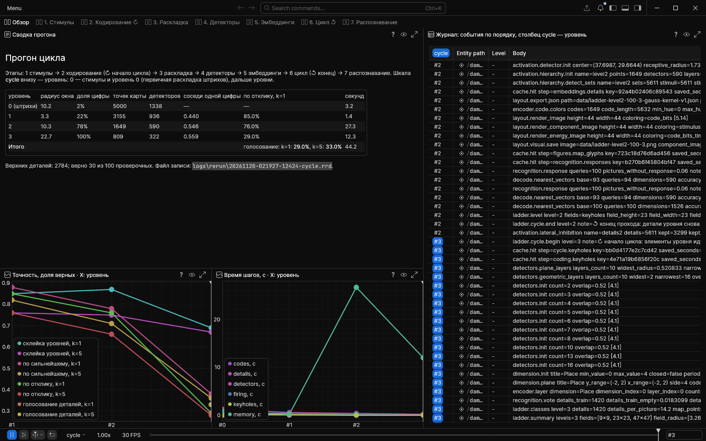

*Обзор: сводка уровней с итогом, точность и время шагов по уровням, журнал со столбцом `cycle`.*

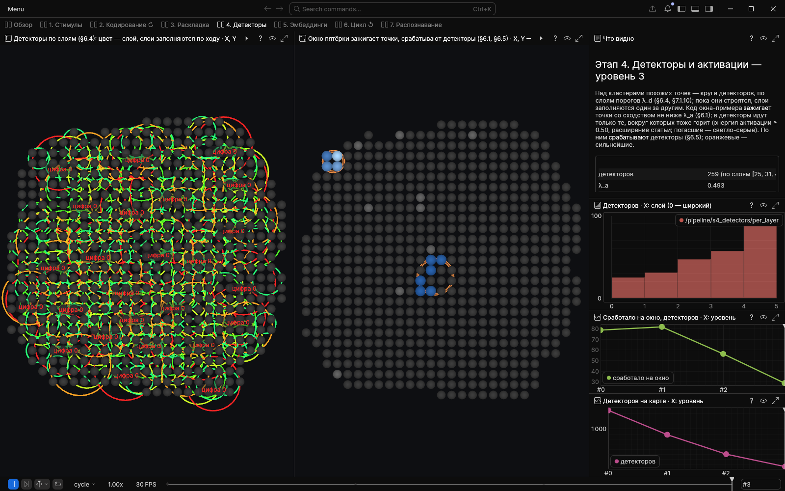

*Этап 4 на уровне 3: детекторы по слоям; код окна-примера зажигает 661 точку из 4 828, срабатывает 96 детекторов, оранжевые — сильнейшие.*

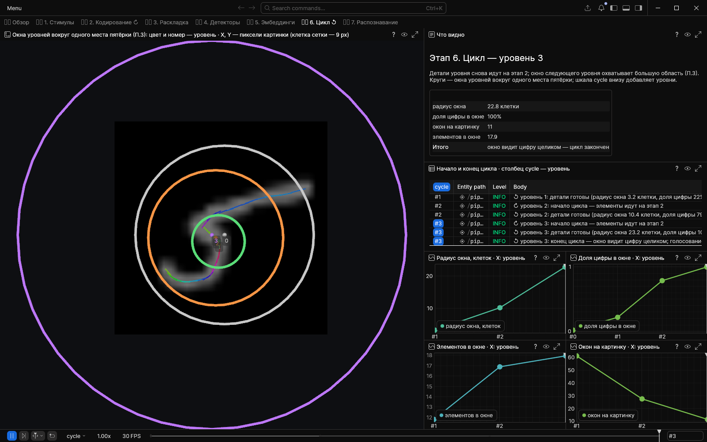

*Этап 6: окна уровней 1–3 вокруг одного места цифры 5 (зелёное, оранжевое, фиолетовое), отметки начала и конца цикла, рост окна по уровням.*

Остальные вкладки: [1. Стимулы](docs/rerun-1-stimuli.png) · [2. Кодирование](docs/rerun-2-coding.png) · [3. Раскладка](docs/rerun-3-layout.png) · [5. Эмбеддинги](docs/rerun-5-embeddings.png) · [7. Распознавание](docs/rerun-7-recognition.png).

**Запись прогона.** Прогон цикла с Rerun пишется и в окно, и в файл `logs/rerun/<время>-<pid>-cycle.rrd` (хранятся последние `RERUN_RECORD_KEEP` = 10). Открыть позже: `rerun logs/rerun/<файл>.rrd`. Без окна, только в файл: `DAMP_RERUN_VIEWER=off`. Без раскладки панелей (свою задаёт тот, кто открывает): `DAMP_RERUN_BLUEPRINT=off`. Скриншоты вкладок для README — `python client/run.py figures --rerun`, около 2 минут: прогон README идёт в окно Rerun (его видно) и в файл, потом запись открывается в Rerun без окна на экране, вкладки открываются по очереди и снимаются.

**Схема данных** — устойчивая, на неё можно опираться (`rerun.dataframe`, свой разбор `.rrd`):

| Путь | Что | Шкала |
|---|---|---|
| `/pipeline` | цвета и подписи цифр 0–9 (AnnotationContext) | статично |
| `/pipeline/overview/summary`, `/seconds/<шаг>` | сводка прогона (пока идёт — что считается сейчас), секунды шагов | статично, cycle |
| `/pipeline/s1_stimuli/main/…`, `/digits/d<k>/…` | цифра-пример и цифры 0–9: картинка и штрихи | статично |
| `/pipeline/s2_coding/keyhole/{image,elements,all,circle}`, `/code/place`, `/code/content` | окна пятёрки, окно-пример на цифре и его код | cycle |
| `/pipeline/s3_layout/map`, `/map/five`, `/energy`, `/glyphs`, `/live/quality` | карта памяти уровня (по ходу раскладки, затем итог), окно пятёрки на карте, качество Ē по шагам | cycle |
| `/pipeline/s4_detectors/layers/l<k>`, `/activation/{lit,fired,strongest}` | детекторы по слоям (по ходу построения, затем итог) и срабатывание окна-примера | cycle |
| `/pipeline/s5_embeddings/code`, `/details/…`, `/fired_levels` | деталь окна-примера | cycle |
| `/pipeline/s6_cycle/keyholes/…`, `/marks` | окна уровней на цифре, отметки цикла | cycle |
| `/pipeline/s7_recognition/accuracy/…`, `/confusion`, `/votes/d<k>`, `/top_map` | распознавание | cycle |
| `/pipeline/<этап>/stats/<мерка>`, `/pipeline/<этап>/about` | числа уровня и описание вкладки | cycle |
| `/damp/log`, `/damp/log/<событие>` | журнал: текст и поля каждой записи | cycle, log_tick, log_time |
| `/bench/…` (запись «bench») | таблица результатов, точность на validation и test, ход обучения CNN `cnn/<конфигурация>/<набор>/{loss,validation_accuracy}` | epoch |
| **Итого** | 7 этапов и обзор; шкала cycle — уровень | |

[↑ к содержанию](#содержание)

## Тесты

```powershell
$env:RERUN='on'    # прогоны тестов видны в окне Rerun; 'off' — без окна
python -m unittest discover -s tests -t .
```

Все тесты проходят. `test_default_empty_ratio_matches_space_filling_margin` держит долю пустых ячеек раскладки на уровне статьи (§7.1.6, 15 %).

| Файл | Что проверяет |
|---|---|
| `tests/test_ladder.py` | цикл: окна и их радиусы (сосед, задавший радиус, — в окне, §6.4.3), код окна, детали, торможение; сверки быстрых путей с прямыми (`MatrixClustersTest`, `SameResultFasterTest`) |
| `tests/test_figures.py` | рисунки: картинка детекторов, наблюдатель прогона, общие приёмы стиля |
| `tests/test_article_invariants.py` | кодер, раскладка, детекторы и активация по статье, тест пинвила, панели Rerun |
| `tests/test_hierarchy_detection.py` | срабатывание детекторов пакетами против прямого счёта |
| `tests/test_fuzzy_search.py` | нечёткий поиск по базе эмбеддингов (§2.2.5) |
| `tests/test_layout_*.py`, `tests/test_fused_energy.py` | раскладка: ускоренные пути дают тот же результат, большие наборы, кеш |
| `tests/test_logging.py` | журнал JSON Lines: полные данные, краткие длинные массивы, ротация |
| `tests/test_imports.py` | каждый модуль системного слоя импортируется, команды клиента собираются |
| `tests/test_client_api.py` | фреймворк `damp_api`: этапы по пайплайну; свои настройки; цикл из кубиков — тот же, что готовый прогон, цифра в цифру; в систему ходит только `_system.py` |
| `tests/test_protocol.py` | сила штриха, группы картинок с явными номерами MNIST, сдвиг на пиксели, пример-пятёрка (`"random"`), одна пятёрка на прогон, дробное место штриха (на крае наклонной полосы, в той же клетке) |
| `tests/test_honest_measures.py` | нормировка уровня по обучающим окнам, длина кода только по обучающим, пустые детали не голосуют, весь цикл не зависит от проверочных, мерки статьи по уровням |
| `tests/test_baselines.py` | kNN по пикселям против прямого счёта |
| `tests/test_bench.py` | стенд: наборы не пересекаются, выбор по select, а не по report и test, интервалы, случайная выборка с зерном, таблица с «Итого», полный прогон с JSON |
| `tests/test_cache.py` | кеш шагов: из кеша — то же, что заново, бит в бит; ключ следует за входом и настройками; сверка ловит порчу; предел места; цикл с кешем = цикл без кеша, и детекторы по карте из кеша = по исходной; обход кеша для одной картинки |
| `tests/test_trained_ladder.py` | обученный цикл: цифра MNIST, поданная как рисунок, проходит уровни цифра в цифру как в прогоне — углопозиции, окна, вхождения, срабатывания, детали, пики, вероятности; пустой рисунок — без ответа |

Тесты работают без кеша (`DAMP_CACHE=off` ставит `tests/__init__.py`): так проверяется настоящий счёт; тесты кеша включают его сами во временной папке.

[↑ к содержанию](#содержание)

## Что дальше

Научный план v2 (этапы 0–7). Агент идёт по нему сам: удалось — оставить, нет — откатить и дальше (автор, 2026-11-15).

| Этап | Что вышло | Версия |
|---|---|---|
| 0. Честная мерка и эталоны | стенд `bench`, случайная выборка, эталоны kNN и CNN; находка: MNIST не перемешан по авторам | 0.9.0 |
| 1. Код детали и чтение класса | принят эмбеддинг окна уровнями активности (§7.1.12): 68.1 → 70.0 %; ε-окрестность, П.7 «в лоб», господство классов — отвергнуты | 0.9.0 |
| 2. Устойчивость к деформациям | **приняты виды обучающих цифр** (§7.1.4): +3.8 п.п., устойчивость к сдвигу 78 → 90 %; три масштаба мест (§4.5) — отвергнуты | 0.10.0 |
| 3. Код окна по источникам | новых проб нет: все пункты измерены раньше (−13, −9 п.п., карта без предела — в пределах шума) | — |
| 4. Верх цикла | уровень 4 «окно на всю цифру» — +1.0 п.п., в пределах шума, отвергнут; перенос на большее поле (П.9) на MNIST не мерится | 0.10.0 |
| 5. §9.3 | **принят линейный читатель** над нормированными уровнями активации: +5.6 п.п. | 0.10.0 |
| 6. Скорость | не понадобилась: кешированный прогон набора — 25–45 с | — |
| 7. 1 000 обучающих | DAMP 91.3 % против kNN 89.5 % (2 набора); CNN ≈ 94–96 % (ориентир, не мерен) | 0.10.0 |
| **Итого** | 5 наборов по 100 цифр, 1 000 отложенных: 70.0 % (0.9.0) → **81.1 %** (0.10.0); CNN со сдвигами ≈ 91 % | |

Не сделано: точный счёт «что видит окно»; декодирование «сверху вниз» отложено автором. Вне плана, по слову автора (0.11.0): [живой дашборд](#живой-дашборд) — рисунок кистью через обученный цикл.

[↑ к содержанию](#содержание)
